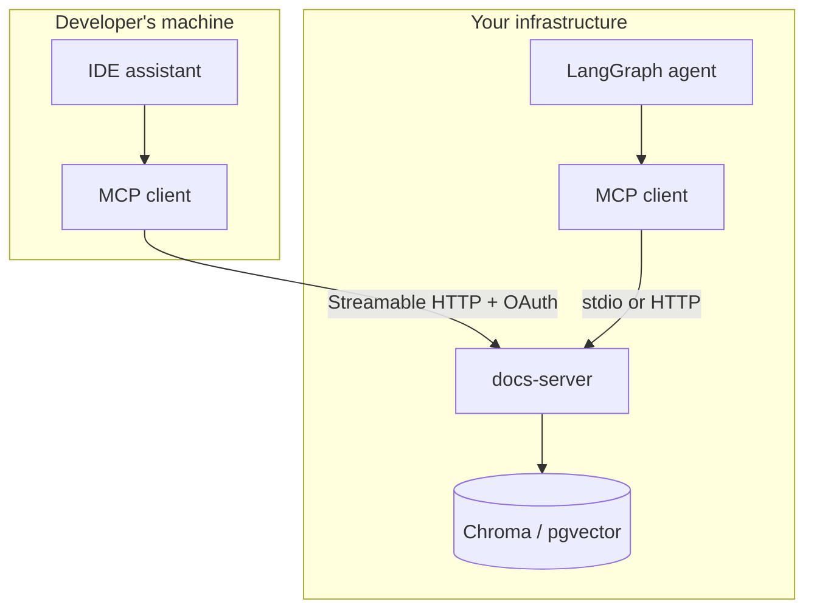

import TOCInline from '@theme/TOCInline';

# MCP in Practice

<TOCInline toc={toc} minHeadingLevel={2} maxHeadingLevel={2} />

:::tip[In this guide]
The judgement page. When MCP is the right call and when it is overhead,
patterns that work and ones that reliably do not, how to migrate tools you
already have, and a worked example of one server serving two very different
consumers.
:::

## What Is It?

You now know how MCP works. This page is about whether to use it, which is a
different question and the one you will actually be asked.

## Why Does It Matter?

Because the failure mode here is not technical. It is adopting a protocol
designed for cross-organisational reuse to solve a problem that was one import
statement away from being solved, and then maintaining a process boundary
forever.

MCP's value scales with the **number of independent consumers**. At one, it is
negative.

## The Three Options

| | Plain function calling | MCP server | REST API the agent calls |
| --- | --- | --- | --- |
| Where the code runs | In your agent process | Separate process | Separate service |
| Latency overhead | None | One IPC or HTTP hop | One HTTP hop |
| Schema | From your type hints | From your type hints, over the wire | You write it, and the tool wrapper |
| Discovery | Compile time | Runtime | You hardcode the tool list |
| Reusable by an IDE assistant | No | Yes | No, without a wrapper per host |
| Reusable by another team's agent | Only if they import your code | Yes | Yes, with their own wrapper |
| Credential scoping | One identity for the agent | Per server | Per service |
| Testing | Trivial | Needs a transport or direct handler calls | Normal API testing |
| Added moving parts | Zero | A process, a transport, a trust boundary | A service |

### Choosing

**Plain function calling** when there is one agent and the tools are your own
code. This is most internal projects, and it stays correct for longer than
people expect. A function call is faster, easier to debug, and has no
deployment story.

**MCP** when a second consumer is real — another team's agent, an IDE
assistant, a desktop app, or your own product being used by third-party
assistants. Also when another team *owns* the system and should own the
integration.

**A plain REST API** when the consumer is only ever your own agent and the
capability is genuinely a remote service. You still write a tool wrapper, but
you skip the protocol. Perfectly reasonable, and under-recommended.

The question that settles it: **name the second consumer.** If you can name
them and they are not hypothetical, MCP. If you cannot, write a function.

## Patterns That Work

### A server per bounded domain

One server per coherent system — docs, tickets, analytics, deploys — with five
to eight tools each. Matches ownership boundaries, keeps credentials scoped,
and keeps tool counts in the range where routing works.

### Read-only servers

A server exposing only queries is dramatically easier to reason about: no
approval flow, no idempotency concerns, a read-only credential, and a small
blast radius. Most analytics and documentation servers should be read-only, and
saying so in the README is a feature.

### Wrapping an internal API for reuse

The clearest win. You have an internal service with real authorisation logic.
Wrap it once as an MCP server, and every agent and assistant in the company
reaches it without each team reimplementing auth handling and pagination.

```python
@mcp.tool()
async def search_customers(query: str, limit: int = 10, ctx: Context = None) -> str:
    """Search customers by name, domain or account ID. Returns records the
    authenticated user is permitted to see."""
    user = ctx.principal
    rows = await crm.search(query, limit=min(limit, 25), on_behalf_of=user)
    if not rows:
        return "No matching customers."
    return "\n".join(f"{r.id} | {r.name} | {r.plan}" for r in rows)
```

The authorisation lives in `crm.search`, where it already was. The server adds
a schema, a description and a cap.

### Exposing your product to third-party assistants

If your customers use IDE assistants and chat apps, an MCP server is how your
product becomes available inside them. This is a product decision more than an
architectural one, and it is the use case the protocol was designed for.

### Prompts shipped with the data

The team that owns a corpus knows how to query it well. Shipping prompts from
the server means that knowledge travels with the data instead of being
reinvented by each consumer.

## Anti-Patterns

| Anti-pattern | Why it fails | Do instead |
| --- | --- | --- |
| One server, fifty tools | Routing accuracy collapses; schemas dominate the prompt | Split by domain; allow-list per agent |
| Thin pass-through of a REST API | Adds a hop and no semantics; the model gets raw endpoints with no guidance | Expose task-shaped tools with real descriptions |
| Resources where a tool belongs | The model cannot initiate a resource read, so the capability is unreachable | Tool when the model decides |
| MCP for a single consumer | All the cost, none of the reuse | A function |
| Business logic in the server | Diverges from your REST layer immediately | Logic in a service class, server as adapter |
| One admin credential | Blast radius of every tool combined | One scoped credential per server |
| Unpinned third-party servers | Tool descriptions you never reviewed, auto-updating | Pin versions; re-review on upgrade |
| A tool per database table | Models cannot compose primitives well; you get fifteen calls per question | One tool per *task* |

That last one is worth dwelling on. `get_user`, `get_subscription`,
`get_invoice`, `get_plan` looks clean and makes the model orchestrate four
round trips to answer one question, often incorrectly. `get_account_summary`
does the join server-side and returns the answer. Design tools around the
questions people ask, not around your schema.

## Migrating Existing Tools

If your agent already has tools as plain functions, republishing them is
mechanical — *provided* the logic is not tangled into the tool definitions.

Before:

```python
# app/agent/tools.py
@tool
async def search_docs(query: str, top_k: int = 4) -> str:
    """Search internal docs."""
    hits = await vector_store.query(embed(query), k=top_k)   # logic inline
    return "\n".join(h.text for h in hits)
```

Step one, extract the logic. Do this even if you never adopt MCP:

```python
# app/services/retrieval.py
class RetrievalService:
    async def search(self, query: str, top_k: int = 4) -> list[Hit]:
        return await self._store.query(self._embed(query), k=min(top_k, 10))

    def format(self, hits: list[Hit]) -> str:
        if not hits:
            return "No matching documents. Try different terms."
        return "\n\n".join(f"[{h.path}]\n{h.text[:1500]}" for h in hits)
```

Step two, both adapters become trivial:

```python
# app/agent/tools.py — unchanged interface for your own agent
@tool
async def search_docs(query: str, top_k: int = 4) -> str:
    """Search internal docs for policies and architecture notes."""
    return retrieval.format(await retrieval.search(query, top_k))
```

```python
# app/mcp_server.py — the same thing, for everyone else
@mcp.tool()
async def search_docs(query: str, top_k: int = 4) -> str:
    """Search internal docs for policies and architecture notes.
    Do NOT use for source code."""
    return retrieval.format(await retrieval.search(query, top_k))
```

One behaviour, two front doors, no duplicated logic. If extracting the service
class is hard, that is the actual finding — your tools had logic in them, and
that was a problem before MCP came up.

## Case Study: One Server, Two Consumers

Your RAG service, reached from an IDE assistant and from your own LangGraph
agent.



The server is written once — the one from
[Building an MCP Server](./03-building-a-server.mdx). Here is the entire delta
for each consumer.

**For the IDE assistant**, a config entry. No code at all:

```json
{
  "mcpServers": {
    "acme-docs": {
      "command": "uvx",
      "args": ["acme-docs-mcp@1.2.0"],
      "env": { "ACME_API_TOKEN": "${env:ACME_TOKEN}" }
    }
  }
}
```

**For your own agent**, the adapter from
[Building an MCP Client](./04-building-a-client.mdx):

```python
tools = await tools_from_server(pool.sessions["docs"], prefix="docs__")
agent = create_react_agent(llm, tools)
```

Two lines. A developer in their editor and your production agent now share one
retrieval implementation, one set of tool descriptions, and one place to fix a
chunking bug.

Now compare the alternative. Without MCP you write a LangChain tool for your
agent and an IDE extension for the editor, each with its own auth, its own
result formatting, and its own copy of the "do not use for source code"
guidance. When you improve the description, you update it twice and the
editor's copy drifts.

That is the pitch, concretely. Note what made it work: **a service class that
already existed, and a second consumer that was real.**

## The Ecosystem

As of early 2026 — and this moves fast enough that you should check rather than
trust this paragraph:

- Adoption is broad. Major assistant and IDE vendors ship MCP client support,
  and the protocol is governed as an open project rather than a single vendor's
  spec.
- [Official SDKs](https://modelcontextprotocol.io/docs/sdk) cover around ten
  languages, with Python and TypeScript the most complete.
- Server registries and directories exist. Treat a listing as zero evidence of
  quality or safety — the [security page](./05-security-and-auth.mdx) explains
  why.
- Support for the primitives is uneven. Tools are universally supported;
  resources, prompts and sampling vary by host. Build around tools and treat
  the rest as a bonus.

That last point is the practical one: **if it has to work everywhere, it is a
tool.**

## The Verdict

MCP is a genuinely good protocol solving a genuinely real problem, and most
teams reading this should not adopt it yet.

**Adopt it when:**

- You can name a second consumer that exists today.
- Another team owns the system and should own the integration.
- Your users work inside assistants you do not control.
- You are exposing capability to third parties as a product.

**Do not adopt it when:**

- One agent, your own code, no external consumers.
- You have not yet got your tool descriptions and result caps right — MCP
  multiplies the cost of getting those wrong, it does not fix them.
- The honest reason is that it is new and interesting.

**The path that ages well,** regardless of which side you land on: keep logic
in service classes, keep tools as thin adapters, and get tool design right.
Then MCP is a sixty-line file you add when a second consumer shows up, and not
adding it costs you nothing. That is a much better position than either
adopting early or dismissing it.

## Common Mistakes

- Adopting MCP for a single consumer because it is the new thing.
- One server with every tool your company has.
- A tool per database table instead of per task.
- Thin REST pass-throughs with no descriptions worth reading.
- Business logic in the server, duplicating the REST layer.
- Relying on resources or prompts for something that must work in every host.
- Treating a registry listing as a safety signal.
- Migrating tools without first extracting a service class.

## Interview Questions

- When is MCP the wrong choice, and what would you do instead?
- What question settles whether a team should adopt MCP?
- Why does one server with fifty tools perform worse than five with ten?
- Why is a tool per database table a bad design?
- You have an agent with tools as plain functions. Walk through republishing them over MCP.
- What is the cost of MCP that its advocates usually skip?
- Which primitive would you build around if the server must work in every host, and why?

## Things to Remember

- MCP's value scales with the number of independent consumers. At one, it is negative.
- Name the second consumer. If you cannot, write a function.
- A server per bounded domain, five to eight task-shaped tools, read-only where possible.
- Logic in service classes; tools and servers are adapters.
- Tools are universally supported; resources and prompts are not.
- A registry listing is not a review.
- Getting tool design right matters more than which protocol carries it.

## Mini Exercise

Take the agent you have built. Write one page answering: who is the second
consumer, what would each of them need, and what would it cost to serve them
without MCP. Then make the decision and write down the reason.

If the answer is "no second consumer", that is a successful outcome of this
section, not a failure. Extract your tool logic into service classes anyway —
that is the work that makes the decision reversible, and it pays off whether or
not you ever add a server.

## Done When

- [ ] You can argue both sides of adopting MCP for a specific project.
- [ ] You can name three anti-patterns and why each fails.
- [ ] Your tool logic lives in service classes, not in tool definitions.
- [ ] You can describe the code delta to serve a second consumer via MCP.
- [ ] You have made and written down a decision for your own project.

Next: [13 · Production GenAI and LLMOps](../13-production-genai-and-llmops/index.mdx).
