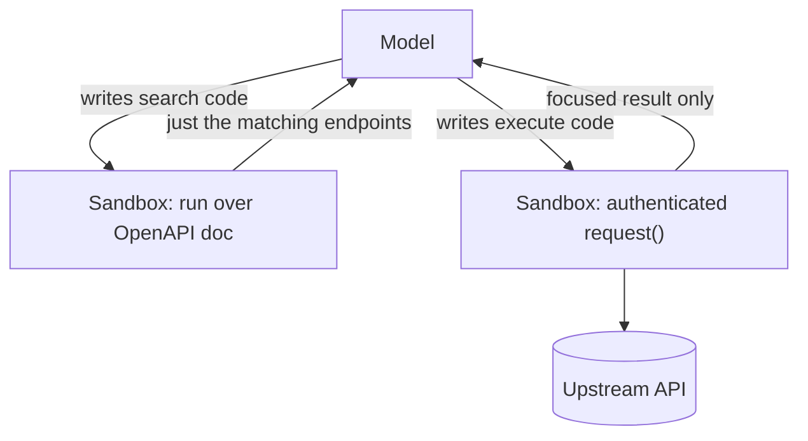

import TOCInline from '@theme/TOCInline';

# Code Mode: Code as the Tool Interface

<TOCInline toc={toc} minHeadingLevel={2} maxHeadingLevel={2} />

:::tip[In this guide]
Every MCP tool you advertise costs context tokens whether the model uses it or
not, and a large API drowns the window before the task even starts. Code Mode
flips the interface: expose *code execution* instead of dozens of tools, let the
model write code against a typed API, run it in a sandbox, and return only the
result. One API, roughly a thousand tokens, fixed no matter how many endpoints
exist.
:::

## What Is It?

**Code Mode** is an MCP design where the model's interface is not a list of
tools but the ability to **write and run code**. Rather than advertising
`list_orders`, `get_order`, `cancel_order` and forty more as separate tools, the
server exposes a tiny surface — a `code` tool, or a `search` plus `execute`
pair — and the model writes a short program that calls the underlying
operations, composes them, filters the data, and returns only what it needs.

The code is a **compact plan**. It runs in a sandbox, makes the real calls
there, and hands back the final answer. The tool definitions and all the
intermediate data stay out of the model's context.

This is a direct response to a tension baked into MCP, documented by Cloudflare
in [Code Mode: give agents an entire API in 1,000 tokens](https://blog.cloudflare.com/code-mode-mcp/)
and explored independently by Anthropic as
[code execution with MCP](https://www.anthropic.com/engineering/code-execution-with-mcp).
[Content was rephrased for compliance with licensing restrictions.]

## Why Does It Matter?

Because MCP's cost scales with the number of tools, and that cost is paid on
every single call.

A tool definition is a name, a description and a JSON Schema for its arguments.
The model has to be *given* all of them to know what it can do, so they sit in
the context window for the whole conversation whether or not they are used. Two
things follow, and both get worse as the integration grows:

- **Tool definitions crowd out the task.** Fifty tools with real schemas is
  tens of thousands of tokens before the user has said anything. A large API —
  Cloudflare's has over 2,500 endpoints — cannot fit at all; the naive tool
  surface would exceed the entire context window of current frontier models.
- **Intermediate results flow back through the model.** The classic agent loop
  is call → result → call → result. "List projects, then for each project list
  its tasks, then filter to blocked ones" round-trips every project and every
  task through the context, one tool call at a time, paying tokens and latency
  for data the model only wants to filter.

Code Mode removes both. The tool surface is fixed and tiny. The chaining,
looping, pagination and filtering happen *in code, in the sandbox*, and only the
final filtered result returns.

```python
# Classic tool calling: three round-trips, every project and task in context.
projects = list_projects(status="active")          # result → context
for p in projects:                                 # model must loop in the transcript
    tasks = list_tasks(project_id=p.id)            # result → context, per project
# ...then the model filters in its head.
```

```javascript
// Code Mode: one call. The loop, the fetch-per-project and the filter all run
// in the sandbox; only the blocked tasks come back.
async () => {
  const projects = await codemode.list_projects({ status: "active" });
  const tasks = [];
  for (const p of projects) {
    tasks.push(...(await codemode.list_tasks({ projectId: p.id })));
  }
  return tasks.filter((t) => t.status === "blocked");
};
```

The second version is one outer tool call and returns one small list. That is
the whole idea.

## Client-Side vs Server-Side

Code Mode comes in two places, and the distinction decides who needs a sandbox.

| | Client-side Code Mode | Server-side Code Mode |
| --- | --- | --- |
| Who runs the code | The agent / client | The MCP server |
| Who needs a sandbox | The agent must ship one | The server owns it; clients need nothing |
| The model writes code against | Typed SDKs the client assembles | A `codemode` namespace or OpenAPI doc the server exposes |
| Works with any MCP client? | No — only clients built for it | Yes — it is just an MCP tool |
| Examples | Anthropic's Claude SDK "programmatic tool calling", Goose | Cloudflare's `@cloudflare/codemode` |

Client-side came first: the agent converts MCP tools into typed SDKs and runs
model-written code in its own secure sandbox. The limitation is obvious — the
agent has to *have* a sandbox, and most do not.

Server-side Code Mode, Cloudflare's contribution, pushes the sandbox into the
MCP server. Now any MCP client — an IDE, a desktop chat app, your own agent —
gets the benefit by calling one ordinary tool, with no changes on its side. The
rest of this page is about the server-side pattern, because it is the one you
can adopt without rewriting your agent.

## Pattern 1 — A Single `code` Tool

Use this to wrap an MCP server you already have, when its tool declarations fit
comfortably in one tool description.

The server advertises **one** tool, `code`. Its description carries generated
TypeScript declarations for every upstream tool, so the model knows the typed
surface it can call. The model writes JavaScript against a `codemode` namespace;
the server runs it in a sandbox, where dependent calls, filtering and
aggregation all happen, and returns only the final value.

With Cloudflare's SDK (`@cloudflare/codemode`), wrapping an existing
`McpServer` is a thin shell around it:

```typescript
import { DynamicWorkerExecutor } from "@cloudflare/codemode";
import { codeMcpServer } from "@cloudflare/codemode/mcp";
import { createLegacyMcpHandler } from "agents/mcp";

export default {
  async fetch(request, env, ctx): Promise<Response> {
    const upstream = createOrdersServer();            // your existing MCP server
    const executor = new DynamicWorkerExecutor({ loader: env.LOADER });
    const server = await codeMcpServer({ server: upstream, executor });
    return createLegacyMcpHandler(server, { route: "/mcp" })(request, env, ctx);
  },
} satisfies ExportedHandler<Env>;
```

The Worker needs a Worker Loader binding and `nodejs_compat`, so the sandbox has
somewhere to run the generated code:

```jsonc
// wrangler.jsonc
{
  "name": "codemode-mcp-server",
  "main": "src/server.ts",
  "compatibility_date": "2026-10-31",
  "compatibility_flags": ["nodejs_compat"],
  "worker_loaders": [{ "binding": "LOADER" }]
}
```

The model then uses the `codemode` namespace inside the one `code` tool:

```javascript
async () => {
  const order = await codemode.get_order({ orderId: "order-123" });
  return { id: order.id, status: order.status };
};
```

When an upstream tool returns structured content, Code Mode hands that value to
the code directly; text content is parsed as JSON when it can be; and upstream
errors surface as exceptions the model's own code can `try/catch`. The practical
boundary of this pattern is the tool description: if the combined TypeScript
declarations are too large to sit comfortably there, you have outgrown it — move
to pattern 2. [Content was rephrased for compliance with licensing restrictions, based on the [Cloudflare guide](https://developers.cloudflare.com/agents/model-context-protocol/guides/build-codemode-mcp-server/).]

## Pattern 2 — `search` and `execute`

Use this for a large API — hundreds or thousands of operations — whose full
schema must never enter the context. It splits the job in two:

- **`search`** runs model-written code against an OpenAPI document *inside the
  sandbox*. The model filters endpoints by path, tag or product and gets back
  only the handful it needs. The full spec never reaches the context.
- **`execute`** runs model-written code with an authenticated `request()`
  function. It calls the operations `search` found, handles pagination, chains
  calls, and returns a focused result.

```typescript
import { DynamicWorkerExecutor } from "@cloudflare/codemode";
import { openApiMcpServer } from "@cloudflare/codemode/mcp";
import { createLegacyMcpHandler } from "agents/mcp";

export default {
  async fetch(request, env, ctx): Promise<Response> {
    const auth = request.headers.get("Authorization");
    if (!auth?.startsWith("Bearer ")) return new Response("Bearer token required", { status: 401 });

    const server = openApiMcpServer({
      spec: await loadSpec(),                                   // your OpenAPI 3.x doc
      executor: new DynamicWorkerExecutor({ loader: env.LOADER }),
      name: "example-api",
      version: "1.0.0",
      // The credential lives HERE, in the host callback — never in the sandbox.
      request: async (opts) => {
        const url = new URL(`${API_ORIGIN}${opts.path}`);
        for (const [k, v] of Object.entries(opts.query ?? {})) {
          if (v !== undefined) url.searchParams.set(k, String(v));
        }
        const res = await fetch(url, {
          method: opts.method,
          headers: { Authorization: auth, "Content-Type": "application/json" },
          body: opts.body === undefined ? undefined : JSON.stringify(opts.body),
        });
        if (!res.ok) throw new Error(`API request failed: ${res.status}`);
        return res.status === 204 ? null : await res.json();
      },
    });

    return createLegacyMcpHandler(server, { route: "/mcp" })(request, env, ctx);
  },
} satisfies ExportedHandler<Env>;
```

The model discovers, then acts:

```javascript
// search: inspect the spec in the sandbox, return only matching paths.
async () => {
  const spec = await codemode.spec();
  return Object.entries(spec.paths)
    .filter(([path]) => path.includes("/orders"))
    .map(([path, ops]) => ({ path, methods: Object.keys(ops) }));
};
```

```javascript
// execute: call the operation through the authenticated request function,
// and shape the response down to what the next decision needs.
async () => {
  const res = await codemode.request({
    method: "GET",
    path: "/orders",
    query: { status: "processing", limit: 20 },
  });
  return res.items.map(({ id, status }) => ({ id, status }));
};
```

This is how Cloudflare exposes its own API — 2,500+ endpoints behind two tools
in roughly 1,000 tokens, a reported ~99.9% cut versus the ~1.17M tokens the
naive tool surface would need. The footprint is **fixed**: adding endpoints adds
nothing to context, because none of them are tools. [Content was rephrased for compliance with licensing restrictions.]



## The Sandbox Is the Whole Security Story

Model-written code is **untrusted code** — the model was steered by a prompt
that may contain
[injection from tool output or documents](../09-tool-calling-and-ai-agents/11-agent-safety.mdx).
Running it safely is the precondition for the whole technique, not a detail.

- **Isolate execution.** Cloudflare runs the code in a Dynamic Worker isolate —
  a V8 sandbox with no filesystem, no environment variables to exfiltrate, and
  outbound `fetch`/`connect` disabled by default. Generated code reaches the
  outside world only through the upstream tools or the host `request` callback.
- **Keep credentials out of the sandbox.** In pattern 2 the bearer token lives
  in the host callback and is attached to outbound requests *outside* the
  sandbox. The code receives a `request` function, never the secret. Do not put
  secrets in tool results or in the OpenAPI document — both are visible to
  model-written code.
- **Code execution is not authorization.** This is the sharp edge. Code Mode
  does not give you per-operation approval — the outer `code`/`execute` call
  runs many upstream operations inside one sandbox invocation, so a
  human-in-the-loop prompt on "the tool call" guards the *batch*, not each write.
  Enforce permissions and any required approval **inside each upstream handler
  or the host callback, before side effects**, exactly as the
  [MCP security page](./05-security-and-auth.mdx) demands.
- **Cap the output.** A sandbox can fetch a lot; have the code select, map and
  paginate before returning, and cap the final response (Cloudflare truncates
  around 6,000 tokens). Note that truncation does not undo API work already
  done — return identifiers and status, not everything.

## How It Compares to Other Context-Reduction Tricks

Code Mode is not the only way to stop tools eating the window. The honest
comparison, following Cloudflare's own:

| Approach | How it shrinks context | The catch |
| --- | --- | --- |
| **Server-side Code Mode** | Two tools; code does the rest in a sandbox | You run a sandbox; code is less predictable than a fixed call |
| Client-side Code Mode | Same, but the client runs the sandbox | The agent must ship secure sandboxing |
| CLI wrapping | Agent explores a self-documenting CLI | Needs a shell — a much larger attack surface |
| Dynamic tool search | Surface only tools relevant to the task | Needs a maintained, evaluated search function; matched tools still cost tokens |

For MCP servers specifically, server-side Code Mode is the one with a *fixed*
cost regardless of API size and *no* client changes — which is why it is worth
knowing even if you never run Cloudflare Workers. The pattern transfers: a tiny
tool surface, a typed API behind it, a sandbox, and results shaped in code.

## When to Use It — and When Not To

**Reach for Code Mode when:**

- The API is large, or the tool count is high enough that definitions crowd the
  window.
- Tasks are compositional — fetch, loop, filter, aggregate — and round-tripping
  intermediate data is the real cost.
- You own the server and can run a sandbox, and you want every client to benefit
  without changes.

**Do not reach for it when:**

- You have a handful of tools. The whole mechanism — a sandbox, generated code,
  an execution attack surface — is pure overhead against five clean tool
  definitions. Get [tool design](../09-tool-calling-and-ai-agents/07-tool-design.mdx)
  right first; Code Mode is for when good tool design has run out of window, not
  a substitute for it.
- You need fine-grained, per-write human approval and cannot push the check into
  the handlers — the batch-in-one-call shape fights you.
- You cannot run or trust a sandbox. Without real isolation, executing
  model-written code is a liability, not a feature.

The thread back to the rest of this section: Code Mode is an *optimisation of
how a client consumes MCP*, and it trades tool-definition tokens for a sandbox
and some predictability. It sits next to the
[cost and latency](../13-production-genai-and-llmops/08-cost-and-latency.mdx)
work, because "tool definitions in every request" is exactly the kind of fixed
input cost that page tells you to hunt down.

## Common Mistakes

- Adopting Code Mode for a handful of tools, adding a sandbox and generated-code
  risk to save tokens you were not spending.
- Treating code execution as authorization, so a batch of writes runs with one
  approval or none — enforce it in the handlers.
- Letting credentials into the sandbox instead of keeping them in the host
  request callback.
- Putting secrets in the OpenAPI document or in tool results, both readable by
  model-written code.
- Running model-written code without a real sandbox because "it is just an
  internal tool".
- Returning everything from `execute` instead of shaping it down, then hitting
  the response cap and losing the useful part.
- Skipping tool design and expecting Code Mode to rescue a badly-shaped API.

## Interview Questions

- Why does an MCP server's context cost grow with its tool count even for tools
  the model never calls?
- What two problems does Code Mode solve, and how does writing code fix the
  intermediate-result one?
- Difference between client-side and server-side Code Mode — who needs a
  sandbox in each?
- When would you use a single `code` tool versus the `search`/`execute` pair?
- Why can Cloudflare expose 2,500+ endpoints in ~1,000 tokens, and why is that
  footprint fixed?
- Why is "code execution is not authorization" the most important caveat, and
  where do you put the permission check instead?
- How do you keep a credential out of model-written code in the `search`/
  `execute` pattern?
- When is Code Mode over-engineering?

## Things to Remember

- Code Mode makes code execution the tool interface: two tools, not fifty, and a
  fixed context cost regardless of API size.
- It fixes both tool-definition bloat and intermediate-result round-tripping —
  the chaining and filtering happen in the sandbox, only the result returns.
- Server-side Code Mode needs no client changes; client-side needs the agent to
  own a sandbox.
- One `code` tool for an existing server that fits; `search` + `execute` for a
  large OpenAPI catalog that must stay out of context.
- The sandbox is the technique's safety precondition: isolate, no filesystem, no
  ambient secrets, outbound disabled by default.
- Credentials live in the host callback, never in the sandbox.
- Code execution is not authorization — enforce permissions and approval in the
  handlers, before side effects.
- It is an optimisation for large tool surfaces. For a few tools, good tool
  design beats it.

## Mini Exercise

Take an MCP server you built in this section with five or more tools. First,
count the tokens its tool definitions add to every request (paste them into a
tokenizer). That is your fixed per-call cost today.

Then sketch — on paper is fine — the `codemode` version: the one `code` tool,
the TypeScript declarations it would carry, and a single code snippet that does
a two-step task (fetch a list, then fetch a detail per item, then filter) which
currently takes three round-trips. Write down which approval check would have to
move into a handler, and whether running a sandbox is worth it for *this* server.

If the honest answer is "five tools, not worth a sandbox," that is the correct
finding — Code Mode earns its place at scale, and naming the threshold is the
skill.

## Done When

- [ ] You can explain why tool definitions cost context on every call, and how
      Code Mode makes that cost fixed.
- [ ] You can explain how code execution removes intermediate-result
      round-tripping.
- [ ] You can distinguish client-side from server-side Code Mode and say who
      needs a sandbox.
- [ ] You can choose between the single-`code`-tool and `search`/`execute`
      patterns for a given API.
- [ ] You can state why the sandbox is mandatory and where authorization must
      live.
- [ ] You can argue against Code Mode for a small tool surface.

Next: [Agent-to-Agent Protocols (A2A)](./09-agent-to-agent-protocols.mdx).
