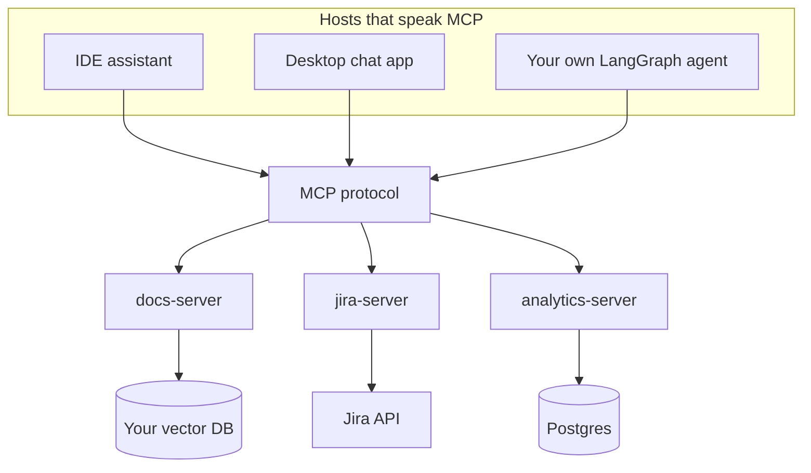

import TOCInline from '@theme/TOCInline';

# 11 · MCP

<ProgressToggle sectionId="11-mcp" />

<TOCInline toc={toc} minHeadingLevel={2} maxHeadingLevel={2} />

:::tip[In this guide]
You have built agents with tools wired directly into your own code. MCP is the
standard for exposing those tools as a separate service that any assistant can
use — your agent, an IDE, a desktop chat app. This section covers the protocol,
how to build both sides, how to secure it, and the honest case for skipping it.
:::

## Goal

Be able to build an MCP server over your own systems, consume third-party
servers from your agent, secure both sides, and decide with reasons whether the
protocol is worth the process boundary it adds.

## Estimated Time

1 week.

## Prerequisites

- [Agents & Agentic AI](../09-tool-calling-and-ai-agents/index.mdx), especially [Tool Design](../09-tool-calling-and-ai-agents/07-tool-design.mdx) — an MCP server is a tool layer with a process boundary, and every tool-design rule still applies.
- A working [RAG project](../06-rag/03-first-project.mdx). The worked example throughout is exposing its retriever over MCP.
- [FastAPI](../02-fastapi/index.mdx) basics for the deployment page.

## What You Will Learn

1. [MCP Fundamentals](./01-mcp-fundamentals.mdx) — the N×M problem, the host/client/server split, tools vs resources vs prompts, and MCP vs plain function calling.
2. [Protocol & Transports](./02-protocol-and-transports.mdx) — JSON-RPC message shapes, the initialize handshake, capability negotiation, stdio vs Streamable HTTP, and the error model.
3. [Building an MCP Server](./03-building-a-server.mdx) — tools, resources and prompts in the Python SDK, running over stdio, wiring into a host config, and testing without a transport.
4. [Building an MCP Client](./04-building-a-client.mdx) — connecting, discovery, converting MCP tools into LangGraph tools, sampling and roots, and handling several servers at once.
5. [MCP Security & Auth](./05-security-and-auth.mdx) — the threat model, OAuth for remote servers, why token passthrough is wrong, consent design, and a hardening checklist.
6. [Deploying & Operating MCP](./06-deploying-and-operating.mdx) — local vs remote topology, running alongside FastAPI, scaling the HTTP transport, observability, and versioning your tool surface.
7. [MCP in Practice](./07-mcp-in-practice.mdx) — patterns, anti-patterns, the ecosystem, migrating existing tools, and a closing verdict.

## Where This Fits

Write the integration once on the right. Every host on the left gets it.
That is the entire pitch, and section 09 is about whether and how to take it.

## Interview Relevance

MCP has moved quickly from novelty to expected knowledge, and the question is
usually some version of "how would you let an agent reach our internal systems
without rebuilding tools for every framework?" Interviewers also probe the
security side, because the answers reveal whether you have thought about an
agent running untrusted code with your credentials. The strongest answer
includes when you would *not* use it.

## Done When

- [ ] You can explain host, client and server, and say which one owns permissions.
- [ ] You can choose between a tool, a resource and a prompt and justify it.
- [ ] You have written a server exposing your retriever and called it from a host.
- [ ] You have converted a server's tools into your agent framework's tool objects.
- [ ] You can name three MCP-specific security risks and their mitigations.
- [ ] You can argue convincingly against adopting MCP for a given project.

Next: [12 · Evaluation, Testing and Observability](../12-evaluation-testing-and-observability/index.mdx).