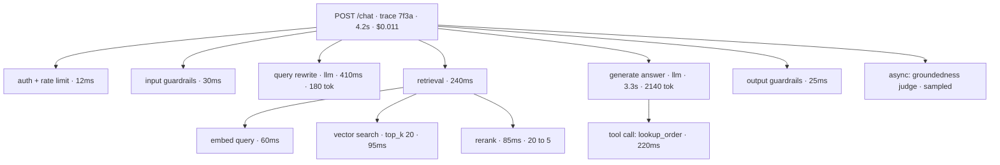

import TOCInline from '@theme/TOCInline';

# Tracing & Observability for LLM Apps

<TOCInline toc={toc} minHeadingLevel={2} maxHeadingLevel={2} />

:::tip[In this guide]
One user request fans out into retrieval, several model calls, and tool calls.
Timings alone will not tell you why the answer was wrong. This page covers the
span model for LLM apps, what to record, OpenTelemetry's GenAI conventions with
working FastAPI code, cost attribution, the tooling landscape, and how a bad
trace becomes a regression test.
:::

## What Is It?

**Tracing** records the full causal tree of a single request: every span, with
its inputs, outputs, timings and metadata, linked by a shared trace ID.

For an LLM app the distinguishing feature is that you need the **payloads**, not
just the timings. "The retrieval span took 180ms" is nearly useless on its own.
"The retrieval span returned these five chunks with these scores, and the chunk
that contained the answer ranked seventh" is a diagnosis.

## Why Standard APM Is Not Enough

Conventional APM is built on the assumption that a request either succeeds or
errors, and that timings plus error rates explain behaviour. LLM systems break
that assumption in three ways.

| Assumption in APM | Reality in an LLM app |
| --- | --- |
| A request is right or it threw | A request returns HTTP 200 with a confidently wrong answer |
| Timings explain the problem | The problem is almost always *content*: what was retrieved, what was in the prompt |
| Inputs are small and structured | Inputs are a 12,000-token prompt assembled from six sources |
| Cost is per-host and roughly constant | Cost is per-request and varies by two orders of magnitude |
| One request is one or two operations | One request fans out into retrieval, reranking, three model calls, and two tool calls |
| Failures are exceptions | Failures are hallucinations, wrong tool choices, silent truncation, and schema drift |

The practical consequence: in a traditional APM dashboard, a request that
invented a refund policy and a request that answered perfectly look identical.
Both are 200s with similar latency.

So the questions LLM observability must answer are different:

- Which exact prompt text went to the model on *this* request?
- What did retrieval return, and with what scores?
- Which prompt version and model version served it?
- How many tokens, and what did it cost?
- Where did the 9 seconds go — retrieval, reranking, or generation?
- Was the answer grounded, and if not, was the right context even present?

## The Span Model for an LLM App

A trace is a tree of spans. Each span has a name, a start and end time, a
parent, and attributes. For LLM apps the useful shape mirrors your pipeline.



Reading that tree answers the "where did the time go" question immediately —
generation is 79% of it — and the attributes on `Vec` and `RR` answer the "was
the right chunk there" question. Those two together cover most debugging.

## What to Record on Every Span

| Scope | Attributes |
| --- | --- |
| Root span | Trace ID, user ID (pseudonymised), tenant, session ID, feature name, app version, flag variant, total tokens, total cost, outcome |
| LLM span | Provider, exact model version, operation type, temperature and all sampling params, prompt version hash, input tokens, output tokens, cached tokens, finish reason, latency, time to first token, retry count, cost |
| Retrieval span | Query text, rewritten query, index name and version, `top_k`, filters applied, number of results, **candidate IDs with scores**, chunk sizes |
| Rerank span | Model, candidates in and out, score before and after, position changes |
| Tool span | Tool name, arguments, result or error, latency, whether the result was used |
| Guardrail span | Check name, verdict, matched rule, action taken |
| Scoring span | Scorer name, rubric version, judge model, verdict, cost |

Three of these are routinely omitted and each one costs you a debugging session:

- **Prompt version hash.** Without it you cannot tell whether a trace from last Tuesday used the prompt you are currently looking at.
- **Retrieval candidates with scores**, including the ones that did *not* make the cut. The interesting question is usually "was the right chunk retrieved and then dropped by reranking, or never retrieved at all?" — and only the full candidate list answers it.
- **Finish reason.** A truncated response because you hit `max_tokens` looks exactly like a model that stopped early, and the fix is completely different.

## OpenTelemetry and the GenAI Conventions

Use OpenTelemetry as the instrumentation layer. It is vendor-neutral, every
platform in this space accepts OTLP, and switching backends then becomes a
config change rather than a rewrite.

OpenTelemetry has semantic conventions for generative AI. They are still
evolving, so pin your version and expect attribute names to shift, but
following them means your traces render correctly in any compatible tool. The
core attributes:

| Attribute | Meaning |
| --- | --- |
| `gen_ai.system` | Provider, e.g. `openai`, `anthropic`, `ollama` |
| `gen_ai.operation.name` | `chat`, `embeddings`, `text_completion` |
| `gen_ai.request.model` | Model requested |
| `gen_ai.response.model` | Model that actually served it — compare the two to catch routing |
| `gen_ai.request.temperature`, `.max_tokens`, `.top_p` | Sampling parameters |
| `gen_ai.usage.input_tokens`, `.output_tokens` | Token counts |
| `gen_ai.response.finish_reasons` | Why generation stopped |
| `gen_ai.conversation.id` | Session or conversation identifier |

Prompt and completion content is handled separately from these attributes,
because it is sensitive and large. Treat content capture as an explicit,
configurable decision — opt-in, redacted, and sampled.

### Instrumenting FastAPI and your LLM client

```python
# otel_setup.py
from opentelemetry import trace
from opentelemetry.exporter.otlp.proto.http.trace_exporter import OTLPSpanExporter
from opentelemetry.instrumentation.fastapi import FastAPIInstrumentor
from opentelemetry.instrumentation.httpx import HTTPXClientInstrumentor
from opentelemetry.sdk.resources import Resource
from opentelemetry.sdk.trace import TracerProvider
from opentelemetry.sdk.trace.export import BatchSpanProcessor
from opentelemetry.sdk.trace.sampling import ParentBased, TraceIdRatioBased


def setup_tracing(service_name: str, endpoint: str, sample_ratio: float = 0.1) -> None:
    provider = TracerProvider(
        resource=Resource.create(
            {"service.name": service_name, "service.version": APP_VERSION}
        ),
        sampler=ParentBased(root=TraceIdRatioBased(sample_ratio)),
    )
    provider.add_span_processor(BatchSpanProcessor(OTLPSpanExporter(endpoint=endpoint)))
    trace.set_tracer_provider(provider)
    HTTPXClientInstrumentor().instrument()


def instrument_app(app) -> None:
    FastAPIInstrumentor.instrument_app(app, excluded_urls="/health,/metrics")
```

A traced LLM call, with cost and redaction handled in one place:

```python
# llm_client.py
from __future__ import annotations

import time
from dataclasses import dataclass

from openai import AsyncOpenAI
from opentelemetry import trace
from opentelemetry.trace import SpanKind, Status, StatusCode

tracer = trace.get_tracer(__name__)

PRICING_PER_1M: dict[str, tuple[float, float]] = {
    "gpt-4o-2024-11-20": (2.50, 10.00),
    "gpt-4o-mini-2024-07-18": (0.15, 0.60),
}


@dataclass(slots=True)
class LLMResult:
    text: str
    input_tokens: int
    output_tokens: int
    cost_usd: float
    finish_reason: str
    latency_ms: float


def estimate_cost(model: str, input_tokens: int, output_tokens: int) -> float:
    in_rate, out_rate = PRICING_PER_1M.get(model, (0.0, 0.0))
    return (input_tokens * in_rate + output_tokens * out_rate) / 1_000_000


class TracedLLM:
    def __init__(self, client: AsyncOpenAI, capture_content: bool = False) -> None:
        self.client = client
        self.capture_content = capture_content

    async def chat(
        self,
        model: str,
        messages: list[dict[str, str]],
        prompt_version: str,
        temperature: float = 0.0,
    ) -> LLMResult:
        with tracer.start_as_current_span(
            f"chat {model}", kind=SpanKind.CLIENT
        ) as span:
            span.set_attribute("gen_ai.system", "openai")
            span.set_attribute("gen_ai.operation.name", "chat")
            span.set_attribute("gen_ai.request.model", model)
            span.set_attribute("gen_ai.request.temperature", temperature)
            span.set_attribute("app.prompt.version", prompt_version)

            if self.capture_content:
                span.set_attribute("app.prompt.messages", redact(serialise(messages)))

            started = time.perf_counter()
            try:
                resp = await self.client.chat.completions.create(
                    model=model, messages=messages, temperature=temperature
                )
            except Exception as exc:
                span.set_status(Status(StatusCode.ERROR, str(exc)))
                span.set_attribute("error.type", type(exc).__name__)
                raise

            latency_ms = (time.perf_counter() - started) * 1000
            usage = resp.usage
            choice = resp.choices[0]
            cost = estimate_cost(
                resp.model, usage.prompt_tokens, usage.completion_tokens
            )

            span.set_attribute("gen_ai.response.model", resp.model)
            span.set_attribute("gen_ai.usage.input_tokens", usage.prompt_tokens)
            span.set_attribute("gen_ai.usage.output_tokens", usage.completion_tokens)
            span.set_attribute("gen_ai.response.finish_reasons", [choice.finish_reason])
            span.set_attribute("app.llm.cost_usd", cost)
            span.set_attribute("app.llm.latency_ms", latency_ms)

            if self.capture_content:
                span.set_attribute(
                    "app.completion.text", redact(choice.message.content or "")
                )

            return LLMResult(
                text=choice.message.content or "",
                input_tokens=usage.prompt_tokens,
                output_tokens=usage.completion_tokens,
                cost_usd=cost,
                finish_reason=choice.finish_reason,
                latency_ms=latency_ms,
            )
```

Setting `gen_ai.response.model` separately from the request model is worth the
one line: providers route requests, and a mismatch explains behaviour changes
that otherwise look impossible.

Retrieval, with the full candidate list:

```python
async def traced_retrieve(
    query: str, index: str, index_version: str, top_k: int = 20
) -> list[Chunk]:
    with tracer.start_as_current_span("retrieval") as span:
        span.set_attribute("app.retrieval.index", index)
        span.set_attribute("app.retrieval.index_version", index_version)
        span.set_attribute("app.retrieval.top_k", top_k)

        results = await vector_search(query, index=index, top_k=top_k)

        span.set_attribute("app.retrieval.result_count", len(results))
        # Candidate IDs and scores are the single most useful retrieval attribute.
        span.set_attribute("app.retrieval.candidate_ids", [c.id for c in results])
        span.set_attribute(
            "app.retrieval.scores", [round(c.score, 4) for c in results]
        )
        span.set_attribute(
            "app.retrieval.top_score", round(results[0].score, 4) if results else 0.0
        )
        return results
```

### Propagating a request and trace ID

Every response should carry the trace ID back to the client. When a user says
"the answer was wrong at about 2pm", a trace ID in a support ticket turns a
two-hour hunt into a thirty-second lookup.

```python
from fastapi import FastAPI, Request
from opentelemetry import trace
from starlette.middleware.base import BaseHTTPMiddleware

app = FastAPI()


class TraceIdMiddleware(BaseHTTPMiddleware):
    async def dispatch(self, request: Request, call_next):
        span = trace.get_current_span()
        ctx = span.get_span_context()
        trace_id = format(ctx.trace_id, "032x") if ctx.trace_id else "none"
        request.state.trace_id = trace_id

        response = await call_next(request)
        response.headers["X-Trace-Id"] = trace_id
        return response


app.add_middleware(TraceIdMiddleware)
```

Surface it in the UI too — a small "reference: 7f3a..." under the answer, or at
least in a copyable debug detail. Also attach the trace ID to every feedback
signal from the previous page, so a thumbs-down links directly to the trace that
earned it.

## Tooling Landscape

| Tool | Model | Strengths | Weaknesses | Self-host |
| --- | --- | --- | --- | --- |
| Plain OTel to your existing backend | OTLP to Grafana Tempo, Jaeger, Honeycomb, Datadog | No new vendor; traces live with the rest of your system; full data control | No LLM-specific UI, no built-in eval or prompt management; you build the payload views | Yes |
| Langfuse | Open source, cloud or self-hosted | Genuinely usable self-hosted deployment; prompt management, datasets, evals, cost tracking; OTLP ingest | Smaller ecosystem than the largest vendors | Yes |
| LangSmith | Commercial, LangChain ecosystem | Deep LangChain and LangGraph integration; strong dataset and annotation workflow; mature playground | Best experience is tied to the LangChain ecosystem; self-hosting is enterprise-tier | Enterprise only |
| Phoenix / Arize | Open source Phoenix, commercial Arize | Phoenix runs locally and is excellent for development; strong drift and embedding analysis; OTel-native | Two products to understand; full production features sit in the commercial tier | Phoenix yes |
| Braintrust | Commercial | Eval-first design; good experiment comparison and human review UI | Less of a general tracing backend; commercial only | No |
| Weights & Biases Weave | Commercial, ML ecosystem | Fits teams already using W&B for training | Heavier than needed if you only serve models | No |

Honest guidance. If you already run a tracing backend, start with plain
OpenTelemetry — you get the fan-out view and cost attribution immediately and
spend nothing. Add a specialised platform when you want the things OTel does not
give you: payload-first UI, prompt versioning, dataset and annotation
workflows, and an eval runner joined to your traces.

On data residency: these platforms receive prompts and completions, which is to
say your users' content. That makes the choice a procurement and compliance
question, not only a developer-experience one. Ask where data is stored, what
the subprocessor list looks like, whether content is used for training, and what
the deletion path is. If the answers are unworkable, Langfuse and Phoenix both
self-host properly, and plain OTel keeps everything inside your perimeter.

Whatever you pick, **instrument with OpenTelemetry rather than a vendor SDK**
where you can. The instrumentation is the expensive part; keeping it portable
means the backend decision stays reversible.

## Cost and Token Attribution

Cost per request is a product metric, and it only becomes one if you attribute
it along the dimensions you make decisions about.

| Dimension | Why | How |
| --- | --- | --- |
| Per request | Spot the pathological outliers | Sum `app.llm.cost_usd` across spans in the trace |
| Per feature | Decide which features earn their cost | `app.feature` attribute on the root span |
| Per user or tenant | Find the 1% of accounts driving 40% of spend | Pseudonymised `app.tenant` on the root span |
| Per model | See what a model swap would actually save | `gen_ai.response.model` |
| Per span type | Find out that reranking is a third of the bill | Span name plus cost attribute |
| Input vs output tokens | Output tokens cost more and dominate latency | Separate counters |

```python
from pydantic import BaseModel


class CostBudget(BaseModel):
    scope: str                 # "tenant:acme" or "feature:chat"
    daily_limit_usd: float
    warn_at_fraction: float = 0.8

    def check(self, spent_today: float) -> str | None:
        if spent_today >= self.daily_limit_usd:
            return f"BREACH {self.scope}: ${spent_today:.2f} of ${self.daily_limit_usd:.2f}"
        if spent_today >= self.daily_limit_usd * self.warn_at_fraction:
            return f"WARN {self.scope}: ${spent_today:.2f} of ${self.daily_limit_usd:.2f}"
        return None
```

Two alarms are worth having from day one. A **daily spend alarm per tenant and
per feature**, because the realistic failure is one account looping a request,
not gradual growth. And a **p99 cost-per-request alarm**, because a prompt
change that accidentally stuffs 40 chunks into the context shows up there long
before it shows up on the monthly invoice.

## From Trace to Eval Case

This is the join between this page and the rest of the section. A trace contains
nearly everything an eval case needs.

```python
from datetime import date
from pydantic import BaseModel


class TracePayload(BaseModel):
    trace_id: str
    user_input: str
    retrieved_ids: list[str]
    retrieved_scores: list[float]
    prompt_version: str
    model: str
    output: str
    tenant: str | None = None


def trace_to_case(
    trace: TracePayload,
    intent: str,
    must_include: list[str],
    must_not_include: list[str],
    note: str,
) -> EvalCase:
    """Promote a bad production trace into a permanent regression case.

    Two non-negotiables: scrub identifying detail, and write an explicit
    expectation. A case without an expectation is a saved prompt, not a test."""
    return EvalCase(
        id=f"regr_{trace.trace_id[:8]}",
        input=scrub(trace.user_input),
        expect=Expectation(
            must_include=must_include,
            must_not_include=must_not_include,
            must_cite=trace.retrieved_ids[:3],
        ),
        intent=intent,
        difficulty="hard",
        source="prod_log",
        added_on=date.today(),
        note=f"{note} (trace {trace.trace_id}, prompt {trace.prompt_version})",
    )
```

What makes this work in practice is **one click from a trace view to a draft
case**. If promoting a trace takes fifteen minutes of copy-paste, it will happen
twice and then stop. If it takes thirty seconds, it becomes the habit that keeps
your dataset alive — which is the whole reason to build tracing in the first
place.

Keep the trace ID in the case note. When the case starts failing again in eight
months, the original trace is the context you will want.

## Sampling and Redaction

Full-payload tracing on 100% of traffic is expensive in storage and risky in
privacy. Sample by value, not uniformly.

| Traffic | Sample rate | Payloads |
| --- | --- | --- |
| Errors and exceptions | 100% | Full |
| Hard-gate failures (schema, safety) | 100% | Full |
| Requests with a negative user signal | 100% | Full |
| Slow requests, above p95 | 100% | Full |
| Requests over a cost threshold | 100% | Full |
| Normal successful traffic | 1–10% | Full on the sample |
| Everything | 100% | Metrics and span metadata only, no payloads |

Tail-based sampling is what makes this possible: buffer the spans, decide
whether to keep the trace once you know the outcome. Head-based sampling decides
at the root span, before you know the request failed — which is exactly
backwards for debugging.

Redaction must happen **in your process, before the span is exported**. Once a
payload reaches a vendor, it is their retention policy and your incident.

```python
import re

PATTERNS: list[tuple[str, re.Pattern[str]]] = [
    ("EMAIL", re.compile(r"[\w.+-]+@[\w-]+\.[\w.]+")),
    ("CARD", re.compile(r"\b(?:\d[ -]*?){13,19}\b")),
    ("PHONE", re.compile(r"\+?\d[\d\s().-]{7,}\d")),
    ("APIKEY", re.compile(r"\b(sk|pk|ghp|xox[baprs])[-_][A-Za-z0-9]{16,}\b")),
    ("IBAN", re.compile(r"\b[A-Z]{2}\d{2}[A-Z0-9]{10,30}\b")),
]
MAX_ATTRIBUTE_CHARS = 8_000


def redact(text: str) -> str:
    """Pattern redaction plus truncation. Run before any span export."""
    for label, pattern in PATTERNS:
        text = pattern.sub(f"[{label}_REDACTED]", text)
        if len(text) > MAX_ATTRIBUTE_CHARS:
            text = text[:MAX_ATTRIBUTE_CHARS] + "...[TRUNCATED]"
    return text
```

Regex redaction catches formatted identifiers and misses free-form personal
information — names, addresses, medical detail in a paragraph. Treat it as
defence in depth alongside short retention, tenant-level opt-out, and restricted
access, not as a complete solution. The runtime guardrail side of this is in
[Logging, Monitoring & Guardrails](../13-production-genai-and-llmops/04-logging-monitoring-guardrails.mdx).

## Dashboards and Alerts Worth Having

Worth building:

| Dashboard | Why |
| --- | --- |
| Latency p50/p95/p99 broken down by span type | Shows immediately whether a slowdown is retrieval, reranking or generation |
| Cost per day by feature and tenant, with the top 10 spenders | The only view that makes cost actionable |
| Hard-gate failure rate over time: schema, citations, safety | Deterministic, low noise, genuinely alertable |
| Error and timeout rate by provider and model | Distinguishes your bug from their outage |
| Retrieval top-1 score distribution over time | The earliest signal of corpus or embedding drift |
| Sampled judge score, 7-day trailing | Noisy daily, meaningful weekly |
| Refusal rate with the over-refusal probe result beside it | Interpretable only as a pair |
| Trace search by tenant, feature, gate failure and cost | The thing you will actually use at 3am |

Alerts worth paging on — deterministic, low-variance, actionable:

- Error or timeout rate above threshold for five minutes.
- Schema-invalid rate above a near-zero threshold.
- Safety-gate failure: any occurrence.
- p95 latency above the guardrail for ten minutes.
- Daily spend crossing a budget line, per tenant and overall.
- Provider probe set showing a material output change.

Alerts that only make noise:

- Any single bad judge score. Sampled judges are noisy; alert on weekly trends.
- Token count on a single request. Alert on the p99, not the max.
- Refusal rate without the over-refusal counterweight — it fires on both improvement and degradation.
- Per-case eval failures piped into paging. That is what CI is for.
- Anything with no runbook. If nobody knows what to do at 3am, it is a dashboard, not an alert.

The test for an alert: write the first action someone takes when it fires. If
you cannot, it should not page.

## Common Mistakes

- Recording timings but not payloads, so you can see the slow span and not the wrong one.
- Logging only the retrieved chunks that were used, not the full candidate list with scores.
- No prompt version on the span, making old traces uninterpretable.
- Ignoring finish reason, then debugging a truncation as if it were a reasoning failure.
- No trace ID returned to the client, so support tickets cannot be traced.
- Head-based sampling, which discards the failures you needed.
- Redacting at the vendor instead of in your own process.
- Cost tracked per month in aggregate, with no per-tenant or per-feature breakdown.
- Alerting on single sampled judge scores and training the team to ignore the channel.
- A trace view with no path to creating an eval case, so failures never compound into tests.

## Interview Questions

- Why is standard APM insufficient for an LLM application? Give three concrete examples.
- What would you record on a retrieval span, and why the candidates that were dropped?
- What are the OpenTelemetry GenAI conventions, and why use them instead of a vendor SDK?
- How would you attribute cost per tenant and per feature?
- Explain tail-based versus head-based sampling and why it matters for LLM debugging.
- Where should PII redaction happen, and what does regex redaction fail to catch?
- Walk me through turning a bad production trace into a regression test.
- Which LLM observability signals would you page on, and which would you only chart?

## Things to Remember

- You need payloads, not just timings. Content is what explains a wrong answer.
- Record prompt version, response model, finish reason, and the full retrieval candidate list with scores.
- Instrument with OpenTelemetry so the backend stays a config decision.
- Return the trace ID to the client and attach it to every feedback signal.
- Attribute cost per request, feature, tenant and model, and alarm on daily spend.
- Tail-based sampling; keep all errors, gate failures, slow and expensive traces.
- Redact in-process, before export, and treat regex as defence in depth.
- One click from a bad trace to a draft eval case is what closes the loop.

## Mini Exercise

Instrument one LLM endpoint with OpenTelemetry. Create a root span, an LLM span
with the GenAI attributes plus cost, and a retrieval span carrying the candidate
IDs and scores. Return the trace ID in a response header.

Then run ten requests, including one you know produces a bad answer. Open that
trace and answer three questions from it alone: was the right context retrieved,
which prompt version served it, and what did the request cost. Finally, use
`trace_to_case` to turn it into an eval case with a scrubbed input and a written
expectation, and add it to the suite from the CI page.

## Done When

- [ ] A single request produces one trace with spans for retrieval, generation and tools.
- [ ] LLM spans carry model, prompt version, tokens, finish reason and cost.
- [ ] Retrieval spans carry the full candidate list with scores.
- [ ] The trace ID is returned to the client and attached to feedback signals.
- [ ] You can break cost down by feature and tenant, and you have a daily spend alarm.
- [ ] Sampling keeps every error, gate failure and slow request, with payloads redacted in-process.
- [ ] You have promoted at least one production trace into an eval case.
