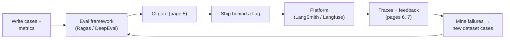

import TOCInline from '@theme/TOCInline';

# Evaluation & Observability Tooling

<TOCInline toc={toc} minHeadingLevel={2} maxHeadingLevel={2} />

:::tip[In this guide]
The rest of this section taught the discipline tool-agnostically on purpose.
This page names the tools you are expected to know — Ragas and DeepEval for
computing metrics, LangSmith and Langfuse for traces, datasets and online
feedback, plus Phoenix and Braintrust — shows a little of each, and gives you a
default stack. The rule underneath all of it: the tool runs your evaluation, it
does not decide what "good" means.
:::

## What Is It?

Two categories that people blur together, and keeping them straight is half the
interview answer:

| Category | Does | Tools |
| --- | --- | --- |
| **Eval frameworks** | Compute metrics and run test suites over a dataset | Ragas, DeepEval, promptfoo |
| **Observability / eval platforms** | Capture traces, store datasets, run evaluators, collect online feedback | LangSmith, Langfuse, Arize Phoenix, Braintrust |

The line is fuzzy — the platforms also run evals, and the frameworks integrate
with the platforms — but the distinction holds: **a framework gives you a
number in CI; a platform gives you a place to see production traffic and turn it
into datasets.** A mature stack uses one of each.

Each tool is an implementation of the concepts in this section, not a
replacement for them. Map before you install:

| Concept page | What the tools do with it |
| --- | --- |
| [Datasets](./02-eval-datasets.mdx) | LangSmith/Langfuse store and version them; DeepEval has a dataset + synthesizer |
| [Metrics](./03-metrics.mdx) | Ragas and DeepEval ship metric implementations |
| [LLM-as-judge](./04-llm-as-judge.mdx) | Ragas metrics and DeepEval's `GEval` are judge-based under the hood |
| [Eval in CI](./05-eval-in-ci.mdx) | DeepEval is pytest-native; Ragas runs in a script |
| [Online eval](./06-online-evaluation.mdx) | LangSmith/Langfuse capture feedback and scores on live traffic |
| [Tracing](./07-tracing-and-observability.mdx) | LangSmith/Langfuse/Phoenix are the trace backends (full comparison there) |

## Ragas — RAG Metrics

**Ragas** is the standard library for RAG-specific metrics. It uses a judge LLM
to score an answer along axes that **separate the retriever from the generator**
— which is exactly the diagnosis split from
[RAG evaluation](../06-rag/14-rag-evaluation.mdx). [Content was rephrased for compliance with licensing restrictions.]

| Metric | Diagnoses | Question it answers |
| --- | --- | --- |
| **Faithfulness** (groundedness) | Generator | Is every claim in the answer supported by the retrieved context? |
| **Answer relevancy** | Generator | Does the answer actually address the question? |
| **Context precision** | Retriever | Are the relevant chunks ranked near the top? |
| **Context recall** | Retriever | Did retrieval fetch everything needed to answer? |

Newer versions add more (context entity recall, noise sensitivity, factual
correctness, and rubric/"aspect" metrics), but those four are the canon to know
cold. Faithfulness and answer relevancy tell you the generator is at fault;
context precision and recall tell you the retriever is.

```python
from datasets import Dataset
from ragas import evaluate
from ragas.metrics import faithfulness, answer_relevancy, context_precision, context_recall

data = Dataset.from_dict({
    "question":     ["What is our EU refund window?"],
    "answer":       ["EU customers have 14 days to request a refund."],
    "contexts":     [["EU orders may be returned within 14 days of delivery."]],
    "ground_truth": ["14 days."],
})

result = evaluate(data, metrics=[faithfulness, answer_relevancy, context_precision, context_recall])
print(result)   # {'faithfulness': 1.0, 'answer_relevancy': 0.97, ...}
```

:::warning[Version churn]
Ragas's metric names, column names (`ground_truth` vs `reference`), and result
access have all shifted across versions, and recent releases moved toward a
class-based metric API with `EvaluationDataset`. Pin the version and read its
docs; the shape above is the idea, not a frozen signature.
:::

The honest caveat: Ragas scores are **judge outputs**, so everything from
[LLM-as-judge](./04-llm-as-judge.mdx) applies — calibrate them against human
labels on a small slice before trusting the number, and watch for the judge
rewarding verbosity.

## DeepEval — LLM Unit Testing

**DeepEval** treats evaluation as **pytest for LLMs**. You write test cases,
attach metrics with thresholds, and fail the build when they are not met — which
makes it the natural fit for the [CI gate](./05-eval-in-ci.mdx).

Its metric catalogue is broader than Ragas's RAG focus: answer relevancy,
faithfulness, contextual precision/recall/relevancy, hallucination, plus
**`GEval`** — a custom judge metric where you describe the criterion in plain
language and it builds the rubric. It also wraps the Ragas metrics.

```python
import pytest
from deepeval import assert_test
from deepeval.test_case import LLMTestCase
from deepeval.metrics import AnswerRelevancyMetric, FaithfulnessMetric, GEval
from deepeval.test_case import LLMTestCaseParams


def test_refund_answer():
    case = LLMTestCase(
        input="What is our EU refund window?",
        actual_output="EU customers have 14 days to request a refund.",
        retrieval_context=["EU orders may be returned within 14 days of delivery."],
    )
    tone = GEval(
        name="Tone",
        criteria="The answer is polite and does not blame the customer.",
        evaluation_params=[LLMTestCaseParams.ACTUAL_OUTPUT],
    )
    assert_test(case, [
        AnswerRelevancyMetric(threshold=0.7),
        FaithfulnessMetric(threshold=0.8),
        tone,
    ])
```

```bash
deepeval test run test_refund.py        # or plain `pytest`
```

DeepEval also generates **synthetic test data** from your documents (see
[synthetic data generation](../14-fine-tuning-and-model-adaptation/09-synthetic-data-generation.mdx)
for the hygiene that still applies), and the team behind it runs a hosted
platform (Confident AI) if you want dashboards. For CI, the pytest integration
is the draw: evals become ordinary failing tests.

**Ragas vs DeepEval, quickly:** Ragas is a focused metrics library you call in a
script; DeepEval is a testing framework with a pytest gate and `GEval` for
custom criteria. Many teams use Ragas's metrics *inside* a DeepEval or custom
harness. Neither chooses your metrics for you — [page 3](./03-metrics.mdx) does.

## LangSmith — The LangChain-Native Platform

**LangSmith** is the tracing, dataset, evaluation and feedback platform from the
LangChain team. Its strengths are deep LangChain/LangGraph integration, a mature
dataset and annotation workflow, experiment comparison, a prompt hub, and
online feedback capture. It works with non-LangChain code too via its SDK
(`@traceable`), but the smoothest experience is inside the LangChain ecosystem.

It is covered in depth in the
[LangSmith complete guide](../10-genai-frameworks-and-ecosystem/03-complete-guides/05-langsmith-complete-guide.mdx)
and the [observability interview roadmap](../17-interview-roadmaps/13-langsmith-and-llm-observability.mdx);
the one-line placement is in the [tracing tooling table](./07-tracing-and-observability.mdx#tooling-landscape).
The thing to know for this page: LangSmith closes the loop — a thumbs-down in
production links to the trace, the trace becomes a dataset example, and the
example runs in an experiment against a candidate prompt.

## Langfuse — The Open-Source Platform

**Langfuse** is the open-source, self-hostable alternative: tracing, a prompt
registry with `production`/`staging` labels, datasets, evaluators, scores, and
OTLP ingest. Its headline advantage is a **genuinely usable self-hosted
deployment**, which makes it the default when prompts and completions (your
users' content) cannot leave your perimeter — the data-residency point from the
[tracing page](./07-tracing-and-observability.mdx).

Instrumentation is a decorator plus score calls:

```python
from langfuse import observe, get_client

langfuse = get_client()

@observe(name="answer")
def answer(question: str) -> str:
    ...  # retrieval + generation; spans are captured automatically
    return result

# Later, attach a production feedback signal to the trace:
langfuse.create_score(trace_id=trace_id, name="user_feedback", value=1)  # 1 = thumbs up
```

A worked FastAPI + Langfuse tracing and feedback example lives in the LLMOps
Roadmap page of [Production GenAI & LLMOps](../13-production-genai-and-llmops/index.mdx).
For a vendor-neutral setup, Langfuse accepts OpenTelemetry, so you can instrument
once with OTel and point it at Langfuse — the portability argument from page 7.

## The Rest Worth Naming

| Tool | What it is | Reach for it when |
| --- | --- | --- |
| **Arize Phoenix** | Open-source tracing + eval, OTel/OpenInference-native, runs locally | Local development, embedding/drift analysis, no vendor |
| **Braintrust** | Commercial, eval-first with strong experiment comparison | Eval and human-review workflows are the priority |
| **promptfoo** | Config-driven prompt/model comparison and red-team testing | Quick side-by-side prompt bake-offs from YAML |
| **Opik** (Comet) | Open-source tracing + eval | A Comet-adjacent stack |
| **W&B Weave** | Tracing in the Weights & Biases ecosystem | You already use W&B for training |

You do not need to have used all of these. Know the two categories, one tool in
each you can speak to in depth, and that **OpenTelemetry / OpenInference** is the
instrumentation standard that keeps the backend choice reversible.

## Choosing a Stack

Pick one eval framework and one platform; do not collect all six.



Sensible defaults by situation:

| Situation | Framework | Platform |
| --- | --- | --- |
| RAG, want metrics fast | Ragas | Langfuse (self-host) or LangSmith |
| Want evals as failing unit tests | DeepEval | either |
| Deep in the LangChain/LangGraph ecosystem | DeepEval or Ragas | LangSmith |
| Data cannot leave your perimeter | Ragas/DeepEval | Langfuse or Phoenix (self-hosted) |
| Local development, no account | DeepEval | Phoenix |

The one non-negotiable across every choice: **instrument with OpenTelemetry**
where you can, so swapping the platform is a config change, not a rewrite.

## Common Mistakes

- Letting the tool pick your metrics. The library ships a dozen; relevance to
  *your* failure modes is still your call ([page 3](./03-metrics.mdx)).
- Trusting Ragas/DeepEval judge scores without calibrating against human labels
  on a slice ([page 4](./04-llm-as-judge.mdx)).
- Treating an eval framework and an observability platform as substitutes —
  you usually want one of each.
- Pinning nothing, then losing a morning to Ragas renaming a column between
  versions.
- Sending prompts and completions to a cloud platform without checking the
  data-residency and training-use terms.
- Instrumenting with a vendor SDK instead of OpenTelemetry, making the backend
  choice irreversible.
- Collecting five tools and mastering none.

## Interview Questions

- What is the difference between an eval framework (Ragas, DeepEval) and an
  observability platform (LangSmith, Langfuse)?
- Name Ragas's four core metrics and say which diagnose the retriever vs the
  generator.
- How does DeepEval fit a CI pipeline, and what does `GEval` add?
- LangSmith vs Langfuse — when would you choose the open-source one?
- Ragas scores come from a judge LLM. What does that mean for how much you trust
  them?
- Why instrument with OpenTelemetry instead of a vendor SDK?
- Sketch a default evaluation stack and justify each piece.

## Things to Remember

- Two categories: eval frameworks (Ragas, DeepEval) compute metrics; platforms
  (LangSmith, Langfuse, Phoenix, Braintrust) capture traces, datasets and
  feedback. Use one of each.
- Ragas: four core RAG metrics — faithfulness and answer relevancy (generator),
  context precision and recall (retriever).
- DeepEval: pytest-native, broad metric set plus `GEval` for custom criteria;
  the natural CI gate.
- LangSmith: LangChain-native, strong datasets and experiments. Langfuse:
  open-source and self-hostable, the pick when data must stay in your perimeter.
- Tools run your evaluation; they do not decide what "good" means — the metric
  must still mean something.
- Judge-based scores (Ragas, `GEval`) need calibration against human labels.
- Instrument with OpenTelemetry so the platform stays a config decision.

## Mini Exercise

Take your RAG eval set from [page 2](./02-eval-datasets.mdx). First, run Ragas's
four core metrics over it and write down which are low — that tells you whether
your next fix is retrieval or generation. Then wrap three of those cases as
DeepEval `LLMTestCase`s with `FaithfulnessMetric` and `AnswerRelevancyMetric`
thresholds, and run them under `pytest` so a regression fails the build. Finally,
add Langfuse (or LangSmith) tracing to the endpoint, send one request, and
confirm you can see the trace and attach a feedback score to it — closing the
loop from [page 7](./07-tracing-and-observability.mdx) back to [page 2](./02-eval-datasets.mdx).

## Done When

- [ ] You can explain the difference between an eval framework and an
      observability platform, and name tools in each.
- [ ] You can list Ragas's four core metrics and what each diagnoses.
- [ ] You can write a DeepEval test with a metric threshold that fails in CI.
- [ ] You can choose between LangSmith and Langfuse and justify it on ecosystem
      and data residency.
- [ ] You calibrate judge-based scores before trusting them.
- [ ] You instrument with OpenTelemetry so the backend stays swappable.

Next: [13 · Production GenAI and LLMOps](../13-production-genai-and-llmops/index.mdx).
