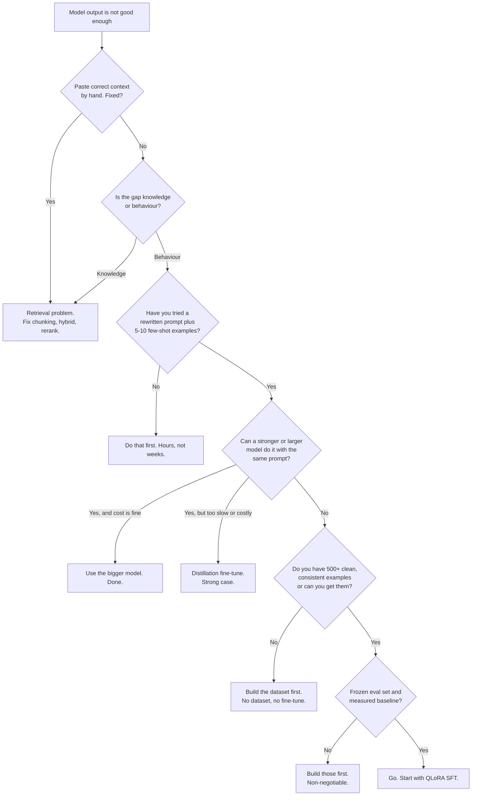
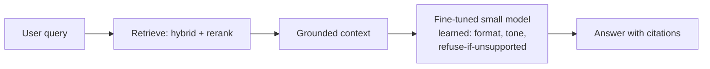

import TOCInline from '@theme/TOCInline';

# When to Fine-Tune

<TOCInline toc={toc} minHeadingLevel={2} maxHeadingLevel={2} />

:::tip[In this guide]
How to decide whether fine-tuning is the right fix, using cost and reversibility
as the ordering principle. The honest list of what it does and does not solve,
what it really costs over a year, and a checklist to clear before anyone spends
money on GPUs.
:::

## What Is It?

Fine-tuning means continuing to train an already-trained model on your own
examples so that its weights change. Not its instructions, not its context —
its weights. That distinction is the whole chapter.

You have four levers over model behaviour, and they are ordered by cost and by
how hard they are to undo:

| Lever | What you change | Time to try | Time to undo |
| --- | --- | --- | --- |
| Prompt | Instructions in the system message | Minutes | Instant |
| Few-shot | Worked examples inside the prompt | Hours | Instant |
| Retrieval | What context the model sees | Days | Config change |
| Fine-tuning | The model's weights | Weeks | Redeploy the old model, re-run evals |

The ladder goes top to bottom. Not because the lower rungs are worse, but
because each step costs roughly an order of magnitude more effort than the one
above it, and each one is harder to walk back. Skipping rungs is the single most
common and most expensive mistake in applied LLM work.

## Why Does It Matter?

Because the thing people want from fine-tuning is usually knowledge, and
fine-tuning is bad at knowledge.

A team notices their assistant gives wrong answers about internal policy. The
instinct is "the model doesn't know our policies, so let's train it on our
policies." Three weeks later they have a model that confidently produces
policy-shaped text, some of which is wrong, none of which is citable, all of
which was correct as of the day they built the dataset. Meanwhile the actual
defect was that their chunker split the policy table across two chunks and
retrieval never returned the right row.

Getting this decision right saves a month. Getting it wrong costs a month and
leaves you with a worse system than you started with.

## What Fine-Tuning Is Genuinely Good At

| Goal | Why fine-tuning works here |
| --- | --- |
| Format and structure adherence | Output shape is a behaviour, learned from thousands of consistent examples far more reliably than from an instruction |
| Tone and style | Style is diffuse and hard to specify in words; it is easy to demonstrate |
| A narrow task done cheaply | A 1–3B fine-tune can match a frontier model on one well-scoped task at a fraction of the cost per call |
| Latency and cost reduction | Distil a big model's behaviour into a small one you can run yourself |
| Domain vocabulary and conventions | Teaching the model that "SLA breach" in your company means a specific state machine, not a general concept |
| Shorter prompts | If 2,000 tokens of instructions and examples get baked into weights, every request gets cheaper and faster |
| Reliable refusals and routing on your own taxonomy | Classification into *your* labels, not plausible-sounding ones |

The pattern across all of these: **the thing you want is a consistent mapping
from input shape to output shape, and it does not change weekly.**

## What Fine-Tuning Is Bad At

| Goal | Why it fails |
| --- | --- |
| Adding facts | See below — parametric storage is the wrong place |
| Keeping knowledge current | Every update means another training run |
| Citations and provenance | Weights have no source attribution to give |
| Access control | Weights cannot forget a document for one user and remember it for another |
| Anything you need tomorrow | A training-plus-eval cycle is days, not minutes |
| Numeric precision and lookups | The model approximates; it does not retrieve |

### Why facts do not belong in weights

When you fine-tune on factual statements, the model does not store those facts
in a retrievable table. It adjusts a very large number of parameters so that
fact-shaped continuations become more likely. The consequences are structural,
not fixable with more data:

- **No boundary between learned and guessed.** The model produces the same
  confident tone for a fact it absorbed and a plausible interpolation between
  two facts. Retrieval gives you a document to point at; weights give you
  nothing.
- **Facts interfere with each other.** Training on "the refund window is 30
  days" alongside an older example saying 14 does not produce a conflict error.
  It produces a model that sometimes says 21.
- **Updates are destructive and global.** Changing one fact means another
  training run, which perturbs everything else the model knows.
- **No deletion.** A customer invoking a right-to-erasure request wants their
  data gone. You can delete a row from a vector store. You cannot delete a fact
  from a weight matrix; you can only retrain without it.
- **Retrieval is simply better at it.** A vector store update is an INSERT.

So: **facts go in retrieval, behaviour goes in weights.** If you can only
remember one sentence from this section, remember that one.

## The Classic Mistake

Fine-tuning to fix a retrieval problem. It looks like this:

```text
Symptom:   "The model gives wrong answers about our product."
Diagnosis: "It doesn't know our product."
Action:    Fine-tune on the product docs.
Reality:   Retrieval was returning chunk 4 of 200 at rank 11,
           below the top-k cutoff. The model never saw the answer.
```

The tell is simple, and it takes an afternoon to check: **paste the correct
context into the prompt by hand and ask again.** If the model answers correctly,
you do not have a model problem. You have a retrieval problem, and fine-tuning
will not touch it. Run that test before anything else in this section.

## Decision Table: Symptom to Fix

| Symptom | Likely right fix | Why |
| --- | --- | --- |
| Wrong or outdated facts | Retrieval: chunking, hybrid search, reranking | Knowledge must be replaceable without retraining |
| Answer is right but the JSON is malformed | Constrained decoding or structured output first, fine-tune if that fails | Cheaper, instant, and deterministic |
| Right content, wrong tone, every time | Fine-tune | Style is demonstrable, not specifiable |
| Model ignores one instruction out of twelve | Simplify and restructure the prompt | Instruction crowding, not a capability gap |
| Works on a frontier model, fails on your small local one | Fine-tune the small model, distilling from the big one | This is the textbook case |
| Needs citations | Retrieval, always | Weights have no sources |
| Prompt is 3,000 tokens and latency hurts | Fine-tune to absorb the instructions | Direct cost and latency win |
| Occasional nonsense on rare inputs | Expand the eval set and look at the data | You probably have a data distribution blind spot |
| Each customer needs different behaviour | Prompt per tenant first, then per-tenant LoRA adapters | Adapters are cheap to store and swap |
| Quality is fine but inference costs too much | Distil into a smaller fine-tuned model | The strongest financial case for fine-tuning |

## A Decision Tree



## Total Cost of Ownership

The GPU bill is the cheapest line item. Here is a realistic first-project
budget for one narrow task, one 7B-class model, QLoRA:

| Cost | Realistic estimate | Notes |
| --- | --- | --- |
| Dataset construction | 2–6 person-weeks | 1,000–5,000 examples, written or curated and reviewed. The dominant cost, every time. |
| Eval set and baseline | 3–5 person-days | 150–300 cases, labelled, frozen. Also needed if you *don't* fine-tune, so it is never wasted. |
| GPU for training | 10–150 USD | A few hours on a rented A100 or H100. Genuinely cheap. |
| Failed runs and hyperparameter search | 2–5x the above | Nobody gets it on the first run. Budget for five. |
| Evaluation cycles | 3–8 person-days | Per candidate checkpoint, if you do it properly. |
| Serving setup | 1–2 person-weeks | Adapter loading, merging, quantizing, registry, rollback path. |
| Ongoing inference | Varies | Often the saving that motivated the project. Measure it. |
| Base model deprecation | 1–3 person-weeks, every 6–12 months | The line item everyone forgets. See below. |

### The deprecation tax

Your fine-tune is welded to one base model checkpoint. When a better base model
ships — and one ships every few months — your adapter does not transfer. You
re-run data prep (usually fine), re-tune hyperparameters (the template and
tokenizer changed), re-evaluate, and re-deploy. Call it a week or two of
engineering per base model generation, forever, for as long as the fine-tune is
in production.

Prompts and retrieval indexes mostly survive a base model swap. Fine-tunes do
not. Factor that recurring cost in before you start, because it is what turns a
successful two-week project into a permanent maintenance obligation.

## RAG and Fine-Tuning Are Complementary

They are not competing answers to one question; they answer different
questions. The strongest production systems use both:

- **Retrieval supplies the facts** — current, citable, access-controlled,
  updatable with an INSERT.
- **The fine-tune supplies the behaviour** — how to read retrieved context, what
  format to answer in, your house tone, when to refuse because the context does
  not support an answer.



The combined pattern has a specific payoff that neither gives alone: a
fine-tune trained on "answer only from the provided context, and say you don't
know otherwise" is markedly better at grounded refusal than a prompt asking for
the same thing. You are teaching a behaviour — *how to use retrieval* — not
teaching facts. That is fine-tuning used correctly.

Build the RAG system first, though. A fine-tune layered on a bad retriever
produces well-formatted wrong answers, which are worse than badly formatted
wrong answers because they are harder to spot.

## Go / No-Go Checklist

Complete this before anyone provisions a GPU. If you cannot tick every box, you
are not ready, and the honest move is to say so.

- [ ] **The context test fails.** Pasting the ideal context by hand does not fix the output. It is not a retrieval problem.
- [ ] **The gap is behaviour, not knowledge.** You can state in one sentence what behaviour you are teaching.
- [ ] **Prompting is exhausted.** A rewritten prompt plus 5–10 few-shot examples has been measured and is still short.
- [ ] **A frozen eval set exists.** 100+ representative cases you did not cherry-pick, with a scoring method.
- [ ] **The baseline is a number.** Current model plus current prompt, scored on that set, written down and dated.
- [ ] **There is a target.** "Format validity from 82% to above 98%" — not "make it better."
- [ ] **The data exists or has an owner.** You have the examples, or a named person with a deadline for producing them.
- [ ] **No eval leakage.** You can prove the training data does not contain your eval cases, including near-duplicates.
- [ ] **A serving plan exists.** You know where the adapter runs, how it is versioned, and how you roll back.
- [ ] **A kill criterion exists.** The agreed condition under which you stop and ship the prompt instead.
- [ ] **The TCO is accepted.** Someone with budget authority has seen the deprecation tax and said yes anyway.

That last one matters more than it looks. A fine-tune without an owner for the
next base model migration is technical debt with a timer on it.

## Common Mistakes

- Fine-tuning to add knowledge. The default error, and the most expensive.
- Starting without a baseline, then having no way to prove improvement. You will end up arguing from vibes in a review meeting.
- Skipping the by-hand context test, which takes an afternoon and resolves the question half the time.
- Treating fine-tuning as a last resort for a problem nobody has actually diagnosed. "We tried everything" usually means "we tried three prompts."
- Fine-tuning a frontier model via a hosted API when the goal was cost reduction. If you still pay per token for a big model, you have added complexity and saved nothing.
- Picking a base model that is about to be deprecated, or one with a licence that forbids your use case. Check both on day one.
- Letting one engineer own the whole thing informally. When they move teams, you have an unmaintainable artefact in production.
- Comparing your fine-tune to the *un-prompted* base model. That is not the baseline. The baseline is your current production prompt.

## Interview Questions

- Your support assistant gives wrong answers about last month's pricing change. Would you fine-tune? Walk through your diagnosis.
- Why is parametric knowledge a poor place to store facts? Give three structural reasons.
- Name three things fine-tuning genuinely does better than prompting plus retrieval.
- What is the cheapest test that distinguishes a retrieval failure from a model failure?
- How would you estimate the total cost of ownership of a fine-tune over twelve months?
- RAG or fine-tuning for a legal document assistant that must cite sources? Defend the answer.
- You have a frontier model that works and a budget problem. What do you do?
- What happens to your fine-tune when the base model is deprecated?
- When would you use RAG and fine-tuning together, and what would the fine-tune be teaching?

## Things to Remember

- Facts go in retrieval. Behaviour goes in weights.
- The ladder is prompt, few-shot, retrieval, fine-tune — ordered by cost and irreversibility.
- Paste the context in by hand first. It resolves the question about half the time.
- The dataset is the expensive part. The GPU is rounding error.
- No baseline, no fine-tune. You cannot improve a number you never wrote down.
- Fine-tuning and RAG are complementary; the fine-tune can teach the model *how to use* retrieval.
- Every fine-tune carries a recurring deprecation tax. Price it in before you start.

## Mini Exercise

Take a real quality complaint from a system you have built or used. Write it as
a one-line symptom, then work the decision tree in this page honestly, writing
down the answer at each branch.

Then do the context test for real: hand-pick the ideal context, paste it into
the prompt, and re-run the failing case. Record whether it fixed the output.

Finally, write the go/no-go checklist for this specific problem and mark each
box truthfully. Most readers will not get past box four — and that is the
correct result, not a failure of the exercise.

## Done When

- [ ] You can explain in two sentences why facts belong in retrieval and behaviour in weights.
- [ ] You can order the four levers by cost and reversibility, and say why that order is the right one.
- [ ] You can describe the by-hand context test and what each outcome tells you.
- [ ] You have a TCO estimate for one concrete fine-tune, including the deprecation tax.
- [ ] You have filled in the go/no-go checklist for a real problem and reached a defensible decision either way.
