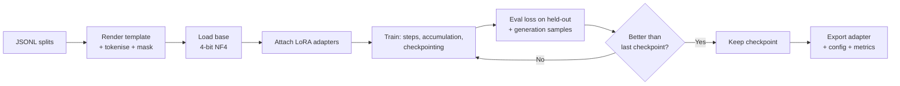

import TOCInline from '@theme/TOCInline';

# Running a Training Job

<TOCInline toc={toc} minHeadingLevel={2} maxHeadingLevel={2} />

:::tip[In this guide]
The end-to-end shape of a training run, a complete commented QLoRA script with
every hyperparameter explained, starting values and which direction to move
them, how to read five distinct loss-curve shapes, compute and
spot-interruption realities, and a symptom-to-fix debugging table.
:::

## What Is It?

A training run is a long-lived batch job: it loads a dataset and a base model,
takes gradient steps, writes checkpoints, and produces an adapter plus a record
of what happened. Treat it like a production job, not a notebook. It runs for
hours unattended, it fails in ways that are only visible in logs, and in six
weeks you will need to know exactly what produced the artefact you deployed.

## The Shape of a Run



The loop that matters is the one on the right: evaluate, generate samples, keep
or discard. A run that only writes checkpoints on a schedule and never looks at
output is a run you cannot make decisions about.

## A Complete QLoRA SFT Script

```python
"""QLoRA supervised fine-tune. Run: python train.py

Pinned, reproducible, and writes its own config next to the output.
"""

from __future__ import annotations

import json
import random
from pathlib import Path

import numpy as np
import torch
from datasets import load_dataset
from peft import LoraConfig
from transformers import (
    AutoModelForCausalLM,
    AutoTokenizer,
    BitsAndBytesConfig,
    set_seed,
)
from trl import SFTConfig, SFTTrainer

MODEL = "Qwen/Qwen2.5-7B-Instruct"
OUT = Path("runs/triage-qlora-r16-v3")
SEED = 20250101

set_seed(SEED)
random.seed(SEED)
np.random.seed(SEED)

# --------------------------------------------------------------------------
# Data. Already cleaned, decontaminated, and split. See the data page.
# --------------------------------------------------------------------------
ds = load_dataset(
    "json",
    data_files={
        "train": "data/train.jsonl",
        "validation": "data/val.jsonl",
    },
)

tok = AutoTokenizer.from_pretrained(MODEL)
# Needed for batching; right-padding is correct for training (left for
# generation). Using eos as pad is standard when the model has no pad token.
tok.pad_token = tok.pad_token or tok.eos_token
tok.padding_side = "right"

# --------------------------------------------------------------------------
# Base model, 4-bit.
# --------------------------------------------------------------------------
model = AutoModelForCausalLM.from_pretrained(
    MODEL,
    quantization_config=BitsAndBytesConfig(
        load_in_4bit=True,
        bnb_4bit_quant_type="nf4",
        bnb_4bit_compute_dtype=torch.bfloat16,
        bnb_4bit_use_double_quant=True,
    ),
    dtype=torch.bfloat16,
    device_map="auto",
    # Disable the KV cache during training: it costs memory and is unused.
    use_cache=False,
)

peft_config = LoraConfig(
    r=16,
    lora_alpha=32,
    lora_dropout=0.05,
    target_modules=[
        "q_proj", "k_proj", "v_proj", "o_proj",
        "gate_proj", "up_proj", "down_proj",
    ],
    bias="none",
    task_type="CAUSAL_LM",
)

# --------------------------------------------------------------------------
# Training configuration. Every line here is a decision.
# --------------------------------------------------------------------------
cfg = SFTConfig(
    output_dir=str(OUT),
    seed=SEED,

    # --- How long -----------------------------------------------------------
    # 2-3 epochs is the SFT sweet spot. Below 1 the adapter barely moves;
    # above 4 you are usually memorising. Prefer more data over more epochs.
    num_train_epochs=3,

    # --- Effective batch size ----------------------------------------------
    # Effective batch = per_device x accumulation x num_gpus = 1 x 16 x 1 = 16.
    # Memory is set by per_device; gradient quality is set by the effective
    # batch. So push per_device as high as VRAM allows, then make up the rest
    # with accumulation. 16-64 effective is a reasonable band for SFT.
    per_device_train_batch_size=1,
    gradient_accumulation_steps=16,

    # --- Learning rate ------------------------------------------------------
    # 2e-4 for LoRA. That is ~10x a full fine-tune's rate, and it is correct:
    # you are training 0.5% of the parameters and the base is frozen, so the
    # update cannot wreck the model the way a full FT at 2e-4 would.
    learning_rate=2e-4,
    # Cosine decays smoothly to ~0 by the end, which stabilises the final
    # checkpoint. "linear" is a fine alternative; "constant" tends to leave
    # the last checkpoint noisier than the one before it.
    lr_scheduler_type="cosine",
    # 3% of steps spent ramping up from 0. Skipping warmup is the most common
    # cause of a loss spike in the first 20 steps.
    warmup_ratio=0.03,
    # Mild regularisation on the adapter weights.
    weight_decay=0.01,
    # Clip gradient norm. Cheap insurance against a single bad batch
    # destabilising the run.
    max_grad_norm=1.0,
    optim="paged_adamw_8bit",

    # --- Sequence handling --------------------------------------------------
    # Set from your p99 token length. Too low silently truncates targets;
    # too high wastes memory on padding.
    max_length=2048,
    # Concatenate short examples to fill the context window. Big throughput
    # win when examples are much shorter than max_length. Turn it OFF if
    # examples must not see each other's context, or if your masking logic
    # assumes one example per sequence.
    packing=False,

    # --- Memory and precision ----------------------------------------------
    # Recompute activations in the backward pass instead of storing them.
    # ~25% slower, 3-5x less activation memory. Leave on.
    gradient_checkpointing=True,
    gradient_checkpointing_kwargs={"use_reentrant": False},
    # bf16 on Ampere or newer. Wider exponent range than fp16, so no loss
    # scaler and far fewer NaNs. Use fp16 only on older cards.
    bf16=True,

    # --- Observability ------------------------------------------------------
    logging_steps=10,
    eval_strategy="steps",
    eval_steps=50,
    save_strategy="steps",
    save_steps=50,
    save_total_limit=3,
    # Keep the checkpoint with the best held-out loss, not the last one.
    load_best_model_at_end=True,
    metric_for_best_model="eval_loss",
    greater_is_better=False,
    report_to=["wandb"],
    run_name=OUT.name,
)

trainer = SFTTrainer(
    model=model,
    args=cfg,
    train_dataset=ds["train"],
    eval_dataset=ds["validation"],
    peft_config=peft_config,
    processing_class=tok,
)

trainer.model.print_trainable_parameters()  # read this before walking away

trainer.train(resume_from_checkpoint=None)  # pass True to resume after a kill

trainer.save_model(str(OUT / "adapter"))
tok.save_pretrained(str(OUT / "adapter"))

# Write the config next to the result. Non-negotiable for reproducibility.
(OUT / "run.json").write_text(
    json.dumps(
        {
            "base_model": MODEL,
            "seed": SEED,
            "lora": peft_config.to_dict(),
            "sft": cfg.to_dict(),
            "train_rows": len(ds["train"]),
            "val_rows": len(ds["validation"]),
        },
        indent=2,
        default=str,
    )
)
```

:::note
`trl` has renamed several of these arguments across recent releases —
`max_seq_length` to `max_length`, `tokenizer` to `processing_class`,
`evaluation_strategy` to `eval_strategy`. Pin your versions, and when you hit a
`TypeError`, read the installed `SFTConfig` signature rather than searching for
a blog post. The shape of the script is stable; the argument names are not.
:::

## Hyperparameter Starting Points

| Parameter | Start | Raise it when | Lower it when |
| --- | --- | --- | --- |
| `learning_rate` | `2e-4` (LoRA), `1e-5` (full FT) | Loss barely moves across a full epoch | Loss spikes, oscillates, or goes NaN |
| `num_train_epochs` | 3 | Eval loss still falling at the end | Eval loss turns up before the end |
| Effective batch size | 16 | Loss curve is noisy step to step | Rarely; raise accumulation instead of lowering |
| `per_device_train_batch_size` | As high as fits | More VRAM is free | OOM |
| `warmup_ratio` | 0.03 | Early-step instability persists | Almost never |
| `max_length` | Your p99 token length | Targets are being truncated | OOM, and p99 says you can |
| `lora_dropout` | 0.05 | Eval loss turns up (overfit) | Clear underfitting |
| `max_grad_norm` | 1.0 | Almost never | Persistent loss spikes |
| `weight_decay` | 0.01 | Overfitting on a small dataset | Underfitting |
| `packing` | `False` first | You need throughput and examples are short | Examples must stay isolated |

Change one thing at a time. A run is cheap enough that an ablation is
affordable and a confounded comparison is not.

## Reading the Loss Curve

Five shapes, and what each means. Watch train and eval together — either alone
is ambiguous.

| Shape | Train loss | Eval loss | Diagnosis | Action |
| --- | --- | --- | --- | --- |
| Healthy | Falls fast, then gradually flattens | Follows train down, flattens slightly above it | Working | Finish, evaluate, consider more epochs if still falling |
| Underfitting | Falls a little, plateaus high | Plateaus at a similar high value | Not enough capacity or signal | Raise `r`, widen `target_modules`, raise learning rate, check data quality |
| Overfitting | Keeps falling toward zero | Bottoms out, then climbs | Memorising | Stop at the eval minimum, lower `r`, raise dropout, add data |
| Diverging | Spikes, oscillates, NaN | Follows or stops being reported | Step size too large or bad batch | Lower learning rate 2–5x, confirm warmup, check `max_grad_norm`, look for a pathological example |
| Dead flat | Nearly constant from step 1 | Constant | Nothing is learning | See below |

### The dead-flat case

A loss curve that starts flat and stays flat is almost never a hyperparameter
problem. In rough order of likelihood:

1. **All labels are masked.** Every token is `-100`, so there is no gradient
   signal. Decode one batch and confirm something is supervised.
2. **`trainable%` is 0.0000.** `target_modules` matched nothing. Read
   `print_trainable_parameters()`.
3. **No gradient flow through a quantized base.** You skipped
   `prepare_model_for_kbit_training`, or gradient checkpointing is on without
   input grads enabled.
4. **Learning rate is effectively zero.** A scheduler misconfiguration, or
   `warmup_ratio` close to 1.

A related and nastier variant: loss that is *low and flat from step one*. That
usually means your prompt tokens are unmasked and dominate an easy, repetitive
sequence — the model is scoring well on text it did not need to learn. Covered
in detail on the data preparation page.

## Monitoring

Three signals, in increasing order of usefulness:

| Signal | What it tells you | Limitation |
| --- | --- | --- |
| Train loss | The optimiser is working | Says nothing about generalisation |
| Eval loss on a held-out split | Whether it generalises | A lower eval loss does not guarantee better outputs |
| **Generation samples at every checkpoint** | What the model actually does | Qualitative, needs you to read them |

Generation samples are the single most informative signal in a fine-tuning run,
and the one most often skipped. Eval loss can improve while the model develops
a habit you would reject on sight — never emitting a stop token, prefixing every
answer with "Certainly!", or collapsing to one output class. Twenty fixed
prompts, generated at every checkpoint, catch all of those in seconds.

```python
from transformers import TrainerCallback

FIXED_PROMPTS = [
    "My card was charged twice for order 8812.",
    "How do I change my delivery address?",
    "This is the worst service I have ever received.",
    # ...20 or so, frozen, covering every class and edge case you care about
]


class SampleGenerations(TrainerCallback):
    """Generate from fixed prompts at every eval. Read the output."""

    def __init__(self, tokenizer, prompts: list[str], max_new_tokens: int = 128):
        self.tok = tokenizer
        self.prompts = prompts
        self.max_new_tokens = max_new_tokens

    def on_evaluate(self, args, state, control, model=None, **kwargs):
        model.eval()
        for p in self.prompts:
            text = self.tok.apply_chat_template(
                [{"role": "user", "content": p}],
                tokenize=False,
                add_generation_prompt=True,
            )
            ids = self.tok(text, return_tensors="pt").to(model.device)
            with torch.no_grad():
                out = model.generate(
                    **ids,
                    max_new_tokens=self.max_new_tokens,
                    # Greedy, so checkpoint comparisons are apples to apples.
                    do_sample=False,
                )
            completion = self.tok.decode(
                out[0][ids["input_ids"].shape[-1] :], skip_special_tokens=False
            )
            print(f"[step {state.global_step}] {p!r}\n  -> {completion!r}\n")
        model.train()


# trainer.add_callback(SampleGenerations(tok, FIXED_PROMPTS))
```

Note `skip_special_tokens=False`. You want to see whether the model emitted its
end-of-turn token. Hiding special tokens hides the most common failure.

For tracking, either Weights and Biases (`report_to=["wandb"]`, hosted, good
run comparison and artefact tracking) or TensorBoard (`report_to=["tensorboard"]`,
local, zero setup, no account). Both are fine. What matters is that you can pull
up two runs side by side a month later and see which config produced which
curve.

## Practical Compute

**Single GPU.** Where you should start, and where most LoRA and QLoRA jobs end.
A 24GB card handles a 7B QLoRA run comfortably. No distributed debugging, no
sharding config, and the failure modes are ones you can reason about.

**Multi-GPU.** Data parallel via `accelerate` or `torchrun` is the easy case:
each GPU holds a full copy and processes different batches. It gets you
throughput, not the ability to train bigger models. For models that do not fit
on one device you need sharding.

**DeepSpeed and FSDP.** Both shard the things that dominate full fine-tuning
memory. DeepSpeed ZeRO has three stages: stage 1 shards optimiser state, stage 2
adds gradients, stage 3 adds parameters. PyTorch FSDP is the native equivalent
and now the better-maintained path for most `transformers` users. Both are
configured through `accelerate` with a YAML file and both add real operational
complexity — inter-GPU bandwidth becomes your bottleneck, OOMs move around, and
debugging means reading several ranks' logs. For LoRA and QLoRA you very rarely
need either; that is much of the point of PEFT.

**Renting a GPU.** Per-hour rates vary widely across providers and over time, so
check current pricing rather than trusting any number here. What is stable is
the shape of the decision: a 7B QLoRA run on a few thousand examples is a few
GPU-hours, which is tens of dollars, which is negligible against the engineering
time. Do not over-optimise this line item. Do check what you are billed for —
some providers charge for storage and idle instances, and a forgotten instance
costs more than the training did.

**Spot instances and interruptions.** Spot capacity is often 50–80% cheaper and
can be reclaimed with a minute or two of warning. For a multi-hour run that is a
real risk, and the mitigation is the same as the reproducibility practice:

```python
cfg = SFTConfig(
    output_dir="runs/triage-v3",
    save_strategy="steps",
    save_steps=50,          # frequent enough that a kill costs minutes
    save_total_limit=3,     # bounded disk
    # ... rest as above
)

# After an interruption, restart the same script with:
trainer.train(resume_from_checkpoint=True)  # picks the latest checkpoint
```

Checkpoint to persistent storage, not the instance's ephemeral disk. A resumed
run restores model, optimiser state, scheduler position and dataloader state,
so it continues rather than restarting — but only if the checkpoint survived the
instance.

## Faster Paths: Unsloth and Axolotl

| Tool | What it buys you | What it hides |
| --- | --- | --- |
| Unsloth | Hand-written fused kernels for LoRA and QLoRA; roughly 2x faster and noticeably less memory on supported architectures. Drop-in-ish replacement for the model loading step. | Custom kernels and patched layers. When an architecture is unsupported or a version drifts, the error messages come from inside the optimisation. Supports a specific list of models. |
| Axolotl | Entire run defined in one YAML: dataset format, template, PEFT config, distributed setup. Excellent defaults, easy to share and diff a config, handles multi-GPU for you. | The whole training loop. When something is subtly wrong — masking, template, packing — you are debugging a config abstraction rather than code you wrote. |

Both are genuinely good and both are the right choice in production. The
recommendation is about sequencing: **write the raw `trl` script once, for a
small dataset, and understand every line.** Then switch to Axolotl or Unsloth
for real work. If you start with the abstraction you will not be able to debug
the thing it abstracts, and the failures in this area — masking, templates,
stop tokens — are exactly the ones the abstraction hides.

## Reproducibility

In six weeks someone will ask why v3 was better than v2. These four habits are
the difference between an answer and a shrug:

- **Pin everything.** Exact versions of `transformers`, `trl`, `peft`,
  `bitsandbytes`, `torch`, `datasets`, in a lockfile. This ecosystem breaks
  across minor versions regularly.
- **Pin the base model by revision.** `from_pretrained(MODEL, revision="<commit sha>")`.
  Hub repos get updated in place.
- **Seed everything** — `set_seed` plus `random` and `numpy`. Note that full
  bit-level determinism on GPU also needs deterministic kernels and costs
  speed; seeding gets you close enough to compare runs.
- **Commit the config next to the result.** The `run.json` write at the end of
  the script above, plus the dataset hash. A metrics file without the config
  that produced it is trivia.

## Debugging Table

| Symptom | Likely cause | Fix |
| --- | --- | --- |
| CUDA out of memory at step 0 | `per_device_train_batch_size` or `max_length` too high | Batch to 1, raise `gradient_accumulation_steps` to compensate, confirm `gradient_checkpointing=True` |
| OOM after hundreds of steps | Memory fragmentation, or a long example late in the dataset | Set `PYTORCH_CUDA_ALLOC_CONF=expandable_segments:True`; check your length p99; sort or filter outliers |
| OOM only during eval | Eval batch size defaults higher than train | Set `per_device_eval_batch_size=1` |
| Loss dead flat from step 1 | All labels masked, or `trainable%` is 0 | Decode a batch; read `print_trainable_parameters()` |
| Loss low and flat from step 1 | Prompt tokens unmasked, dominated by repeated system prompt | Use the completion-only collator |
| Loss NaN | `fp16` overflow, or learning rate too high | Switch to `bf16`; lower learning rate 5x; check `max_grad_norm=1.0` |
| Loss spikes early then recovers | No warmup | Set `warmup_ratio=0.03` |
| Generations never stop | End-of-turn token absent from training targets | Fix the data, confirm `tok.eos_token` appears in rendered examples, and set the stop token at inference |
| Generations are garbage | Template mismatch between training and inference | Render both with `apply_chat_template` and diff the strings |
| Generations ignore the fine-tune | Adapter not loaded, or wrong template at serving time | Check the adapter actually loaded; compare the rendered inference prompt to training |
| Output collapses to one answer | Overfit, or severe class imbalance | Rebalance data, fewer epochs, lower `r` |
| Model forgot general capabilities | Learning rate too high, too many epochs, or `target_modules` too broad | Lower learning rate, fewer epochs, attention-only adapters, mix in general-purpose data |
| Eval loss improves, humans say it got worse | Eval loss is not your metric | Score task metrics and pairwise comparisons instead |
| Run is 5x slower than expected | Padding to `max_length` on short examples | Enable `packing=True`, or lower `max_length` to your real p99 |
| `TypeError` on a trainer argument | Library version churn | Read the installed signature; pin versions |

## Common Mistakes

- Walking away before reading `print_trainable_parameters()` and the first ten loss values.
- Never looking at generations, then discovering at deployment that the model does not emit a stop token.
- Changing three hyperparameters at once, so no run teaches you anything.
- Training for 10 epochs on 500 examples. You will get beautiful train loss and a memoriser.
- Using a full-fine-tune learning rate for LoRA, then concluding LoRA does not work.
- Keeping the last checkpoint instead of the best. Set `load_best_model_at_end=True`.
- `fp16` on modern hardware, inviting NaNs for no reason. Use `bf16`.
- No checkpointing on a spot instance, losing four hours to a reclaim notice.
- Starting with Axolotl before ever writing a raw training loop, leaving you unable to debug a masking bug.
- Not committing the config, so the good run is unreproducible.

## Interview Questions

- How do you get an effective batch size of 64 on a GPU that fits one example at a time?
- Why does LoRA use a learning rate roughly 10x higher than full fine-tuning?
- What does gradient checkpointing trade, and roughly in what ratio?
- Why prefer `bf16` over `fp16` for training?
- Your loss is dead flat from step 1. Give three causes in order of likelihood.
- Train loss is falling and eval loss is rising. What is happening and what do you do?
- Why are generation samples more useful than eval loss?
- What is warmup for, and what does its absence look like?
- How do you make a multi-hour run survive a spot-instance reclaim?
- What do Unsloth and Axolotl give you, and why might you still write the raw script first?
- You need to explain why last month's checkpoint beat this month's. What did you need to have recorded?

## Things to Remember

- Effective batch = per-device x accumulation x GPUs. Memory follows per-device; gradient quality follows the product.
- LoRA at `2e-4`, full fine-tuning at `1e-5`. Not a typo.
- `bf16`, gradient checkpointing on, cosine schedule, 3% warmup. Good defaults.
- Generation samples at every checkpoint are the most informative signal you have.
- Dead-flat loss means masking or `target_modules`, not hyperparameters.
- 2–3 epochs. Prefer more data over more epochs.
- Checkpoint every 50 steps to persistent storage, and know how to resume.
- Pin versions, seed, and commit the config next to the result.

## Mini Exercise

Fine-tune a small instruct model (0.5B–1.5B) on 200 examples with the script
above, scaled down. Attach the generation callback with five fixed prompts and
watch the output change across checkpoints. That is the loop you are learning.

Then deliberately break it three ways, one at a time, and record what the loss
curve and the generations look like each time:

1. Set `learning_rate=2e-2`. Watch it diverge.
2. Mask every label (`labels = [-100] * len(ids)`). Watch it go dead flat.
3. Strip the end-of-turn token from your training targets. Watch generations run on forever.

Those three signatures cover most of what will go wrong in real runs, and
having seen them once is worth more than reading about them twice.

## Done When

- [ ] You have run a QLoRA SFT job end to end and kept its config and metrics.
- [ ] You can explain every hyperparameter in the script in one sentence each.
- [ ] You can identify healthy, underfitting, overfitting, diverging and dead-flat curves on sight.
- [ ] You generate samples at every checkpoint and read them.
- [ ] You can resume a killed run from its latest checkpoint.
- [ ] You can map at least six symptoms from the debugging table to their fixes without looking.
