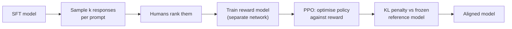

import TOCInline from '@theme/TOCInline';

# Preference Tuning: DPO & Friends

<TOCInline toc={toc} minHeadingLevel={2} maxHeadingLevel={2} />

:::tip[In this guide]
SFT teaches a plausible answer; preference tuning teaches which of two answers
is better. This page covers the RLHF pipeline you will probably never run, DPO
which you might, the ORPO and KTO and GRPO alternatives, how preference data is
actually collected and what it costs, and the large set of cases where a better
prompt or a filter gets you the same result for nothing.
:::

## What Is It?

Preference tuning is a second training stage after SFT that optimises against
*comparisons* rather than against single correct answers.

SFT's loss asks: how likely is this exact target given this prompt? It has no
way to express "both of these are valid, but the first is better." Preference
tuning's loss asks exactly that: raise the likelihood of the chosen response
relative to the rejected one.

| Stage | Data | Teaches |
| --- | --- | --- |
| SFT | `(prompt, response)` | What a valid response looks like |
| Preference tuning | `(prompt, chosen, rejected)` | Which valid response is better |

## Why Does It Matter?

Because SFT has a structural ceiling on anything involving taste.

Take a support reply. There are hundreds of correct answers to "my package is
late." SFT trained on one of them pushes the model toward that exact phrasing,
and gives you no mechanism to say "shorter is better," "do not apologise three
times," or "never promise a delivery date you cannot verify." You could try to
encode those as more SFT examples, but you are demonstrating a rule by example
and hoping it generalises.

Preference data expresses the rule directly, because a human comparing two
plausible answers applies their judgement to exactly the axis you care about.
The practical signature of a problem that needs preference tuning: **your
reviewers agree the output is acceptable but keep saying "the other one was
better," and they struggle to say why.** That is taste, and taste is what
comparisons capture.

## The RLHF Pipeline, and Why You Will Not Run It

The original approach, as used to turn base models into chat models:



It works, and it is how the frontier labs did it. It is also:

- **Four models in memory at once** — policy, reference, reward model, value
  head. Memory and orchestration both get ugly.
- **Genuinely unstable.** PPO has its own hyperparameters and the failure modes
  are reinforcement-learning failure modes, which are harder to debug than
  supervised ones.
- **Dependent on a good reward model**, which needs tens of thousands of
  comparisons to train, and which the policy will then learn to exploit.

Unless you are doing alignment research, know the diagram, understand that the
KL penalty is what stops the policy drifting into gibberish that happens to
score well, and use DPO instead.

## DPO

Direct Preference Optimization's insight: the optimal policy under an RLHF
objective has a closed-form relationship to the reward model. So you can skip
the reward model entirely and optimise the preference objective directly as a
classification-style loss on pairs.

What you need: the SFT model (which becomes both the thing you train and, as a
frozen copy, the reference), and preference pairs. No reward model, no PPO, no
sampling loop. It is roughly as easy to run as SFT.

The data shape:

```json
{"prompt": "My package is three days late and I need it tomorrow.", "chosen": "I can see order 4471 is delayed in transit. I've flagged it for priority handling and you'll get a tracking update within 2 hours. I can't guarantee tomorrow, but I'll tell you as soon as we have a firm date.", "rejected": "I'm so sorry to hear that! I completely understand how frustrating this must be. Let me look into this for you right away. I'm sure we can get this sorted out and have it to you by tomorrow!"}
```

Read that pair carefully, because it is doing more work than it looks. The
rejected response is not wrong, badly written, or unhelpful-sounding. It is
longer, more effusive, and promises something it cannot verify. That is the
axis being taught. **Good preference pairs differ on one dimension**; pairs
where the rejected response is simply broken teach nothing that SFT could not,
because the model already assigns it low probability.

```python
from __future__ import annotations

import torch
from datasets import load_dataset
from peft import LoraConfig
from transformers import AutoModelForCausalLM, AutoTokenizer
from trl import DPOConfig, DPOTrainer

# Start from the SFT checkpoint, not the raw base model. DPO refines a model
# that already produces acceptable answers; it cannot teach the task.
SFT_MODEL = "runs/triage-qlora-r16-v3/merged"

tok = AutoTokenizer.from_pretrained(SFT_MODEL)
model = AutoModelForCausalLM.from_pretrained(
    SFT_MODEL, dtype=torch.bfloat16, device_map="auto"
)

# Columns: prompt, chosen, rejected.
ds = load_dataset(
    "json",
    data_files={"train": "data/prefs_train.jsonl",
                "validation": "data/prefs_val.jsonl"},
)

cfg = DPOConfig(
    output_dir="runs/triage-dpo-v1",

    # The central knob. Controls how far the policy may drift from the
    # reference. Low (0.01-0.05): aggressive, learns preferences fast, risks
    # degeneration. High (0.3-0.5): conservative, barely moves. 0.1 is the
    # standard starting point.
    beta=0.1,

    # An order of magnitude below SFT. DPO on an already-good model needs
    # small steps; 2e-4 here will wreck it.
    learning_rate=5e-6,
    lr_scheduler_type="cosine",
    warmup_ratio=0.1,

    # 1 epoch. DPO overfits preference data much faster than SFT overfits
    # demonstrations. Two epochs is often already too many.
    num_train_epochs=1,

    per_device_train_batch_size=1,
    gradient_accumulation_steps=16,
    # Prompt and completion lengths are separate limits here.
    max_length=1024,
    max_prompt_length=512,

    bf16=True,
    gradient_checkpointing=True,
    eval_strategy="steps",
    eval_steps=50,
    logging_steps=10,
    report_to=["wandb"],
)

trainer = DPOTrainer(
    model=model,
    # ref_model=None with a PEFT config: the adapter is disabled to act as the
    # reference, which halves memory versus holding a second full model.
    ref_model=None,
    args=cfg,
    train_dataset=ds["train"],
    eval_dataset=ds["validation"],
    processing_class=tok,
    peft_config=LoraConfig(
        r=16, lora_alpha=32, lora_dropout=0.05,
        target_modules=["q_proj", "k_proj", "v_proj", "o_proj"],
        task_type="CAUSAL_LM",
    ),
)

trainer.train()
trainer.save_model("runs/triage-dpo-v1/adapter")
```

Watch two metrics that SFT does not have:

| Metric | Healthy | Warning sign |
| --- | --- | --- |
| `rewards/accuracies` | Rises to 0.65–0.85 | Stuck at 0.5 means no signal; above 0.95 means the pairs are trivially separable |
| `rewards/margins` | Grows steadily | Explodes upward while generation quality falls — you are drifting from the reference |

:::note
`trl`'s preference trainers have moved fast. `beta` placement, `ref_model`
handling, length-argument names, and which trainers exist at all have changed
across releases. Pin your version and read the installed config signature.
:::

## Alternatives

| Method | Data needed | Appeal | Cost |
| --- | --- | --- | --- |
| DPO | Preference pairs | The default. Well understood, widely supported, stable. | Requires an SFT stage first |
| ORPO | Preference pairs | Single stage — folds SFT and preference learning into one loss with an odds-ratio penalty on the rejected response. Skips a whole training run. | Less battle-tested; you lose the ability to evaluate the SFT model separately |
| KTO | Single examples labelled good or bad | No pairs needed. Production thumbs-up/thumbs-down data works directly, and you can use unbalanced data. | Weaker signal per example than a pair |
| SimPO | Preference pairs | Length-normalised, reference-free. Attacks DPO's verbosity bias directly and uses less memory. | Newer, fewer reports from production |
| GRPO | A verifiable reward function | For tasks with a programmatic correctness check — code that compiles and passes tests, maths with a known answer, JSON that validates. No human labels at all. | Only applies when correctness is checkable in code |

Choosing between them is mostly a data question, not a quality question:

- **You have pairs and an SFT model** → DPO.
- **You have pairs and want one training stage** → ORPO.
- **You have thumbs up/down from production** → KTO. This is the most
  underused option, because that data already exists in most products.
- **Your output can be programmatically scored** → GRPO. If you can write
  `assert` statements about correctness, you do not need human preferences at
  all, and this is a strong path.
- **Verbosity creep is your specific problem** → SimPO, or DPO with explicit
  length controls.

## Collecting Preference Data

| Source | Cost | Quality | Notes |
| --- | --- | --- | --- |
| Pairwise human comparison | High | Highest | 100–400 comparisons per annotator-day on short outputs; much less on long ones |
| Expert comparison in a specialist domain | Very high | Highest where it matters | Often the only way; a clinician's hour is not a crowdworker's hour |
| AI feedback (a stronger model judges) | Low | Decent, with caveats | Inherits the judge's biases, including its own length and style preferences |
| Production implicit signals | Near zero | Noisy but real | The user kept the draft, copied the answer, did not retry, resolved the ticket |
| Production explicit signals | Near zero | Sparse but honest | Thumbs up/down. Use KTO; these are rarely paired |
| Edit distance from a human correction | Low | Very good | The original is rejected, the human-edited version is chosen. Underrated. |

Annotation cost reality: a pairwise comparison on two paragraph-length
responses takes a careful annotator 30–90 seconds. Call it 300 comparisons per
day, so 3,000 pairs is roughly two annotator-weeks, plus the time to write
guidelines and measure inter-annotator agreement. Measure that agreement — if
two annotators disagree 40% of the time, your preference axis is not defined
well enough to train on, and no amount of data fixes that.

The cheapest high-quality source most teams already have and ignore: **human
edits**. Any product where a person reviews and amends model output is
generating preference pairs for free. The pre-edit version is `rejected`, the
shipped version is `chosen`, and the difference is exactly the correction you
want to learn.

## Hyperparameters That Matter

| Parameter | Start | Effect |
| --- | --- | --- |
| `beta` | 0.1 | The KL leash. Lower learns preferences harder and risks degeneration; higher stays close to the reference and may barely move |
| `learning_rate` | `5e-6` | An order of magnitude below SFT. DPO is a refinement step |
| `num_train_epochs` | 1 | DPO overfits fast. If you need more than 1, suspect your data |
| Reference model | The SFT checkpoint | Must be the model you started from. A mismatched reference makes the KL term meaningless |

`beta` is the one to understand. The DPO objective balances "prefer chosen over
rejected" against "stay near the reference model." `beta` sets the exchange
rate. Push it to 0.01 and the model will satisfy your preference axis while
quietly losing fluency and diversity, because nothing is holding it near a
model that spoke well. Raise it to 0.5 and the KL term dominates and you have
trained nothing. When generation quality degrades while `rewards/margins`
looks great, raise `beta` before anything else.

On the reference model: with a PEFT config, `ref_model=None` lets `trl` use the
adapter-disabled base as the reference, which is both correct and cheap. If you
pass a *different* model as reference, the KL penalty is measuring drift from
something you never trained toward and the objective stops meaning what you
think.

## Failure Modes

| Failure | What it looks like | Mitigation |
| --- | --- | --- |
| Length bias / verbosity creep | Responses get steadily longer; the model learned "longer won" because annotators mildly prefer thorough-looking answers | Length-control annotation guidelines, length-matched pairs, SimPO, or explicit length penalties. Plot mean output length per checkpoint — always. |
| Reward hacking | Optimises a proxy of what you wanted: hedging more, adding disclaimers, restating the question | Human review of samples, not just metrics. The proxy is always narrower than the intent. |
| Over-refusal | Refuses benign requests because rejected examples skewed toward "answered something it shouldn't" | Include pairs where the chosen response *does* answer; measure refusal rate on a benign set |
| Diversity collapse | Every answer has the same opening, structure and cadence. Metrics fine, product bland. | Raise `beta`, fewer steps, check for annotator template effects |
| Sycophancy | Agrees with the user's premise even when wrong | Include pairs where chosen politely disagrees |
| Degeneration | Repetition, broken formatting, trailing fragments | `beta` too low. Raise it. This is the classic signature of too little KL. |
| Capability regression | Lost something it could do before, on a task you never trained | Run the SFT regression suite again after DPO. People skip this and ship regressions. |

The two to internalise: **length bias and degeneration**. Length bias is nearly
universal, it is easy to detect (plot mean output length by checkpoint), and it
will make your model worse while every metric improves. Degeneration is the
`beta`-too-low signature and it is also easy to spot if you are reading
generations.

## When Preference Tuning Is Actually The Right Tool

It is genuinely right when:

- Many outputs are valid and the difference between them is judgement, not
  correctness.
- Reviewers consistently prefer one option but cannot articulate a rule you
  could write into a prompt.
- You already have preference signal — edits, thumbs, A/B outcomes — sitting in
  your logs.
- Correctness is programmatically verifiable and you want to optimise against
  it directly. That is GRPO, and it is the cleanest case in the family.
- You are trying to reduce a specific measured behaviour, like verbosity or
  over-hedging, and SFT on shorter examples has not moved it.

It is the wrong tool, and the following get you the same result for a fraction
of the cost, when:

| Situation | Do this instead |
| --- | --- |
| The rule is articulable | Put it in the prompt. "Never promise a date you cannot verify" is one line. |
| Bad outputs are detectable in code | Filter or reject at generation time. A validator is free, instant, and 100% reliable. |
| You can score candidates | Best-of-n sampling with a rubric-based scorer. No training, works immediately, and it is a strict upgrade you can turn off. |
| You have not done SFT yet | Do SFT. DPO cannot teach the task, only refine it. |
| Your SFT data is inconsistent | Fix the SFT data. Preference tuning on top of a confused model amplifies the confusion. |
| You have fewer than ~500 pairs | Not enough signal. Spend the effort on better SFT examples. |

The honest summary: for most product teams, a rubric-based filter plus a
clearer prompt plus clean SFT data captures most of what preference tuning
would, at a tiny fraction of the cost and with none of the failure modes. The
cases where it genuinely wins are real but narrower than the literature's
prominence suggests. Reach for it when you have measured that the alternatives
fell short — and note that a rubric filter is instantly reversible while a DPO
checkpoint is not.

## Evaluating a Preference-Tuned Model

Eval loss is close to useless here. The training objective is relative, so
evaluate relatively: **pairwise comparison against the SFT baseline.**

```python
import itertools
import random
from dataclasses import dataclass


@dataclass
class Verdict:
    winner: str  # "dpo", "sft", or "tie"


def pairwise_eval(
    prompts: list[str],
    gen_sft,
    gen_dpo,
    judge,
    seed: int = 7,
) -> dict[str, float]:
    """Win rate of DPO vs SFT with position randomisation."""
    rng = random.Random(seed)
    tally = {"dpo": 0, "sft": 0, "tie": 0}

    for prompt in prompts:
        a, b = gen_sft(prompt), gen_dpo(prompt)
        # Judges have a strong position bias. Randomise, or your win rate is
        # measuring which slot you put the candidate in.
        flipped = rng.random() < 0.5
        left, right = (b, a) if flipped else (a, b)
        choice = judge(prompt, left, right)  # "left" | "right" | "tie"

        if choice == "tie":
            tally["tie"] += 1
        else:
            picked_left = choice == "left"
            is_dpo = picked_left == flipped
            tally["dpo" if is_dpo else "sft"] += 1

    n = len(prompts)
    return {k: v / n for k, v in tally.items()}
```

Four rules that make the number trustworthy:

1. **Randomise position.** Judges — human and model — prefer whichever side
   they see first or last. Without randomisation you are measuring slot order.
2. **Same decoding parameters for both.** Temperature, top-p, max tokens,
   seed. A win from a different temperature is not a win.
3. **Report ties.** A 40/20/40 split means your preference tuning changed
   little. A 55/5/40 split is a real effect. Collapsing ties hides that.
4. **Track output length alongside the win rate.** If the win rate went up 12
   points and mean length went up 60%, you have probably measured the judge's
   length bias rather than a quality improvement.

Then run your SFT regression suite again. Preference tuning is a second
opportunity to lose a capability you did not mean to touch, and the only way
you find out is by testing things you did not train on.

## Common Mistakes

- Running DPO on a base model instead of an SFT checkpoint. It refines; it cannot teach.
- Preference pairs where the rejected response is simply broken. Those teach nothing SFT did not.
- Using an SFT-magnitude learning rate. `2e-4` will destroy a DPO run.
- Leaving `beta` at 0.01 "to learn faster," then getting repetitive degenerate output.
- Not plotting output length per checkpoint, then shipping verbosity creep as a quality win.
- Evaluating with eval loss instead of pairwise comparison.
- Judging without position randomisation, producing a win rate that measures layout.
- Skipping the regression suite after DPO because you already ran it after SFT.
- Reaching for preference tuning when the rule was one sentence you could have put in the prompt.
- Training on 200 pairs and concluding the method does not work.

## Interview Questions

- What does preference tuning teach that SFT structurally cannot?
- Sketch the RLHF pipeline and explain what the KL penalty is for.
- What is DPO's key insight, and what does it let you remove?
- What does `beta` control, and what happens at 0.01 versus 0.5?
- Which model should be the reference, and what breaks if it is the wrong one?
- You have thumbs up/down from production, not pairs. Which method and why?
- When would GRPO be a better fit than DPO?
- What is length bias, how do you detect it, and how do you mitigate it?
- You get a 70% win rate over the SFT baseline. What three things would make you distrust that number?
- Name two situations where preference tuning is the wrong tool and say what you would do instead.

## Things to Remember

- SFT teaches a valid answer; preference tuning teaches which valid answer is better.
- DPO removes the reward model and the RL loop. That is why it is the default.
- Start from an SFT checkpoint, at roughly `5e-6`, for one epoch.
- `beta` is the KL leash. Degeneration means raise it.
- Good pairs differ on one axis. Broken rejected responses teach nothing.
- Human edits are free preference pairs most teams throw away.
- Plot output length every checkpoint. Length bias is the default failure.
- Evaluate by pairwise comparison with randomised positions, and report ties.
- A rubric filter plus a clearer prompt matches preference tuning in most product cases, and is reversible.

## Mini Exercise

Take 30 prompts from a task you know and generate two responses each with
different temperatures or different system prompts. Label which you prefer and,
critically, write one sentence on *why* for each pair.

Then read your 30 reasons and group them. If they collapse to two or three
recurring rules, write those rules into the system prompt, re-generate, and
measure whether the issue disappeared. That is the cheap path, and it works
more often than people expect.

If the reasons do not collapse into articulable rules — if your notes keep
saying "the second one just reads better" — you have found a genuine
preference-tuning case. Write those 30 pairs as a JSON-lines file in DPO shape,
and note how long collecting 30 took you. Multiply by 100 for the real dataset.
That number is the decision.

## Done When

- [ ] You can explain what preference data expresses that SFT data cannot.
- [ ] You can describe the RLHF pipeline and say why DPO replaced it for most people.
- [ ] You can write a DPO pair that differs on exactly one axis.
- [ ] You can explain `beta` and name the symptom that tells you to raise it.
- [ ] You can pick between DPO, ORPO, KTO and GRPO from a description of the available data.
- [ ] You can run a pairwise evaluation against the SFT baseline with randomised positions and reported ties.
- [ ] You can name two cheaper alternatives and the conditions under which you would use them instead.
