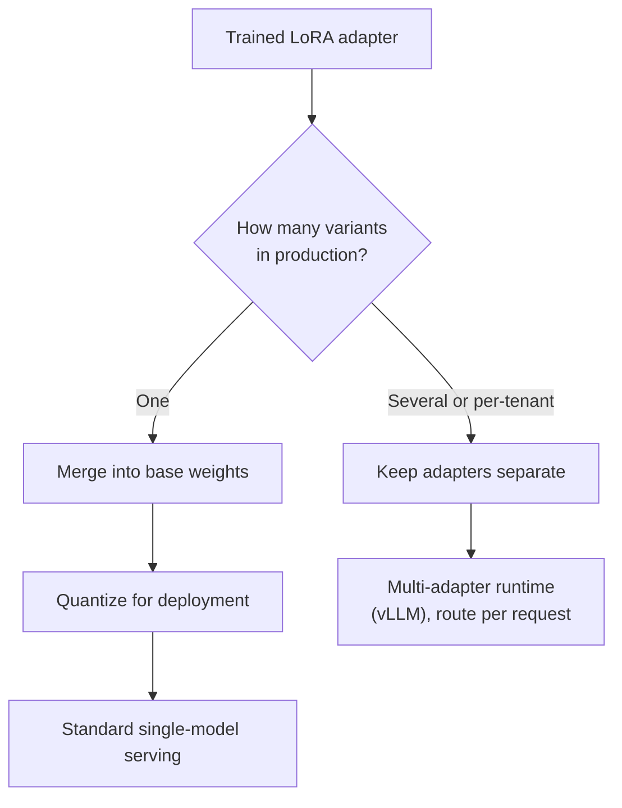
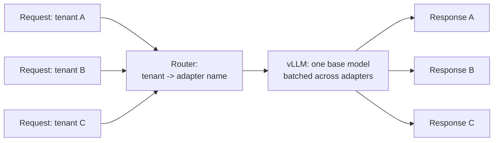
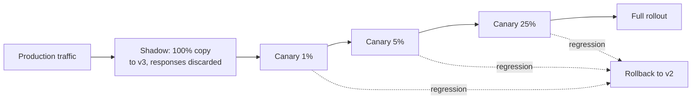

import TOCInline from '@theme/TOCInline';

# Serving Fine-Tuned Models

<TOCInline toc={toc} minHeadingLevel={2} maxHeadingLevel={2} />

:::tip[In this guide]
The question people postpone until the adapter exists: where does this actually
run? Adapter versus merged weights, vLLM and TGI and Ollama with concrete
commands, multi-tenant adapter serving and the memory maths behind it,
post-training quantization, registry and lineage, canary rollout, and the cost
comparison that decides whether the whole project succeeded.
:::

## What Is It?

Serving is everything between "the adapter finished training" and "requests are
being answered in production." It is where fine-tuning projects quietly die.

The reason is a mismatch in assumptions. Training produces a 40MB adapter that
only works with one specific base model at one specific precision, rendered
with one specific chat template. Production has an OpenAI-compatible endpoint, a
latency budget, a cost target, autoscaling, and a rollback requirement. Nothing
about the training output satisfies any of that. Bridging it is a week or two of
work that nobody put in the plan.

## Why Does It Matter?

Because the thing that justified the project was almost always a serving
property. You fine-tuned a small model to reduce cost per request, or to cut
latency, or to run on your own hardware. None of those are properties of the
adapter — they are properties of the deployment.

A fine-tune that beats the baseline on quality but costs more per request than
the hosted model it replaced is a failed project. You find that out at the
serving stage, which is an argument for sketching the serving plan before you
train, not after.

## Adapters or Merged Weights



| Dimension | Merged weights | Separate adapters |
| --- | --- | --- |
| GPU memory | One full model per variant | One base model plus ~40MB per adapter |
| Multi-tenancy | Impossible without N full models | The whole point — hundreds of adapters on one base |
| Swap cost | Full model reload, tens of seconds | Milliseconds to seconds; often already resident |
| Inference overhead | None — it is just a model | Small per-token cost for the adapter matmuls, typically a few percent |
| Quantization path | Standard: GPTQ, AWQ, GGUF all work | Harder; most quantizers expect merged weights |
| Runtime support | Everything | vLLM, TGI, LoRAX, and a few others |
| Artefact size | Tens of GB | Tens of MB |
| Rollback | Redeploy a different model | Change an adapter name in a request |
| Debuggability | Simple | Need to know which adapter served which request |

The decision collapses to one question: **do you serve one variant or many?**

One variant, high traffic → merge. You get the simplest serving path, every
quantization and runtime works, and you avoid per-token adapter overhead.

Many variants — per customer, per task, per experiment → keep adapters
separate. The memory maths is overwhelming and nothing else comes close.

## Merging an Adapter

```python
from __future__ import annotations

import torch
from peft import PeftModel
from transformers import AutoModelForCausalLM, AutoTokenizer

BASE = "Qwen/Qwen2.5-7B-Instruct"
ADAPTER = "runs/triage-qlora-r16-v3/adapter"
OUT = "models/triage-v3-merged"

# CRITICAL: load the base in bf16, NOT 4-bit, even though you trained with
# QLoRA. See the warning below.
base = AutoModelForCausalLM.from_pretrained(
    BASE,
    dtype=torch.bfloat16,
    device_map="cpu",      # CPU is fine and avoids VRAM limits when merging
)

model = PeftModel.from_pretrained(base, ADAPTER)

# Folds W' = W + (alpha/r) * B @ A into the base weights and drops the
# adapter modules. The result is an ordinary causal LM.
merged = model.merge_and_unload()

merged.save_pretrained(OUT, safe_serialization=True)
AutoTokenizer.from_pretrained(BASE).save_pretrained(OUT)
```

:::warning
**The QLoRA merge trap.** You trained with a 4-bit NF4 base, so the obvious
move is to load the base in 4-bit to merge. Do not. Merging `bf16` adapter
weights into dequantized-then-requantized 4-bit weights compounds quantization
error and measurably degrades quality, sometimes badly.

The correct sequence is: load the base in `bf16` or `fp16`, merge the adapter,
save, *then* quantize the merged model with a proper post-training quantizer
(AWQ, GPTQ, or GGUF). Quantize once, at the end, with a method designed for it.
Then re-run your evaluation on the quantized artefact, because the thing you
evaluated is not the thing you are about to serve.
:::

Always copy the tokenizer alongside the merged model. A merged model with the
wrong tokenizer or a missing chat template produces output that looks like a
bad fine-tune and is actually a packaging bug.

## Serving Options

### vLLM with LoRA adapters

The default for self-hosted GPU serving. High throughput via continuous
batching and paged attention, OpenAI-compatible API, and first-class
multi-adapter support.

```bash
# Serve the base model with named adapters loaded at startup.
vllm serve Qwen/Qwen2.5-7B-Instruct \
  --enable-lora \
  --max-loras 8 \
  --max-lora-rank 16 \
  --lora-modules \
      triage-v3=/models/adapters/triage-v3 \
      summarise-v2=/models/adapters/summarise-v2 \
  --max-model-len 4096 \
  --port 8000
```

Route per request by using the adapter name where you would name a model:

```python
from openai import OpenAI

client = OpenAI(base_url="http://localhost:8000/v1", api_key="not-used")

resp = client.chat.completions.create(
    # The adapter name, not the base model name. This is the routing switch.
    model="triage-v3",
    messages=[{"role": "user", "content": "My card was charged twice."}],
    temperature=0.0,
)
print(resp.choices[0].message.content)
```

`--max-loras` caps how many adapters are active in GPU memory at once; the
runtime swaps others in from host memory on demand. `--max-lora-rank` must be
at least the rank you trained with, or loading fails. Newer vLLM versions also
expose a runtime endpoint for loading and unloading adapters without a restart,
which is what makes "deploy a new adapter" a sub-second operation instead of a
rolling restart.

### TGI

Hugging Face's Text Generation Inference. Comparable throughput, also supports
adapters, and worth considering if you are already in the Hugging Face
ecosystem or want their enterprise support path. The practical difference for
most teams is ecosystem preference rather than capability.

```bash
docker run --gpus all -p 8080:80 \
  -v /models:/data \
  ghcr.io/huggingface/text-generation-inference:latest \
  --model-id Qwen/Qwen2.5-7B-Instruct \
  --lora-adapters triage-v3=/data/adapters/triage-v3
```

### GGUF and Ollama

For local development, laptop demos, CPU inference, or edge deployment. Convert
the *merged* model to GGUF, quantize it, and wrap it in a `Modelfile`.

```bash
# llama.cpp provides the conversion and quantization tools.
python llama.cpp/convert_hf_to_gguf.py \
  models/triage-v3-merged \
  --outfile triage-v3-f16.gguf \
  --outtype f16

# Q4_K_M is the usual quality/size compromise; Q5_K_M if you have the room.
./llama.cpp/llama-quantize \
  triage-v3-f16.gguf \
  triage-v3-q4_k_m.gguf \
  Q4_K_M
```

The `Modelfile` is where the chat template and stop tokens live. Getting it
wrong here is the most common reason a fine-tune "works in training and not in
Ollama."

```text
FROM ./triage-v3-q4_k_m.gguf

TEMPLATE """{{ if .System }}<|im_start|>system
{{ .System }}<|im_end|>
{{ end }}{{ if .Prompt }}<|im_start|>user
{{ .Prompt }}<|im_end|>
{{ end }}<|im_start|>assistant
{{ .Response }}<|im_end|>
"""

PARAMETER stop "<|im_end|>"
PARAMETER stop "<|im_start|>"
PARAMETER temperature 0.0

SYSTEM """You are a support triage assistant. Reply with one label."""
```

```bash
ollama create triage-v3 -f Modelfile
ollama run triage-v3 "My card was charged twice for order 8812."
```

That `TEMPLATE` block must match what you trained with, token for token. Render
one training example with `apply_chat_template` and diff it against what Ollama
produces before you blame the fine-tune.

| Option | Best for | Avoid when |
| --- | --- | --- |
| vLLM | Self-hosted GPU production, multi-adapter, high throughput | You have no GPU |
| TGI | Same, if you prefer the Hugging Face stack | — |
| Ollama / llama.cpp | Local dev, demos, CPU, edge | Concurrent production traffic |
| Hosted fine-tune API | You want zero infrastructure | You fine-tuned to cut cost — check the per-token rate first |

## Multi-Adapter Serving

This is the pattern that makes fine-tuning economically interesting, and it is
worth seeing the numbers.

Fifty customers, each wanting behaviour tuned to their domain, on a 7B model:

| Approach | GPU memory | GPUs needed (80GB) |
| --- | --- | --- |
| 50 merged `bf16` models | 50 x 14 GB = 700 GB | 9+ |
| 50 merged AWQ 4-bit models | 50 x 4 GB = 200 GB | 3 |
| 1 base + 50 LoRA adapters at `r=16` | 14 GB + 50 x 0.04 GB = 16 GB | 1 |

One GPU instead of nine. That is not an optimisation, it is a different
business model — it is what makes per-customer fine-tuning viable as a product
feature rather than an enterprise-tier special case.



The subtlety that makes it work: modern runtimes batch requests using
*different* adapters into the same forward pass. Without that you would
serialise per adapter and throughput would collapse. With it, the marginal cost
of adapter 51 is 40MB and a routing table row.

Three things to get right:

- **Routing is your code.** Map tenant or task to adapter name, with a
  documented default when no adapter exists. A missing adapter must fall back to
  the base model, not 500.
- **Respect `--max-loras`.** Beyond that count, adapters swap from host memory.
  It is fast but not free; if your traffic cycles across 200 adapters evenly,
  measure the swap cost under load before promising a latency SLA.
- **Attribute requests to adapter versions.** Log the adapter name and version
  on every request. Without it, debugging "customer B's answers got worse" is
  guesswork.

## Quantizing After Fine-Tuning

Merged, you have a `bf16` model: 14GB for 7B. Quantizing for deployment is
usually worth it, but it is a quality decision and must be measured.

| Format | Bits | Size (7B) | Use for |
| --- | --- | --- | --- |
| `bf16` | 16 | ~14 GB | The reference you measure everything against |
| AWQ | 4 | ~4 GB | GPU serving; activation-aware, generally preserves quality well |
| GPTQ | 4 | ~4 GB | GPU serving; mature tooling, needs a calibration set |
| GGUF Q5_K_M | ~5 | ~5 GB | CPU and Ollama, when quality matters more than size |
| GGUF Q4_K_M | ~4 | ~4 GB | CPU and Ollama default compromise |

Two rules. **Quantize the merged model, not during training**, for the reason
in the warning above. And **re-evaluate after quantizing**, on the same frozen
eval set, because a fine-tune's gains can sit in exactly the behaviours
quantization perturbs.

What to measure on the quantized artefact:

- Task metric versus the `bf16` merged model. A 1–2 point drop is normal and
  usually acceptable; 5+ means try a different method or more bits.
- Format validity, specifically. Structured output degrades under quantization
  more than prose does, and format adherence is often what you fine-tuned for.
- Output length distribution. A shift usually means a stop-token probability
  moved.
- Latency and throughput, which is the reason you did it.

## Versioning and Lineage

A fine-tuned model is a function of four inputs. If you cannot name all four
for a deployed artefact, you cannot reproduce it, debug it, or safely roll it
back.

```json
{
  "name": "triage-v3",
  "created": "2025-01-14T09:22:11Z",
  "base_model": "Qwen/Qwen2.5-7B-Instruct",
  "base_revision": "a1b2c3d4e5f6a7b8c9d0e1f2a3b4c5d6e7f8a9b0",
  "dataset": {
    "uri": "s3://ml-data/triage/v7/",
    "sha256": "9f2c...e81a",
    "train_rows": 4210,
    "val_rows": 468
  },
  "training": {
    "method": "qlora-sft",
    "config_uri": "s3://ml-runs/triage-v3/run.json",
    "lora_rank": 16,
    "epochs": 3,
    "commit": "repo@7d41f90"
  },
  "artifacts": {
    "adapter": "s3://ml-models/triage-v3/adapter/",
    "merged_awq": "s3://ml-models/triage-v3/awq/"
  },
  "eval": {
    "suite": "triage-eval-v2",
    "format_validity": 0.991,
    "label_accuracy": 0.943,
    "baseline_label_accuracy": 0.871,
    "regression_suite_passed": true
  },
  "status": "canary",
  "replaces": "triage-v2",
  "rollback_to": "triage-v2"
}
```

Conventions that save pain:

- **Immutable, incrementing names.** `triage-v3`, never `triage-latest`.
  Mutable names make "which version answered this request" unanswerable.
- **Base model pinned by revision SHA.** Hub repos are updated in place. A
  lineage record with only a model name is incomplete.
- **Dataset by content hash.** "The dataset in that folder" changes.
- **Eval results stored with the artefact**, including the baseline number, so
  the comparison travels with the model.
- **An explicit `rollback_to`.** Decided in advance, while calm. Rollback must
  be one command, and for adapters it genuinely can be.

## Canary and Shadow Rollout

Your offline eval set is a few hundred cases. Production is a different
distribution, and you will learn that the hard way unless you roll out
gradually.

**Shadow** sends a copy of real traffic to the new checkpoint and discards its
responses. No user risk at all. You get real-distribution quality comparisons,
real latency numbers, and real error rates. The limitation: no user-behaviour
signal, because nobody saw the output. Run shadow first for any significant
change.

**Canary** routes a small share of live traffic — 1%, then 5%, then 25% — to
the new checkpoint. You now get the signals that matter and cannot be
simulated: retry rate, escalation rate, thumbs, whether the user kept the
draft.



Compare the canary against **the current production model, on the same traffic
in the same window** — not against your offline numbers and not against last
week. Traffic mix shifts and that comparison will mislead you.

Decide the abort criteria before you start, and write them down:

| Signal | Example abort threshold |
| --- | --- |
| Format validity | Any drop below the production baseline |
| Task metric on sampled live traffic | More than 2 points below production |
| p95 latency | More than 20% above production |
| Error / exception rate | Any increase |
| User retry or escalation rate | Any statistically meaningful increase |
| Safety flag rate | Any increase at all |

For adapters, rollback is removing an adapter name from the routing table.
Measure that path once, before you need it, so you know it takes seconds.

## The Number That Decides Everything

Most fine-tunes are justified by cost or latency. So compute the comparison
honestly, against the hosted baseline you were actually using:

| Metric | Hosted baseline | Self-hosted fine-tune |
| --- | --- | --- |
| Input tokens per request | Long prompt with instructions and few-shot | Shorter — instructions are in the weights |
| Output tokens per request | Measure | Measure; often shorter too |
| Cost per 1k requests | Tokens x published rate | GPU hourly cost / requests per hour |
| p50 / p95 latency | Measure under real concurrency | Measure under real concurrency |
| Throughput ceiling | Provider rate limits | Your GPU, measured at your sequence lengths |
| Fixed cost | Zero | GPU, whether or not traffic arrives |
| Engineering cost | Near zero | Serving, monitoring, registry, migrations |

The self-hosting break-even is driven almost entirely by **utilisation**. A GPU
costs the same idle as busy. At high steady traffic, self-hosted inference is
dramatically cheaper per request than a hosted frontier model. At low or spiky
traffic, a rented GPU sitting at 5% utilisation is more expensive than the API
you replaced — and you have taken on the operational burden too.

Three mistakes in this calculation, all common:

1. **Forgetting prompt shrinkage.** If the fine-tune removed 1,500 tokens of
   instructions from every request, that is a real saving on the hosted side of
   the comparison too. Count it.
2. **Measuring latency at concurrency 1.** Under real batching, throughput and
   p95 look very different. Load test.
3. **Ignoring the engineering line.** Serving, monitoring, and the next base
   model migration are recurring costs. If the inference saving is a few hundred
   dollars a month and the maintenance is a week per quarter, the project lost
   money.

Write this table down with real numbers. It is the artefact that tells you
whether the project succeeded, and it is the one your manager will ask for.

## Deployment Checklist

- [ ] Decided merged versus adapter, with the reason recorded.
- [ ] If merged from QLoRA, the base was loaded in `bf16` for the merge.
- [ ] Tokenizer and chat template shipped with the artefact.
- [ ] Inference-time rendered prompt diffed against a training example — byte for byte.
- [ ] Stop tokens configured in the serving layer, and verified by a long generation.
- [ ] Quantized artefact re-evaluated on the frozen eval set, with the delta recorded.
- [ ] Registry entry with base revision, dataset hash, config, and eval results.
- [ ] Immutable version name; no mutable `latest` pointer in production routing.
- [ ] Adapter name and version logged on every request.
- [ ] Shadow traffic run, with quality and latency compared to production.
- [ ] Canary stages and abort thresholds agreed in writing.
- [ ] Rollback path tested end to end, with a measured time-to-rollback.
- [ ] Cost and latency comparison against the previous baseline, written down.
- [ ] Named owner for the next base model migration.

## Common Mistakes

- Merging a QLoRA adapter into a 4-bit base, degrading quality invisibly.
- Shipping the merged weights without the tokenizer or chat template.
- A serving-time template that differs from training by one newline, which looks exactly like a failed fine-tune.
- No stop token configured, so generations run to the token limit.
- Evaluating `bf16` and serving a 4-bit quantization without re-measuring.
- Mutable model names, making request-to-version attribution impossible.
- Merging when you have fifty tenants, and provisioning nine GPUs you did not need.
- Measuring latency at concurrency 1 and promising that number under load.
- No rollback plan, discovering during an incident that it is a 40-minute redeploy.
- Never computing the cost comparison, so nobody can say whether the project worked.

## Interview Questions

- When would you merge a LoRA adapter and when would you keep it separate?
- Why should you not merge an adapter into a 4-bit quantized base?
- Fifty tenants each need a tuned model. How do you serve that, and what is the memory maths?
- How does a runtime batch requests that use different adapters, and why does that matter?
- You fine-tuned to cut cost. What determines whether self-hosting is actually cheaper?
- What is the difference between shadow and canary, and what does each give you?
- What would you compare a canary against, and why not your offline eval numbers?
- A fine-tune works in training and produces nonsense in Ollama. What do you check first?
- What belongs in a model registry entry, and why does the base revision SHA matter?
- What is your rollback path, and how long does it take?

## Things to Remember

- One variant, high traffic → merge. Many variants → adapters.
- Merge in `bf16`, then quantize once with a proper quantizer, then re-evaluate.
- The template must match training byte for byte. Diff it; do not assume it.
- Multi-adapter serving turns nine GPUs into one. That is the economic case for fine-tuning.
- Quantizing after fine-tuning changes what you shipped. Measure it again.
- Immutable names, pinned base revision, dataset hash, config stored with the artefact.
- Shadow first, then canary at 1%, with abort thresholds agreed in advance.
- Self-hosting economics are a utilisation question. An idle GPU costs full price.
- If you never wrote down the cost comparison, you cannot claim the project succeeded.

## Mini Exercise

Take any small fine-tuned adapter you have — or train one on 100 examples in
ten minutes — and deploy it twice.

First as an adapter: run vLLM with `--enable-lora` and hit it via the
OpenAI-compatible client using the adapter name as the model. Confirm the base
model still answers when you pass the base name.

Then merged: merge in `bf16`, convert to GGUF, quantize to `Q4_K_M`, write a
`Modelfile` with the correct template and stop tokens, and run it in Ollama.
Send the same five prompts to both and diff the outputs.

Then do the part people skip: write the registry JSON for the artefact, with
base revision SHA, dataset hash, and your eval numbers. Note how much of it you
could not fill in from memory. That gap is the one that bites in three months.

## Done When

- [ ] You can justify merged versus adapter serving for a given deployment shape.
- [ ] You have merged an adapter correctly and know why the base must be `bf16`.
- [ ] You have served a fine-tune through vLLM with per-request adapter routing.
- [ ] You have exported to GGUF and run it in Ollama with a template that matches training.
- [ ] You can compute the multi-adapter memory argument for N tenants.
- [ ] You have a registry entry format with full lineage from base, dataset and config.
- [ ] You have a written canary plan with abort thresholds and a tested rollback.
- [ ] You have a real cost and latency comparison against the baseline you replaced.
