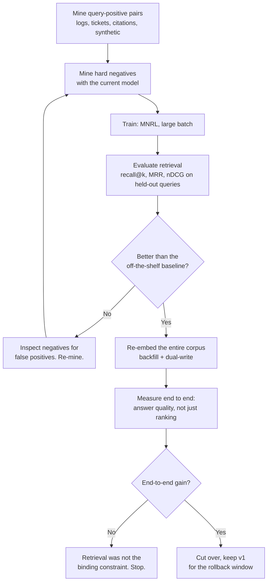
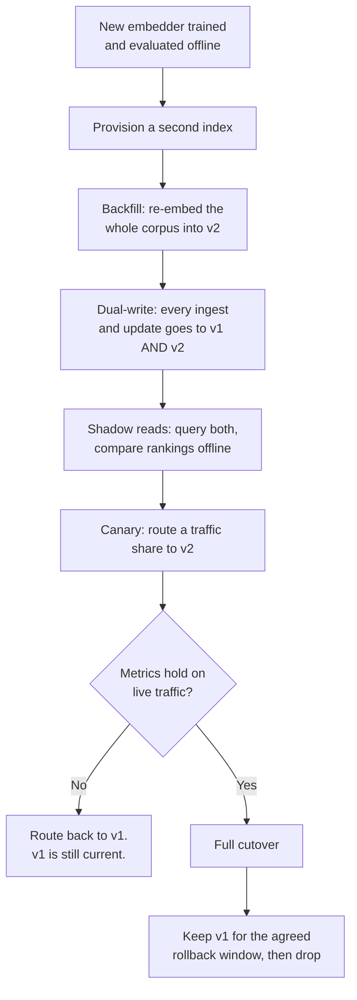

import TOCInline from '@theme/TOCInline';

# Fine-Tuning Embeddings & Rerankers

<TOCInline toc={toc} minHeadingLevel={2} maxHeadingLevel={2} />

:::tip[In this guide]
Most teams fine-tune the generator and leave the retriever untouched, which is
backwards. Retrieval is usually the bottleneck, embedding models are small, and
training takes minutes to hours. This page covers mining pairs and hard
negatives, the loss functions and what each demands, training an embedder and a
cross-encoder reranker, and the re-embedding migration nobody plans for.
:::

## What Is It?

Fine-tuning a retrieval model means continuing to train an embedding model, a
reranker, or both on query-document pairs from your own domain, so that *your*
queries retrieve *your* documents better.

Two model types, two different jobs:

| | Bi-encoder (embedder) | Cross-encoder (reranker) |
| --- | --- | --- |
| Input | Query and document encoded **separately** | Query and document encoded **together** |
| Output | A vector per text | A relevance score per pair |
| Precompute | Documents embedded once, offline | Nothing — scoring happens at query time |
| Query cost | One encode plus an index lookup | One forward pass **per candidate** |
| Scales to | Millions of documents | Tens of candidates |
| Role | First-stage recall over the whole corpus | Reordering a shortlist for precision |
| Typical size | 20M–500M parameters | 20M–500M parameters |

Most production stacks run both: the bi-encoder plus keyword search produces
50–100 candidates, the cross-encoder reorders them, and the top 5 go into the
prompt. Both are fine-tunable, and the reranker is often the better place to
start. See
[reranking and hybrid search](../06-advanced-rag/02-reranking-hybrid-search.mdx)
for the inference-side architecture; this page is about training them.

## Why Does It Matter?

This is the highest-return fine-tune most RAG teams never try, and the reason
is almost entirely attention: "fine-tuning" has become synonymous with
fine-tuning the generator.

| Factor | Generator fine-tune (7B) | Embedder fine-tune (110M) |
| --- | --- | --- |
| Where the errors come from | Downstream of retrieval | The usual bottleneck |
| Parameters | Billions | Tens to hundreds of millions |
| Training hardware | One 24GB GPU minimum, QLoRA | One modest GPU, often a full fine-tune |
| Training time | Hours to days | Minutes to a few hours |
| Data to see gains | 1,000–5,000 curated examples | A few thousand mined pairs, mostly automatic |
| Labour to build the data | Written or heavily curated by humans | Mined from logs plus synthetic generation |
| Typical gain on a domain corpus | A few points on the task metric | Often large on `recall@k`; double digits is common on a specialised corpus |
| Blast radius if it goes wrong | Behaviour, safety, formats | Ranking only |
| Reversibility | Redeploy, re-evaluate | Keep the old index, flip a pointer |

The arithmetic is simple: **if the right chunk is not in the top-k, no amount
of generator fine-tuning can recover it.** A fine-tuned generator on a retriever
that misses 30% of the time gives you well-formatted answers to questions it
could not see the evidence for.

The honest caveat: the gains are large when your corpus is genuinely
specialised — internal systems, a vertical domain, heavy acronym use, a
particular document genre. On general English prose a good off-the-shelf
embedder is already strong and the headroom is small. Measure before you assume.

## The Loop



## Why General Embedders Underperform on Your Corpus

A general-purpose embedder was trained on broad web-scale pairs. Three specific
mismatches follow.

**Domain vocabulary and acronyms the model never saw.** If your company writes
"TPR" for a form nobody outside the building has heard of, the model has no
useful representation for it — and worse than none, it has a *plausible* one.
`TPR` embeds near "true positive rate" because that is what the token sequence
meant in training data, so retrieval silently ranks machine-learning documents
above the form you wanted. Acronym collisions are the most common failure on
internal corpora and they are invisible without a labelled query set.

**Your users' actual phrasing.** Training pairs are typically well-formed
questions matched to clean passages. Real queries are terse, misspelt, full of
internal shorthand, often not questions — "card charged 2x order 8812", "vpn mac
sonoma", "refund window?". A model trained on "What is the refund policy for
returned items?" has not learned that "refund window?" is the same query.

**Query/document asymmetry.** Structural rather than lexical. A query is 5–15
tokens; a passage is 200–500. They come from different distributions and sit in
different regions of the space even when they match in meaning. A bi-encoder
trained on your pairs learns to bridge that gap for your query shapes and your
document shapes. Some models address it with asymmetric prefixes — a `query:`
prefix and a `passage:` prefix, or instruction-style prompts — and if your base
model uses them, **you must use the same prefixes at training and inference, on
the correct side each time.** Getting this wrong is a quiet ten-point recall loss
that looks like a failed fine-tune.

## Training Data

This section decides whether the project works. Everything else is mechanics.
The target format is minimal: a query, a known-relevant document, and ideally
some known-irrelevant-but-plausible documents.

```text
{"query": "card charged twice order 8812", "positive": "Duplicate charges occur when ...", "negatives": ["Refunds are issued to the original ...", "To update a saved card ..."]}
{"query": "vpn mac sonoma", "positive": "macOS 14 Sonoma requires the v9 client ...", "negatives": ["Windows VPN setup steps ...", "Mobile VPN profile install ..."]}
```

### Mining pairs from what you already have

You likely have more supervision than you think, sitting in systems nobody
thinks of as training data.

| Source | Pair construction | Caveats |
| --- | --- | --- |
| Search click logs | Query plus the clicked result | Position bias: users click rank 1 because it is rank 1. Down-weight or debias. |
| Thumbs-up on RAG answers | The query plus the chunks actually cited | Only usable if you log retrieved chunk IDs per answer |
| Support ticket resolutions | The customer's message plus the KB article the agent linked | Excellent quality — agent links are human relevance labels |
| Resolved issue threads | Title or first message plus the resolving comment | Noisy but plentiful |
| Existing FAQ pages | Question plus answer section | Clean, limited volume, and your users do not phrase things that way |
| Documentation anchors | Section heading plus section body | Weak supervision, nearly free, fine as a warm-up signal |
| Queries with no click | Treated as **hard cases**, not pairs | Your evaluation gold mine. Label them by hand. |

Two rules for mined data. **Log the chunk IDs you retrieved and the ones you
cited**, per request, from day one — without that you cannot build pairs from
feedback later. And **split by time**: train on earlier data, evaluate on later
data, because that is how the system is actually used.

### Synthetic query generation

With no logs — a new system, a fresh corpus — generate the queries. Take each
chunk, ask an LLM to write the questions it answers, use the pairs.

```python
from __future__ import annotations

import json

from openai import OpenAI

client = OpenAI()

PROMPT = """You are given a passage from internal documentation.

Write {n} questions that this passage directly and completely answers.

Rules:
- Each question must be answerable from THIS passage alone.
- Write them the way a hurried colleague would type into a search box:
  short, lowercase, often no question mark, sometimes keywords only.
- Use the acronyms and product names exactly as they appear in the passage.
- Do not invent facts, names or numbers that are not in the passage.
- Vary the specificity: some narrow, some broad.

Return a JSON object with a single key "queries" holding an array of strings.

Passage:
---
{passage}
---"""


def generate_queries(passage: str, n: int = 3) -> list[str]:
    resp = client.chat.completions.create(
        model="gpt-4o-mini",
        messages=[{"role": "user", "content": PROMPT.format(n=n, passage=passage)}],
        temperature=0.8,  # Some diversity is the point here.
        response_format={"type": "json_object"},
    )
    payload = json.loads(resp.choices[0].message.content or "{}")
    return [str(q).strip() for q in payload.get("queries", []) if str(q).strip()]
```

The prompt detail that matters most is the instruction to write queries the way
users actually type. Left to itself an LLM writes polished full-sentence
questions, you train on those, and you have taught the model to match a query
distribution you will never see in production.

Quality filtering, because raw synthetic pairs contain junk:

| Filter | Why |
| --- | --- |
| Round-trip retrieval | Embed the synthetic query with the *current* model. If the source chunk is not in the top 20, the query is probably unanswerable or malformed. |
| Specificity check | Drop queries so generic that dozens of chunks answer them ("what are the steps"). They create false negatives everywhere. |
| Deduplicate near-identical queries | Three paraphrases of one question triple that chunk's weight for no gain |
| Length bounds | Single-word queries and 60-word essays are both off-distribution |
| Human spot-check | Read 50. You will find a systematic prompt problem in ten minutes that would otherwise cost a training run. |

Synthetic pairs are good enough to carry a first fine-tune and noticeably worse
than mined pairs. Treat them as the bootstrap: train on synthetic, ship, start
logging feedback, retrain on real pairs in a month.

### Hard-Negative Mining

This is what separates a fine-tune that works from one that barely moves the
metric, and it is the part most tutorials skip.

**Random negatives teach the model almost nothing.** Pick a random chunk as a
negative for "vpn mac sonoma" and you get something about expense reports. The
model already separates those trivially — the loss on that triplet is near zero
at initialisation, so the gradient is near zero, so no learning happens. You can
train on a million random negatives and move the metric a point.

The useful negatives are the ones the model currently gets **almost right**:
topically adjacent, sharing vocabulary, and genuinely not the answer. "Windows
VPN setup steps" is a hard negative for "vpn mac sonoma". That is where the
decision boundary actually is, and where the gradient lives.

The technique: embed your corpus with the **current** model; for each training
query retrieve a generous top-k (50–100); remove every known positive; then
**sample from the rank window just below the positives** — if the positive sits
at rank 3, draw negatives from roughly ranks 10–50.

| Rank window | What lives there | Use it? |
| --- | --- | --- |
| Ranks 1–9 | Unlabelled positives, mostly | No. High false-negative risk. |
| Ranks 10–50 | Plausible, topically close, usually wrong | **Yes.** This is the signal. |
| Ranks 50+ | Near-random | Weak gradient, little value |

Why not take the top-ranked non-positives? Because of the hazard that makes
this whole technique delicate.

**The false-negative hazard.** Your positive labels are incomplete. A corpus has
many chunks that answer a given query; your logs captured one. When you mine
the top of the ranking, the thing at rank 2 is very often an *unlabelled
positive* — a genuinely correct answer you never labelled. Using it as a
negative does not merely waste an example: it actively teaches the model to push
a correct document away from the query. That is worse than no signal, and it is
a known way to make a fine-tune come out *worse* than the base model.

Two mitigations, use both:

- **A margin threshold.** Drop any candidate whose similarity to the query is
  within some margin of the positive's. If `sim(query, negative)` is close to
  `sim(query, positive)`, you cannot distinguish "hard negative" from
  "unlabelled positive", so do not guess. Keeping negatives below roughly 95%
  of the positive's score is a reasonable default.
- **A cross-encoder filter.** Score the survivors with a strong off-the-shelf
  reranker and drop anything it rates as highly relevant. Cheap — a few dozen
  pairs per query, offline — and it catches what a bi-encoder margin misses. No
  reranker? An LLM answering "does this passage answer this query, yes or no"
  works and costs more.

```python
from __future__ import annotations

import random
from dataclasses import dataclass

import numpy as np
from sentence_transformers import CrossEncoder, SentenceTransformer


@dataclass(frozen=True)
class MinedExample:
    query: str
    positive: str
    negatives: list[str]


def mine_hard_negatives(
    queries: list[str],
    positives: list[str],
    corpus: list[str],
    model: SentenceTransformer,
    reranker: CrossEncoder | None = None,
    top_k: int = 100,
    rank_floor: int = 10,
    n_negatives: int = 4,
    relative_margin: float = 0.95,
    seed: int = 7,
) -> list[MinedExample]:
    """Mine negatives from the rank window below the positive.

    - `rank_floor` skips the top of the ranking, where unlabelled positives
      live.
    - `relative_margin` drops candidates scoring too close to the positive.
    - `reranker` is the second line of defence against false negatives.
    """
    rng = random.Random(seed)
    corpus_vecs = model.encode(corpus, normalize_embeddings=True, batch_size=128)
    query_vecs = model.encode(queries, normalize_embeddings=True)
    positive_vecs = model.encode(positives, normalize_embeddings=True)

    mined: list[MinedExample] = []
    for i, query in enumerate(queries):
        sims = corpus_vecs @ query_vecs[i]
        ceiling = float(positive_vecs[i] @ query_vecs[i]) * relative_margin

        candidates = [
            corpus[int(idx)]
            # Ranks, best first. Skip the top: false-negative territory.
            for rank, idx in enumerate(np.argsort(-sims)[:top_k])
            if rank >= rank_floor
            and corpus[int(idx)] != positives[i]
            # Indistinguishable from the positive. Do not guess.
            and float(sims[int(idx)]) <= ceiling
        ]

        if reranker is not None and candidates:
            scores = reranker.predict([(query, c) for c in candidates])
            candidates = [c for c, s in zip(candidates, scores) if float(s) < 0.5]

        if not candidates:
            continue  # No safe negatives. Dropping the query is correct.

        rng.shuffle(candidates)
        mined.append(MinedExample(query, positives[i], candidates[:n_negatives]))
    return mined
```

:::warning
Hard-negative mining is the step most likely to make your fine-tune worse than
the base model. If the metric goes *down* after training, suspect false
negatives before hyperparameters. The diagnostic: sample 30 mined negatives and
read them. If several genuinely answer the query, raise `rank_floor`, tighten
`relative_margin`, or add the cross-encoder filter.
:::

Two refinements. Re-mining with the model you are *currently* training — every
epoch or two — gives progressively harder negatives as the model improves, at
the cost of a full corpus re-embed each round. And `sentence-transformers` ships
a mining utility implementing this pattern, so check for it before writing your
own; the function above is here so you understand what it does.

## Loss Functions

| Loss | Data it needs | How it works | Use it when |
| --- | --- | --- | --- |
| `MultipleNegativesRankingLoss` (MNRL) | Positive pairs; negatives optional | Every other document in the batch is a negative for every query | **The default.** Pairs, no graded labels. |
| `CachedMultipleNegativesRankingLoss` | Same | MNRL with gradient caching, so large batches fit in modest VRAM | You want a batch your GPU cannot hold |
| `TripletLoss` | Query, positive, explicit negative | Pushes the positive closer than the negative by a fixed margin | Curated negatives, direct control |
| `CosineSimilarityLoss` | Pairs with a **graded score** in `[0, 1]` | Regresses predicted cosine similarity onto the label | You have relevance grades. Rare; expensive to label. |
| `MatryoshkaLoss` | Wraps another loss | Trains so the first `d` dimensions are usable alone | You want truncatable vectors for cheaper storage and search |
| `GISTEmbedLoss` | Pairs plus a guide model | Uses a stronger model to filter in-batch false negatives | In-batch false negatives are hurting and you have a good guide |

### Why MNRL is the default

Its data requirement is the one you can actually meet: **positive pairs.**
Everything about mining and synthetic generation produces those cheaply. Graded
relevance scores, which `CosineSimilarityLoss` needs, require a labelling
project.

And it is efficient with what it has. In a batch of `n` query-positive pairs,
MNRL treats each query's other `n-1` positives as negatives. A batch of 64 gives
64 queries each scored against 64 documents — 4,096 comparisons from 64 labelled
pairs. Nothing else gives you that leverage from pairs alone.

### Why batch size is a hyperparameter of the loss

With in-batch negatives, **batch size *is* the number of negatives per query.**
A batch of 16 asks the model to pick the right document out of 16. A batch of
256 asks it to pick out of 256 — a much harder task, so a much stronger training
signal. The gap between batch 16 and batch 256 on MNRL is usually larger than
the gap between any two learning rates you might try.

So the usual advice inverts. For generator fine-tuning you often reduce batch
size and lean on gradient accumulation. For MNRL, **gradient accumulation does
not help** — it averages gradients across micro-batches, but each micro-batch
still only saw its own small negative pool. You want genuinely large batches.

How to get them: push batch size until you OOM and step back one notch; use
`CachedMultipleNegativesRankingLoss`, which splits the forward pass and caches
embeddings so the loss still sees all of them; shorten `max_seq_length` to what
your chunks actually need, since halving it roughly doubles the batch you can
hold; keep `bf16` on.

One caveat follows directly: large batches raise the chance that a random
in-batch document is an unlabelled positive for some other query. Same
false-negative problem, now arriving through the loss rather than the mining.
Usually small, and the reason guide-model losses exist.

## Training an Embedder

```python
from __future__ import annotations

from datasets import Dataset
from sentence_transformers import (
    SentenceTransformer,
    SentenceTransformerTrainer,
    SentenceTransformerTrainingArguments,
)
from sentence_transformers.evaluation import InformationRetrievalEvaluator
from sentence_transformers.losses import CachedMultipleNegativesRankingLoss
from sentence_transformers.training_args import BatchSamplers

BASE = "BAAI/bge-base-en-v1.5"   # 110M params, 768-dim, strong starting point
OUT = "models/support-embed-v1"

model = SentenceTransformer(BASE)
# Match your real chunk length. Shorter means bigger batches, and batch size
# is the dominant hyperparameter for in-batch-negative losses.
model.max_seq_length = 256

# Column ORDER carries meaning for MNRL: anchor, positive, then any number
# of negative columns. The names are conventional, the order is not.
train = Dataset.from_dict(
    {
        "anchor": [ex.query for ex in mined_train],
        "positive": [ex.positive for ex in mined_train],
        "negative_1": [ex.negatives[0] for ex in mined_train],
        "negative_2": [ex.negatives[1] for ex in mined_train],
    }
)

# Built from HELD-OUT queries, against the FULL corpus.
evaluator = InformationRetrievalEvaluator(
    queries=eval_queries,          # dict[str, str]
    corpus=eval_corpus,            # dict[str, str] - the whole corpus
    relevant_docs=eval_relevant,   # dict[str, set[str]]
    name="support-held-out",
    accuracy_at_k=[1, 3, 5, 10],
    precision_recall_at_k=[1, 5, 10],
    ndcg_at_k=[10],
    mrr_at_k=[10],
)

# Baseline BEFORE training. Same discipline as any other fine-tune: no
# starting number, no claim of improvement.
print(evaluator(model))

loss = CachedMultipleNegativesRankingLoss(
    model,
    # Splits the batch for the forward pass so a large effective batch fits.
    mini_batch_size=32,
)

args = SentenceTransformerTrainingArguments(
    output_dir=OUT,
    num_train_epochs=2,               # Retrieval fine-tunes overfit fast.
    per_device_train_batch_size=256,  # The knob that matters most.
    learning_rate=2e-5,               # Much lower than LoRA on an LLM.
    warmup_ratio=0.1,
    bf16=True,
    # Prevents the same text appearing twice in a batch, which would make
    # one in-batch "negative" an exact positive.
    batch_sampler=BatchSamplers.NO_DUPLICATES,
    eval_strategy="epoch",
    save_strategy="epoch",
    load_best_model_at_end=True,
    metric_for_best_model="eval_support-held-out_cosine_ndcg@10",
    greater_is_better=True,
    logging_steps=20,
    seed=7,
)

trainer = SentenceTransformerTrainer(
    model=model,
    args=args,
    train_dataset=train,
    loss=loss,
    evaluator=evaluator,
)
trainer.train()

print(evaluator(model))   # After training, same evaluator, same corpus.
model.save_pretrained(OUT)
```

:::note
The `SentenceTransformerTrainer` API arrived in `sentence-transformers` v3;
older tutorials use `model.fit()` with `DataLoader` objects, which still works
but is the legacy path. Loss class names, the `batch_sampler` enum, and the
exact format of evaluator metric keys have all shifted across v3 and v4 — pin
the version and print `evaluator(model)` once to read the real metric key names
rather than trusting `metric_for_best_model` to be spelled right.
:::

Four things that go wrong here more often than anything else:

- **Prefixes.** If the base model expects `query:` and `passage:` prefixes or an
  instruction prompt, apply them in training data *and* at inference, correct
  side each time. Check the model card.
- **Column order.** MNRL reads positional meaning from column order, not names.
  An anchor column second is a silent disaster.
- **Epochs.** Two is often right, three usually too many. Retrieval fine-tunes
  overfit visibly: held-out `ndcg@10` peaks and falls while training loss keeps
  dropping.
- **Evaluator corpus size.** Evaluate against the *full* corpus, not just the
  documents in your eval pairs. Retrieving from 500 documents is a much easier
  problem than retrieving from 500,000, and the easy number will mislead you.

## Fine-Tuning a Cross-Encoder Reranker

Often the better return than the embedder, for three reasons.

**It sees query and document together.** Full cross-attention between query
tokens and document tokens, rather than two vectors compared after the fact. It
can represent "this passage mentions macOS Sonoma *and* the VPN client version"
in a way no cosine similarity between independently-computed vectors can.

**Inference cost is bounded.** It only scores the shortlist. Fifty candidates, a
small model, batched — tens of milliseconds. The cost does not grow with your
corpus, which is what makes a model this expensive per pair usable at all.

**It does not require re-embedding the corpus.** The operational headline.
Swapping in a new reranker is a model-file change in the serving layer: no
index rebuild, no backfill, no dual-write, and rollback is reverting a
deployment. Compare that to the embedder migration below and the reranker
becomes the obvious first move.

```python
from __future__ import annotations

from datasets import Dataset
from sentence_transformers.cross_encoder import (
    CrossEncoder,
    CrossEncoderTrainer,
    CrossEncoderTrainingArguments,
)
from sentence_transformers.cross_encoder.losses import BinaryCrossEntropyLoss

BASE = "cross-encoder/ms-marco-MiniLM-L6-v2"   # ~22M params, fast
OUT = "models/support-rerank-v1"

model = CrossEncoder(BASE, num_labels=1, max_length=512)

# The hard negatives mined for the embedder are the right negatives here too.
pairs: list[tuple[str, str, float]] = []
for ex in mined_train:
    pairs.append((ex.query, ex.positive, 1.0))
    for neg in ex.negatives:
        pairs.append((ex.query, neg, 0.0))

train = Dataset.from_dict(
    {
        "query": [p[0] for p in pairs],
        "passage": [p[1] for p in pairs],
        "label": [p[2] for p in pairs],
    }
)

args = CrossEncoderTrainingArguments(
    output_dir=OUT,
    num_train_epochs=1,               # Cross-encoders overfit even faster.
    per_device_train_batch_size=32,   # Batch size is NOT the loss here.
    learning_rate=2e-5,
    warmup_ratio=0.1,
    bf16=True,
    eval_strategy="steps",
    eval_steps=200,
    save_strategy="steps",
    save_steps=200,
    load_best_model_at_end=True,
    seed=7,
)

CrossEncoderTrainer(
    model=model,
    args=args,
    train_dataset=train,
    loss=BinaryCrossEntropyLoss(model),
).train()
model.save_pretrained(OUT)

# Inference: score the shortlist, reorder, keep the top few.
candidates = ["...passage A...", "...passage B...", "...passage C..."]
scores = model.predict([("vpn mac sonoma", c) for c in candidates])
reranked = [c for _, c in sorted(zip(scores, candidates), reverse=True)]
```

One positive to four negatives per query is a reasonable starting ratio.
Heavily imbalanced data makes the model conservative, and 1:1 does not reflect
the shortlist it will actually see. Note also that **batch size is an ordinary
hyperparameter here** — there are no in-batch negatives, so the MNRL reasoning
does not apply.

:::note
The cross-encoder trainer and loss module paths moved into
`sentence_transformers.cross_encoder` in recent versions; older code imports
`CrossEncoder` from the top level and trains with `model.fit()`. Check the
installed version's import paths.
:::

## Evaluation

Two layers, and you need both. They can disagree, and when they do, the
disagreement is the most useful thing you will learn.

### Retrieval metrics on held-out queries

| Metric | What it tells you | Watch out for |
| --- | --- | --- |
| `recall@k` at your real `k` | Is the answer in the context you send the generator? **The one that matters most.** | Measure at the `k` you actually use, not `k=100` |
| `MRR@10` | How high the first correct result lands | Insensitive to additional correct results |
| `nDCG@10` | Graded, position-weighted quality | Needs graded labels to mean much; with binary labels it is close to MRR |
| `precision@k` | Share of the context window that is useful | Matters when context is tight or expensive |
| Latency p95 at your corpus size | The cost of the win | Reranking adds a forward pass per candidate |

Non-negotiable: **held-out queries, full corpus, measured before and after with
the same evaluator.** And decontaminate — a synthetic query generated from chunk
412 that also sits in the eval set makes the number meaningless.

### End-to-end answer quality

Better retrieval does not automatically mean better answers. Three ways it
fails to translate:

- **Recall improved outside your `k`.** `recall@50` went up, `recall@5` did not,
  and you only send 5 chunks. Real gain, zero user impact.
- **The generator was not the constraint.** If answer quality was limited by a
  prompt problem, better context does not help.
- **More relevant context, worse answers.** Occasionally five highly similar
  chunks crowd out the one distinctive chunk that had the answer. Rare, real,
  and only visible end to end.

Run your normal answer-quality evaluation on the full pipeline with the new
retriever, holding everything else fixed — same generator, same prompt, same
decoding. The comparison discipline from
[evaluating a fine-tune](./07-evaluating-fine-tunes.mdx) applies unchanged: one
variable, which here is the retriever.

| Layer | Before | After | Delta |
| --- | --- | --- | --- |
| `recall@5` on held-out queries | 0.68 | 0.84 | +16 pts |
| `recall@20` | 0.89 | 0.95 | +6 pts |
| `MRR@10` | 0.52 | 0.71 | +19 pts |
| Answer faithfulness (judge) | 0.74 | 0.83 | +9 pts |
| Answer correctness (judge) | 0.71 | 0.79 | +8 pts |
| Retrieval p95 latency | 38 ms | 41 ms | +3 ms |
| "I don't know" rate | 0.18 | 0.09 | -9 pts |

That last row is often the clearest signal of a retrieval win in a grounded
system: the model stops saying it cannot find the answer, because it can.

## The Re-Embedding Migration

The operational consequence people miss. **A new embedding model means every
vector in your index is wrong.** Not degraded — incomparable. Embeddings from two
different models, or even two checkpoints of one model, occupy unrelated
geometries. A query vector from the new model scored against document vectors
from the old one produces numbers that look like similarities and are noise.

So shipping an embedder fine-tune is a data migration, not a deploy.



The parts that bite:

- **Backfill is the long pole.** Ten million chunks on one GPU is hours to days.
  Batch it, checkpoint progress so a crash does not restart from zero, and run
  it against a read replica.
- **Dual-write is mandatory.** Between starting the backfill and cutting over,
  documents are created and edited. If those writes land only in v1, index v2 is
  stale on exactly the newest content — the content users ask about most.
- **Both indexes cost money simultaneously.** Double storage and double write
  throughput for the duration. On a large corpus that is a real budget line.
- **Store the model version with the vectors.** Tag every vector or collection
  with the embedder name and revision. Without it, a future engineer cannot tell
  which model produced which vector, and the mixed-geometry bug is nearly
  undebuggable from the symptoms.
- **Keep v1 alive through the rollback window.** Rollback means routing reads
  back to v1, which only works if v1 is still being written to.

The zero-downtime playbook — collection aliasing, backfill throughput, cutover
mechanics — is in
[vector store operations](../04-embeddings-vector-db/06-vector-store-operations.mdx).
What matters here is the planning consequence: **the migration is usually more
work than the training.** Training is an afternoon. The migration is a sprint.
Price it before you promise a date.

## Where to Spend Effort on Retrieval Quality

| Intervention | Expected gain | Effort | Re-embed required? |
| --- | --- | --- | --- |
| Fix chunking: size, overlap, respect structure | Often the largest single gain, especially if chunks split tables or sections | Days | **Yes** (chunks changed) |
| Hybrid search: BM25 plus vector, fused | Large and reliable, especially for IDs, error codes, acronyms | Days | No |
| Off-the-shelf cross-encoder reranker | Large on precision; the standard next move | Hours | No |
| **Fine-tuned reranker** | Moderate to large on a specialised corpus | Days | **No** |
| **Fine-tuned embedder** | Moderate to large on recall, biggest on specialised corpora | Days to weeks, mostly data and migration | **Yes** |
| Query transformation: rewriting, expansion, HyDE | Moderate, variable by domain; adds latency | Days | No |
| Metadata filtering and structured pre-filters | Large where it applies, zero where it does not | Days | No |
| Fine-tuned generator | Small for retrieval quality; it is not a retrieval fix | Weeks | No |

**The explicit recommendation:** fix chunking, add hybrid search, add an
off-the-shelf reranker, measuring after each. If you are still short,
**fine-tune the reranker before the embedder** — same training data, comparable
gain, no corpus migration. Fine-tune the embedder when the reranker is
exhausted and `recall@k` is still the ceiling, because a reranker cannot promote
a document the first stage never retrieved. Fine-tune the generator last, and
only for generation problems.

The reason this ordering holds: the first three cost hours or days and need no
migration. The embedder fine-tune costs a sprint including the re-embed. Doing
them in the wrong order means paying the sprint to fix a problem better
chunking would have solved for free — and you will not know, because you changed
two things at once.

Chunking is the asterisk: it also requires a re-embed, because changing chunk
boundaries changes the text being embedded. Do chunking experiments early,
while the corpus is small and nobody depends on the index. See
[chunking experiments](../06-advanced-rag/01-chunking-experiments.mdx).

## Common Mistakes

- Fine-tuning the generator while retrieval misses 30% of the time.
- Random negatives. Near-zero gradient, weeks of training, one point of gain.
- Mining negatives from the very top of the ranking, picking up unlabelled positives, and ending up worse than the base model.
- Small batch size with MNRL, then blaming the learning rate. Or using gradient accumulation to "get a bigger batch" — it does not give you more negatives.
- Forgetting the model's `query:` / `passage:` prefixes, or applying them inconsistently between training and inference.
- Column order wrong in the training dataset, so the anchor is treated as the positive.
- Evaluating against a 500-document subset instead of the full corpus, and believing the number.
- Synthetic queries written in polished full sentences nobody would ever type, with no decontamination against the eval query set.
- Three or more epochs, overfitting past the `ndcg` peak while training loss keeps falling.
- Measuring `recall@50` when you send `k=5` to the generator.
- Reporting a retrieval win with no end-to-end answer-quality number behind it.
- Shipping a new embedder with no backfill and dual-write plan, then serving queries against a half-migrated index.
- Not recording which model produced which vectors, making the next migration undebuggable.

## Interview Questions

- Why is fine-tuning the retriever often a better investment than fine-tuning the generator?
- What is the difference between a bi-encoder and a cross-encoder, and where does each sit in the stack?
- Why does a general-purpose embedder underperform on an internal corpus? Give three specific reasons.
- Where would you get query-positive pairs for a system that has been in production six months?
- Why do random negatives barely train the model?
- Describe hard-negative mining. Why sample from below the top of the ranking rather than from the top?
- What is a false negative here, and what are two ways to mitigate it?
- Why is MNRL the default loss, and why is batch size effectively one of its hyperparameters?
- Why does gradient accumulation not substitute for a larger batch with in-batch negatives?
- Why is fine-tuning a reranker operationally cheaper than fine-tuning an embedder?
- `recall@5` improved 16 points and answer quality did not move. What are the possible explanations?
- You are replacing the embedding model in a production RAG system with ten million chunks. Walk me through the migration.
- A team wants to fine-tune an embedder. Which three cheaper interventions do you check first?

## Things to Remember

- Retrieval is usually the bottleneck. If the chunk is not in the top-k, nothing downstream can save it.
- Embedding models are small. Training is minutes to hours, not days.
- The data decides the outcome. Mine from logs, tickets and citations; generate synthetically to bootstrap.
- Random negatives teach nothing. Hard negatives are where the gradient lives.
- Hard-negative mining is also the step most likely to make things worse. Margin threshold plus cross-encoder filter.
- MNRL is the default because it needs only positive pairs. Batch size is its strongest knob.
- Match the base model's prefix convention exactly, in training and at inference.
- Evaluate on held-out queries against the full corpus, at the `k` you actually serve, plus end-to-end answer quality.
- A reranker fine-tune needs no re-embed. That alone makes it the better first move.
- A new embedder means re-embedding everything: backfill, dual-write, canary, rollback window. The migration outweighs the training.
- Order of work: chunking, hybrid, off-the-shelf reranker, fine-tuned reranker, fine-tuned embedder, generator last.

## Mini Exercise

Take any corpus of 500 or more chunks you have — documentation, a wiki export,
your own notes.

First, build 150 synthetic query-positive pairs with the generation prompt
above and hold out 50 as an eval set. Run an `InformationRetrievalEvaluator`
against the **full** corpus with an off-the-shelf embedder and record
`recall@5` and `ndcg@10`. That is your baseline.

Second, mine four negatives per training query two ways: random, and hard with
`rank_floor=10` plus a relative margin. Read 20 of each. The difference in how
plausible they look is the whole point of hard-negative mining, and it is more
convincing to see than to be told.

Third, train twice with MNRL — once on random negatives, once on hard ones —
everything else identical, and compare the evaluator output. Then retrain on
the hard negatives with the batch size halved and compare again. You now have a
direct reading of how much negatives and batch size each matter.

Finally, write down what the migration would cost if this were production: how
many chunks, how long to re-embed, how much extra storage for the dual-index
period, and how you would roll back.

## Done When

- [ ] You can explain why retrieval fine-tuning usually beats generator fine-tuning on return per unit of effort.
- [ ] You can describe hard-negative mining, the false-negative hazard, and two mitigations.
- [ ] You can explain why batch size is effectively a hyperparameter of MNRL, and why gradient accumulation does not substitute.
- [ ] You have trained an embedder and measured `recall@k` on held-out queries against the full corpus, before and after.
- [ ] You have trained or evaluated a cross-encoder reranker and can say why it needs no re-embed.
- [ ] You can describe the re-embedding migration — backfill, dual-write, canary, rollback — and estimate its cost.
- [ ] You can order the retrieval-quality interventions and justify why the embedder fine-tune is not first.
