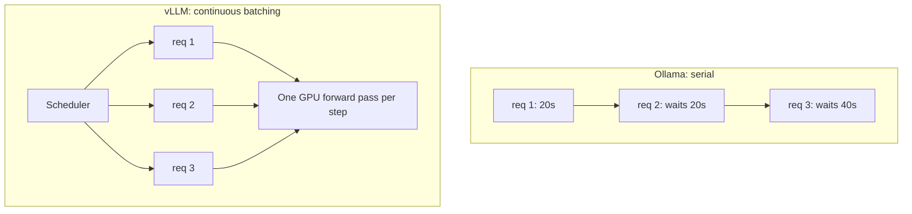
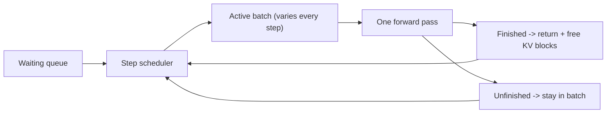

import TOCInline from '@theme/TOCInline';

# GPU Serving Engines: vLLM, SGLang, TGI & Triton

<TOCInline toc={toc} minHeadingLevel={2} maxHeadingLevel={2} />

:::tip[In this guide]
What actually happens when ten users hit your LLM at once, why Ollama handles
that badly, and how vLLM, SGLang, TGI and TensorRT-LLM plus Triton fix it.
Includes the serving vocabulary you need — continuous batching, KV cache,
prefix reuse, prefill vs decode — and how to benchmark without fooling
yourself.
:::

## What Is It?

A **serving engine** is the layer between an HTTP request and a GPU doing
matrix multiplication. Its job is to keep the GPU busy while many requests are
in flight, each at a different point in its generation.

That sounds mundane. It is actually the difference between 3 and 300
concurrent users on the same hardware.

| Engine | Built on | Primary goal |
| --- | --- | --- |
| Ollama | llama.cpp | Easy local single-user inference |
| vLLM | PyTorch + PagedAttention | High-throughput open-source serving |
| TGI | Rust + PyTorch | Production serving in the HF ecosystem |
| TensorRT-LLM + Triton | Compiled CUDA kernels | Lowest latency on NVIDIA hardware |
| NIM | TensorRT-LLM or vLLM | The above, prepackaged |

## Why Does It Matter?

Ollama's defaults are tuned for one person at a keyboard. It loads a quantized
GGUF model, runs requests largely serially, and gives you good single-stream
latency on a laptop. Perfect for development.

Point production traffic at it and you see:

- **Requests queue.** Request two waits for request one to finish generating,
  not just to start. A 20-second answer means the second user waits 20 seconds
  before their first token.
- **The GPU idles.** Decoding one token for one request uses a tiny fraction of
  a GPU's compute. You bought an H100 and are using a few percent of it.
- **No shared KV cache management.** Memory is allocated per request without
  the pooling that lets many requests coexist.
- **Latency collapses under load**, non-linearly. p95 goes from 2s to 40s
  somewhere between 5 and 10 concurrent users.

The fix is not a bigger GPU. It is an engine that batches.



## Core Concepts

Learn these five and every engine's documentation becomes readable.

### Prefill vs Decode

Generation has two phases with completely different performance characteristics.

**Prefill** processes your entire prompt in one forward pass. All tokens are
known, so the GPU runs a big parallel matrix multiply. This is
**compute-bound** — it saturates the GPU's FLOPs.

**Decode** generates one token at a time, each depending on the last. Each step
is a tiny amount of compute but must read the whole model's weights from
memory. This is **memory-bandwidth-bound** — the GPU's compute units sit mostly
idle waiting on HBM.

| Phase | Tokens per pass | Bottleneck | Scales with |
| --- | --- | --- | --- |
| Prefill | Whole prompt | GPU compute (FLOPs) | Prompt length |
| Decode | One | Memory bandwidth | Output length |

This split explains nearly everything else:

- A long prompt costs you time-to-first-token, not tokens/sec.
- A long answer costs you tokens/sec, not time-to-first-token.
- Batching helps decode enormously (the weight read is shared across all
  requests in the batch) and helps prefill much less.

### KV Cache

During decode, the model needs the attention keys and values for every prior
token. Recomputing them each step would be quadratic, so they are cached.

The KV cache is **per request**, grows with every token, and lives in VRAM
alongside the weights. It is the reason a model that "fits in 16GB" cannot
serve 50 concurrent long-context requests on a 16GB card. The weights are
fixed; the cache is not.

Full formula and worked numbers in
[GPU Sizing & Quantization](./03-gpu-sizing-and-quantization.mdx).

### Continuous (In-Flight) Batching

Static batching waits to collect N requests, runs them together, and returns
when the **slowest** finishes. If one request generates 10 tokens and another
generates 1000, the short one is held hostage for the duration.

**Continuous batching** operates per decoding step. At each step the scheduler
looks at which sequences are active, runs one forward pass for all of them,
and then — crucially — evicts any that just finished and admits waiting
requests into the freed slots immediately.



The practical result: throughput increases several-fold, and a new request
starts generating within a step or two rather than waiting for a whole batch.
This is the single most important feature a production engine has and Ollama
does not.

### Time-to-First-Token vs Inter-Token Latency

Two numbers, often confused, driven by different things.

| Metric | What it measures | Driven by | Fix it with |
| --- | --- | --- | --- |
| TTFT | Request start to first token | Queue wait + prefill | Smaller prompt, prefix caching, more GPUs |
| ITL / TPOT | Gap between consecutive tokens | Memory bandwidth, batch size | Smaller model, quantization, faster HBM |
| End-to-end | TTFT + ITL × output tokens | Both | Both |

For a chat UI, TTFT dominates perceived speed — which is why streaming makes a
slow model feel acceptable. For a batch summarisation job, nobody is watching;
only total throughput matters.

### The Throughput/Latency Tradeoff

Bigger batches mean better GPU utilisation and higher total tokens/sec. They
also mean each individual request's tokens arrive more slowly, because the
forward pass does more work per step.

There is no setting that optimises both. You choose:

- **Interactive chat** — cap the batch size, accept lower throughput, protect
  p95 TTFT.
- **Offline batch jobs** — maximise batch size, ignore per-request latency.
- **Mixed** — run two deployments. Do not try to tune one for both.

### Speculative Decoding

A small "draft" model proposes several tokens cheaply; the large model verifies
them in a single forward pass. Accepted tokens are kept, the first rejected one
is corrected, and you continue.

Because verification is parallel, you can produce 2–3 tokens for roughly the
cost of one — *when the draft model agrees with the big one*. On predictable
text (code, structured output) acceptance is high and you get a real speedup.
On creative or unusual text, acceptance drops and you have paid for the draft
model for nothing.

Output is mathematically identical to not using it. It is a latency
optimisation, not a quality tradeoff. It helps low-concurrency latency most;
at high batch sizes the GPU is already busy and there is no spare capacity to
exploit.

## vLLM

vLLM is the default answer for self-hosted open-model serving.

### PagedAttention

vLLM's core contribution. Classic implementations allocate one contiguous KV
cache buffer per request, sized for the *maximum* possible length — so a
request that generates 50 tokens still reserves space for 4096. Most of your
VRAM becomes reservation you never use.

PagedAttention borrows from virtual memory: the cache is split into fixed-size
blocks, allocated on demand, tracked by a block table. Fragmentation drops to
near zero, so far more sequences fit in the same VRAM — which directly raises
the batch size, which directly raises throughput.

It also makes **prefix sharing** cheap. Requests with the same system prompt
share the identical blocks instead of each holding a copy. With a long system
prompt and many users, this is a large saving on its own.

### Running the server

```bash
pip install vllm
```

```bash
vllm serve meta-llama/Llama-3.1-8B-Instruct \
  --host 0.0.0.0 \
  --port 8000 \
  --max-model-len 8192 \
  --gpu-memory-utilization 0.90 \
  --dtype auto
```

The flags that actually matter:

| Flag | What it does | Getting it wrong |
| --- | --- | --- |
| `--max-model-len` | Max prompt + output tokens | Too high reserves cache you don't need, shrinking the batch |
| `--gpu-memory-utilization` | Fraction of VRAM vLLM may use | Too high and you OOM when something else touches the GPU |
| `--tensor-parallel-size` | Shard one model across N GPUs | Only helps if the model doesn't fit on one |
| `--max-num-seqs` | Cap on concurrent sequences | Your main latency-vs-throughput dial |
| `--quantization` | `awq`, `gptq`, `fp8`, ... | Must match how the checkpoint was produced |
| `--enable-prefix-caching` | Reuse shared prompt prefixes | Large win with a fixed system prompt |

### Calling it

It is an OpenAI-compatible server, so this is the same client from
[NVIDIA NIM & Hosted Endpoints](./01-nvidia-nim-endpoints.mdx):

```python
from openai import OpenAI

client = OpenAI(base_url="http://localhost:8000/v1", api_key="not-used")

completion = client.chat.completions.create(
    model="meta-llama/Llama-3.1-8B-Instruct",
    messages=[{"role": "user", "content": "Define PagedAttention."}],
    max_tokens=256,
)
print(completion.choices[0].message.content)
```

The `model` string must match what the server registered — check
`GET /v1/models` rather than guessing.

### Tensor parallelism

When a model doesn't fit on one GPU, split each layer's weight matrices across
GPUs:

```bash
vllm serve meta-llama/Llama-3.1-70B-Instruct \
  --tensor-parallel-size 4 \
  --max-model-len 8192
```

Every forward pass now needs an all-reduce across GPUs, so interconnect speed
matters a lot. NVLink is fine; PCIe is a real tax. Also note `--shm-size` on
containerised deployments — the default is too small for TP.

If the model *does* fit on one GPU, do not use tensor parallelism. Run N
independent replicas behind a load balancer instead: no collective
communication, better total throughput, and one crash takes out one replica.

### LoRA adapters

vLLM can serve many LoRA adapters against one set of base weights, selecting
per request:

```bash
vllm serve meta-llama/Llama-3.1-8B-Instruct \
  --enable-lora \
  --max-loras 4 \
  --lora-modules sql=/models/lora-sql support=/models/lora-support
```

```python
completion = client.chat.completions.create(
    model="sql",  # the adapter name, not the base model
    messages=[{"role": "user", "content": "Top 5 customers by revenue"}],
)
```

This is how you serve per-tenant or per-task fine-tunes without one full model
copy each. The adapters are small (tens of MB); the base weights are shared.

## Hugging Face TGI

**Text Generation Inference** is Hugging Face's Rust-based serving stack. It
also does continuous batching, tensor parallelism, quantization and streaming,
and exposes both a native API and an OpenAI-compatible route.

```bash
docker run --gpus all --shm-size 1g -p 8080:80 \
  -v "$PWD/data:/data" \
  ghcr.io/huggingface/text-generation-inference:latest \
  --model-id meta-llama/Llama-3.1-8B-Instruct \
  --max-input-tokens 4096 \
  --max-total-tokens 8192
```

Pick TGI over vLLM when:

- You are already deep in the HF ecosystem and want the matching toolchain.
- You want a well-packaged container as the primary interface rather than a
  Python dependency.
- You use HF Inference Endpoints, which runs TGI — local parity is useful.
- You want guided/grammar-constrained generation and prefer TGI's take on it.

Pick vLLM when you want the broadest model coverage, fastest adoption of new
architectures, and the largest community. In practice vLLM moves faster and
has more eyes on it; TGI is more opinionated and more "productised". Both are
credible. The difference between either of them and Ollama under load is far
larger than the difference between them.

## SGLang

SGLang is the third credible open engine, and it is worth knowing specifically
because it optimises a case the other two treat as incidental: **workloads that
reuse prefixes heavily**.

Its core idea is **RadixAttention**. vLLM's prefix caching is a flat lookup —
an incoming prompt either reuses a cached prefix or it does not. SGLang keeps
the KV cache in a radix tree keyed by token prefix, so many requests sharing
partial prefixes share cache at every branch point, and eviction is
least-recently-used over the tree rather than per-sequence.

That matters more than it sounds for the workloads in this roadmap:

| Workload | Why the radix tree wins |
| --- | --- |
| RAG with a fixed system prompt and few-shot block | Every request shares a long identical head |
| Agent loops | Each step resends the whole growing trace; step N shares all of step N-1 |
| Multi-turn chat | Turn N shares the entire prior conversation |
| Self-consistency or branching sampling | N samples of one prompt share everything up to the branch |
| Batch extraction over one document | Same instructions and document, different questions |

An agent loop is the clearest case. Ten steps with a naive engine re-prefills a
context that grows every step — quadratic prefill work over the run. With
prefix sharing, each step only prefills the new tokens.

```bash
python -m sglang.launch_server \
  --model-path meta-llama/Llama-3.1-8B-Instruct \
  --port 30000 \
  --mem-fraction-static 0.85
```

It serves an OpenAI-compatible route, so the client from
[One Client, Many Backends](../08-llm-application-development/01-one-client-many-backends.mdx)
works unchanged.

SGLang also ships a frontend DSL for expressing constrained and branching
generation — forks, parallel samples, grammar-constrained output — as program
structure rather than prompt text. Useful, but the server-side prefix sharing
is the reason most teams adopt it.

Pick SGLang when prefix reuse dominates your traffic: agents, long multi-turn
sessions, or many questions against one large shared context. Pick vLLM when
you want the broadest model coverage and the largest community, which it still
has. Treat the choice as a benchmark question on *your* traffic shape, not a
ranking — and measure with the concurrency sweep below, because an engine's
advantage here only shows up when requests actually share prefixes.

## TensorRT-LLM + Triton

The NVIDIA-native path, and the most work.

**TensorRT-LLM** compiles a model into an optimised engine for a *specific* GPU
architecture, batch size range and sequence length. Compilation does kernel
fusion, picks FP8/INT8 paths, and bakes in layout decisions. The output is a
binary engine file, not a portable checkpoint.

**Triton Inference Server** is the serving front end: HTTP and gRPC endpoints,
dynamic batching, model versioning, multi-model hosting, metrics. It serves
TensorRT-LLM engines and also ONNX, PyTorch and Python models — useful when
your LLM sits next to an embedding model and a reranker in one deployment.

The build-then-serve shape:

```bash
# 1. Convert checkpoint, then build an engine for your exact GPU.
trtllm-build \
  --checkpoint_dir ./ckpt/llama-3.1-8b \
  --output_dir ./engines/llama-3.1-8b-fp8 \
  --gemm_plugin auto \
  --max_batch_size 64 \
  --max_input_len 4096 \
  --max_seq_len 8192

# 2. Serve the engine with Triton.
tritonserver --model-repository=/models
```

:::note
`trtllm-build` flags and the Triton model-repository layout change between
releases more than most tooling. Treat this as the shape of the workflow and
follow the version-matched NVIDIA docs for exact arguments.
:::

When the complexity pays off:

- You are latency-critical and need the lowest possible TTFT on NVIDIA GPUs.
- You run at a scale where a 20–30% efficiency gain is real money.
- You want FP8 on Hopper or later, properly exploited.
- You already run Triton for other models and want one serving layer.

When it does not:

- You change models often. Every change means a rebuild.
- You run on mixed GPU types. Engines are architecture-specific.
- You are pre-product-market-fit. Spend the time on the product.

**This is exactly the gap NIM fills.** A NIM container is a prebuilt
TensorRT-LLM engine plus a server, with profile selection done for you. You
get most of the benefit without owning the build pipeline. That tradeoff — and
the lost control over quantization — is covered in
[NVIDIA NIM & Hosted Endpoints](./01-nvidia-nim-endpoints.mdx).

## Comparison

| Dimension | Ollama / llama.cpp | vLLM | SGLang | TGI | TensorRT-LLM + Triton | Hosted NIM |
| --- | --- | --- | --- | --- | --- | --- |
| Concurrency | Poor (effectively serial) | Excellent | Excellent | Excellent | Excellent | Excellent (elastic) |
| Continuous batching | No | Yes | Yes | Yes | Yes (in-flight) | Yes |
| Prefix reuse | No | Flat prefix cache | Radix tree, best in class | Limited | Limited | Fixed by image |
| Time-to-first-token | Good solo, collapses under load | Good, stable | Best when prefixes are shared | Good, stable | Best on NVIDIA | Good + network RTT |
| Tokens/sec aggregate | Low | High | High | High | Highest | High |
| Setup cost | Minutes | Hours | Hours | Hours | Days | Minutes |
| Quantization | GGUF q2–q8, excellent | AWQ, GPTQ, FP8, INT8 | AWQ, GPTQ, FP8 | AWQ, GPTQ, EETQ, FP8 | FP8, INT8, INT4 (compiled) | Fixed by image |
| CPU / Apple Silicon | Yes — its strength | No (GPU required) | No | No | No | N/A |
| Multi-GPU | Limited | TP + PP | TP | TP | TP + PP | Managed |
| LoRA serving | Limited | Many adapters, per request | Yes | Yes | Limited | Model-dependent |
| Ops burden | None | Moderate | Moderate | Moderate | High | None |
| Best for | Local dev, single user, offline | Default production self-host | Agents, multi-turn, shared context | HF-centric production | Latency-critical at scale | Evaluation, bursty, no GPU |

Default recommendation: **Ollama to build, vLLM to ship, SGLang when your
traffic reuses long prefixes, NIM when you want someone else to own the GPU,
TensorRT-LLM when you have measured that you need it.**

## Benchmarking Honestly

Most LLM benchmarks you see are wrong in the same few ways. Measure like this
instead.

### Run a concurrency sweep

One number at one concurrency level tells you nothing. The shape of the curve
is the answer.

```bash
# vLLM ships a benchmark harness; flags vary by version.
python -m vllm.entrypoints.openai.api_server --help

for c in 1 2 4 8 16 32 64; do
  python benchmarks/benchmark_serving.py \
    --backend openai-chat \
    --base-url http://localhost:8000 \
    --model meta-llama/Llama-3.1-8B-Instruct \
    --dataset-name random \
    --random-input-len 512 \
    --random-output-len 256 \
    --max-concurrency "$c" \
    --num-prompts $((c * 20))
done
```

### Record these, per concurrency level

| Metric | Why |
| --- | --- |
| TTFT p50 / p95 | What the user feels first |
| Inter-token latency p50 / p95 | Whether the stream feels smooth |
| End-to-end p50 / p95 / p99 | What your SLO is written against |
| Output tokens/sec per request | Per-user speed |
| Output tokens/sec aggregate | Capacity, and therefore cost |
| Successful requests/sec | Throughput that actually counts |
| Error and timeout rate | A fast benchmark that drops 8% is a failure |
| Peak VRAM | Headroom before OOM |

Report **p95, not the mean**. Mean latency hides the queueing that users
actually notice, and under load the distribution has a long right tail by
construction.

### A minimal harness of your own

```python
import asyncio
import statistics
import time

import httpx


async def one_request(client: httpx.AsyncClient, prompt: str, model: str) -> dict[str, float]:
    start = time.perf_counter()
    ttft: float | None = None
    tokens = 0
    payload = {
        "model": model,
        "messages": [{"role": "user", "content": prompt}],
        "max_tokens": 256,
        "stream": True,
    }
    async with client.stream("POST", "/v1/chat/completions", json=payload) as resp:
        resp.raise_for_status()
        async for line in resp.aiter_lines():
            if not line.startswith("data:"):
                continue
            if line.removeprefix("data:").strip() == "[DONE]":
                break
            if ttft is None:
                ttft = time.perf_counter() - start
            tokens += 1
    total = time.perf_counter() - start
    return {"ttft": ttft or total, "total": total, "tokens": float(tokens)}


async def sweep(base_url: str, model: str, prompt: str, concurrency: int, n: int) -> None:
    limiter = asyncio.Semaphore(concurrency)
    async with httpx.AsyncClient(base_url=base_url, timeout=300.0) as client:

        async def guarded() -> dict[str, float]:
            async with limiter:
                return await one_request(client, prompt, model)

        wall_start = time.perf_counter()
        results = await asyncio.gather(*(guarded() for _ in range(n)))
        wall = time.perf_counter() - wall_start

    ttfts = sorted(r["ttft"] for r in results)
    totals = sorted(r["total"] for r in results)
    out_tokens = sum(r["tokens"] for r in results)
    p95 = lambda xs: xs[min(len(xs) - 1, int(0.95 * len(xs)))]

    print(
        f"c={concurrency:3d} "
        f"ttft_p50={statistics.median(ttfts):.3f}s ttft_p95={p95(ttfts):.3f}s "
        f"e2e_p95={p95(totals):.3f}s "
        f"agg_tok_s={out_tokens / wall:.1f}"
    )


asyncio.run(sweep("http://localhost:8000", "meta-llama/Llama-3.1-8B-Instruct",
                  "Explain continuous batching.", concurrency=16, n=160))
```

Counting SSE chunks as tokens is an approximation — a chunk is usually one
token but not guaranteed. For precise accounting, read `usage` from a
non-streaming run, or request usage in the stream if your backend supports it.

### What fools people

- **Measuring one request at a time.** This is the single most common error.
  Ollama looks competitive at concurrency 1 and loses by an order of magnitude
  at concurrency 32. Concurrency 1 is not your production workload.
- **Reporting means.** Hides the tail that generates your support tickets.
- **Ignoring output length.** Tokens/sec is meaningless without knowing how
  many tokens were generated. Fix `max_tokens` across runs.
- **Not warming up.** The first requests pay engine init, CUDA graph capture
  and cache warm-up. Discard them.
- **Benchmarking from a laptop over the internet.** You are measuring your
  WiFi. Run the client near the server.
- **Comparing different quantizations as if the model is the same.** A 4-bit
  model is faster *and* worse. Report quality alongside speed or the
  comparison is meaningless.
- **Identical prompts every iteration.** With prefix caching on, you benchmark
  the cache. Use varied prompts.
- **Ignoring errors.** Throughput with a 10% timeout rate is not throughput.
- **One prompt/output length shape.** Short-prompt-long-output and
  long-prompt-short-output stress completely different parts of the system.
  Test both.

## Common Mistakes

- Taking Ollama to production because it worked in development.
- Turning on tensor parallelism for a model that fits on one GPU, instead of
  running independent replicas.
- Setting `--max-model-len` to the model's theoretical maximum, starving the
  KV cache and crushing the batch size.
- Pushing `--gpu-memory-utilization` to `0.98` and OOM-ing when anything else
  touches the GPU.
- Tuning one deployment for both interactive chat and batch jobs.
- Building TensorRT engines on a different GPU architecture than you deploy on.
- Expecting speculative decoding to help at high concurrency.
- Assuming "OpenAI-compatible" means every parameter is supported — unknown
  fields may be silently ignored.
- Treating a concurrency-1 benchmark as a capacity plan.

## Interview Questions

- Why does Ollama's latency degrade non-linearly with concurrency?
- Explain continuous batching and why it beats static batching.
- What problem does PagedAttention solve, and how does virtual memory relate?
- Contrast prefill and decode. Which is memory-bandwidth-bound, and why does
  that make batching so effective?
- Why does TTFT grow with prompt length while tokens/sec does not?
- When would you choose tensor parallelism over separate replicas?
- What does speculative decoding cost you when the draft model is wrong?
- When is TensorRT-LLM's build complexity justified?
- Which metrics would you report from a serving benchmark, and why p95?
- How does serving many LoRA adapters differ from serving many models?

## Things to Remember

- Ollama for laptops, vLLM for servers, NIM when you want it prebuilt.
- Continuous batching is the feature that makes concurrency work.
- Prefill is compute-bound; decode is memory-bandwidth-bound.
- The KV cache, not the weights, is what limits concurrency.
- Prefix reuse is a workload property. If your traffic shares long heads —
  agents, multi-turn, one document many questions — SGLang's radix tree is the
  specific thing to benchmark.
- Throughput and per-request latency trade against each other. Pick one per
  deployment.
- Tensor parallelism only when the model doesn't fit on one GPU.
- Benchmark with a concurrency sweep and report p95.

## Mini Exercise

Launch vLLM with an 8B model (or point at a NIM endpoint if you have no GPU).
Run the harness above at concurrency 1, 4, 16 and 64 with `max_tokens=256`
fixed. Plot TTFT p95 and aggregate tokens/sec against concurrency. Identify
the concurrency level where TTFT p95 crosses two seconds — that is your
capacity per replica. Then run the same sweep against Ollama and compare the
two curves.

## Done When

- [ ] You can explain why continuous batching beats static batching.
- [ ] You can describe prefill vs decode and which one batching helps most.
- [ ] You can launch `vllm serve` and call it with an OpenAI client.
- [ ] You can name when you'd pick SGLang, TGI or TensorRT-LLM over vLLM.
- [ ] You can explain why an agent loop benefits disproportionately from prefix
      caching.
- [ ] You can run a concurrency sweep and report p50/p95 TTFT and aggregate
      tokens/sec.
