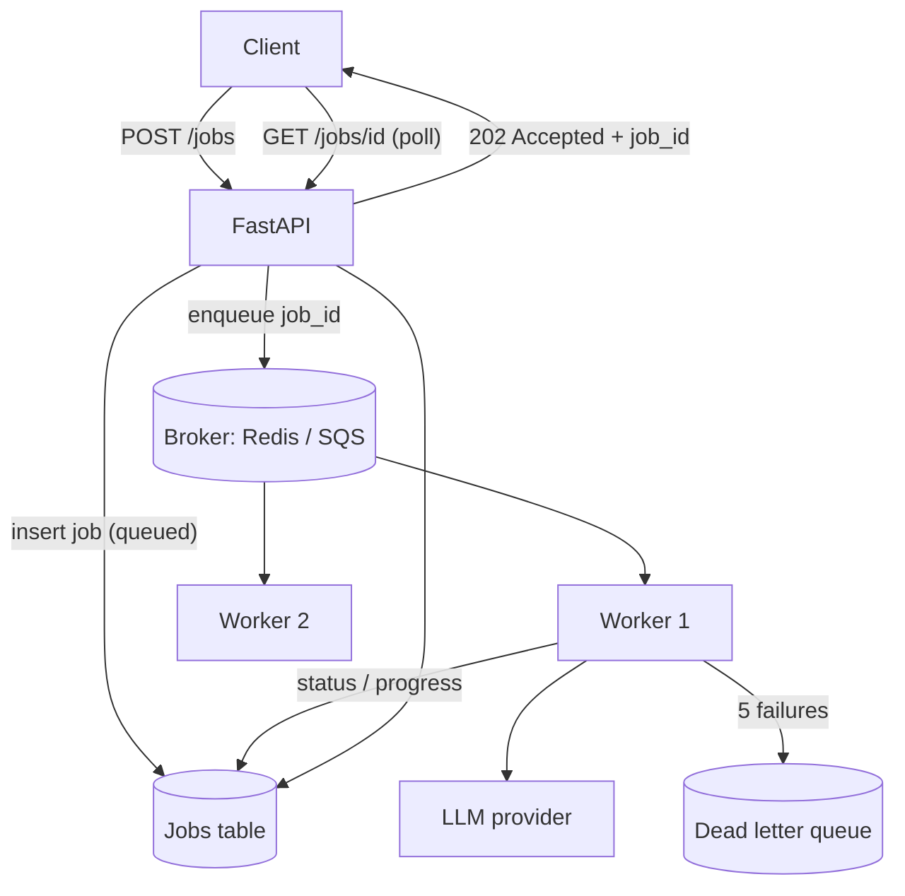

import TOCInline from '@theme/TOCInline';

# Queues & Async Jobs

<TOCInline toc={toc} minHeadingLevel={2} maxHeadingLevel={2} />

:::tip[In this guide]
LLM work is slow, rate-limited and expensive to redo, which breaks the
synchronous request/response model. Move the work off the request path with a
queue and workers, then handle the four problems that follow: duplicate
enqueues, unbounded growth, unfair tenants and provider rate limits.
:::

## What Is It?

An **async job** is work your API accepts but does not finish before replying.
The caller gets an identifier and comes back for the result. A **queue** is the
durable buffer between the service that accepts work and the workers that do it.

This is ordinary backend architecture. What is specific to LLM systems is how
early you need it: one document-ingestion request or a 4000-token generation
already exceeds what a request/response path comfortably holds.

## Why Does It Matter?

| Property | Typical HTTP request | LLM work |
| --- | --- | --- |
| Duration | 50–500 ms | 2 s – 10 min |
| Predictability | Tight | Varies 10x with output length |
| Upstream capacity | Scales with your replicas | Fixed provider quota |
| Cost of redoing it | Negligible | Real money, every time |
| Partial failure | Rare | Normal: chunk 7 of 40 fails |

Three consequences, each a different outage:

- **Timeouts you do not control.** Load balancers and browsers close
  connections at 30–60 seconds. Your code keeps generating, the caller has
  given up, and you pay for tokens nobody reads.
- **Rate limits are fixed and shared.** Adding API replicas does not raise your
  provider quota, so a spike becomes a wall of `429`s your callers see.
- **Partial failure needs state.** Ingesting 500 documents where 3 fail is
  normal. A synchronous endpoint has nowhere to record "483 done, 3 failed, 14
  pending" when the connection drops.

## The Four Shapes

| Shape | Mechanism | Ceiling | Survives a deploy | Progress and cancel | Use when |
| --- | --- | --- | --- | --- | --- |
| **Synchronous** | Work inside the request | ~20–30 s | No | No | Short, bounded, user watching |
| **Background task** | `BackgroundTasks` after the response | Minutes, unreliably | No | No | Side effects you can lose |
| **Queue plus worker** | Durable broker, separate workers | Hours | Yes | Yes | The production default |
| **Scheduled batch** | Cron or scheduler over a dataset | Unbounded | Yes | Per-run | Offline, nobody waiting |

FastAPI's `BackgroundTasks` runs in the same process after the response is
sent, so the work dies with the process and nothing records that it was lost.
Fine for an email you can drop; not a job system, despite looking like one.
See [background processing](../02-fastapi/01-core-path/11-background-processing.mdx)
for the mechanics.

The queue-worker shape decouples what scales differently: accepting requests is
cheap and spiky, executing jobs is slow and expensive, reading results is cheap
and frequent.



Broker and jobs table are separate on purpose. The broker holds "this id needs
doing"; the database holds state you can query or show a user. Brokers are bad
databases — you cannot ask Redis how many of tenant A's jobs failed yesterday.

## Picking One

| Expected duration | User waiting | Choice |
| --- | --- | --- |
| Under 2 s | Yes | Synchronous |
| 2–20 s | Yes | Synchronous with streaming, so the wait is visible |
| 20 s – 2 min | Yes | Queue plus worker, poll or stream progress |
| Over 2 min | Yes | Queue plus worker, mandatory progress and cancel |
| Any | No | Queue plus worker, or batch if it is periodic |
| Hours | No | Scheduled batch with per-item checkpointing |

One rule cuts through most debates: **if losing the work silently would be a
bug, it needs a durable queue.** Latency is the obvious trigger; durability is
the one people skip.

## A Worked Implementation

ARQ is used here because it is async-native and small; Celery is the same shape
with more features and a sync worker model. The job record is the contract
between API and worker, and the thing you query during an incident.

```python
from datetime import datetime
from enum import StrEnum
from typing import Any
from pydantic import BaseModel


class JobStatus(StrEnum):
    QUEUED = "queued"
    RUNNING = "running"
    SUCCEEDED = "succeeded"
    FAILED = "failed"
    CANCELLED = "cancelled"


class Job(BaseModel):
    id: str
    tenant_id: str
    kind: str                            # "summarize_doc", "ingest_corpus"
    status: JobStatus = JobStatus.QUEUED
    priority: str = "interactive"        # queue name
    idempotency_key: str | None = None
    progress_done: int = 0
    progress_total: int | None = None
    attempts: int = 0
    cost_usd: float = 0.0
    result: dict[str, Any] | None = None
    error: str | None = None
    created_at: datetime
    heartbeat_at: datetime | None = None
```

`attempts`, `cost_usd`, `progress_done` and `heartbeat_at` are the fields teams
add after their first incident. Put them in from the start.

The enqueue endpoint authorises, checks the idempotency key, checks
backpressure, then inserts and enqueues.

```python
from fastapi import APIRouter, Depends, HTTPException, Response, status

router = APIRouter(prefix="/jobs", tags=["jobs"])
MAX_QUEUE_DEPTH = 5_000


@router.post("", status_code=status.HTTP_202_ACCEPTED)
async def create_job(
    req: SummarizeRequest,
    response: Response,
    principal: Principal = Depends(auth),
    jobs: JobRepo = Depends(get_job_repo),
    broker: Broker = Depends(get_broker),
) -> JobAccepted:
    queue = queue_for(principal.tier)               # "interactive" | "bulk"

    if req.idempotency_key:
        if found := await jobs.find_by_key(principal.tenant_id, req.idempotency_key):
            response.headers["Idempotent-Replay"] = "true"
            return JobAccepted(job_id=found.id, status=found.status)

    if await broker.depth(queue) >= MAX_QUEUE_DEPTH:
        raise HTTPException(503, "Queue is full, retry shortly",
                            headers={"Retry-After": "30"})

    job = await jobs.create(
        tenant_id=principal.tenant_id, kind="summarize_doc", priority=queue,
        idempotency_key=req.idempotency_key, progress_total=req.chunk_count,
    )
    await broker.enqueue(queue, "summarize_doc", job_id=job.id)
    return JobAccepted(job_id=job.id, status=job.status)
```

Insert the row **before** enqueueing. The reverse order lets a worker pick up a
job id that does not exist yet. A failed enqueue after a successful insert
leaves a `queued` row a reaper can re-enqueue — recoverable; the other order is
not.

The worker: status transitions, per-item progress, cancellation checks, and
retryable versus permanent failure.

```python
from arq import Retry


async def summarize_doc(ctx: dict, job_id: str) -> None:
    jobs: JobRepo = ctx["jobs"]
    job = await jobs.get(job_id)
    if job is None or job.status in {JobStatus.CANCELLED, JobStatus.SUCCEEDED}:
        return                                       # already settled

    await jobs.mark_running(job_id, worker=ctx["worker_id"])
    summaries: list[str] = []

    try:
        for index, chunk in enumerate(await load_chunks(job)):
            if await jobs.cancel_requested(job_id):
                return await jobs.mark(job_id, JobStatus.CANCELLED)
            summary, usage = await call_provider(chunk)   # rate-limited below
            summaries.append(summary)
            await jobs.record_progress(job_id, done=index + 1, usage=usage)

        await jobs.succeed(job_id, result={"summary": "\n".join(summaries)})

    except ProviderRateLimited as exc:
        raise Retry(defer=exc.retry_after or 30)     # requeue, not a failure
    except PermanentError as exc:
        await jobs.fail(job_id, error=str(exc), retryable=False)
    except Exception as exc:
        await jobs.bump_attempts(job_id, error=repr(exc))
        raise                                        # let ARQ retry
```

`record_progress` persists progress *and* token usage as it goes, so a job
killed at chunk 400 of 500 has already accounted for what it spent. A rate
limit raises `Retry` rather than failing: being throttled is not a job defect
and should not consume a retry budget meant for real errors.

The status endpoint is poll-friendly, ownership-checked, and tells the client
when to come back.

```python
TERMINAL = {JobStatus.SUCCEEDED, JobStatus.FAILED, JobStatus.CANCELLED}


@router.get("/{job_id}")
async def get_job(job_id: str, principal: Principal = Depends(auth),
                  jobs: JobRepo = Depends(get_job_repo)) -> JobView:
    job = await jobs.get(job_id)
    if job is None or job.tenant_id != principal.tenant_id:
        raise HTTPException(404)                     # never leak existence
    return JobView(
        job_id=job.id,
        status=job.status,
        progress=job.progress_done / job.progress_total if job.progress_total else None,
        result=job.result if job.status is JobStatus.SUCCEEDED else None,
        error=job.error,
        retry_after=None if job.status in TERMINAL else 2,
    )
```

`retry_after` lets clients back off instead of polling every 200 ms. For push
instead of poll, the server-sent-events pattern in
[Agents in Production](../09-tool-calling-and-ai-agents/12-production-agents.mdx) applies
unchanged — same job table, events read from a pub/sub channel.

## Idempotency Keys

A client times out on the enqueue, retries, and you now pay twice to generate
the same summary. The fix is a client-supplied key, unique per logical
operation, behind a uniqueness constraint.

```sql
CREATE UNIQUE INDEX jobs_idempotency
    ON jobs (tenant_id, idempotency_key)
    WHERE idempotency_key IS NOT NULL;
```

| Rule | Why |
| --- | --- |
| Scope the key per tenant | Two tenants may use the same string legitimately |
| Client generates it | The server cannot know two requests are one operation |
| Derive from content, not time | A retry must produce the identical key |
| Return the original job id | The client wants the first job, not a new one |
| Expire keys after 24–48 h | Otherwise the index grows forever |
| Trust the constraint, not a read | Check-then-insert races under concurrency |

The last row is the one people get wrong. If two concurrent requests both pass
the lookup, the insert raises a unique violation — catch it and return the
existing job. The database is the serialisation point. With no natural key, a
`sha256` of tenant, kind and normalised input is a fine default.

## Backpressure and Queue Depth

An unbounded queue does not prevent an outage, it hides one. Work keeps being
accepted, depth grows, and the only symptom is answers arriving later and later
until someone spots jobs enqueued 40 minutes ago. Every caller got a `202`
saying things were fine.

Derive the limit from a time budget, not a round number. If you drain 20 jobs
per second and will not accept a wait beyond 5 minutes, the limit is 6000.
Depth alone is ambiguous — 5000 jobs draining in 30 seconds is healthy, 200
queued for ten minutes is not. **Oldest-message age is the honest metric**, so
extend the admission check in `create_job` to reject on either signal, with
`Retry-After` derived from the current head age.

A fast `503` with `Retry-After` is better product behaviour than a slow
success, and much better than a timeout. Shedding load is a feature.

## Priority and Fairness

One tenant uploading 80,000 documents must not delay another tenant's
interactive request. A single FIFO queue guarantees it will, because FIFO is
the wrong policy when job values differ.

| Queue | Fed by | Workers | Target wait |
| --- | --- | --- | --- |
| `interactive` | User-triggered requests | Majority, dedicated | Under 5 s |
| `bulk` | Ingestion, backfills, exports | Capped pool | Minutes to hours |
| `retry` | Second and later attempts | Small pool | Best effort |

Dedicated workers per queue beat priority ordering inside one queue: with
strict priority in a single queue, a flood of high-priority work starves the
rest completely and you cannot reserve capacity. With separate pools, bulk is
throttled by construction.

Within a queue you still need per-tenant fairness. The cheap version is a
concurrency cap checked at claim time — walk the head of the queue and skip
jobs from tenants already at their cap. That is round-robin enough for most
systems. The proper version is per-tenant subqueues drained in rotation, which
you need once one tenant can enqueue more than your total daily capacity.

## Provider Rate Limits

Providers enforce two separate limits, and the second surprises people.

| Limit | Unit | How you hit it |
| --- | --- | --- |
| Request rate | requests per minute | Many small calls, high concurrency |
| Token rate | tokens per minute | Few calls with large prompts or long outputs |

You can sit at 10% of your request limit and be saturated on tokens. A worker
pool sized by concurrency alone does exactly this: 20 workers each sending a
30,000-token RAG prompt is 600,000 tokens in flight, which exceeds most
mid-tier token quotas no matter how modest 20 requests looks.

Limit on both, charging estimated tokens before the call and reconciling after:

```python
import asyncio
import time


class TokenBucket:
    """Refills continuously; `take` waits for capacity rather than failing."""

    def __init__(self, rate_per_sec: float, burst: float) -> None:
        self._rate, self._burst = rate_per_sec, burst
        self._tokens, self._updated = burst, time.monotonic()
        self._lock = asyncio.Lock()

    async def take(self, amount: float) -> None:
        while True:
            async with self._lock:
                now = time.monotonic()
                self._tokens = min(
                    self._burst, self._tokens + (now - self._updated) * self._rate
                )
                self._updated = now
                if self._tokens >= amount:
                    self._tokens -= amount
                    return
                deficit = amount - self._tokens
            await asyncio.sleep(min(5.0, deficit / self._rate))

    def refund(self, amount: float) -> None:
        self._tokens = min(self._burst, self._tokens + amount)


requests = TokenBucket(rate_per_sec=8, burst=16)            # 480 rpm
tokens = TokenBucket(rate_per_sec=4_000, burst=40_000)      # 240k tpm


async def call_provider(prompt: str, max_output: int = 512) -> tuple[str, Usage]:
    estimate = count_tokens(prompt) + max_output
    await requests.take(1)
    await tokens.take(estimate)                             # charge up front
    text, usage = await llm(prompt, max_tokens=max_output)
    tokens.refund(max(0, estimate - usage.total_tokens))    # reclaim slack
    return text, usage
```

Set client limits near 80% of the provider's so headroom absorbs estimation
error. When a `429` still arrives, **honour `Retry-After` exactly** and do not
stack your own backoff on top — the provider is telling you when capacity
returns, and retrying sooner extends the penalty. An `asyncio` bucket covers
one process; across processes it must live in Redis, or every worker
independently believes it owns the whole quota.

## Dead Letter Queues and Poison Messages

A **poison message** fails every time: malformed input, a document that crashes
your parser, a prompt that always exceeds context. Retrying it forever burns
capacity and fills your error budget with one bad row.

```python
MAX_ATTEMPTS = 5


async def on_failure(job: Job, exc: Exception) -> None:
    if job.attempts < MAX_ATTEMPTS and not isinstance(exc, PermanentError):
        return                                   # let the broker retry it
    await jobs.fail(job.id, error=repr(exc), retryable=False)
    await dlq.put({
        "job_id": job.id, "kind": job.kind, "tenant_id": job.tenant_id,
        "attempts": job.attempts, "error": repr(exc)[:2000],
        "input_ref": job.input_ref,              # a handle, not the payload
    })
    DLQ_DEPTH.labels(kind=job.kind).inc()
```

| Situation | Action |
| --- | --- |
| Transient outage, now resolved | Replay the batch after confirming the fix |
| Bad input from one tenant | Mark failed, surface the reason to the tenant |
| A bug you just fixed | Replay; keep the DLQ replayable by design |
| Unknown, not reproducing | Keep it, alarm, do not auto-replay |

Two things make a DLQ useful rather than decorative. **Alarm on non-zero DLQ
depth** — nobody discovers a silent DLQ, and looking at failures is the point
of moving them there. And make replay one command, because a DLQ you cannot
drain is a log with extra steps. Store a reference to the input, never the
payload: payloads contain user data, they are large, and DLQ retention is long.

## Progress and Cancellation

Past about 10 seconds, a progress number is the difference between "working"
and "broken" in the user's mind. Report real units — chunks embedded, documents
processed — not a timer pretending to be progress.

Cancellation is **cooperative**. You set a flag; the worker notices.

```python
@router.post("/{job_id}/cancel", status_code=202)
async def cancel_job(job_id: str, principal: Principal = Depends(auth),
                     jobs: JobRepo = Depends(get_job_repo)) -> dict[str, str]:
    job = await jobs.get(job_id)
    if job is None or job.tenant_id != principal.tenant_id:
        raise HTTPException(404)
    if job.status is JobStatus.QUEUED:
        await jobs.mark(job_id, JobStatus.CANCELLED)   # it never starts
        return {"status": "cancelled"}
    await jobs.request_cancel(job_id)                  # worker checks the flag
    return {"status": "cancelling"}
```

Check the flag at natural boundaries: between chunks, between steps, before
each provider call. Checking mid-call does not help, since you cannot unspend
committed tokens. Decide explicitly what happens to partial work — discard it,
or persist it as a partial result. Silently abandoning it generates tickets.

Also reap **stuck jobs**. A worker killed without warning leaves a row marked
`running` forever. A periodic sweep that re-queues jobs with a stale heartbeat
fixes it; use the heartbeat column rather than `started_at`, so genuinely slow
work is not killed.

## Observability for Queues

| Metric | Type | What it tells you | Alarm on |
| --- | --- | --- | --- |
| `queue_depth` | Gauge per queue | How much is waiting | Sustained growth, not a spike |
| `oldest_message_age_seconds` | Gauge per queue | Actual user-visible wait | Above your wait SLO |
| `worker_busy_ratio` | Gauge | Pool saturation | Above ~0.85 sustained |
| `job_failure_rate` | Ratio per kind | Whether work succeeds | Above baseline, by kind |

Alarm on **oldest-message age**, not depth: depth without drain rate is
meaningless, and age encodes both. Add "DLQ depth above zero" as a separate
ticket-level alarm.

```python
from prometheus_client import Counter, Gauge, Histogram

QUEUE_DEPTH = Gauge("job_queue_depth", "Jobs waiting", ["queue"])
OLDEST_AGE = Gauge("job_queue_oldest_age_seconds", "Age of head job", ["queue"])
JOB_WAIT = Histogram("job_wait_seconds", "Enqueue to start", ["queue"],
                     buckets=(0.5, 1, 5, 15, 60, 300, 1800))
DLQ_DEPTH = Gauge("job_dlq_depth", "Dead-lettered jobs", ["kind"])
JOB_COST = Counter("job_cost_usd_total", "Spend by job", ["kind", "tenant"])
```

Label by `queue`, `kind` and `tenant`, never by `job_id` — every distinct label
value is a new time series, and job ids will take your metrics backend down.
Use one trace per job with the enqueue as the root span, so queue wait is
visible in the timeline; see
[tracing and observability](../12-evaluation-testing-and-observability/07-tracing-and-observability.mdx)
for the span structure.

## Common Mistakes

- Using `BackgroundTasks` for work you cannot afford to lose.
- Unbounded queues, so overload shows up as silent minutes-long waits.
- Alarming on depth without oldest-message age.
- No idempotency key, so a client retry double-pays for one generation.
- Check-then-insert idempotency instead of a unique constraint.
- One FIFO queue shared by bulk ingest and interactive traffic.
- Sizing worker concurrency against the request-rate limit, then being
  throttled on tokens.
- Stacking your own backoff on top of `Retry-After`.
- Infinite retries, so one poison message consumes the pool.
- A DLQ nobody alarms on, or one that stores full payloads.
- Jobs stuck in `running` forever because no reaper exists.
- Cancellation that updates the row but never stops the worker.

## Interview Questions

- Why does LLM work fit the request/response model badly? Give three reasons.
- Compare synchronous, background task, queue plus worker and scheduled batch.
- Why is FastAPI's `BackgroundTasks` not a job queue?
- Why insert the job row before enqueueing rather than after?
- Why must the idempotency uniqueness check live in the database?
- What is wrong with an unbounded queue, given it never rejects anything?
- Which queue metric would you alarm on, and why not depth?
- Explain request-rate versus token-rate limits and how each one bites.
- What is a poison message, and what happens on the fifth failure?
- How do you cancel a job that is already running?
- How do you stop one tenant's bulk ingest from starving interactive traffic?

## Things to Remember

- If losing the work silently would be a bug, it needs a durable queue.
- The broker holds job ids; the database holds job state you can query.
- Idempotency is enforced by a unique constraint, not an application read.
- A bounded queue with a fast `503` beats an unbounded one with hidden waits.
- Oldest-message age is the honest queue health metric.
- Rate-limit tokens as well as requests, and honour `Retry-After` as given.
- Cap attempts, dead-letter the rest, alarm on DLQ depth.
- Cancellation is cooperative, and stuck `running` rows need a reaper.

## Mini Exercise

Take a summarisation endpoint that blocks for 40 seconds and move it behind a
queue.

1. `POST /jobs` returns `202` with a job id; the row is inserted before the
   enqueue, and a worker writes progress per chunk.
2. `GET /jobs/{id}` returns status, progress and `retry_after`.
3. Add an idempotency key with a unique constraint, send the same request twice
   concurrently, and confirm exactly one job runs.
4. Set `MAX_QUEUE_DEPTH` to 3, enqueue 5 jobs, and confirm the fourth gets a
   `503` with `Retry-After`.
5. Kill the worker mid-job and confirm your reaper re-queues the row instead of
   leaving it `running`.

## Done When

- [ ] Work longer than your timeout budget runs outside the request path, on a
      durable queue.
- [ ] Enqueue is idempotent, enforced by a database constraint.
- [ ] The queue is bounded and rejects early with `503` plus `Retry-After`.
- [ ] Bulk and interactive work use separate queues with separate capacity.
- [ ] Client-side limiting covers token rate as well as request rate.
- [ ] Failures stop after a capped number of attempts and land in a DLQ you
      alarm on.
- [ ] Depth, oldest-message age, saturation and failure rate are measured, with
      the alarm on age.

Next: [Model Gateway & Fallbacks](./07-model-gateway-and-fallbacks.mdx).
