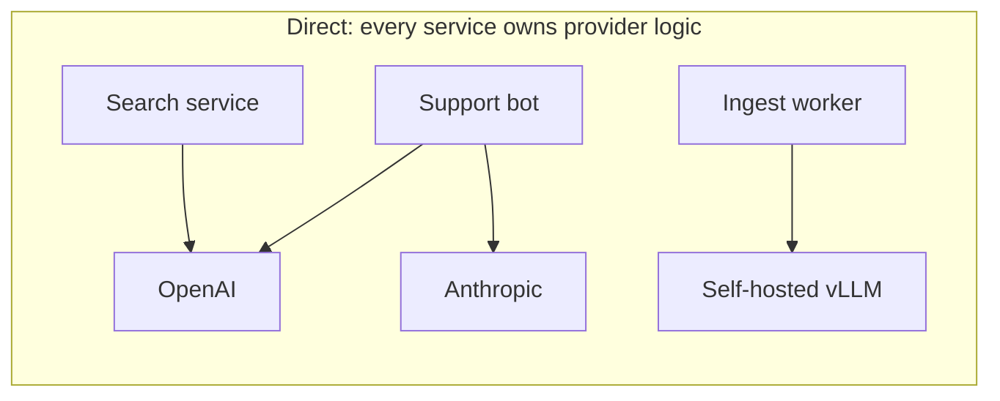
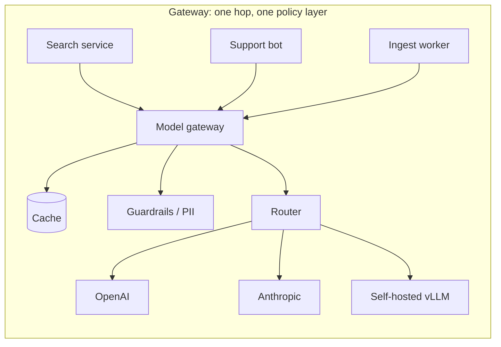

import TOCInline from '@theme/TOCInline';

# Model Gateway & Fallbacks

<TOCInline toc={toc} minHeadingLevel={2} maxHeadingLevel={2} />

:::tip[In this guide]
What a model gateway is, what it buys you, and when it is premature. Then the
policies that only a gateway can enforce: cost cascades, fallback chains,
caching, per-tenant quotas, central guardrails — and how not to turn it into
your single point of failure.
:::

## What Is It?

A **model gateway** is one internal service that every LLM call in your
organisation goes through. Callers ask it for a capability ("summarise this",
"answer with the `fast-chat` profile") and the gateway decides which provider
and model actually serves the request.





The difference is not the arrows, it is where policy lives. In the first
diagram, "which model, with what budget, with what redaction" is a decision
copied into three codebases. In the second it is configuration in one.

## Why Does It Matter?

| Concern | Without a gateway | With a gateway |
| --- | --- | --- |
| Provider keys | Copied into every service | Held in one service |
| Cost attribution | A single provider invoice | Per team, tenant, route, model |
| Quotas | Nowhere to enforce them | One place, hard stops |
| Caching | Per-service, cold, duplicated | Shared across all callers |
| Fallbacks | Reimplemented per service, inconsistently | One policy, uniformly applied |
| Swapping a model | A deploy of every caller | A config change |
| Guardrails and redaction | Whatever each team remembered | Mandatory middleware |
| Audit trail | Scattered logs | One log of every prompt and response |

Row 6 is the decisive one in practice. Once three teams call providers
directly, moving off a model needs three coordinated deploys, and it never
happens in one quarter. A gateway makes model choice an operational decision
rather than an engineering project.

## When You Do Not Need One

Be honest about this. If you have one service calling one provider, a gateway
is a second deployable, a second on-call surface and an extra network hop that
buys you nothing you cannot get from a shared client library.

| Signal | Reading |
| --- | --- |
| One service, one provider | Use a client library. No gateway. |
| Two or three services, one provider | Shared library still fine; add cost tagging |
| Multiple teams, or more than one provider | A gateway starts paying for itself |
| Per-tenant quotas or chargeback required | You need a gateway |
| Regulated data needing mandatory redaction | You need a gateway |

A good intermediate step: build the policy as a library first, with a clean
interface. When you extract it into a service, callers change a base URL rather
than their code. The provider-abstraction client in
[one client, many backends](../08-llm-application-development/01-one-client-many-backends.mdx)
is exactly that library.

## Routing Strategies

| Strategy | Decides on | Good for | Watch out for |
| --- | --- | --- | --- |
| **Static** | Config per route | Predictability, easy rollback | No adaptivity |
| **Model class** | Caller asks for `fast`, `balanced`, `deep` | Decoupling callers from model names | Class definitions drift |
| **Cost cascade** | Cheap model first, escalate on failure | Large savings on easy traffic | Double latency on escalation |
| **Latency-based** | Observed p95 per provider | Interactive paths | Flapping between providers |
| **Tenant-pinned** | Tenant configuration | Compliance, enterprise commitments | Fragmented cache, more variants |

Model-class routing is the one to adopt first, even with a single provider. A
caller that asks for `fast-chat` instead of a specific model version can be
moved to a new model without a code change, and that one indirection is most of
the gateway's value.

Latency-based routing needs hysteresis. Switching providers the moment one is
50 ms slower produces a system that flaps, has no stable cache, and is
impossible to reason about during an incident. Require a sustained margin over
a window before switching.

## Implementing a Cost Cascade

Run the cheap model, validate the output, and escalate only when validation
fails. This works when the task has a checkable result — structured output,
classification into a known set, extraction with required fields. It does not
work for open-ended prose, where you cannot tell a weak answer from a good one
without another model call.

```python
from pydantic import BaseModel, ValidationError

TIERS = [("small", "gpt-4o-mini"), ("large", "gpt-4o")]


class Extraction(BaseModel):
    invoice_id: str
    total_cents: int
    currency: str


async def cascade(prompt: str) -> tuple[Extraction, str]:
    """Return the parsed result and the tier that produced it."""
    last_error: Exception | None = None

    for name, model in TIERS:
        text, usage = await call_model(model, prompt)
        record_spend(model, usage)                   # charge every attempt
        try:
            result = Extraction.model_validate_json(text)
        except ValidationError as exc:
            last_error = exc
            ESCALATIONS.labels(from_tier=name).inc()
            continue
        SERVED_BY.labels(tier=name).inc()
        return result, name

    raise CascadeExhausted(str(last_error))
```

The economics only work if the escalation rate is low, so **measure it** — that
is what `ESCALATIONS` and `SERVED_BY` are for. With per-1k prices of 0.15 and
2.50 for input:

| Escalation rate | Relative cost vs. always-large | Verdict |
| --- | --- | --- |
| 5% | ~0.11x | Clear win |
| 20% | ~0.26x | Still a strong win |
| 50% | ~0.56x | Win on cost, worse p95 latency |
| 80% | ~0.85x | Marginal; the small model is the wrong choice |

Above roughly 50% you are paying for two calls most of the time and should
either improve the small model's prompt or route straight to the large one. The
escalation rate is a dashboard number, not a one-time measurement: it drifts
when prompts, schemas or input distributions change.

## Fallback Chains

A cascade escalates for *quality*. A fallback chain degrades for
*availability*. Keep them separate in your head and in your config.

| Tier | Trigger | What the user notices |
| --- | --- | --- |
| 1 · Primary provider | — | Nothing |
| 2 · Secondary provider | Primary down, breaker open, timeout | Slightly different phrasing and formatting |
| 3 · Self-hosted model | Both hosted providers unavailable | Noticeably weaker answers |
| 4 · Cached answer | No model reachable | Possibly stale; must be labelled |
| 5 · Honest degradation | Nothing works | A clear message and, for RAG, the retrieved passages |

Tier 5 is the one teams skip, and it is the one that protects you. For a RAG
service, "generation is unavailable, here are the three most relevant passages"
is a genuinely useful response. A spinner followed by a `500` is not.

```python
async def complete_with_fallback(req: GatewayRequest) -> GatewayResponse:
    errors: list[str] = []

    for tier in chain_for(req.route):            # ordered, from config
        if not tier.breaker.allow():
            errors.append(f"{tier.name}: breaker open")
            continue
        try:
            async with asyncio.timeout(tier.timeout_s):
                text, usage = await tier.call(req)
            tier.breaker.record_success()
            return GatewayResponse(
                text=text, served_by=tier.name, degraded=tier.degraded,
                usage=usage, cache="miss",
            )
        except Exception as exc:
            tier.breaker.record_failure()
            errors.append(f"{tier.name}: {type(exc).__name__}")

    if cached := await cache.stale_get(req):     # tier 4
        return GatewayResponse(text=cached, served_by="cache-stale",
                               degraded=True, cache="stale")

    raise AllTiersFailed(errors)                 # caller renders tier 5
```

Three rules make this safe:

- **Always return which tier served the request.** Without `served_by`, a
  quality complaint is unanswerable and a silent two-week fallback to a weaker
  model looks like a model regression. Put it in the response, the log line and
  the trace span.
- **Never fall back across a trust boundary silently.** If tier 1 was a
  zero-retention endpoint, a fallback may move data somewhere policy does not
  allow. Tag tiers with their data classification and skip ineligible ones.
- **Only fall back on availability errors.** A `400`, a context-length error or
  a content-policy refusal fails identically on the next provider — retrying
  them wastes money and triples latency on requests that were always doomed.

## Retries, Timeouts and Breakers

The per-call mechanics — exponential backoff with full jitter, retry
classification, the three breaker states — are implemented in
[one client, many backends](../08-llm-application-development/01-one-client-many-backends.mdx).
Do not reimplement them here. What is specific to the gateway is the *policy*
that wraps them.

| Policy | Rule | Why |
| --- | --- | --- |
| Timeout budget | Gateway total is shorter than the caller's | The caller must be the one that gives up, not the one that is abandoned |
| Attempt accounting | Retries and fallbacks share one budget | Otherwise 3 retries x 4 tiers is 12 calls on one request |
| Breaker scope | One per provider *and* model | A rate-limited large model should not open the breaker for the small one |
| Deadline propagation | Pass remaining time to each tier | Tier 3 must not get the full timeout when 80% is already spent |
| Retry classification | Shared, central, versioned | Each team guessing which errors are retryable is how retry storms start |

Deadline propagation is the subtle one. With a 20-second budget and four tiers,
each tier's timeout must derive from the time remaining, not a fixed value.
Otherwise the chain overshoots and the caller times out mid-fallback, having
paid for every attempt.

## Caching at the Gateway

A gateway cache is shared across all callers, which makes it much more
effective than per-service caches — and much more dangerous, because a bad key
leaks between tenants.

| Kind | Key | Typical hit rate | Correctness risk |
| --- | --- | --- | --- |
| **Exact match** | Hash of full request | 2–10% | Very low |
| **Normalised** | Lowercased, whitespace-collapsed, punctuation-stripped | 5–20% | Low |
| **Semantic** | Nearest embedding within a threshold | 20–40% | **High** |
| **Prompt cache** (provider-side) | Stable request prefix | 50–90% of input tokens | None |

Provider-side prompt caching is the one with no correctness risk and the
largest effect, because it is the provider reusing computation rather than you
reusing an answer. The ordering rules that make it work are in
[context engineering](../04-prompt-engineering/04-context-engineering.mdx).

Semantic caching is where confidently wrong answers come from. The cache cannot
tell "similar question" from "same question", and these pairs embed close
together: refund policy for EU versus US customers; Q3 revenue versus Q4
revenue; "is this covered" versus "is this *not* covered", since negation
barely moves the vector. The failure is worse than a miss because the answer
arrives fast, fluent, and about a different question.

If you use it, restrict it to a narrow intent domain, set the threshold high,
exclude anything containing a number, date or negation, and log every hit with
the original question so you can audit it.

Every cache key must include the tenant, the model, the prompt version and any
corpus version. Omitting the tenant from a gateway cache key is a cross-tenant
data leak with excellent p99 latency.

## Quotas and Spend Limits

Rate limiting by request count does not bound spend, because one request can
cost a thousand times another. Meter tokens and dollars.

```python
class Quota(BaseModel):
    scope: str                     # "team:search" | "tenant:acme" | "key:ak_123"
    usd_per_day: float
    tokens_per_minute: int
    on_exceed: str = "reject"      # "reject" | "downgrade" | "queue"


async def enforce(quota: Quota, estimate_usd: float) -> None:
    spent = await ledger.spent_today(quota.scope)
    if spent + estimate_usd > quota.usd_per_day:
        if quota.on_exceed == "downgrade":
            raise ForceTier("small")                  # cheaper, still answers
        raise HTTPException(
            429, f"Daily budget exhausted for {quota.scope}",
            headers={"Retry-After": str(seconds_until_midnight())},
        )
```

Design notes worth copying:

- **Reserve before the call, reconcile after.** Charge the estimate up front so
  concurrent requests cannot both pass the check. Checking only after the
  response lets a burst blow through the cap.
- **Hard stop, not just an alert.** An alert at 3 a.m. is not a control. Warn
  at 80%, stop at 100%.
- **Prefer downgrade over reject.** A tenant over budget served by the small
  model is a degraded product; a tenant served `429` is an outage.
- **Scope per tenant as well as per team**, or one tenant inside a healthy team
  consumes the whole allocation.

## Centralised Guardrails and Redaction

Guardrails on the request path are the strongest argument for a gateway: a
control you cannot bypass is worth more than a better control each team
implements voluntarily.

```text
request
  → authenticate caller          (service identity + tenant)
  → quota reservation            (tokens and dollars)
  → input validation             (size, shape, max output tokens)
  → PII detection and redaction  (placeholders out, rehydrate on return)
  → injection heuristics         (flag, tag, do not silently rewrite)
  → cache lookup
  → route / cascade / fallback
  → output validation            (schema, citations, leakage check)
  → rehydrate placeholders
  → log and meter
```

Run cheap checks on every request and expensive ones selectively. Decide per
route whether a guardrail failure fails closed or fails open, and record which
guardrails ran — "did the redactor run on this request?" must be answerable
from the log.

The redaction pipeline, the placeholder round-trip and the access-control rules
belong to [Security & Privacy](./09-security-and-privacy.mdx); the gateway is
where you mount them so no caller can skip them.

## Observability

The gateway is the one place the bill is explainable. Record on every request:
tenant, team, API key, route, requested model class, model actually used,
`served_by` tier, cache status, input and output tokens, computed cost, latency
split into queue, provider and guardrail time, and any guardrail verdicts.

| Question to answer in one query | Needs |
| --- | --- |
| Which tenant costs the most this month? | Cost tagged by tenant |
| Did last week's prompt change raise cost per request? | Prompt version per record |
| How much traffic is on a degraded tier? | `served_by` per record |
| Is the cascade still paying off? | Escalation rate by route |
| Why was this answer wrong? | Request id joining log, trace and response |

Use one trace per gateway request with a child span per attempted tier, so a
fallback chain is four spans rather than one slow call. See
[tracing and observability](../12-evaluation-testing-and-observability/07-tracing-and-observability.mdx).

## Failure Modes of the Gateway Itself

You have concentrated all LLM traffic into one service. Take that seriously.

| Risk | Control |
| --- | --- |
| Single point of failure | Multiple stateless replicas across zones, behind a load balancer |
| Added latency | Keep the hop thin: no synchronous work beyond routing, cache and guardrails |
| Cascading timeout | Gateway budget strictly shorter than every caller's |
| Shared cache or ledger outage | Treat both as optional: bypass on failure, do not fail the request |
| Blast radius of a config change | Version configs, canary them, keep one-command rollback |
| Noisy-neighbour saturation | Per-tenant concurrency caps inside the gateway |
| Total gateway outage | A documented bypass path |

The **bypass path** deserves a decision rather than an accident. Three
defensible options: break-glass credentials held by a few critical services and
alarmed on use (fast recovery, weakens the "keys in one place" property); a
cache-only read mode that serves cached answers and the degradation message
(keeps the security model intact); or no bypass at all, treating the gateway as
tier-0 infrastructure and investing in its availability. What is not defensible
is discovering during the outage that nobody chose.

## Common Mistakes

- Building a gateway for one service calling one provider.
- Routing on model names, so swapping models still needs a caller deploy.
- Cascading on tasks with no checkable output, so escalation is a coin flip.
- Never measuring the escalation rate, so a cascade quietly costs more than the
  large model alone.
- Falling back on `400`s, context-length errors and policy refusals.
- Not recording `served_by`, making degradation invisible.
- Falling back to a provider the data is not allowed to reach.
- Retry budget per tier instead of per request, so one call becomes twelve.
- A gateway timeout longer than the caller's.
- Semantic caching on questions containing numbers, dates or negations.
- Cache keys without tenant, model or prompt version.
- Spend caps that alert instead of stopping, or rate limits counting requests
  rather than tokens.
- One replica, no bypass path, and no plan for the gateway being down.

## Interview Questions

- What does a model gateway give you that a shared client library does not?
- When is a gateway premature, and what would you build instead?
- Compare static, model-class, cost-cascade, latency-based and tenant-pinned
  routing.
- At what escalation rate does a cost cascade stop being worth it?
- What is the difference between a cascade and a fallback chain?
- Which errors should never trigger a fallback, and why?
- Why must the response record which tier served it?
- Why is semantic caching risky, and when is it acceptable?
- What must be in a gateway cache key?
- Why is request-count rate limiting insufficient for spend control?
- Your gateway is now a single point of failure. What do you do about it?

## Things to Remember

- A gateway turns model choice into configuration instead of a deploy.
- Route on capability classes, never on raw model names.
- Cascades buy cost, fallbacks buy availability; keep the two configs separate.
- Measure the escalation rate or the cascade is a guess.
- Record `served_by` on every response, log line and span.
- Shared caches need tenant, model and prompt version in the key.
- Semantic caching trades a real hit-rate gain for confidently wrong answers.
- Meter tokens and dollars with a hard stop, and prefer downgrade over reject.
- Gateway timeouts shorter than the caller's; pick a bypass path before the
  outage.

## Mini Exercise

Build a minimal gateway in front of two providers.

1. `POST /v1/complete` takes a `model_class` (`fast` or `deep`), not a model
   name, and returns `served_by` and `usage` in the response.
2. Add a two-tier cascade for a JSON extraction task with Pydantic validation,
   and a counter for escalations. Run 100 requests and report the rate.
3. Add a fallback chain with a per-provider circuit breaker and a deadline
   shared across tiers. Point tier 1 at a port with nothing listening and
   confirm tier 2 serves the request within the budget.
4. Add a normalised-prompt cache keyed by tenant, model and prompt version.
   Confirm two tenants sending the identical prompt do not share an entry.
5. Add a per-tenant daily dollar quota that reserves before the call, and
   confirm the request after the cap is reached is downgraded, not rejected.

## Done When

- [ ] All LLM traffic goes through one service holding the provider keys.
- [ ] Callers request capability classes, so models can change without a caller
      deploy.
- [ ] A cascade exists for at least one validatable task, with a measured
      escalation rate.
- [ ] A fallback chain ends in honest degradation, with `served_by` recorded
      everywhere.
- [ ] Cache keys include tenant, model and prompt version.
- [ ] Per-tenant token and dollar quotas have a hard stop.
- [ ] Guardrails and redaction run as middleware no caller can bypass.
- [ ] The gateway has replicas, a shorter timeout than its callers, and a chosen
      bypass path.

Next: [Cost & Latency Optimization](./08-cost-and-latency.mdx).
