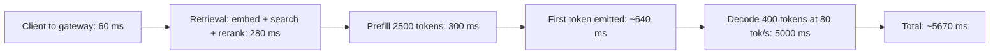

import TOCInline from '@theme/TOCInline';

# Cost & Latency Optimization

<TOCInline toc={toc} minHeadingLevel={2} maxHeadingLevel={2} />

:::tip[In this guide]
Build a cost model you can defend, break a latency target into parts you can
measure, and work the levers in the order that actually pays. Most of this
reduces to one fact: output tokens are expensive and serial.
:::

## What Is It?

Two budgets that share a cause. **Cost** is dollars per request; **latency** is
seconds per request. Both are dominated by how many tokens you push through a
model, so most optimisations move both numbers at once — which is unusual and
worth exploiting.

## Why Does It Matter?

Token economics has one asymmetry that drives everything:

| | Input tokens | Output tokens |
| --- | --- | --- |
| Unit price | Baseline | Typically 3–5x input |
| Generation | Parallel, one forward pass over the prompt | Serial, one pass per token |
| Effect on latency | Small and sublinear | Large and linear |
| Your control | Prompt and retrieval design | `max_tokens` and instructions |

A 400-token answer costs four times a 100-token answer and takes four times as
long to produce, regardless of how clever your infrastructure is. Brevity is
simultaneously your biggest cost lever and your biggest latency lever. Nothing
else in this page has that property.

The flip side: input tokens are cheap per unit but there are usually far more
of them. A RAG prompt with 2,500 input tokens and 400 output tokens spends more
on input than output even at a 3x price ratio. Both ends need attention.

## Build a Cost Model

Model a realistic assistant: a hybrid-retrieval RAG endpoint with a 600-token
system prompt, roughly 1,700 tokens of retrieved context, a 200-token question
and a 400-token answer. Prices below are illustrative mid-tier figures — put
your provider's current numbers in before quoting any of this.

Assumptions: input `$0.50` per 1M tokens, output `$1.50` per 1M, embeddings
`$0.02` per 1M, reranking `$1.00` per 1,000 queries.

| Component | Per request | 10k / month | 100k / month | 1M / month |
| --- | --- | --- | --- | --- |
| Input tokens (2,500) | `$0.00125` | `$12.50` | `$125.00` | `$1,250.00` |
| Output tokens (400) | `$0.00060` | `$6.00` | `$60.00` | `$600.00` |
| Query embedding (30 tok) | `$0.0000006` | `$0.01` | `$0.06` | `$0.60` |
| Reranking (20 candidates) | `$0.00100` | `$10.00` | `$100.00` | `$1,000.00` |
| Vector store (hosted) | — | `$25.00` | `$70.00` | `$250.00` |
| **Total** | | **`$53.51`** | **`$355.06`** | **`$3,100.60`** |
| **Cost per request** | | `$0.0054` | `$0.0036` | `$0.0031` |

Three things fall out of this table that people consistently guess wrong:

- **Input dominates output**, two to one, despite output costing 3x per token.
  Shrinking retrieved context is the highest-leverage cost work in most RAG
  systems, and nobody looks there first.
- **Reranking is about a third of variable cost** at scale. A per-query-priced
  component quietly becomes a peer of the LLM bill. Price every API in the
  pipeline, not just the model.
- **Fixed infrastructure stops mattering** above roughly 100k requests. Below
  that, your bill is mostly the vector store and you are optimising the wrong
  thing.

Build this table for your own system before optimising anything. A cost model
you can edit beats a benchmark you cannot.

## The Levers, Ranked

| Lever | Effort | Typical saving | Latency effect | Risk |
| --- | --- | --- | --- | --- |
| Cut output length (`max_tokens`, "be brief") | Very low | 10–30% | Large improvement | Truncated answers if too aggressive |
| Prompt caching | Low | 25–50% of input cost | Faster prefill | None, if ordering is stable |
| Trim retrieved context (fewer, tighter chunks) | Low | 15–40% | Faster prefill | Recall loss if overdone |
| Answer caching | Low | 2–20% | Huge on hits | Staleness |
| Drop or downgrade the reranker | Low | Up to 30% | Faster | Measurable recall loss |
| Smaller model for the whole route | Low | 60–90% | Faster | Quality loss, needs eval |
| Model cascade | Medium | 40–80% | Worse p95 on escalation | Needs validatable output |
| Shorter system prompt | Medium | 5–15% | Minor | Behaviour drift |
| Batching (offline work only) | Medium | 30–50% on provider batch tiers | Much worse | Wrong for interactive |
| Self-hosting | High | 50–80% at high volume | Depends on your ops | Real operational cost |
| Quantization on self-hosted | Medium | 30–50% of GPU spend | Faster | Quality loss, needs eval |
| Not calling the model at all | Low | 100% of those requests | Instant | Needs intent routing |

Work top-down. The first four items are a week of work combined and routinely
take 40% off the bill with no quality review needed. Self-hosting is at the
bottom not because it does not work, but because the saving arrives with a
permanent on-call obligation, and teams reach for it before they have done the
cheap work.

## Prompt Caching Economics

Providers cache the computation for a stable prefix of your request. If your
system prompt and tool schemas are byte-identical across calls and sit at the
front, the input tokens covered by the prefix are billed at a large discount —
commonly 75–90% off — and prefill gets faster.

For the model above, with 600 system tokens plus roughly 400 tokens of stable
few-shot examples cached at 90% off:

| | Uncached | Cached prefix |
| --- | --- | --- |
| Billed input tokens | 2,500 | 1,500 + (1,000 × 0.1) = 1,600 |
| Input cost per request | `$0.00125` | `$0.00080` |
| Monthly at 1M requests | `$1,250` | `$800` |

A 36% cut to input cost for a reordering change and a discipline rule. There is
no quality tradeoff, which makes it the best return per hour of work in this
entire page.

The discipline rule is the whole trick: **nothing variable may appear before
the cached boundary.** A timestamp, a request id, a user name or a shuffled
tool order in the system prompt invalidates the prefix on every call and your
hit rate is zero while your code looks correct. The ordering rules are in
[context engineering](../04-prompt-engineering/04-context-engineering.mdx).

Verify it rather than assuming it. Providers report cached token counts in the
usage object; put cache-hit rate on a dashboard, because a prompt edit six
months from now will silently break it.

## Latency Budget

Pick a p95 target, then decompose it. Here is a 6-second p95 target for the
same RAG endpoint, with a self-hosted 8B model decoding at about 80 tokens per
second per stream.



| Stage | Budget | Share | Scales with |
| --- | --- | --- | --- |
| Network and gateway | 60 ms | 1% | Hops, TLS, region |
| Query embedding | 40 ms | 1% | Model size |
| Vector search | 60 ms | 1% | Index size, `top_k` |
| Reranking | 180 ms | 3% | Candidate count |
| Prefill | 300 ms | 5% | Input tokens |
| Decode | 5,000 ms | 88% | **Output tokens** |
| Serialisation | 30 ms | 1% | Response size |

Decode is 88% of the budget. That has a blunt consequence: **optimising
retrieval is almost always wasted effort.** Shaving 100 ms off vector search is
2% of a budget where halving output length is 44%. Teams spend weeks on index
tuning and ship a 400-token answer where 150 would do.

You need **two targets, not one**, because they come from different stages and
move independently:

| Metric | What it measures | Driven by | Realistic p95 target |
| --- | --- | --- | --- |
| Time to first token | Retrieval plus prefill | Input tokens, retrieval depth | 800 ms |
| Total response time | Everything | Output tokens, decode speed | 6 s |

A single "latency" number hides the trade. Adding a reranker worsens TTFT but
may shorten the answer and improve total time. Measure both or you cannot see
that. The engine-level mechanics behind prefill, decode and KV cache are in
[GPU serving engines](./02-gpu-serving-engines.mdx).

## Streaming Is Perceived Latency

Streaming does not make generation faster. The last token arrives at the same
time. What it changes is when the user sees the first one — from 5.7 seconds to
0.6 seconds in the budget above.

That is legitimate when the user reads sequentially: chat, prose answers,
explanations. They start consuming at 600 ms and the remaining 5 seconds
overlap with reading.

It is not legitimate in three cases, where you are hiding a problem rather than
solving one. **Structured output** is useless until complete, so streaming JSON
shows the user a progress bar made of syntax. **Validated output** cannot be
streamed raw if you check schema, citations or grounding before display. And
**streaming instead of shortening** is self-deception: a 2,000-token answer
that should have been 200 still costs 10x and still holds a worker for 25
seconds. The bill does not care that it felt fast.

Streaming also costs you operationally: long-lived connections, buffering
proxies to configure, and a harder time measuring "done".

## Batching Is for Throughput, Not Latency

Batching trades per-request latency for hardware or price efficiency. Two
different things wear the name:

| Kind | What it is | Latency effect | Use for |
| --- | --- | --- | --- |
| **Continuous batching** | The serving engine interleaves concurrent requests | Mild, well-managed | Always on, interactive included |
| **Request batching** | You collect N items and submit them together | Adds the collection window plus the whole batch time | Offline jobs only |
| **Provider batch tier** | Submit a file, get results within hours, 50% off | Hours | Nightly and backfill work |

Continuous batching is a property of the engine and you want it on; see
[GPU serving engines](./02-gpu-serving-engines.mdx).

Request batching for interactive traffic is the mistake. A 200 ms collection
window plus a batch whose completion time is set by its *slowest* member means
every user waits for the worst request in the group. You converted a
predictable p95 into an unpredictable one to save money you could have saved by
shortening prompts.

Provider batch tiers are excellent for anything in a queue already: embedding a
corpus, bulk classification, nightly summarisation. Route those through
[queues and async jobs](./06-queues-and-async-jobs.mdx) and take the discount.

## Autoscaling

Scale on the wrong signal and you will either overpay constantly or fall over
under load.

| Signal | Use for LLM serving? | Why |
| --- | --- | --- |
| CPU utilisation | **No** | The process is waiting on a GPU or a network call. CPU stays flat while latency triples. |
| GPU utilisation | Weak | Already high under continuous batching; it saturates before latency does and gives no headroom warning. |
| In-flight concurrency per replica | **Yes** | Directly maps to the engine's batch capacity. |
| Queue depth and oldest-message age | **Yes** | Leading indicator: it rises before latency does. |
| p95 latency | As a guardrail | Lagging — by the time it moves, users are affected. |

Scale on concurrency per replica for synchronous paths and queue depth for
async paths. Use latency only as a backstop alarm.

**GPU cold starts break naive autoscaling.** A new replica must pull a
multi-gigabyte image, load weights into VRAM, and warm up the engine: 60
seconds to several minutes before it serves one request, against a spike that
arrives in ten. So scale up on a leading indicator (queue depth) so the replica
is ready when load lands; scale up fast and down slowly, because aggressive
scale-down plus slow warm-up oscillates and you pay for cold starts repeatedly;
keep a provisioned minimum sized for your trough, since an idle GPU is cheaper
than the latency cliff; and pre-warm before known daily peaks.

Scale-to-zero is right for development, demos, and genuinely bursty offline
batch work where a two-minute first-request penalty is acceptable. It is wrong
for anything a human waits on.

## Capacity Planning for Self-Hosted Inference

Requests per second per replica comes out of throughput and average output
length. Do the arithmetic before buying anything.

```python
def rps_per_replica(
    output_tokens_per_sec: float,      # measured aggregate, all streams
    avg_output_tokens: float,
    target_utilisation: float = 0.70,  # headroom for bursts
) -> float:
    return (output_tokens_per_sec / avg_output_tokens) * target_utilisation


def replicas_needed(
    monthly_requests: float,
    avg_output_tokens: float,
    output_tokens_per_sec: float,
    peak_to_mean: float = 5.0,         # measure yours; 3-10x is common
) -> int:
    mean_rps = monthly_requests / (30 * 24 * 3600)
    peak_rps = mean_rps * peak_to_mean
    per_replica = rps_per_replica(output_tokens_per_sec, avg_output_tokens)
    import math
    return max(2, math.ceil(peak_rps / per_replica))   # 2 = minimum for HA
```

Worked through, for an 8B model on one GPU measuring 2,000 output tokens per
second aggregate, a 400-token average answer, and 1M requests per month:

| Step | Arithmetic | Result |
| --- | --- | --- |
| Capacity per replica | 2,000 ÷ 400 | 5.0 rps |
| Usable at 70% | 5.0 × 0.70 | 3.5 rps |
| Mean load | 1,000,000 ÷ 2,592,000 s | 0.39 rps |
| Peak load at 5x | 0.39 × 5 | 1.93 rps |
| Replicas for peak | ceil(1.93 ÷ 3.5) | 1 |
| Replicas deployed | max(2, 1), for HA | **2** |

Two numbers decide this, and both must be measured rather than assumed.
`output_tokens_per_sec` is aggregate throughput at your real batch size, not
the single-stream speed on a brochure. `peak_to_mean` is the one people skip —
provisioning for the mean guarantees failure at peak, and 5x is a modest
assumption for human-driven traffic. VRAM and quantization sizing is in
[GPU sizing and quantization](./03-gpu-sizing-and-quantization.mdx).

Compare the result honestly against hosted pricing. Two always-on GPUs is a
real monthly commitment; at 1M requests a month the hosted bill in the model
above was `$3,100`. Self-hosting wins at high and predictable volume, and loses
at low or spiky volume, every time.

## Cost Attribution and Showback

An undifferentiated provider invoice generates one conversation: "the AI bill
is too high." Attributed spend generates useful ones.

Tag every call at the gateway with tenant, team, route, model, prompt version
and `served_by` tier — see
[Model Gateway & Fallbacks](./07-model-gateway-and-fallbacks.mdx) — then expose
it back to the teams that spend it.

| Report | Answers | Drives |
| --- | --- | --- |
| Cost per request, by route | Which feature is expensive | Prompt and retrieval work |
| Monthly spend by team | Who to involve | Showback conversations |
| Cost per tenant versus revenue | Which customers lose money | Pricing and plan limits |
| Cost per request over time, by prompt version | Whether a change regressed | Release gating |
| Token split, input versus output | Where to trim | Targeted optimisation |

**Showback** (reporting spend to each team) is usually enough; **chargeback**
(billing them) adds accounting overhead for marginal extra behaviour change.
Teams that can see their own line on a dashboard mostly fix it themselves.

Treat cost per request as a release gate. A prompt change that improves quality
3% and raises cost 60% is a decision someone should make deliberately, and they
cannot if the number is not in the pull request.

## A Cost-Reduction Playbook

Order matters, and so does the measurement step between each. Change two things
at once and you learn nothing.

1. **Instrument first.** Tokens in, tokens out, cost per request, by route.
   Without this the guess is usually "the model is expensive" when the answer
   is "we retrieve 12 chunks and need 4".
2. **Find the top three routes by total spend** — cost per request times
   volume, never cost per request alone.
3. **Cap output length.** Set `max_tokens` from the p99 of genuinely useful
   answers and ask for brevity. This is where truncation complaints come from,
   so check quality.
4. **Turn on prompt caching.** Reorder for a stable prefix; verify the reported
   hit rate is above 70%.
5. **Trim retrieved context.** Drop `top_k`, tighten chunks. Confirm recall@k
   has not moved before accepting the saving.
6. **Add answer caching** where staleness is acceptable, keyed with tenant,
   model and corpus version.
7. **Try the smaller model** on the cheapest route, offline, against your eval
   set. Promote only on evidence.
8. **Add a cascade** if the output is validatable, then watch the escalation
   rate for a week before believing the saving.
9. **Move offline work to batch tiers** and queues.
10. **Only now consider self-hosting**, with the arithmetic above and an honest
    estimate of the operational cost.

Re-measure cost per request *and* eval scores after each step. A saving that
quietly cost 8% answer quality is not a saving, it is an unpriced trade.

## The Cheapest Call Is the One You Do Not Make

Worth stating plainly, because it beats every lever in the table:

- **Cache aggressively** where correctness allows. A hit costs nothing and
  returns in milliseconds.
- **Route to a non-LLM path** when one exists. "What is my account balance?" is
  a database query. Classify intent cheaply and send deterministic questions to
  deterministic code.
- **Reject out-of-scope requests early.** A one-cent classifier declining
  before a thirty-cent generation is a 30x saving, and a better product than a
  confident off-topic answer.
- **Do not generate what nobody reads.** Pre-generating suggestions where the
  UI shows one is pure waste. Generate lazily.

## Common Mistakes

- Optimising retrieval latency when decode is 88% of the budget.
- One "latency" number, with no separate time-to-first-token target.
- Streaming a long answer instead of shortening it.
- Request-batching interactive traffic.
- Autoscaling LLM serving on CPU, or scale-to-zero on a user-facing GPU path.
- Provisioning for mean load and meeting peak unprepared.
- A variable token in the system prompt, zeroing the prompt-cache hit rate, and
  never re-checking the hit rate after a prompt edit.
- Pricing only the model and missing per-query reranking.
- Assuming output tokens dominate cost when input volume is 6x larger.
- Self-hosting before doing the cheap prompt work.
- Quoting single-stream tokens-per-second as capacity.
- One provider invoice with no per-team or per-tenant attribution.
- Changing three levers at once and not knowing which one worked.

## Interview Questions

- Why are output tokens more expensive than input tokens in both money and
  time?
- Walk me through a cost model for a RAG assistant at 1M requests a month.
  Which component surprises people?
- Where does the time actually go in a 6-second LLM response?
- Why do you need separate TTFT and total-time targets?
- Is streaming a latency optimisation? When is it the wrong answer?
- Why is request batching wrong for interactive traffic but right for
  ingestion?
- What signal would you autoscale LLM serving on, and why not CPU?
- Why do GPU cold starts break naive autoscaling, and what do you do about it?
- Derive requests per second per replica from tokens per second.
- When is self-hosting cheaper than a hosted API, and when is it not?
- What breaks prompt caching, and how would you detect it?
- Rank the cost levers by return on effort.

## Things to Remember

- Output tokens are priced higher and generated serially: brevity cuts cost and
  latency together.
- Input volume usually exceeds output volume, so trim context as well as
  answers.
- Price every component. Reranking can rival the model bill.
- Decode dominates the latency budget; retrieval tuning is mostly noise.
- Track time-to-first-token and total time separately.
- Prompt caching is the best return per hour of work, and one variable token
  destroys it.
- Autoscale on concurrency and queue depth, keep a provisioned minimum, scale
  down slowly.
- Size capacity from measured aggregate throughput and a real peak-to-mean
  ratio.
- Attribute spend per tenant, team and prompt version, and gate releases on
  cost per request.
- The cheapest request is the one that never reaches the model.

## Mini Exercise

1. Instrument your `/ask` endpoint to record input tokens, output tokens, model
   and computed cost per request, then build the cost table above with your own
   prices at 10k, 100k and 1M requests a month.
2. Measure your current p95 split: retrieval, prefill, decode. Report decode as
   a percentage of total.
3. Halve `max_tokens` and shorten the retrieved context by a third. Re-measure
   cost per request, p95 total time and your eval score. Keep the change only
   if quality held.
4. Reorder your prompt for a stable cached prefix, then confirm the provider's
   reported cached-token count is above 70% of your system prompt.
5. Compute `replicas_needed` for your traffic with a measured aggregate
   tokens-per-second figure, then compare the monthly GPU cost against your
   hosted bill.

## Done When

- [ ] You have a cost model with every component priced, at three traffic
      levels.
- [ ] Cost per request is recorded per route, tenant and prompt version.
- [ ] You know the decode share of your p95 and have separate TTFT and total
      targets.
- [ ] Output length is capped from real data, and prompt caching is on and
      verified.
- [ ] Offline work runs on queues and batch tiers, not the interactive path.
- [ ] Autoscaling uses concurrency or queue depth, with a provisioned minimum.
- [ ] Self-hosting decisions are backed by the capacity arithmetic, not a
      hunch.
- [ ] Every optimisation was measured against both cost and eval score.

Next: [Security & Privacy](./09-security-and-privacy.mdx).
