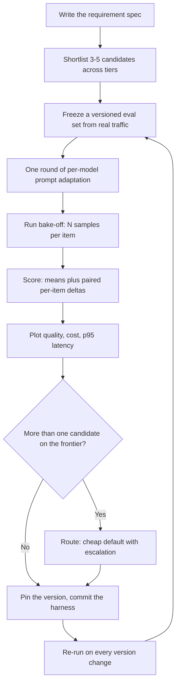

import TOCInline from '@theme/TOCInline';

# Model Selection & Benchmarking

<TOCInline toc={toc} minHeadingLevel={2} maxHeadingLevel={2} />

:::tip[In this guide]
Turn "which model should we use" from an opinion into a measurement. Write a
requirement spec, shortlist three to five candidates, run a bake-off on your
own traffic, and decide on the cost/quality frontier instead of the
leaderboard.
:::

## What Is It?

The process that takes a task and returns a defensible model choice plus the
evidence for it: write the requirements, shortlist candidates, run a bake-off
on a frozen eval set, place the results on a cost/quality frontier, schedule
the re-run. Reading a leaderboard is an input to step two, nothing more.



## Why Does It Matter?

Public leaderboards answer a question you do not have. They measure average
performance on general benchmarks; you need performance on your task, your data
distribution, your latency budget and your cost ceiling. Those are different
questions and they often have different answers. A model ranked fourth overall
can be the best choice for a schema-constrained extraction task — more reliable
valid JSON, a fifth of the cost, half the latency, while losing on the
competition-maths items that drove its ranking down. You do not ship
competition maths.

Selection decisions also get baked into prompts, evals, fine-tuning plans and
capacity models, so revisiting one six months later is expensive. Two days of
bake-off up front is cheap by comparison.

## Why Public Benchmarks Mislead

| Failure | What happens | Consequence for you |
| --- | --- | --- |
| **Contamination** | Test sets end up in pretraining data | The score measures memorisation, not capability |
| **Aggregation** | One headline number averages many capabilities | Strong at code, weak at extraction, still looks "good" |
| **Prompt gap** | Benchmarks use short, clean, few-shot prompts | Your 2,000-token RAG prompt with a schema is a different task |
| **Harness variance** | Scoring, parsing and sampling differ | The same model scores points apart across harnesses |
| **Vendor framing** | Reported numbers are chosen, not sampled | Conditions favour the reporter |
| **Distribution** | Public-web English prose | Your jargon, formats and languages are absent |

Contamination is the hardest to detect and the most corrosive: a test set that
has been public for two years tells you very little, and the gap between
benchmark score and observed quality tends to be widest on exactly the
benchmarks everybody quotes.

Leaderboards are still useful for one job — narrowing hundreds of models to a
handful worth testing. Use them to build the shortlist, then stop. "It is top
of the leaderboard" is a measurement claim you cannot support.

## Write the Requirement Spec First

Most selection arguments are not disagreements about models, they are
disagreements about unstated requirements: one person is optimising quality,
another the p95, and neither has said so. Write them down and the argument
usually resolves itself.

| Requirement | Specify it as | Example |
| --- | --- | --- |
| Task shape | Input, output, schema | Invoice text in, 11-field JSON out |
| Quality bar | Metric, threshold, grader | 95% field-exact on the gold set, programmatic |
| Latency | p95 end to end, not mean | p95 under 4s including retrieval |
| Cost ceiling | Per request and per month at volume | Under $0.004 per request, under $6,000 at 1.5M |
| Deployment | Residency, self-host, data terms | EU-only, no training on our data |
| Context | Tokens at p99 of real inputs | 24k input tokens at p99 |
| Structured output | Enforced or best-effort | Constrained decoding required |
| Tool calling | Parallel calls, reliability | Up to 4 parallel, 98% well-formed |
| Languages | Which, at what quality | English and German at parity |

Express the quality bar as a check, not an adjective: "accurate" is not a
requirement, "95% field-exact against the gold set" is. See
[metrics](../12-evaluation-testing-and-observability/03-metrics.mdx) for choosing one and
[LLM-as-judge](../12-evaluation-testing-and-observability/04-llm-as-judge.mdx) for tasks with no
programmatic check. Mark every entry hard or soft — hard requirements such as
residency or no-training-on-our-data eliminate candidates on day one, and
discovering that after the bake-off is wasted work.

## Build the Shortlist

Span the cost/quality space rather than taking the top five of one list. The
goal is to learn the shape of the trade-off for your task.

| Tier | Why it is on the list |
| --- | --- |
| Small / cheap hosted | Often sufficient for extraction, classification, routing |
| Mid hosted | The usual default; the baseline others must beat |
| Frontier hosted | Establishes the quality ceiling even if unaffordable |
| Reasoning | Verifiable multi-step tasks; see [reasoning models](../03-llm-fundamentals/06-reasoning-models.mdx) |
| Open-weight, self-hostable | A cost control and a lock-in control |

Three to five candidates maximum — each costs prompt-adaptation, harness and
review time, and candidate six adds little. Keep the frontier model even if you
cannot afford it: its score is the ceiling that tells you whether the cheap
candidate loses 2 points or 20. Keep the open-weight option even if you never
deploy it, because a credible alternative changes both your pricing
conversations and your exposure to a provider's roadmap.

## The Bake-Off

**Freeze a versioned eval set drawn from real traffic.** Sample production logs,
stratified across the input types you actually see, including the malformed
ones. Version it in the repo and never edit it mid-comparison — see
[eval datasets](../12-evaluation-testing-and-observability/02-eval-datasets.mdx). Synthetic sets select
for the model that resembles whatever generated them.

**Allow one round of per-model prompt adaptation.** This is the step most
bake-offs get wrong. Prompts are not portable: formatting conventions,
instruction-following strictness, tolerance for long system prompts and
structured-output behaviour all differ. Running your incumbent-tuned prompt
unchanged against a challenger measures prompt fit, not capability, and it
systematically favours the incumbent. Give every candidate the same time-boxed
round, then freeze and commit the final prompt per candidate.

**Run N samples per item.** One sample cannot distinguish a model that is
reliably mediocre from one that is excellent two thirds of the time. Three to
five at production temperature; record the spread, and for tasks where one bad
output is costly, worst-of-N matters more than the mean.

**Record per item:** quality score, input tokens, output tokens including
reasoning tokens, client-side wall-clock latency, and the failure mode. Failure
modes are the most useful column — "schema invalid", "refused", "truncated" and
"wrong field" are different problems, and a candidate whose failures are all
schema-invalid may be fixable with constrained decoding.

## A Bake-Off Harness

Keep this in the repo so adding a candidate is an afternoon, not a project.

```python
import asyncio, csv, time
from dataclasses import dataclass, asdict, fields

@dataclass(frozen=True)
class Candidate:
    name: str            # "A-small-hosted"
    model: str           # pinned version string
    prompt_path: str     # per-candidate adapted prompt
    usd_in_per_mtok: float
    usd_out_per_mtok: float

@dataclass
class Row:
    candidate: str; item_id: str; sample: int
    score: float; tokens_in: int; tokens_out: int
    latency_s: float; failure: str = ""

SAMPLES = 3
SEM = asyncio.Semaphore(8)            # respect provider rate limits

async def run_one(c: Candidate, item: dict, k: int, client) -> Row:
    prompt = open(c.prompt_path).read().format(**item["inputs"])
    t0 = time.perf_counter()
    async with SEM:
        try:
            resp = await client.complete(model=c.model, prompt=prompt,
                                         temperature=0.2, max_tokens=800)
        except Exception as exc:
            return Row(c.name, item["id"], k, 0.0, 0, 0,
                       time.perf_counter() - t0, type(exc).__name__)
    dt = time.perf_counter() - t0
    score, failure = grade(item, resp.text)     # programmatic or judge
    return Row(c.name, item["id"], k, score,
               resp.usage.input_tokens,
               resp.usage.output_tokens + resp.usage.reasoning_tokens,
               dt, failure)

async def bake_off(candidates, eval_set, client, out="results.csv"):
    rows = await asyncio.gather(*[
        run_one(c, item, k, client)
        for c in candidates for item in eval_set for k in range(SAMPLES)
    ])
    with open(out, "w", newline="") as fh:
        w = csv.DictWriter(fh, [f.name for f in fields(Row)])
        w.writeheader()
        w.writerows(asdict(r) for r in rows)
    return rows

def cost_per_1k(rows, c: Candidate) -> float:
    mine = [r for r in rows if r.candidate == c.name]
    t_in = sum(r.tokens_in for r in mine) / len(mine)
    t_out = sum(r.tokens_out for r in mine) / len(mine)
    per_req = (t_in * c.usd_in_per_mtok + t_out * c.usd_out_per_mtok) / 1e6
    return per_req * 1000
```

Three details worth copying. Latency is measured client-side, because
provider-reported timings exclude queueing and network. Reasoning tokens are
added into `tokens_out`, because they are billed as output even when you never
see them. Every row is written to disk, so re-scoring happens offline instead
of needing another paid run. Wire the same harness into CI once you have
chosen — see [eval in CI](../12-evaluation-testing-and-observability/05-eval-in-ci.mdx).

## Scoring and Deciding

Aggregate per candidate, then look past the aggregate. The mean says who won on
average; it hides the distribution of deltas, which is what users experience.
Candidate B scoring 3 points above A can mean B is uniformly slightly better,
or that B is much better on 60% of items and clearly worse on 40%. The second
case ships a regression, and the complaints come from whoever's queries landed
in the losing 40% regardless of the mean.

Report paired results on identical items:

```text
Candidate B vs Candidate A, 300 items, 3 samples each
  B wins    : 164 items
  A wins    :  92 items
  ties      :  44 items
  mean delta: +3.1 points
  worst regression: numeric-table extraction (A 0.91 -> B 0.58)
```

That last line is the decision-relevant one. A category where the challenger
collapses is either a blocker or a routing rule, and the mean will never show
it to you.

**Significance sanity.** For binary-scored items the standard error is roughly
the square root of `p * (1 - p) / n`. At a score of 0.80 with 40 items that is
about 6 points, so the 95% interval spans roughly 12 points: a 2-point
difference on 40 items is noise. At 400 items the standard error is about 2
points, so a 5-point gap is meaningful and a 1-point gap still is not. Paired
comparison on identical items is much tighter than comparing two independent
means, because item difficulty cancels — which is why every candidate must run
the same frozen set. If you report nothing else, report win/loss/tie counts
rather than two bare averages.

## The Cost/Quality Frontier

Assumptions: 2,000 input and 400 output tokens per request, 1.5M requests per
month. Prices are illustrative, not current.

| Candidate | Assumed price (in / out per 1M) | Quality | Per 1k req | p95 | Monthly at 1.5M |
| --- | --- | --- | --- | --- | --- |
| A (small, hosted) | $0.15 / $0.60 | 71 | $0.54 | 2.9s | $810 |
| B (mid, hosted) | $0.50 / $1.50 | 84 | $1.60 | 3.1s | $2,400 |
| C (frontier, hosted) | $3.00 / $12.00 | 89 | $10.80 | 5.2s | $16,200 |
| D (reasoning, hosted) | $3.00 / $12.00 plus 1,200 reasoning tokens | 91 | $25.20 | 14.0s | $37,800 |
| E (open-weight, self-hosted) | GPU hours, below | 82 | $0.37 | 2.8s | $5,760 |

Arithmetic for B: input 2,000 tokens at $0.50 per million is $0.0010, output
400 at $1.50 per million is $0.0006, so $0.0016 per request, $1.60 per 1,000,
$2,400 at 1.5M. D uses the same list price as C but bills 1,200 hidden
reasoning tokens as output, which is why it costs more than twice as much per
request — reasoning models are priced by behaviour, not by rate card.

A candidate is **on the frontier** if nothing else beats it on all three axes.
Here E is cheaper, faster and better than A, so A is **dominated** and drops
out. B, C, D and E each win at something, so the decision is among those four,
and the remaining question is what a quality point is worth to the business.

Two caveats. Domination holds only within your requirements: if self-hosting is
excluded by a hard requirement, E disappears and A returns. And the frontier is
per task — run the same arithmetic for summarisation and the ordering can
invert. For rolling these numbers into a plan, see
[capacity and cost estimation](../16-ai-system-design/07-capacity-and-cost-estimation.mdx)
and [cost and latency](./08-cost-and-latency.mdx).

## Open-Weight vs Hosted: Break-Even

The comparison people get wrong is per-token price against per-token price.
Self-hosting has no per-token price. You rent GPUs by the hour and they bill
whether or not traffic arrives, so the whole question is utilisation.

Assume $2.00 per GPU-hour, a two-GPU replica, and a serving engine sustaining
1,200 output tokens per second aggregate — see
[GPU serving engines](./02-gpu-serving-engines.mdx) and
[GPU sizing and quantization](./03-gpu-sizing-and-quantization.mdx).

```text
Replica cost      : 2 GPUs x $2.00/h            = $4.00/h = $2,880/month (720h)
Throughput        : 1,200 tok/s / 400 tok       = 3 req/s = 10,800 req/h
Monthly capacity  : 10,800 x 720                = 7.78M requests
Cost at 100% util : $4.00 / 10,800              = $0.00037/req ($0.37 per 1k)

Break-even vs B ($0.0016/req) : $2,880 / $0.0016  = 1.80M req/mo = 23% util
Break-even vs A ($0.00054/req): $2,880 / $0.00054 = 5.33M req/mo = 69% util
```

Against a mid-tier hosted model, self-hosting pays from roughly a quarter of
one replica's capacity. Against a small hosted model it needs about 70%
utilisation, which is hard to sustain with diurnal traffic and leaves no
headroom for spikes. That single difference explains most arguments about
whether self-hosting is cheaper: both sides are right about different tiers.

Then adjust for reality. Redundancy means two replicas, which doubles the fixed
cost and the break-even volume. Spiky traffic means provisioning for peak and
paying for troughs. An on-call engineer maintaining the serving stack is a real
recurring cost no per-token comparison shows.

| Dimension | Hosted | Self-hosted open-weight |
| --- | --- | --- |
| Version stability | Changes under you, sometimes silently | Exactly the weights you deployed |
| Data residency | Provider regions only | Wherever you run it |
| Tail latency | Shared capacity, provider queueing | Yours to control and to break |
| Fine-tuning | Provider-gated if offered; see [when to fine-tune](../14-fine-tuning-and-model-adaptation/01-when-to-fine-tune.mdx) | Full access |
| Lock-in | Pricing and roadmap are not yours | None |
| Operational burden | Low | Serving, upgrades, capacity, on-call |

Version stability is undersold. For a regulated workload, "the model cannot
change unless we change it" is sometimes worth more than the whole cost
difference.

## Version Drift and Re-Selection

A hosted model is a moving target, so a bake-off result has a shelf life.

- **Pin explicit versions** wherever the provider exposes them. Never point
  production at a floating alias; aliases are convenient precisely because they
  change, which is the thing you do not want.
- **Re-run the eval set on every announced version change**, before migrating.
  This is the whole reason the harness lives in the repo.
- **Keep an eval-only canary** on the floating alias so you see drift before
  your users do.
- **Re-select on a schedule**, quarterly or when prices move. The cheap tier
  improves fastest, so the common finding is that a task given to the frontier
  model two quarters ago now passes on the mid tier.
- **Store the evidence with the decision**: eval set version, prompt per
  candidate, model version strings, date, results CSV. Without it the next
  person re-litigates from scratch.

Selection is a recurring process with a maintained harness, not a one-time
decision captured in a slide.

## Routing Instead of Choosing

The frontier does not force one answer, and the mature setup is usually more
than one model: a cheap default handling the bulk of traffic, escalating when a
validator fails, a confidence signal is low, or the request classifies as hard.
That turns selection into a per-request routing decision and captures most of
the cheap model's cost advantage with most of the strong model's quality.

It needs two things the bake-off already produced: per-item deltas showing
which inputs the cheap model loses on, and a checkable escalation signal. Build
it at the [model gateway](./07-model-gateway-and-fallbacks.mdx) so the routing
table is configuration rather than a deploy. It is not free — two prompts, two
eval runs, and an escalation rate that drifts upward turns the saving into an
increase.

## Common Mistakes

- Choosing from a leaderboard and calling it a decision.
- Starting the bake-off before the requirements are written, so the comparison
  optimises an axis nobody agreed on.
- Running the incumbent's tuned prompt against every challenger, which measures
  prompt fit and favours the incumbent.
- One sample per eval item, so variance reads as capability.
- A 40-item eval set and a 2-point winner.
- Comparing means with no paired per-item deltas, then shipping a regression on
  one input category.
- Ignoring reasoning tokens, understating a reasoning model several times over.
- Using provider-reported latency instead of client-side wall clock.
- Comparing hosted per-token price to self-hosted per-token price with no
  utilisation assumption anywhere.
- Costing one self-hosted replica, then needing two for redundancy.
- Evaluating on synthetic data that resembles the generator more than your
  traffic.
- Pointing production traffic at a floating model alias.
- Running the bake-off in a notebook that gets deleted.
- Deciding among dominated candidates because nobody drew the frontier.

## Interview Questions

- Why can a model ranked fourth on public benchmarks be the right choice?
- What is benchmark contamination and how does it distort selection?
- What belongs in a model requirement spec, and which entries eliminate
  candidates before any testing?
- Why should a shortlist span cost tiers instead of taking the top five of one
  list?
- Why include a frontier model you cannot afford and an open-weight model you
  may not deploy?
- Why is holding the prompt identical across candidates the wrong protocol?
- Why run multiple samples per eval item?
- B beats A by 3 points on the mean. What else do you need before shipping B?
- How many eval items do you need to call a 2-point difference real?
- Define the cost/quality frontier and what makes a candidate dominated.
- At what utilisation does self-hosting beat a mid-tier hosted model, and how
  does the answer change against a small one?
- Name three non-cost reasons to self-host an open-weight model.
- How do you detect that a hosted model's behaviour has changed?
- When is the right answer two models instead of one?

## Things to Remember

- Leaderboards build shortlists; bake-offs make decisions.
- Requirements first — most model arguments are unstated-requirement arguments.
- Three to five candidates spanning cheap, mid, frontier, reasoning and
  open-weight.
- Freeze a versioned eval set from real traffic; never edit it mid-comparison.
- Prompts are not portable: one adaptation round per candidate, then freeze.
- Record quality, both token counts, client-side latency and the failure mode
  per item.
- Report paired win/loss/tie and the worst regression, not just the mean.
- Small eval sets cannot resolve small differences; do the standard-error
  arithmetic.
- Decide only among frontier candidates and name the dominated ones.
- Self-hosting is a utilisation bet, and redundancy doubles the break-even.
- Pin model versions and re-run the eval set on every version change.
- Keep the harness in the repo so re-selection takes a day.
- The best answer is often a cheap default with escalation.

## Mini Exercise

Pick one real task with a checkable output, such as field extraction from a
document.

1. Write the requirement spec: task shape, quality metric and threshold, p95
   budget, cost ceiling per request and per month at expected volume,
   deployment constraints, p99 context length. Mark each entry hard or soft.
2. Build a 200-item eval set from production logs, stratified across input
   types and including malformed ones. Commit it with a version tag.
3. Shortlist four candidates — small hosted, mid hosted, frontier hosted,
   open-weight — and drop any that fail a hard requirement before spending.
4. Time-box one prompt-adaptation round per candidate and commit each prompt.
5. Run the harness with three samples per item and produce the results CSV with
   quality, both token counts, latency and failure mode per row.
6. Report per-candidate means, paired win/loss/tie against the incumbent, and
   the standard error. State whether the margin is real.
7. Build the frontier table with quality, cost per 1,000 requests and p95, and
   name the dominated candidates and why.
8. For the open-weight candidate, compute monthly replica cost, monthly request
   capacity, and break-even volume against each hosted candidate. Double it for
   redundancy.
9. Write a one-page decision record: choice, evidence, eval set version, model
   version strings, next re-run date.

Next: [Model Gateway & Fallbacks](./07-model-gateway-and-fallbacks.mdx).
