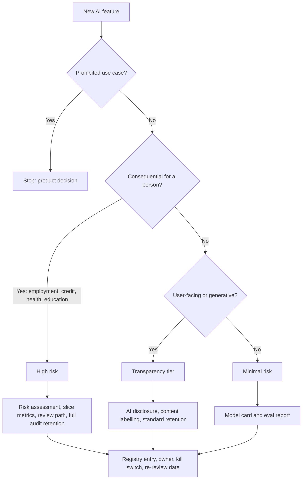

import TOCInline from '@theme/TOCInline';

# Responsible AI & Governance

<TOCInline toc={toc} minHeadingLevel={2} maxHeadingLevel={2} />

:::tip[In this guide]
The artifacts and controls needed to deploy an AI feature and justify it
afterwards: a risk tier, a model card, a data sheet, per-slice eval metrics, a
reconstructible trace, a named owner and a kill switch. Engineering work with
files, tests and CI gates — not a values statement.
:::

## What Is It?

Governance is the set of documents, tests and controls that answer three
questions after the fact: what does this system do, who approved it, and what
happens when it is wrong. It is a shipping gate in most enterprises, and it is
the part of an AI system engineers tend to discover two weeks before launch.

| Concern | The question it answers | Where it lives |
| --- | --- | --- |
| **Security** | Can an attacker make it misbehave? | [Security & Privacy](./09-security-and-privacy.mdx), [prompt injection](../04-prompt-engineering/07-prompt-injection.mdx) |
| **Privacy** | Whose data is in the system, and where does it go? | [Security & Privacy](./09-security-and-privacy.mdx) |
| **Guardrails** | Does this request or response get blocked? | [Guardrails](./04-logging-monitoring-guardrails.mdx) |
| **Governance** | Can we show what it does, who signed off, and what the recourse is? | This page |

Guardrails are runtime enforcement; governance is the paper trail and process
around them. A perfect guardrail stack with no documentation still fails review.

:::warning[Not legal advice]
This page describes the *shape* of the regulatory landscape so you can build
systems that are cheap to comply with. Specific obligations, thresholds and
deadlines vary by jurisdiction and sector, and they change. Route actual
compliance questions to your legal and privacy functions.
:::

## Why Does It Matter?

**It gates the release.** Legal, security and procurement reviews ask for a
model card, a risk assessment and an eval report. Produced after code freeze
these take weeks; produced alongside the code they take hours.

**Retrofitting is expensive.** Disclosure, content labelling and audit logging
are each a day of work if designed in. Added later, disclosure becomes a UX
redesign and audit logging becomes a schema migration plus the admission that
six months of decisions cannot be explained.

**You will be asked to explain one specific output.** A user disputes a
decision, or a reviewer asks why one group gets worse results. Without
versioned prompts, versioned models, retained traces and per-slice metrics, the
honest answer is that you do not know.

## Risk Tiering

The dominant regulatory pattern — most explicitly the EU AI Act, echoed in
sectoral rules elsewhere — classifies by **use case**, not by model.

| Tier | Typical examples | Practical engineering obligation |
| --- | --- | --- |
| **Prohibited** | Social scoring, manipulation exploiting vulnerability, some biometric categorisation | Do not build it. A product decision, not a control |
| **High risk** | Hiring and CV screening, credit decisions, education assessment, medical triage, safety functions | Risk assessment, data-governance records, traceability, human oversight, accuracy and robustness evidence, per-subgroup evaluation, post-market monitoring |
| **Limited risk / transparency** | Chatbots, synthetic media, emotion-inference surfaces, AI-assisted drafting | Disclose it is AI, label synthetic output, disclose automated decisioning. Light to build, costly to retrofit |
| **Minimal risk** | Spam filters, summarisation, code completion, internal search | Normal hygiene. Document the use case so reclassification stays cheap |

The same model is minimal risk in a document summariser and high risk in a
hiring screen. The obligation attaches to what you built and who it affects —
not to the model's name, the vendor, or what you called the feature internally.
A "productivity assistant" that ranks CVs is a hiring system.

Consequences for design: classify before you choose a model, and write the tier
down. Two features on one gateway can sit in different tiers, so the tier
belongs to the *feature*, and so do its eval thresholds, retention period and
approval path.



## Transparency Obligations

Three disclosures are now broadly expected, cheap to build and painful to add
late.

| Obligation | Implementation | Retrofit cost |
| --- | --- | --- |
| **Disclose AI interaction** | A persistent label on the surface, not a line in the terms. A user should never discover mid-conversation that the agent is a model | UX redesign plus a review of every entry point |
| **Label synthetic content** | A visible marker on generated text, image and audio, plus provenance metadata where the format supports it | Backfilling labels onto published artifacts, usually impossible |
| **Disclose automated decisioning** | State the decision was automated or assisted, name the recourse, give the contest route | Legal review of decisions already issued without notice |

Patterns for these surfaces are in
[AI product UX patterns](../08-llm-application-development/04-ai-product-ux-patterns.mdx).
The engineering rule: disclosure is a property of the response envelope, not of
the copy. Return the flag with the output so every client renders it, rather
than hoping each client remembers.

## The Documentation Artifacts

Four documents. Each lives in the repo next to the code, versioned with it, and
has a named consumer — a document with no consumer is theatre.

| Artifact | Contains | Consumed by |
| --- | --- | --- |
| **Model / system card** | Intended use, out-of-scope use, data provenance claims, eval results including per-slice, known limitations, version | Security and legal review, integrators, support |
| **Data sheet** | What is in the index or training set, source, licence, consent basis, retention, who may read it | Privacy review, procurement, data owners |
| **Risk assessment** | Foreseeable misuse, failure modes, affected parties, mitigations, residual risk, sign-off | Approver, auditor, incident responders |
| **Eval report** | Results against a frozen versioned dataset, per release, with slice breakdown | Release gate, regression triage |

The eval report is only credible if the dataset is frozen and versioned — see
[eval datasets](../12-evaluation-testing-and-observability/02-eval-datasets.mdx) and
[metrics](../12-evaluation-testing-and-observability/03-metrics.mdx). A rerun on a dataset that quietly
changed proves nothing.

A model card small enough to actually maintain:

```yaml
# docs/cards/support-reply-assistant.yaml
feature: support-reply-assistant
version: 2.4.0
owner: support-platform-team
risk_tier: transparency        # not high risk: agent-assist, human sends
approved_by: j.okafor
approved_on: 2025-02-11
review_due: 2025-08-11

intended_use: >
  Drafts a reply to an inbound support ticket for a human agent to edit and
  send. The draft is never sent automatically.

out_of_scope_use:
  - Automated sending without human review
  - Refund, chargeback or account-closure decisions
  - Medical, legal or financial advice to the end user

system:
  model: vendor-x/chat-large
  model_version: "2025-01-24"
  prompt_version: sha256:7f3c91e2
  retrieval_index: kb-public-v18
  guardrails: [pii_redaction, output_schema, topic_allowlist]

data:
  training: none (base model as served, no fine-tuning)
  retrieval: public help-centre articles, licence CC-BY-4.0
  user_data_sent: ticket body, PII-redacted before the prompt
  provider_retention: zero-retention endpoint, DPA-2024-118

evaluation:
  dataset: support-eval-v6 (frozen, 840 cases)
  aggregate: {groundedness: 0.94, policy_violations: 0.0, edit_rate: 0.38}
  slices:                      # produced by the script below
    locale_en: {groundedness: 0.95, n: 410}
    locale_pt_br: {groundedness: 0.91, n: 120}
    informal_register: {groundedness: 0.89, n: 130}

limitations:
  - Degrades past roughly 4000 input tokens; truncation loses context
  - Informal register trails the mean; monitored, gap inside 6 points
  - No coverage of enterprise contract terms; routes to a human

oversight:
  human_in_loop: mandatory pre-send review
  contest_route: support-escalation queue, 2 business day SLA
  kill_switch: flag ai.support_reply_assistant (per-tenant, runtime)
```

Require an update in the PR that changes the prompt or model and the card stays
true. Keep it in a wiki and it is stale within a month.

## Fairness Testing as an Engineering Task

Bias testing is measurement, and the method is unglamorous: slice the eval set
by the attributes that matter for the use case, compute the same metric per
slice, compare. An aggregate cannot reveal disparate performance — a model can
score 0.92 overall while scoring 0.97 for one group and 0.71 for another.

What to look for: comparable accuracy or recall **across slices for the task at
hand**. Define the acceptable gap before you measure, or you will rationalise
whatever you find.

Three honest caveats:

- You usually do not have labelled demographic attributes, and inferring them
  is itself a privacy problem that creates a sensitive dataset you did not
  previously hold.
- What you can test are **proxy attributes** in the input: locale, language or
  dialect, spelling variant, name form, formality register, input length,
  channel. These are legitimate dimensions in their own right — if the model is
  worse on Brazilian Portuguese tickets, that is a defect regardless of what it
  correlates with.
- Small slices are noisy. Twenty cases cannot separate a real 5-point gap from
  sampling variance. Report slice size next to the metric and treat anything
  under roughly 50 cases as a reason to collect more data, not as a finding.

A runnable slice evaluation that reports per-slice metrics and fails on a gap:

```python
"""Per-slice evaluation. Flags disparities, exits non-zero on a breach.

Run: python slice_eval.py results.jsonl 0.05 50
results.jsonl, one JSON object per line:
  {"id": "c-1", "correct": true, "slice": {"locale": "de", "register": "formal"}}
"""
import json
import math
import sys
from collections import defaultdict


def wilson(hits: int, n: int, z: float = 1.96) -> tuple[float, float]:
    """Error bars that stay honest on small slices."""
    p, denom = hits / n, 1 + z**2 / n
    centre = (p + z**2 / (2 * n)) / denom
    margin = z * math.sqrt(p * (1 - p) / n + z**2 / (4 * n**2)) / denom
    return max(0.0, centre - margin), min(1.0, centre + margin)


def evaluate(rows: list[dict], max_gap: float, min_n: int) -> int:
    print(f"overall {sum(r['correct'] for r in rows) / len(rows):.3f}  n={len(rows)}\n")
    failed = 0

    dims: dict[str, dict[str, list[dict]]] = defaultdict(lambda: defaultdict(list))
    for row in rows:
        for dim, value in row["slice"].items():
            dims[dim][str(value)].append(row)

    for dim, buckets in sorted(dims.items()):
        print(f"dimension: {dim}")
        scores: dict[str, float] = {}
        for value, group in sorted(buckets.items()):
            hits, n = sum(r["correct"] for r in group), len(group)
            lo, hi = wilson(hits, n)
            note = "" if n >= min_n else "  [underpowered]"
            print(f"  {value:<16} acc={hits / n:.3f} n={n:<5} ci=[{lo:.3f},{hi:.3f}]{note}")
            if n >= min_n:                      # noisy slices never gate a release
                scores[value] = hits / n
        if len(scores) >= 2:
            best, worst = max(scores, key=scores.get), min(scores, key=scores.get)
            gap = scores[best] - scores[worst]
            print(f"  gap {gap:.3f} ({worst} vs {best}) limit {max_gap:.3f} ->"
                  f" {'FAIL' if gap > max_gap else 'ok'}\n")
            failed |= gap > max_gap
    return int(failed)


if __name__ == "__main__":
    path, max_gap, min_n = sys.argv[1], float(sys.argv[2]), int(sys.argv[3])
    with open(path) as fh:
        data = [json.loads(line) for line in fh if line.strip()]
    sys.exit(evaluate(data, max_gap, min_n))
```

Wire it into the release gate like any other eval —
[eval in CI](../12-evaluation-testing-and-observability/05-eval-in-ci.mdx) — and copy the output into the
model card. If you fine-tune, the same slices belong in the training-data audit
from [data preparation](../14-fine-tuning-and-model-adaptation/02-data-preparation.mdx).

## Auditability

Every consequential output must be reconstructible. The test is blunt: six
months from now, can you answer "why did the system say that to this user on
that date?"

| Field | Why |
| --- | --- |
| `trace_id` | Joins everything; surfaced to the user in support flows |
| `prompt_version` | A hash, not "latest". Behaviour moves with the prompt |
| `model_id`, `model_version` | Vendor models change under a stable alias |
| `retrieved_doc_ids`, index version | Explains a wrong answer from a stale document |
| `tool_calls` with args and results | The side effects, which matter more than the text |
| `guardrails_fired` | Scopes an incident without needing the content |
| `final_output` or its hash | What the user actually saw |
| `human_action` | Accepted, edited, overridden, escalated |

Store identifiers and versions rather than raw content where content is
sensitive; a hash plus the inputs is usually enough to reconstruct. Mechanics
are in [tracing and observability](../12-evaluation-testing-and-observability/07-tracing-and-observability.mdx).
The governance-specific addition is retention: a deliberate number per tier.
Thirty days is too short to answer a dispute, and indefinite retention of
prompt content is a privacy liability of its own.

## Human Oversight and Contestability

**A review path.** For consequential decisions, define who reviews, when, and
with what in front of them. Review that shows the output but not the retrieved
evidence is rubber-stamping. Placement — pre-send, sampled post-send, or
threshold-triggered — is covered in
[AI product UX patterns](../08-llm-application-development/04-ai-product-ux-patterns.mdx)
and, for autonomous flows, [agent safety](../09-tool-calling-and-ai-agents/11-agent-safety.mdx).

**A contest route.** An affected user needs a way to dispute an output that
reaches a human with authority to change the result, plus a stated SLA. An
endpoint filing into an unread queue is not a route.

**An owner.** One named team accountable for behaviour, eval thresholds and
incidents. Shared ownership means nobody reruns the evals when the vendor ships
a new model version.

## Incident Response for AI Failures

Classify these as incidents with the usual severity process:

- **Harmful or policy-violating output** reaching a user.
- **Systematic error** — a category of inputs reliably wrong, usually surfaced
  by a slice metric dropping rather than by an alert.
- **Data leak through output**: context, another tenant's document, or the
  system prompt revealed.
- **Injection leading to action** — untrusted content caused a tool call. See
  [prompt injection](../04-prompt-engineering/07-prompt-injection.mdx).
- **Groundedness collapse** after a model or index change; see
  [hallucination detection](../04-prompt-engineering/05-hallucination-detection.mdx).

The control that makes these survivable is a **per-feature flag**:

```python
# Three states, not two. Off alone is a blunt instrument.
async def answer(req: Request) -> Response:
    mode = await flags.get("ai.support_reply_assistant", tenant=req.tenant_id)
    if mode == "off":
        return route_to_human(req)               # deterministic fallback
    if mode == "degraded":
        return await answer_retrieval_only(req)  # cite docs, no generation
    return await answer_with_generation(req)
```

Why a runtime flag rather than a revert: a deploy takes minutes to hours and
needs someone who can ship, while an incident needs the feature stopped now.
Flags also scope the response — disable for one tenant, locale or decision type
instead of pulling the feature for everyone. The degraded mode earns its keep
because most AI incidents are a generation-quality problem sitting on top of a
retrieval layer that is still trustworthy. Rehearse it; an untested kill switch
is a comment.

## Governance in the Delivery Process

Make the gate mechanical. Anything that depends on someone remembering gets
skipped under deadline.

**Pre-deployment checklist:**

- [ ] Use case classified, tier recorded in the registry.
- [ ] Prohibited-use check done and documented.
- [ ] Model card present, version matches the release.
- [ ] Data sheet lists every source with licence, consent basis, retention.
- [ ] Risk assessment signed off by a named approver, residual risk stated.
- [ ] Eval report against a frozen dataset, thresholds met *(CI)*.
- [ ] Per-slice metrics computed, no gap beyond threshold *(CI)*.
- [ ] Red-team suite passes, injection cases included *(CI)*.
- [ ] Guardrails configured and logged.
- [ ] AI disclosure and content labelling live on every surface.
- [ ] Trace fields emitted, retention set for the tier *(CI)*.
- [ ] Review path and contest route defined with an SLA.
- [ ] Kill switch exists, is per-feature, and has been tested.
- [ ] Owner named, re-review date set.

**A registry.** One table: feature, tier, owner, model and prompt versions,
card link, eval link, approval date, review date, flag name. "How many AI
features do we run, and which ones touch hiring" should take seconds, not a
survey.

**Periodic re-review.** Behaviour drifts without a code change: the vendor
updates the model behind an alias, the index grows, usage shifts to inputs you
never evaluated. Re-review on a schedule by tier, and trigger one on any model
or prompt change. Pair it with
[model selection and benchmarking](./10-model-selection-and-benchmarking.mdx)
so the harness already exists when the review lands.

## Common Mistakes

- Classifying by model instead of use case, so a high-risk feature inherits a
  summariser's paperwork.
- Treating an aggregate eval score as fairness evidence.
- Reporting slice metrics without slice sizes, turning noise into a finding or
  hiding a real gap.
- Inferring demographic attributes to test for bias, creating a sensitive
  dataset in the process.
- Documentation in a wiki, drifting from the code within a month.
- Eval reports against a dataset that is not frozen or versioned.
- Logging the output but not the prompt version, model version or retrieved
  document IDs, making reconstruction impossible.
- A global AI kill switch instead of one flag per feature, or one that needs a
  deploy.
- Disclosure written as copy in each client rather than a flag on the response.
- No owner, so nobody reruns the evals when the vendor updates the model.

## Interview Questions

- Frameworks classify by use case rather than by model. Why, and what does that
  mean for a team running several features on one gateway?
- Walk through the artifacts you would produce before shipping a feature that
  screens job applicants.
- How do you test an LLM feature for bias with no demographic labels?
- Why can an aggregate eval score never demonstrate equitable performance?
- A user asks why the system gave them a particular answer four months ago.
  What must have been logged to answer?
- What is the difference between a guardrail and a governance control?
- Why prefer a per-feature flag over reverting a deploy during an incident, and
  what does a degraded mode look like?
- Which parts of a pre-deployment review can be enforced in CI, and which
  cannot?
- Your vendor silently updates the model behind a stable alias. What breaks in
  your governance posture, and what detects it?

A credible answer is specific about artifacts and tests. "We take fairness
seriously" is not an answer. "We slice the eval set by locale and register,
require the gap to stay inside five points with at least fifty cases per slice,
and fail the build otherwise" is.

## Things to Remember

- Governance answers what the system does, who approved it, and what happens
  when it is wrong. Security and privacy are different questions.
- Risk attaches to the use case, not the model.
- Disclosure, content labelling and automated-decision notice are cheap now and
  expensive later.
- Four artifacts: model card, data sheet, risk assessment, eval report — each
  versioned in the repo with a named consumer.
- Fairness is measurement: slice, compare, report slice sizes, set the
  threshold first.
- Proxy attributes you already hold — locale, dialect, register, length — are
  safer test dimensions than inferred demographics.
- Reconstructibility is the audit test: trace ID, prompt version, model
  version, retrieved IDs, tool calls, output, human action, retention.
- Consequential decisions need a review path, a contest route and an owner.
- One flag per AI feature, three states, tested, no deploy required.
- Re-review on a schedule, because behaviour drifts with no code change.
- None of this is legal advice, and specifics vary by jurisdiction.

## Mini Exercise

1. Pick one AI feature you have built. Write its risk tier and one sentence
   justifying the tier by use case rather than by model.
2. Fill in the model-card template above for it. Every field you cannot
   complete is your governance gap.
3. Emit `results.jsonl` from your existing eval set with a `slice` object
   carrying two proxy dimensions (locale and input length will do), run the
   script, and record the gaps alongside the slice sizes.
4. Take the largest gap. Decide whether it breaches your threshold *before*
   looking at the cause, then investigate.
5. Reconstruct one output from last week using logs alone: prompt version,
   model version, retrieved documents, tool calls. Add every field you could
   not recover to your trace schema.
6. Add a per-feature flag with `full`, `degraded` and `off`, flip it to `off`
   in a staging tenant, and confirm the deterministic fallback works.
