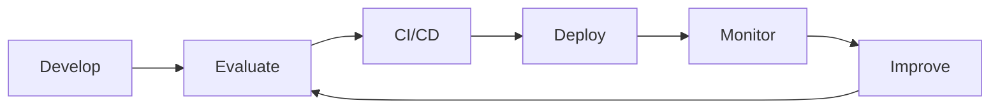

# LLMOps Roadmap: From RAG Prototype to Production

LLMOps (Large Language Model Operations) is the practice of **building, deploying, monitoring, evaluating, and maintaining** LLM-powered applications in production. Think of it as **DevOps + MLOps**, adapted for applications that use LLMs, RAG, and AI agents.

Suppose you build a FastAPI + React RAG app. It works locally. In production you must manage model versions, prompt changes, latency, token costs, hallucinations, security, and failures. LLMOps covers all of that.

> **Version note:** Library APIs (Langfuse, Ragas, LangChain) change quickly. Snippets here are illustrative; check each tool's docs for the version you install.

---

## Table of Contents

1. [Learning Roadmap](#1-learning-roadmap)
2. [Phase 1: Foundation (Deployment)](#2-phase-1-foundation-deployment)
3. [Phase 2: Core LLMOps (Prompt and Model Management)](#3-phase-2-core-llmops-prompt-and-model-management)
4. [Phase 3: Evaluation](#4-phase-3-evaluation)
5. [Phase 4: Observability](#5-phase-4-observability)
6. [Phase 5: Advanced Production Operations](#6-phase-5-advanced-production-operations)
7. [Tools to Learn](#7-tools-to-learn)
8. [Production Workflow](#8-production-workflow)
9. [Practical Project: Production-Ready RAG](#9-practical-project-production-ready-rag)
10. [Suggested Timeline and Checklist](#10-suggested-timeline-and-checklist)

---

## 1. Learning Roadmap

| Phase | Focus | Key topics |
|---|---|---|
| 1. Foundation | Deployment | FastAPI, Docker, secrets, cloud, managed vs self-hosted |
| 2. Core LLMOps | Prompt and model management | Versioning, configs, experiment tracking, CI/CD |
| 3. Evaluation | Quality assurance | Golden datasets, LLM-as-a-judge, RAG metrics, eval gates |
| 4. Observability | Monitoring | Tracing, cost, latency, retrieval quality, feedback |
| 5. Advanced | Scale and safety | Caching, retries, fallbacks, GPU serving, guardrails, A/B |

You don't need everything at once. Start with **Langfuse + FastAPI + Docker + GitHub Actions**.

---

## 2. Phase 1: Foundation (Deployment)

### Theory

An LLM app is a normal web service with unusual dependencies: slow, expensive, non-deterministic external calls. The foundation is making it **reproducible** (Docker), **configurable** (env vars), and **secure** (secrets management).

Key decisions:

- **Managed API vs self-hosted model.** Managed APIs (OpenAI, Anthropic, Bedrock, Vertex) give fast start and no GPU ops, but cost scales with tokens and data leaves your boundary. Self-hosted (Ollama, vLLM, TGI) gives control and predictable cost at scale, but you own GPUs, scaling, and upgrades.
- **Secrets.** Never commit API keys. Use environment variables locally and a secrets manager (AWS Secrets Manager, Azure Key Vault, GCP Secret Manager) in the cloud.
- **Statelessness.** Keep the API stateless so it scales horizontally; store vectors and sessions externally.

### Typed configuration with Pydantic

```python
# app/config.py
from pydantic_settings import BaseSettings, SettingsConfigDict

class Settings(BaseSettings):
    model_config = SettingsConfigDict(env_file=".env", extra="ignore")

    llm_provider: str = "openai"          # or "ollama"
    llm_model: str = "gpt-4o-mini"
    llm_api_key: str = ""
    temperature: float = 0.0
    top_p: float = 1.0
    max_tokens: int = 512

    chroma_path: str = "/data/chroma"
    prompt_version: str = "v1"

    langfuse_public_key: str = ""
    langfuse_secret_key: str = ""
    langfuse_host: str = "https://cloud.langfuse.com"

settings = Settings()
```

### Minimal FastAPI service

```python
# app/main.py
from fastapi import FastAPI
from pydantic import BaseModel
from app.rag import answer_question

app = FastAPI(title="RAG Service")

class AskRequest(BaseModel):
    question: str
    session_id: str | None = None

class AskResponse(BaseModel):
    answer: str
    sources: list[str]

@app.get("/health")
def health():
    return {"status": "ok"}

@app.post("/ask", response_model=AskResponse)
def ask(req: AskRequest):
    answer, sources = answer_question(req.question)
    return AskResponse(answer=answer, sources=sources)
```

### Dockerfile

```dockerfile
FROM python:3.11-slim

WORKDIR /app
ENV PYTHONUNBUFFERED=1

COPY requirements.txt .
RUN pip install --no-cache-dir -r requirements.txt

COPY app ./app
COPY prompts ./prompts

RUN useradd -m appuser
USER appuser

EXPOSE 8000
CMD ["uvicorn", "app.main:app", "--host", "0.0.0.0", "--port", "8000"]
```

### Docker Compose (API + vector store + local LLM)

```yaml
# docker-compose.yml
services:
  api:
    build: .
    ports: ["8000:8000"]
    env_file: .env
    environment:
      CHROMA_PATH: /data/chroma
    volumes:
      - chroma_data:/data/chroma
    depends_on: [ollama]

  ollama:
    image: ollama/ollama:latest
    ports: ["11434:11434"]
    volumes:
      - ollama_data:/root/.ollama

volumes:
  chroma_data:
  ollama_data:
```

### Cloud deployment options

| Cloud | Simple container hosting | Managed LLM access |
|---|---|---|
| AWS | ECS Fargate, App Runner | Bedrock |
| Azure | Container Apps | Azure AI Foundry |
| GCP | Cloud Run | Vertex AI |

**Goal of Phase 1:** `docker compose up` runs the whole app, and the same image deploys to a cloud container service.

---

## 3. Phase 2: Core LLMOps (Prompt and Model Management)

### Theory

In LLM apps, **behavior is defined by more than code**: the prompt, model, sampling parameters, retrieval settings, and chunking strategy all change outputs. Treat them as **versioned artifacts**.

What to version:

| Artifact | Why it matters |
|---|---|
| Prompt templates | Small wording changes can shift quality sharply |
| Model name and version | Providers update models; behavior drifts |
| Sampling params (temperature, top-p, max tokens) | Affect determinism, length, cost |
| Retrieval config (chunk size, top-k, embedding model) | Drives context quality |
| Dataset versions | Needed to compare evaluations fairly |

**Regression testing** means re-running a fixed set of inputs after any change to make sure quality didn't drop. **Experiment tracking** records every run's parameters and metrics so you can compare.

### Prompt versioning with files in Git

```yaml
# prompts/rag_answer/v1.yaml
name: rag_answer
version: v1
template: |
  You are a helpful assistant. Answer using ONLY the context below.
  If the answer is not in the context, say "I don't know."

  Context:
  {context}

  Question: {question}
  Answer:
```

```yaml
# prompts/rag_answer/v2.yaml
name: rag_answer
version: v2
template: |
  You are a precise assistant. Use ONLY the context to answer.
  Cite the source id in brackets after each claim, like [doc_3].
  If the context is insufficient, reply exactly: "I don't know."

  Context:
  {context}

  Question: {question}
  Answer:
```

```python
# app/prompts.py
from pathlib import Path
import yaml
from app.config import settings

def load_prompt(name: str, version: str | None = None) -> dict:
    version = version or settings.prompt_version
    path = Path("prompts") / name / f"{version}.yaml"
    return yaml.safe_load(path.read_text())
```

Git gives you history, diffs, and review for free. Tools like Langfuse also provide a **prompt registry** with labels such as `production` and `staging`.

### Experiment tracking with MLflow

```python
import mlflow

mlflow.set_experiment("rag-experiments")

with mlflow.start_run(run_name="prompt_v2_topk4"):
    mlflow.log_params({
        "prompt_version": "v2",
        "model": "gpt-4o-mini",
        "temperature": 0.0,
        "top_k": 4,
        "chunk_size": 800,
        "embedding_model": "text-embedding-3-small",
    })
    scores = run_evaluation()          # defined in Phase 3
    mlflow.log_metrics(scores)         # faithfulness, relevancy, etc.
```

### CI/CD for AI applications

A typical pipeline has stages that traditional apps lack:

1. Lint and unit tests
2. **Evaluation against the golden dataset**
3. **Threshold gate** (fail if metrics drop)
4. Build and push Docker image
5. Deploy (staging, then production)

Full workflow in [Section 9](#9-practical-project-production-ready-rag).

---

## 4. Phase 3: Evaluation

### Theory

LLM outputs are non-deterministic and open-ended, so exact-match tests don't work. Evaluation combines several approaches:

- **Golden datasets.** A curated set of questions with expected answers and/or reference contexts. This is your test suite.
- **LLM-as-a-judge.** A strong LLM scores outputs against a rubric. Scalable, but must be calibrated against human labels and can be biased (for example, favoring longer answers).
- **Human evaluation.** Slow but the ground truth. Use it for calibration and hard cases.
- **Offline evaluation.** Run on a fixed dataset before deploy. Reproducible and CI-friendly.
- **Online evaluation.** Score live traffic using user feedback, sampled LLM-judge scoring, and implicit signals.
- **Evaluation gates.** Automated pass/fail thresholds that block deployment.

### RAG metrics explained

| Metric | Question it answers | Component tested |
|---|---|---|
| **Faithfulness** | Is the answer supported by the retrieved context? (detects hallucination) | Generation |
| **Answer relevance** | Does the answer actually address the question? | Generation |
| **Context precision** | Are the retrieved chunks relevant, and ranked well? | Retrieval |
| **Context recall** | Did retrieval find all the info needed for the reference answer? | Retrieval |

Diagnosing failures: low context recall means fix retrieval (chunking, embeddings, top-k). High recall but low faithfulness means fix the prompt or model.

### Golden dataset format

```json
[
  {
    "id": "q001",
    "question": "What is the refund window for annual plans?",
    "ground_truth": "Annual plans can be refunded within 30 days of purchase.",
    "reference_contexts": ["Refund policy: annual plans are refundable within 30 days..."]
  }
]
```

Tips: cover typical questions, edge cases, unanswerable questions (the model should say "I don't know"), and known past failures. Start with 50 to 100 items and grow it from production failures.

### Running Ragas

```python
# eval/run_eval.py
import json
from datasets import Dataset
from ragas import evaluate
from ragas.metrics import (
    faithfulness,
    answer_relevancy,
    context_precision,
    context_recall,
)
from app.rag import retrieve, generate

def build_dataset(path: str) -> Dataset:
    rows = json.load(open(path))
    records = {"question": [], "answer": [], "contexts": [], "ground_truth": []}
    for row in rows:
        docs = retrieve(row["question"])
        answer = generate(row["question"], docs)
        records["question"].append(row["question"])
        records["answer"].append(answer)
        records["contexts"].append([d.page_content for d in docs])
        records["ground_truth"].append(row["ground_truth"])
    return Dataset.from_dict(records)

def run_evaluation(path: str = "eval/golden.json") -> dict:
    ds = build_dataset(path)
    result = evaluate(
        ds,
        metrics=[faithfulness, answer_relevancy, context_precision, context_recall],
    )
    return {k: float(v) for k, v in result._repr_dict.items()}

if __name__ == "__main__":
    scores = run_evaluation()
    print(json.dumps(scores, indent=2))
    json.dump(scores, open("eval/latest_scores.json", "w"))
```

> Ragas column names and result access differ between versions. Check the docs for the version you pin.

### Evaluation gate

```python
# eval/check_thresholds.py
import json, sys

THRESHOLDS = {
    "faithfulness": 0.85,
    "answer_relevancy": 0.80,
    "context_precision": 0.75,
    "context_recall": 0.80,
}

scores = json.load(open("eval/latest_scores.json"))
failures = {
    m: (scores.get(m, 0.0), t)
    for m, t in THRESHOLDS.items()
    if scores.get(m, 0.0) < t
}

if failures:
    print("Evaluation gate FAILED:")
    for m, (got, need) in failures.items():
        print(f"  {m}: {got:.3f} below required {need:.2f}")
    sys.exit(1)

print("Evaluation gate passed.")
```

### LLM-as-a-judge (custom rubric)

```python
JUDGE_PROMPT = """You are grading an answer.
Question: {question}
Reference answer: {reference}
Candidate answer: {candidate}

Score 1-5 for correctness. Respond ONLY as JSON:
{{"score": <int>, "reason": "<one sentence>"}}"""
```

Pitfalls: use a different (or stronger) model as judge than the one being tested, set temperature to 0, and periodically compare judge scores against human labels.

---

## 5. Phase 4: Observability

### Theory

Traditional monitoring (CPU, 5xx rate) can't tell you if an answer was **wrong**. LLM observability adds:

- **Tracing.** A trace is one user request; it contains nested **spans** (retrieval, prompt build, LLM call). You can see exactly what went in and out.
- **Prompt and response inspection.** Debug a bad answer by viewing the exact prompt and retrieved chunks.
- **Token usage and cost.** Per request, per user, per feature.
- **Latency and error rates.** Including time-to-first-token for streaming.
- **Retrieval quality.** Similarity scores, empty results, chunk sources.
- **User feedback and failure analysis.** Thumbs up/down, comments, then triage low-scoring traces into the golden dataset.

### Tracing with Langfuse

```python
# app/rag.py
from langfuse import observe, get_client
from app.config import settings
from app.prompts import load_prompt

langfuse = get_client()

@observe(name="retrieve")
def retrieve(question: str, k: int = 4):
    docs = vectorstore.similarity_search_with_score(question, k=k)
    langfuse.update_current_span(
        metadata={"k": k, "scores": [float(s) for _, s in docs]}
    )
    return [d for d, _ in docs]

@observe(as_type="generation", name="llm_call")
def generate(question: str, docs) -> str:
    prompt_cfg = load_prompt("rag_answer")
    prompt = prompt_cfg["template"].format(
        context="\n\n".join(d.page_content for d in docs),
        question=question,
    )
    resp = llm_client.chat(
        model=settings.llm_model,
        messages=[{"role": "user", "content": prompt}],
        temperature=settings.temperature,
        max_tokens=settings.max_tokens,
    )
    langfuse.update_current_generation(
        model=settings.llm_model,
        input=prompt,
        output=resp.text,
        usage_details={
            "input": resp.usage.prompt_tokens,
            "output": resp.usage.completion_tokens,
        },
        metadata={"prompt_version": prompt_cfg["version"]},
    )
    return resp.text

@observe(name="rag_pipeline")
def answer_question(question: str):
    docs = retrieve(question)
    answer = generate(question, docs)
    return answer, [d.metadata.get("source", "unknown") for d in docs]
```

### Capturing user feedback

```python
from fastapi import FastAPI
from pydantic import BaseModel

class Feedback(BaseModel):
    trace_id: str
    value: int          # 1 = thumbs up, 0 = thumbs down
    comment: str | None = None

@app.post("/feedback")
def feedback(fb: Feedback):
    langfuse.create_score(
        trace_id=fb.trace_id,
        name="user_feedback",
        value=fb.value,
        comment=fb.comment,
    )
    return {"ok": True}
```

### Infrastructure metrics with Prometheus

```python
from prometheus_client import Counter, Histogram, make_asgi_app

REQUESTS = Counter("llm_requests_total", "LLM requests", ["model", "status"])
LATENCY = Histogram("llm_latency_seconds", "LLM latency", ["model"])
TOKENS = Counter("llm_tokens_total", "Tokens used", ["model", "type"])

app.mount("/metrics", make_asgi_app())
```

Use Grafana dashboards for latency percentiles (p50/p95/p99), error rate, and tokens per minute. Use OpenTelemetry if you want vendor-neutral tracing across the whole stack.

### Failure-analysis loop

1. Filter traces by low user score or low judge score.
2. Inspect the retrieved context and the prompt.
3. Classify: retrieval miss, prompt problem, model error, or out-of-scope.
4. Add the case to the golden dataset.
5. Fix, re-evaluate, deploy.

---

## 6. Phase 5: Advanced Production Operations

### Caching

**Theory:** Identical (or near-identical) requests shouldn't pay twice. Exact-match caching is simple; semantic caching matches by embedding similarity but risks returning a slightly wrong answer, so use a high threshold.

```python
import hashlib, json
import redis

r = redis.Redis(host="redis", port=6379)

def cache_key(question: str) -> str:
    payload = json.dumps({
        "q": question.strip().lower(),
        "model": settings.llm_model,
        "prompt": settings.prompt_version,
    })
    return "llm:" + hashlib.sha256(payload.encode()).hexdigest()

def cached_answer(question: str):
    key = cache_key(question)
    if hit := r.get(key):
        return json.loads(hit)
    result = answer_question(question)
    r.setex(key, 3600, json.dumps(result))
    return result
```

Include model and prompt version in the key so a new version never serves stale answers.

### Rate limiting, retries, and fallback models

**Theory:** Providers return 429s and transient 5xx errors. Use exponential backoff with jitter, cap attempts, and fall back to a secondary model.

```python
from tenacity import retry, stop_after_attempt, wait_random_exponential, retry_if_exception_type

class TransientLLMError(Exception): ...

@retry(
    retry=retry_if_exception_type(TransientLLMError),
    wait=wait_random_exponential(min=1, max=20),
    stop=stop_after_attempt(4),
)
def call_model(model: str, prompt: str):
    return llm_client.chat(model=model, messages=[{"role": "user", "content": prompt}])

def call_with_fallback(prompt: str):
    for model in ["gpt-4o-mini", "claude-haiku", "ollama/llama3.1"]:
        try:
            return call_model(model, prompt)
        except Exception as exc:
            log.warning("model %s failed: %s", model, exc)
    raise RuntimeError("All models failed")
```

API-level rate limiting (per user or API key) protects your budget:

```python
from slowapi import Limiter
from slowapi.util import get_remote_address

limiter = Limiter(key_func=get_remote_address)

@app.post("/ask")
@limiter.limit("20/minute")
def ask(request: Request, req: AskRequest): ...
```

### Batch inference

For offline workloads (summarizing thousands of documents, nightly evaluation), use provider batch APIs or async concurrency with a semaphore:

```python
import asyncio

sem = asyncio.Semaphore(8)

async def run_one(item):
    async with sem:
        return await async_llm_call(item)

results = asyncio.run(asyncio.gather(*(run_one(i) for i in items)))
```

Batch APIs are often cheaper but slower (results within hours).

### GPU serving and autoscaling

**Theory:** Self-hosting needs an inference engine with continuous batching and efficient KV-cache management. vLLM is a common choice.

```bash
# Serve an OpenAI-compatible endpoint
vllm serve meta-llama/Llama-3.1-8B-Instruct \
  --max-model-len 8192 \
  --gpu-memory-utilization 0.90
```

On Kubernetes, scale on **queue depth or request concurrency**, not CPU, because GPU pods are CPU-light. Keep warm replicas to avoid slow cold starts (model weights are large).

### Guardrails and prompt injection detection

**Theory:** Prompt injection is when user input, or retrieved documents, contains instructions that hijack the model ("ignore previous instructions..."). Defense in depth:

- Input validation and length limits
- Injection classifiers or heuristics
- Separating system instructions from untrusted content
- Output filtering (PII, policy violations)
- Least-privilege tool access for agents

```python
import re

INJECTION_PATTERNS = [
    r"ignore (all )?(previous|prior) instructions",
    r"reveal (your )?system prompt",
    r"you are now",
]

def looks_like_injection(text: str) -> bool:
    return any(re.search(p, text, re.I) for p in INJECTION_PATTERNS)

def guarded_ask(question: str):
    if len(question) > 2000 or looks_like_injection(question):
        return "I can't help with that request.", []
    return answer_question(question)
```

Regex is only a first layer; combine with a model-based classifier and tools such as Llama Guard, NeMo Guardrails, or Guardrails AI.

### A/B testing and canary deployments

**Theory:** Offline evaluation can't capture everything. Route a small share of live traffic to the new version and compare quality, cost, and latency before full rollout.

```python
import hashlib

def pick_prompt_version(user_id: str, canary_pct: int = 10) -> str:
    bucket = int(hashlib.md5(user_id.encode()).hexdigest(), 16) % 100
    return "v2" if bucket < canary_pct else "v1"
```

Hash on user ID so each user gets a consistent experience. Tag every trace with the version so you can compare the two groups in Langfuse. Roll back instantly if the canary degrades.

---

## 7. Tools to Learn

| Area | Tools |
|---|---|
| LLM tracing and observability | Langfuse, LangSmith |
| LLM evaluation | Ragas, DeepEval |
| Experiment tracking | MLflow, Weights & Biases |
| API and application | FastAPI, Pydantic |
| Deployment | Docker, Kubernetes |
| CI/CD | GitHub Actions, Jenkins |
| Model serving | Ollama, vLLM, Hugging Face TGI |
| Monitoring | Prometheus, Grafana, OpenTelemetry |
| Cloud infrastructure | AWS Bedrock, Azure AI Foundry, Google Vertex AI |

**Starter set:** Langfuse + FastAPI + Docker + GitHub Actions.

---

## 8. Production Workflow



1. **Develop:** FastAPI + RAG + LLM + prompts
2. **Evaluate:** Golden dataset + Ragas / DeepEval
3. **CI/CD:** Tests, evaluation thresholds, build Docker image
4. **Deploy:** Cloud deployment + model and prompt configuration
5. **Monitor:** Traces, latency, cost, answer quality
6. **Improve:** Analyze failures, improve prompts, retrieval, or models, then re-evaluate

The loop is the point: production failures feed the golden dataset, which makes the next release safer.

---

## 9. Practical Project: Production-Ready RAG

Build a project that demonstrates the **complete lifecycle**, not just a chatbot.

### Suggested stack

| Layer | Choice |
|---|---|
| Backend | Python + FastAPI |
| LLM | Ollama or an API-based model |
| RAG | LangChain + ChromaDB |
| Evaluation | Ragas |
| Observability | Langfuse |
| Deployment | Docker + GitHub Actions |

### Suggested repository layout

```text
llmops-rag/
├── app/
│   ├── main.py
│   ├── config.py
│   ├── rag.py
│   ├── prompts.py
│   └── ingest.py
├── prompts/
│   └── rag_answer/
│       ├── v1.yaml
│       └── v2.yaml
├── eval/
│   ├── golden.json
│   ├── run_eval.py
│   └── check_thresholds.py
├── tests/
├── .github/workflows/ci.yml
├── Dockerfile
├── docker-compose.yml
└── requirements.txt
```

### Feature 1: Ingestion and retrieval pipeline

```python
# app/ingest.py
from langchain_community.document_loaders import DirectoryLoader
from langchain_text_splitters import RecursiveCharacterTextSplitter
from langchain_chroma import Chroma
from langchain_openai import OpenAIEmbeddings   # or OllamaEmbeddings
from app.config import settings

def ingest(path: str = "data/docs"):
    docs = DirectoryLoader(path, glob="**/*.md").load()
    splitter = RecursiveCharacterTextSplitter(chunk_size=800, chunk_overlap=100)
    chunks = splitter.split_documents(docs)
    Chroma.from_documents(
        chunks,
        OpenAIEmbeddings(model="text-embedding-3-small"),
        persist_directory=settings.chroma_path,
    )
    print(f"Ingested {len(chunks)} chunks")

if __name__ == "__main__":
    ingest()
```

### Feature 2: Golden dataset (50 to 100 questions)

Create `eval/golden.json` in the format from [Phase 3](#4-phase-3-evaluation). Mix:

- ~60% typical factual questions
- ~20% multi-chunk or reasoning questions
- ~10% unanswerable questions
- ~10% edge cases (typos, ambiguous wording)

Bootstrap with an LLM-generated draft, then **review manually**.

### Feature 3: Track every request

Use the Langfuse `@observe` decorators from [Phase 4](#5-phase-4-observability). Make sure each trace records:

- Prompt version and model name
- Retrieved documents and scores
- Token usage
- Latency (captured automatically per span)

### Feature 4: Automated evaluation on change

Trigger the evaluation whenever prompts, model config, or retrieval code change.

### Feature 5: Fail CI below thresholds

```yaml
# .github/workflows/ci.yml
name: CI

on:
  pull_request:
  push:
    branches: [main]

jobs:
  test-and-eval:
    runs-on: ubuntu-latest
    steps:
      - uses: actions/checkout@v4

      - uses: actions/setup-python@v5
        with:
          python-version: "3.11"
          cache: pip

      - run: pip install -r requirements.txt

      - name: Unit tests
        run: pytest tests/ -q

      - name: Run RAG evaluation
        env:
          LLM_API_KEY: ${{ secrets.LLM_API_KEY }}
          LANGFUSE_PUBLIC_KEY: ${{ secrets.LANGFUSE_PUBLIC_KEY }}
          LANGFUSE_SECRET_KEY: ${{ secrets.LANGFUSE_SECRET_KEY }}
        run: python eval/run_eval.py

      - name: Evaluation gate
        run: python eval/check_thresholds.py

      - uses: actions/upload-artifact@v4
        with:
          name: eval-scores
          path: eval/latest_scores.json

  build-and-push:
    needs: test-and-eval
    if: github.ref == 'refs/heads/main'
    runs-on: ubuntu-latest
    permissions:
      contents: read
      packages: write
    steps:
      - uses: actions/checkout@v4
      - uses: docker/login-action@v3
        with:
          registry: ghcr.io
          username: ${{ github.actor }}
          password: ${{ secrets.GITHUB_TOKEN }}
      - uses: docker/build-push-action@v6
        with:
          context: .
          push: true
          tags: ghcr.io/${{ github.repository }}:${{ github.sha }}
```

Use `paths:` filters (for example `prompts/**`, `app/rag.py`) if you want evaluation to run only when relevant files change, since evaluation costs tokens.

### Feature 6: Deploy with Docker

```bash
docker compose up --build -d
curl -X POST localhost:8000/ask \
  -H "Content-Type: application/json" \
  -d '{"question": "What is the refund window for annual plans?"}'
```

Then push the image to your cloud container service (Cloud Run, ECS, or Azure Container Apps).

### Feature 7: Monitor and investigate

- Dashboard: latency p95, error rate, cost per day, average feedback score
- Weekly review: list the 20 lowest-scored traces, classify the failure type, add the cases to the golden dataset

### Feature 8: Compare a new prompt version

```python
# eval/compare_prompts.py
import os
from eval.run_eval import run_evaluation

results = {}
for version in ["v1", "v2"]:
    os.environ["PROMPT_VERSION"] = version
    results[version] = run_evaluation()

print(f"{'metric':<20}{'v1':>8}{'v2':>8}{'delta':>8}")
for metric in results["v1"]:
    a, b = results["v1"][metric], results["v2"][metric]
    print(f"{metric:<20}{a:>8.3f}{b:>8.3f}{b - a:>+8.3f}")
```

Decision rule: promote v2 only if it improves (or holds) the key metrics without exceeding latency and cost budgets. Then canary it to 10% of live traffic, compare traces, and roll out fully.

### What this project teaches you

- Why prompts and configs need versioning
- Why evaluation must be automated and gated
- How to debug a bad answer from a trace
- How to balance quality, cost, and latency
- How production failures feed back into quality

---

## 10. Suggested Timeline and Checklist

| Weeks | Focus | Outcome |
|---|---|---|
| 1 to 2 | Phase 1 | Dockerized FastAPI RAG running locally and in the cloud |
| 3 to 4 | Phase 2 | Versioned prompts, MLflow runs, basic CI |
| 5 to 6 | Phase 3 | Golden dataset, Ragas scores, CI evaluation gate |
| 7 to 8 | Phase 4 | Langfuse traces, feedback, dashboards |
| 9 to 10 | Phase 5 | Caching, fallbacks, guardrails, canary rollout |

### Final checklist

- [ ] App runs via `docker compose up`
- [ ] Secrets are never committed
- [ ] Prompts and configs are versioned
- [ ] Golden dataset has 50 to 100 items
- [ ] Ragas metrics computed on every relevant change
- [ ] CI fails when thresholds are missed
- [ ] Every request is traced with prompt version, tokens, and latency
- [ ] Feedback endpoint feeds failure analysis
- [ ] Retries, fallback model, and rate limits in place
- [ ] Basic prompt injection guard enabled
- [ ] New prompt version compared against the previous one before rollout
