import TOCInline from '@theme/TOCInline';

# 13 · Production GenAI and LLMOps

<ProgressToggle sectionId="13-production-genai-and-llmops" />

<TOCInline toc={toc} minHeadingLevel={2} maxHeadingLevel={2} />

:::tip[In this guide]
Turn the working RAG API into something you'd actually operate: observable,
resilient, safe and deployable — then the platform layer around it. Queues for
work that outlives a request, a gateway so model choice is configuration, a
cost and latency budget you can defend, and the security controls specific to
LLM applications.
:::

## Goal

Add the operational concerns that separate a demo from a service, and the
platform concerns that separate a service from a system several teams depend
on.

## Estimated Time

3 weeks.

## Prerequisites

- [RAG project](../06-rag/03-first-project.mdx) and [Advanced RAG](../07-advanced-rag/index.mdx).
- [FastAPI production architecture](../02-fastapi/01-core-path/21-production-architecture.mdx).

## What You Will Learn

### GPU Inference & Serving

Where the model actually runs, and what it costs in hardware.

1. [NVIDIA NIM & Hosted Endpoints](./01-nvidia-nim-endpoints.mdx) — calling a GPU-served model over an OpenAI-compatible endpoint, streaming, embeddings, reranking, and self-hosting a NIM container.
2. [GPU Serving Engines](./02-gpu-serving-engines.mdx) — why Ollama stalls under concurrency, and how vLLM, SGLang, TGI and TensorRT-LLM fix it: continuous batching, KV cache, prefix reuse, prefill vs decode, honest benchmarking.
3. [GPU Sizing & Quantization](./03-gpu-sizing-and-quantization.mdx) — VRAM math for weights and KV cache, GGUF/AWQ/GPTQ/FP8, `nvidia-smi`, and multi-GPU choices.

### The Service Layer

Making one service correct, visible and deployable.

4. [Logging, Monitoring & Guardrails](./04-logging-monitoring-guardrails.mdx) — structured logs, metrics, tracing, prompt-injection defenses, input/output validation.
5. [Deployment Basics](./05-deployment-basics.mdx) — Docker, environments, health checks, scaling concepts.

### The Platform Layer

What you add once the work is slow, the traffic is shared and the bill is real.

6. [Queues & Async Jobs](./06-queues-and-async-jobs.mdx) — execution shapes, idempotency, backpressure, priority queues, provider rate limits, dead letter queues.
7. [Model Gateway & Fallbacks](./07-model-gateway-and-fallbacks.mdx) — central routing, cost cascades, fallback chains, caching, per-tenant quotas.
8. [Cost & Latency Optimization](./08-cost-and-latency.mdx) — token economics, cost models, latency budgets, autoscaling signals, capacity arithmetic.
9. [Security & Privacy](./09-security-and-privacy.mdx) — access control in retrieval, PII redaction, injection controls, insecure output handling, denial of wallet.

### Choosing & Defending

The decisions you have to justify to someone else.

10. [Model Selection & Benchmarking](./10-model-selection-and-benchmarking.mdx) — why leaderboards answer the wrong question, writing the requirement spec, running a bake-off on your own eval set, the cost/quality frontier, and the self-host break-even.
11. [Responsible AI & Governance](./11-responsible-ai-and-governance.mdx) — risk tiering by use case, model cards and data sheets, per-slice fairness testing, auditability, kill switches, and the pre-deployment checklist.

The per-service resilience basics — config, timeouts, retries, caching,
connection reuse — live in
[API & Service Design](../08-llm-application-development/02-api-service-design.mdx),
since they belong to the application rather than the platform.

## How It Evolves

```mermaid
flowchart LR
    Proto[Prototype] --> Obs[Observability]
    Obs --> Guard[Guardrails]
    Guard --> Resil[Resilience]
    Resil --> Deploy[Deployable service]
    Deploy --> Async["Queues and async work"]
    Async --> GW["Model gateway"]
    GW --> Cost["Cost and latency control"]
    Cost --> Sec["Security and privacy"]
    Sec --> Gov["Selection and governance"]
```

The order is deliberate. You cannot tune what you cannot see, you cannot route
traffic you cannot deploy, you cannot cap spend you cannot attribute, and you
cannot defend a model choice without an eval set to defend it with.

## Interview Relevance

"How would you productionize this?" is the standard senior AI-engineering
question. The follow-ups are almost always queues, fallbacks, cost per request,
and how you stop one tenant reading another's documents.

Two more come up once the role is senior enough to own a decision: "how did you
pick that model?" — where the only good answer involves your own eval set, not
a leaderboard — and "how would you get this approved?", which is the governance
page.

## Done When

- [ ] Config, logging, metrics and tracing are in place.
- [ ] Guardrails validate inputs and outputs.
- [ ] Timeouts, retries, breakers and caching protect the service.
- [ ] It runs in a container with health and readiness checks.
- [ ] Long-running work executes on a durable queue with idempotent enqueue and
      bounded depth.
- [ ] All LLM traffic flows through one gateway with routing, fallbacks and
      per-tenant quotas.
- [ ] You have a cost model, a latency budget, and cost per request recorded
      per route and tenant.
- [ ] Retrieval is authorised inside the query, PII is redacted before the
      prompt, and spend is capped per key.
- [ ] Your model choice is backed by a bake-off on your own eval set, and the
      harness is in the repo so you can re-run it when a version changes.
- [ ] Each AI feature has an owner, a model card, per-slice eval results and a
      kill switch that works without a deploy.

Next: [14 · Fine-Tuning and Model Adaptation](../14-fine-tuning-and-model-adaptation/index.mdx).
