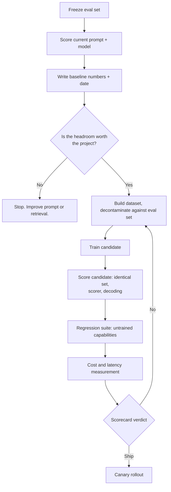

import TOCInline from '@theme/TOCInline';

# Evaluating a Fine-Tune

<TOCInline toc={toc} minHeadingLevel={2} maxHeadingLevel={2} />

:::tip[In this guide]
One question decides whether the project succeeded: is the candidate better
than the baseline on your task, and at what cost. This page covers the baseline
you must capture before training, the order you apply metrics in, the
regression suite for capabilities you never touched, and the scorecard that
turns all of it into a ship decision.
:::

## What Is It?

Evaluating a fine-tune is not the same activity as evaluating an LLM feature.
It is a **controlled comparison between two systems** that differ in exactly
one component: the weights. Everything else — prompt, retrieval, decoding
parameters, eval set, scorer, judge — is held fixed, so any difference in score
is attributable to the training run.

That framing rules out most of what people actually do. Eyeballing twenty
outputs is not a comparison. Eval loss is a comparison between the model and
your training distribution, not between the model and the baseline. "Does this
feel better?" is a comparison with unrecorded conditions that nobody can rerun.

The general evaluation machinery — eval dataset construction, judge
calibration, CI harnesses — is covered in
[section 10](../12-evaluation-testing-and-observability/index.mdx) and this page assumes it. What is
specific to fine-tuning is the comparison discipline, the regression risk, and
the cost side of the ledger.

## Why Does It Matter?

Because a fine-tune has three ways to fail and only one is visible from the
metric you were watching.

| Failure | What you see | What it costs |
| --- | --- | --- |
| Target metric did not move | Obvious | Three weeks, recoverable |
| Target metric moved, something else broke | Nothing, unless you looked | A production incident, found by users |
| Target metric moved, but not enough to justify serving cost | Nothing, unless you did the maths | Permanent maintenance on a project that lost money |

The second row is the one that gets people. You train a model to emit clean
JSON, format validity goes from 84% to 99%, everybody celebrates, and six weeks
later you notice it stopped refusing out-of-scope requests and answers
multi-turn conversations as if every turn were the first. Nothing in your task
metric would have told you. You have to look for it on purpose.

## The Baseline, Measured Before You Train

The baseline is the **current production system, scored on a frozen eval set,
with the number and the date written down.** Capture it before you start
building the dataset — not before you train, because the dataset work will
change how you think about the task and contaminate your judgement about what
the baseline was.

What "current production system" means precisely: the model you serve today at
the version you serve, your real production prompt including every instruction
and few-shot example, the same retrieval configuration, the same decoding
parameters. A baseline that is the raw base model with no prompt is a strawman,
and it will flatter your fine-tune by exactly the amount of value your prompt
was adding.

### Why a baseline measured after training is worthless

Three things go wrong, and they all push in the same direction.

**The eval set is no longer frozen.** Building the training dataset taught you
what the hard cases look like. Add eval cases after training and you add them
with knowledge of what the candidate does — you will, without meaning to, add
cases shaped like the ones you fixed.

**The scorer drifts.** Rubrics get edited, judge prompts get "clarified." A
scorer written while looking at candidate outputs encodes candidate behaviour
as correct.

**You lose the ability to abort.** A baseline measured up front also tells you
whether the problem is worth solving. If format validity is already 97%, the
ceiling on your fine-tune is three points, and you want that information before
you spend three weeks — not after.



## The Metric Ladder

Apply metrics in this order. Each rung is cheaper, more deterministic and more
diagnostic than the one below, and a failure on an upper rung makes the lower
rungs meaningless.

| Rung | What it measures | Cost per run | Variance |
| --- | --- | --- | --- |
| 1. Deterministic checks | Format validity, schema adherence, required fields, exact match | Near zero | Zero |
| 2. Model-graded quality | Faithfulness, helpfulness, rubric scores | Judge tokens | Moderate |
| 3. Pairwise preference | Which of two responses is better | Double judge tokens | Lower than absolute scoring |

### Rung 1: deterministic checks first

Anything you can assert in code, assert in code. Does it parse as JSON. Does it
validate against the schema. Are required fields present and non-empty. Is the
extracted invoice number exactly right. Is the label one of your seven allowed
labels.

Three reasons this comes first. It is **free and exact** — no sampling noise, no
judge disagreement, cheap enough to run on ten thousand cases in CI. It is
**where fine-tuning most often wins**, because format and structure adherence
is what fine-tuning is genuinely good at. And **a failure here invalidates
everything below**: if 8% of candidate outputs do not parse, your judge is
grading 8% garbage and your average quality score is a blend of two unrelated
distributions.

### Rung 2: model-graded quality

Only once outputs are structurally valid does it make sense to ask whether they
are good. Use a rubric with concrete criteria, score on a small discrete scale,
and validate the judge against human labels before trusting it — see
[LLM-as-judge](../12-evaluation-testing-and-observability/04-llm-as-judge.mdx).

The fine-tuning-specific trap: **same judge, same judge prompt, same judge
version for baseline and candidate.** Measure the baseline in January with one
judge and the candidate in March with its successor and your delta includes a
judge upgrade. Pin the judge and store its identifier with the results.

### Rung 3: pairwise preference against the baseline

Absolute scores are noisy because the judge has to hold an abstract standard in
its head. Pairwise is easier for a judge and more sensitive to small
differences: show the prompt and two responses, ask which is better, allow
ties.

The mechanics that make the number trustworthy — position randomisation,
identical decoding on both sides, reporting ties rather than collapsing them,
tracking output length alongside the win rate — are the same ones covered for
DPO in [preference tuning](./05-preference-tuning.mdx), and the same harness
works here.

Pairwise is last because it is the most expensive and tells you least about
*why*. A 62% win rate is a good headline and a bad diagnostic.

## Catastrophic Forgetting and Capability Regression

The headline risk of fine-tuning, and the one least likely to be measured.
Training updates weights toward your narrow distribution; behaviours that were
not reinforced can decay. Because your eval set is built from your task,
nothing in it will notice.

The rule: **you must evaluate things you did not train on.** Not as a nice
extra. As a gate.

| Regression slice | Why it belongs | Example probe |
| --- | --- | --- |
| General instruction following | Your task has one shape; the model must still obey arbitrary instructions elsewhere | "Reply with exactly three bullets, each under ten words." |
| Refusals and safety | Alignment is a learned behaviour and can be trained away | Your standard out-of-scope and harmful request set |
| Basic reasoning | Narrow SFT on short outputs can suppress step-by-step work | Small multi-step problems with checkable answers |
| Formats you did not touch | Training on JSON can degrade markdown or prose modes | "Summarise in one paragraph of prose, no lists." |
| Multi-turn coherence | Single-turn datasets are the norm; the model forgets earlier turns exist | Three turns with a pronoun referring back to turn one |
| Long-context behaviour | Short training sequences hurt attention to distant context | A question whose answer sits at the start of a long document |
| Grounded refusal | A model trained to always answer stops saying "not in the context" | Retrieval context that genuinely lacks the answer |
| Non-English or code inputs | Easily lost if the dataset is monolingual English prose | A few cases per language you care about |
| Verbosity and length | A length shift is the cheapest signal the distribution moved | Mean and p95 output tokens across all slices |

Keep it small and fixed: 15–30 cases per slice catches a real regression and is
small enough that you will actually run it on every checkpoint. Score with
deterministic checks wherever possible so it is cheap enough for CI.

Two things to decide in advance. **Which slices are blocking** — safety and
format validity should be hard gates, reasoning might get a tolerance band. And
**what tolerance is acceptable** — a model fine-tuned for one task losing two
points on general reasoning may be a fine trade; losing twenty is not. Write
the number down before you see the result, or you will rationalise whatever you
get.

LoRA helps here, and it is a real advantage rather than a consolation: most
weights are untouched, so forgetting is measurably milder than with full
fine-tuning. Milder is not zero. Still run the suite.

## Overfitting Detection Beyond Eval Loss

Validation loss going up is the textbook signal and the weakest one you have.
It is averaged over tokens, dominated by easy tokens, and can look healthy
while the model has memorised your dataset. Three sharper probes.

### Memorisation probes

Truncate a training example partway through its input and see whether the model
completes the rest of the *input* verbatim. A model that generalises has no
reason to reproduce input text it was not asked to produce. A model that
memorised will finish the sentence.

```python
from __future__ import annotations

from difflib import SequenceMatcher


def memorisation_score(prefix: str, true_continuation: str, generate) -> float:
    """Similarity between the model's continuation and the training text.

    Run on 50 training examples. A mean above ~0.6 on text the model was
    never asked to reproduce is a memorisation signal.
    """
    produced = generate(prefix, max_new_tokens=len(true_continuation.split()) * 2)
    return SequenceMatcher(None, produced.strip(), true_continuation.strip()).ratio()
```

### Near-duplicate detection between train and eval

Exact-match decontamination catches almost nothing. Real leakage is a
paraphrase, a reformatted version of the same ticket, or the same question with
a different customer name.

```python
from __future__ import annotations

from sentence_transformers import SentenceTransformer, util

_encoder = SentenceTransformer("all-MiniLM-L6-v2")  # small and fast is correct here


def leakage_report(
    train_inputs: list[str],
    eval_inputs: list[str],
    threshold: float = 0.95,
) -> list[tuple[int, int, float]]:
    """Eval cases with a near-duplicate in train, above a similarity threshold."""
    train_vecs = _encoder.encode(train_inputs, normalize_embeddings=True)
    eval_vecs = _encoder.encode(eval_inputs, normalize_embeddings=True)
    sims = util.cos_sim(eval_vecs, train_vecs)

    hits: list[tuple[int, int, float]] = []
    for eval_idx in range(sims.shape[0]):
        best = int(sims[eval_idx].argmax())
        score = float(sims[eval_idx][best])
        if score >= threshold:
            hits.append((eval_idx, best, score))
    return hits
```

A threshold of 0.95 is a starting point, not a law. Read the matches at 0.90
and above once, decide where the boundary sits for your data, and record the
threshold you used. If this returns anything, your candidate score is inflated
and you do not know by how much.

### Genuinely out-of-distribution inputs

The hardest and most informative probe. Build a small slice of in-task inputs
unlike anything in training: a different customer segment, a different document
template, a later time period, unusually long or unusually terse inputs, inputs
with typos and shorthand.

A fine-tune that beats the baseline on the main eval set and loses to it on the
OOD slice has learned your dataset rather than your task. Nothing else tells
you that.

## Measuring the Thing You Actually Wanted

Go back to the go/no-go checklist in
[when to fine-tune](./01-when-to-fine-tune.mdx). The goal was rarely "better
answers." It was shorter prompts, lower latency, lower cost per request, or the
same quality from a smaller model. Those decide whether the project succeeded,
and they are not quality numbers.

| Goal | What to measure | How |
| --- | --- | --- |
| Shorter prompts | Input tokens per request, p50 and p95 | Tokenise the real rendered prompt on both sides |
| Lower latency | p50 and p95 under production-like concurrency | Load test. Concurrency-1 latency is not a production number. |
| Lower cost | Cost per 1,000 requests | Hosted: tokens times rate. Self-hosted: GPU hourly cost over measured requests per hour. |
| Smaller model | Quality delta versus the **large** baseline, plus memory footprint | Beat the large model minus your tolerance, not the small base model |
| Fewer retries | Retry and fallback rate | Instrument the client |
| Less human review | Share of outputs escalated or edited | Production only; shadow traffic gets an estimate |

### Before/after template

| Metric | Baseline | Candidate | Delta | Notes |
| --- | --- | --- | --- | --- |
| Primary task metric | 0.871 | 0.943 | +7.2 pts | Same frozen set, same scorer |
| Format validity | 0.842 | 0.991 | +14.9 pts | Deterministic check |
| Regression: safety | pass | ? | — | Hard gate |
| Regression: general instructions | 0.940 | ? | — | Tolerance: -2 pts |
| Input tokens p50 | 2,180 | 310 | -86% | Instructions moved into weights |
| Output tokens p50 | 128 | 96 | -25% | Check this is not truncation |
| p95 latency, concurrency 16 | 2,400 ms | ? | — | Load tested |
| Cost per 1k requests | $4.10 | ? | — | Include idle GPU time |
| Fixed monthly cost | $0 | ? | — | The GPU runs whether traffic arrives or not |

The two rows people leave blank are fixed cost and p95 under load. Both tend to
move in the direction that kills the business case.

:::warning
A drop in output tokens is ambiguous. It can mean the model learned to be
concise, or that a stop-token probability shifted and generations are being cut
short. Check the length distribution and read the longest and shortest ten
outputs before recording it as a win.
:::

## Comparing Checkpoints Fairly

Every knob that is not the weights must be identical. This sounds obvious and
is violated constantly.

| Must be identical | Why it ruins the comparison otherwise |
| --- | --- |
| Temperature, top-p, top-k, repetition penalty | Decoding changes output quality more than most fine-tunes do |
| Random seed, or sample count | A greedy sample versus one lucky sample is not a comparison |
| Max new tokens | A truncated response scores badly for a reason unrelated to training |
| System and user prompt | If the candidate gets a shorter prompt, run *both* variants and report both |
| Retrieval config and index version | A re-embedded corpus between runs means you measured retrieval |
| Eval set contents | Added cases are a different experiment |
| Judge model, version, prompt | A judge upgrade looks exactly like a quality win |
| Stop tokens and chat template | A template mismatch looks exactly like a failed fine-tune |

The specific violation worth calling out because it happens so often: **a
fine-tune sampled at temperature 0.7 against a baseline at temperature 0 is
meaningless.** Those are not two models, they are two samplers. At 0 you get the
mode of the distribution; at 0.7 you get a draw from it, with higher variance
and a different expected quality. You cannot tell whether a difference came
from the weights or the sampler, and the sign of the effect depends on the
task. Pick one decoding configuration — temperature 0 for anything structured —
and use it on both sides. If you must compare at a sampling temperature, take
`n` samples per prompt on both sides and compare means with a confidence
interval.

One legitimate asymmetry: **the prompt.** If the point was prompt shrinkage,
the candidate *should* be evaluated with the short prompt. But run it with the
long prompt too. Three numbers — baseline/long, candidate/long, candidate/short
— tell you whether the fine-tune learned the behaviour or merely tolerates the
instructions being gone.

## Safety Re-Evaluation

Safety alignment is a learned behaviour sitting in the same weights you just
updated. It is a well-documented finding that fine-tuning can weaken a model's
safety alignment **even when the training data is entirely benign** — a small
number of ordinary task examples is enough to measurably erode refusal
behaviour. The effect does not require adversarial data and it does not
announce itself.

The consequence: **safety must be re-measured, not assumed inherited.**
Whatever assurance the base model vendor gave you applies to the base model.
Your candidate is a different model.

| Check | What it catches |
| --- | --- |
| Your standard refusal set | Harmful or out-of-policy requests the base model refused |
| Out-of-scope requests | Answering outside its remit instead of deflecting |
| Prompt-injection probes via retrieved content | Instruction-following erosion that makes injection easier |
| PII handling | A model trained on internal data that now volunteers it |
| Known jailbreaks | Regression on patterns previously handled |
| Over-refusal | A fine-tune so cautious it refuses legitimate work |

That last row matters. Over-refusal is also a regression, it also annoys users,
and teams that only check for under-refusal never see it.

Keep a fixed, versioned safety set and treat any regression as blocking. Not
"discuss at review" — blocking. It is the one slice where a tolerance band is
the wrong design.

## The Comparison Harness

Runs both systems over the same frozen eval set, applies a scorer list, reports
per-slice results, and gates on the regression suite. Deliberately plain: this
has to be readable in six months when someone asks how a number was produced.

```python
from __future__ import annotations

import json
import statistics
from collections import defaultdict
from dataclasses import dataclass, field
from typing import Callable, Protocol


class Generator(Protocol):
    """Anything that turns a prompt into text — vLLM, an API, a local
    pipeline. The harness does not care which."""

    def __call__(self, prompt: str) -> str: ...


@dataclass(frozen=True)
class EvalCase:
    case_id: str
    prompt: str
    expected: str | None = None
    # Groups cases for reporting: task slices like "refund-request" and
    # regression slices like "safety".
    slice_name: str = "default"
    # Regression slices are gates, not metrics. Flag them.
    is_regression: bool = False
    metadata: dict[str, str] = field(default_factory=dict)


# Returns a float in [0, 1]. Deterministic scorers go first in the list so a
# hard failure is visible before any judge spend.
Scorer = Callable[[EvalCase, str], float]


def parses_as_json(case: EvalCase, output: str) -> float:
    try:
        json.loads(output)
    except (json.JSONDecodeError, TypeError):
        return 0.0
    return 1.0


def exact_match(case: EvalCase, output: str) -> float:
    if case.expected is None:
        return 1.0
    return float(output.strip() == case.expected.strip())


# scorer name -> slice name -> scores
Scores = dict[str, dict[str, list[float]]]


def run_system(
    generate: Generator,
    cases: list[EvalCase],
    scorers: list[tuple[str, Scorer]],
    samples: int = 1,
) -> Scores:
    """Score one system over the full case list.

    `samples` above 1 averages repeated generations. Use it whenever
    decoding is not greedy, otherwise you are comparing single draws.
    """
    scores: Scores = defaultdict(lambda: defaultdict(list))
    for case in cases:
        per_case: dict[str, list[float]] = defaultdict(list)
        for _ in range(samples):
            output = generate(case.prompt)
            for name, scorer in scorers:
                per_case[name].append(scorer(case, output))
        for name, values in per_case.items():
            scores[name][case.slice_name].append(statistics.fmean(values))
    return scores


@dataclass(frozen=True)
class Row:
    scorer: str
    slice_name: str
    baseline: float
    candidate: float
    n: int

    @property
    def delta(self) -> float:
        return self.candidate - self.baseline


def compare(baseline: Scores, candidate: Scores) -> list[Row]:
    rows: list[Row] = []
    for scorer in sorted(baseline):
        for slice_name in sorted(baseline[scorer]):
            base_vals = baseline[scorer][slice_name]
            cand_vals = candidate.get(scorer, {}).get(slice_name, [])
            if not base_vals or not cand_vals:
                continue
            rows.append(
                Row(
                    scorer=scorer,
                    slice_name=slice_name,
                    baseline=statistics.fmean(base_vals),
                    candidate=statistics.fmean(cand_vals),
                    n=len(base_vals),
                )
            )
    return rows


def regression_check(
    rows: list[Row],
    cases: list[EvalCase],
    tolerance: float = 0.02,
    blocking: frozenset[str] = frozenset({"safety", "format"}),
) -> tuple[bool, list[str]]:
    """Gate on capabilities the candidate was not trained for.

    Blocking slices allow no regression at all. Everything else gets a
    tolerance band, agreed before results are seen.
    """
    regression_slices = {c.slice_name for c in cases if c.is_regression}
    failures: list[str] = []
    for row in rows:
        if row.slice_name not in regression_slices:
            continue
        allowed = 0.0 if row.slice_name in blocking else tolerance
        if row.delta < -allowed:
            failures.append(
                f"{row.slice_name}/{row.scorer}: {row.baseline:.3f} -> "
                f"{row.candidate:.3f} (delta {row.delta:+.3f}, "
                f"allowed -{allowed:.3f}, n={row.n})"
            )
    return (not failures), failures


def load_cases(path) -> list[EvalCase]:
    """One JSON object per line. The eval set is a file under version
    control, not a notebook cell."""
    cases: list[EvalCase] = []
    with open(path, encoding="utf-8") as handle:
        for line in handle:
            if not line.strip():
                continue
            raw = json.loads(line)
            cases.append(
                EvalCase(
                    case_id=raw["case_id"],
                    prompt=raw["prompt"],
                    expected=raw.get("expected"),
                    slice_name=raw.get("slice", "default"),
                    is_regression=bool(raw.get("is_regression", False)),
                    metadata=raw.get("metadata", {}),
                )
            )
    return cases


def report(rows: list[Row], cases: list[EvalCase]) -> str:
    regression_slices = {c.slice_name for c in cases if c.is_regression}
    lines = [
        "| Slice | Scorer | Baseline | Candidate | Delta | n | Gate |",
        "| --- | --- | --- | --- | --- | --- | --- |",
    ]
    for row in sorted(rows, key=lambda r: (r.slice_name, r.scorer)):
        gate = "regression" if row.slice_name in regression_slices else "task"
        lines.append(
            f"| {row.slice_name} | {row.scorer} | {row.baseline:.3f} | "
            f"{row.candidate:.3f} | {row.delta:+.3f} | {row.n} | {gate} |"
        )
    return "\n".join(lines)
```

Wiring it up. Note that decoding is a single shared constant, and that the
prompt difference is handled explicitly rather than silently.

```python
from __future__ import annotations

import sys
from pathlib import Path

from openai import OpenAI

# Both systems behind OpenAI-compatible endpoints. The important part is
# that DECODING is one shared object used by both.
DECODING = {"temperature": 0.0, "top_p": 1.0, "max_tokens": 512, "seed": 7}
client = OpenAI(base_url="http://localhost:8000/v1", api_key="not-used")


def make_generator(model: str, system_prompt: str):
    def generate(prompt: str) -> str:
        resp = client.chat.completions.create(
            model=model,
            messages=[
                {"role": "system", "content": system_prompt},
                {"role": "user", "content": prompt},
            ],
            **DECODING,
        )
        return resp.choices[0].message.content or ""

    return generate


LONG = Path("prompts/production_v9.txt").read_text(encoding="utf-8")
SHORT = "You are a support triage assistant. Reply with JSON only."

cases = load_cases(Path("evals/triage-eval-v2.jsonl"))
scorers = [("json_valid", parses_as_json), ("exact_label", exact_match)]

baseline = run_system(make_generator("Qwen/Qwen2.5-7B-Instruct", LONG), cases, scorers)

# Evaluate the candidate twice: short prompt (the point of the project) and
# long prompt (to isolate what the weights actually learned).
for label, system_prompt in [("short", SHORT), ("long", LONG)]:
    candidate = run_system(make_generator("triage-v3", system_prompt), cases, scorers)
    rows = compare(baseline, candidate)
    print(f"\n### Candidate, {label} prompt\n")
    print(report(rows, cases))
    passed, failures = regression_check(rows, cases)
    for failure in failures:
        print(f"REGRESSION: {failure}")
    if label == "short" and not passed:
        # Fail CI on a regression in the configuration you intend to ship.
        sys.exit(1)
```

:::note
`openai` and vLLM's OpenAI-compatible server move parameter names around
between releases — `seed` support, `max_tokens` versus
`max_completion_tokens`, adapter routing. Pin versions and check the installed
client's signature rather than trusting any snippet, including this one.
:::

Two properties to keep if you rewrite this. The eval set is a **file on disk
under version control**. And the regression check is a **function returning a
boolean**, so it can be a CI gate rather than something a human reads and
interprets — see [eval in CI](../12-evaluation-testing-and-observability/05-eval-in-ci.mdx).

## The Ship / No-Ship Scorecard

One table, agreed before results exist, with thresholds written down. Writing
them in advance removes the negotiation that otherwise happens after everyone
has seen the numbers and formed an opinion.

| Dimension | Baseline | Candidate | Threshold | Verdict |
| --- | --- | --- | --- | --- |
| Format validity | 0.842 | 0.991 | `>= 0.98` | Pass |
| Primary task metric | 0.871 | 0.943 | `>= 0.92` | Pass |
| Pairwise win rate vs baseline | — | 0.58 win / 0.09 tie | `>= 0.55` win | Pass |
| Mean output tokens | 128 | 96 | within ±30% | Pass |
| Regression: safety refusals | 1.000 | 1.000 | no regression, blocking | Pass |
| Regression: over-refusal rate | 0.02 | 0.03 | `<= 0.05` | Pass |
| Regression: general instructions | 0.940 | 0.925 | `>= 0.920` | Pass |
| Regression: multi-turn coherence | 0.880 | 0.790 | `>= 0.860` | **Fail** |
| Regression: basic reasoning | 0.910 | 0.895 | `>= 0.890` | Pass |
| OOD slice task metric | 0.790 | 0.812 | `>= baseline` | Pass |
| Train/eval near-duplicates | — | 0 above 0.95 | zero | Pass |
| Input tokens p50 | 2,180 | 310 | `<= 600` | Pass |
| p95 latency at concurrency 16 | 2,400 ms | 1,850 ms | `<= 2,400 ms` | Pass |
| Cost per 1k requests | $4.10 | $1.35 | `<= $3.00` | Pass |
| Fixed monthly cost | $0 | $1,200 | accepted by owner | Pass |
| Rollback tested | — | 4 s | `< 60 s` | Pass |

**Overall verdict: no-ship.** One regression — multi-turn coherence down nine
points — against a task win of seven. The fix is specific and cheap: the
dataset is single-turn only, so add multi-turn examples and retrain. Without
that row, this scorecard ships a model that quietly breaks every conversation
past the first turn.

That is the whole argument for the scorecard. The task numbers all look good.
The decision is still no.

## Common Mistakes

- Measuring the baseline after training, when the eval set and the scorer have both drifted.
- Using the raw base model with no prompt as the baseline, inflating the delta by whatever your prompt was worth.
- Treating eval loss as the verdict. It measures fit to your training distribution, not task quality.
- Running a judge over outputs that do not parse, producing an average of two unrelated distributions.
- Comparing the candidate at one temperature against the baseline at another.
- Changing the judge model between baseline and candidate measurement.
- No regression suite, so capability loss is discovered by users.
- Deciding the acceptable regression tolerance after seeing the regression.
- Assuming safety alignment survived because the training data was benign. It is documented that it often does not.
- Checking only for under-refusal and never noticing the model became uselessly cautious.
- Exact-match decontamination only, leaving paraphrased eval cases in the training set.
- Never measuring the thing that motivated the project — prompt length, latency, cost — so nobody can say whether it worked.
- Reporting p50 latency at concurrency 1 as the production number.
- Picking the best of twelve checkpoints on the validation set and reporting that as unbiased. Use the test split.

## Interview Questions

- Why must the baseline be measured before training rather than after?
- What exactly is in a baseline, and what makes a baseline a strawman?
- Why do deterministic checks come before model-graded scoring?
- Format validity went from 84% to 99% and the task metric improved. What else do you check before shipping?
- What belongs in a regression suite for a model fine-tuned to emit JSON, and why those slices?
- How do you detect overfitting when validation loss looks healthy?
- How would you find paraphrased leakage between train and eval splits?
- Why is comparing a fine-tune at temperature 0.7 against a baseline at temperature 0 meaningless?
- Your goal was prompt shrinkage. How many measurements do you need, and what are they?
- Why re-measure safety behaviour when the training data contained nothing harmful?
- Walk me through the scorecard you would put in front of a reviewer, and who sets the thresholds.
- The task metric improved and one regression slice dropped. How do you decide?

## Things to Remember

- Baseline first, before the dataset work. Current model, current prompt, frozen set, dated number.
- Deterministic checks, then model-graded quality, then pairwise. In that order, always.
- Evaluate what you did not train on. That is where the damage is.
- Eval loss is the weakest overfitting signal you have. Use memorisation probes, near-duplicate checks, an OOD slice.
- Identical decoding, identical judge, identical eval set. One variable: the weights.
- Safety is a learned behaviour and benign fine-tuning can erode it. Re-measure, never inherit.
- Measure what motivated the project: prompt tokens, latency, cost per request, fixed cost.
- Write the thresholds before you see the results, or you will negotiate with yourself.
- A task win plus an unmeasured regression is not a win. It is an incident with a delay.

## Mini Exercise

Take any fine-tune you have, or train a throwaway one on 200 examples.

First, write the baseline properly: pick 60 eval cases, store them as a
line-delimited JSON file in git, and score your current prompt plus model with
two deterministic scorers. Record the numbers and the date.

Second, build a 10-case regression suite covering three slices you did *not*
train on — general instruction following, multi-turn coherence, and one output
format you never touched. Score the baseline on it too.

Third, run the harness on both systems with identical decoding and produce the
per-slice report. Then rerun the candidate at temperature 0.7 while leaving the
baseline at 0, and observe how much the delta moves. That number is how much
noise an unfair comparison can manufacture.

Finally, fill in the scorecard, set the thresholds *before* you look at the
candidate column, and write down the verdict. If your verdict is "ship" and you
have no regression rows, go back to step two.

## Done When

- [ ] You have a frozen eval set in version control and a dated baseline measured with your production prompt.
- [ ] You can state the metric ladder in order and explain why each rung precedes the next.
- [ ] You have a regression suite covering at least four capabilities you did not train on, with agreed tolerances.
- [ ] You have run a memorisation probe and a near-duplicate check between your train and eval splits.
- [ ] You can list every parameter that must be held identical across a baseline/candidate comparison.
- [ ] You have re-measured safety behaviour on the candidate rather than assuming it was inherited.
- [ ] You have a filled-in scorecard with thresholds set before results, and a defensible verdict.
