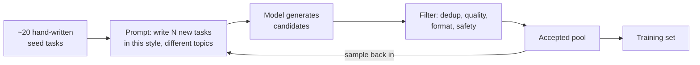

import TOCInline from '@theme/TOCInline';

# Synthetic Data Generation

<TOCInline toc={toc} minHeadingLevel={2} maxHeadingLevel={2} />

:::tip[In this guide]
Data is the expensive part of every fine-tune and every eval set, and a strong
model can manufacture a lot of it cheaply. This page is about doing that without
lying to yourself: how to generate, how to filter aggressively enough that the
output is worth training on, how to avoid contaminating your eval set, the
licensing trap, and the specific ways synthetic data makes a model worse while
the loss curve looks fine.
:::

## What Is It?

Synthetic data is training or evaluation data produced by a model rather than
collected from humans. In practice it takes three shapes, and they are not
equally safe:

| Shape | What it is | Main risk |
| --- | --- | --- |
| **Generated instructions** | A model writes prompts *and* answers from a seed set | Narrow, repetitive, drifts off your real distribution |
| **Distillation** | A stronger model answers *your* real prompts; you train a smaller model on the answers | You inherit the teacher's errors and its licence terms |
| **Augmentation** | Paraphrase, translate or perturb data you already have | Amplifies whatever bias the originals carried |

The second shape — distillation — is the highest-value and gets its own
treatment in
[Distillation & Model Compression](./10-distillation-and-compression.mdx),
because sequence-level distillation *is* "fine-tune on synthetically generated
answers." This page is the generation and hygiene layer under all three.

## Why Does It Matter?

Because the data week is the one people underestimate (see
[Data Preparation](./02-data-preparation.mdx)), and human labelling is slow and
expensive. A model can produce thousands of examples an hour at a tiny fraction
of the per-label cost, in domains where no public dataset exists, and in exactly
the format your trainer wants.

The catch is that cheap, plausible and *useful* are three different things.
Synthetic data is cheap and plausible by default. Making it useful is the whole
job, and most of the work is throwing examples away.

A blunt rule to carry through the page: **synthetic data is a bootstrap, not a
destination.** It gets a first model or a first eval set off the ground while
you accumulate real interactions. The moment you have real production data,
start folding it in and let the synthetic share fall.

## Generation Techniques

### Self-Instruct: seed and expand

The canonical bootstrap. Start with a small set of hand-written seed examples,
then ask a strong model to generate more *like them but different*, feeding a
few seeds plus a few of its own accepted outputs back in as context each round.



The feedback loop is what gives diversity, and it is also what makes it drift.
Sample seeds randomly each round, and keep some *original* human seeds in every
prompt so the distribution does not wander away from where you started.

### Evol-Instruct: deepen and broaden

Self-Instruct tends to produce easy, similar examples. Evol-Instruct takes an
existing instruction and *evolves* it along two axes:

- **Deepen** — add constraints, reasoning steps, edge cases, or more specific
  requirements, so the task gets harder.
- **Broaden** — mutate it into a related but distinct task, so the set covers
  more ground.

```python
DEEPEN = """Rewrite the instruction below to be more demanding: add one
realistic constraint or edge case a careful user would include. Keep it
answerable. Return only the rewritten instruction.

Instruction: {instruction}"""

BROADEN = """Write a new instruction in the same domain and difficulty as the
one below, but about a different task. Return only the new instruction.

Instruction: {instruction}"""
```

Run a few evolution rounds, keep what survives filtering, and you get a
difficulty gradient instead of a flat pile of easy prompts — which is what makes
the trained model handle the hard tail, not just the median case.

### Persona and scenario seeding

Diversity is the scarce resource, and the cheapest way to buy it is to vary
*who is asking* and *in what situation*. Generate across a grid of personas
(a new customer, a frustrated power user, an auditor) and scenarios (first
contact, escalation, edge case). Without this, a model left to itself writes the
same polite, well-formed prompt a thousand times, and you train a model that
only handles polite, well-formed prompts.

### Distillation from a stronger model

For most *supervised* fine-tuning, the highest-return pattern is not
generating prompts at all — it is taking your **real** prompts and having a
stronger model answer them, then training a smaller cheaper model on those
answers. Real prompts mean real distribution; a strong teacher means good
targets. See
[Distillation & Model Compression](./10-distillation-and-compression.mdx), and
read the licensing section below first.

## The Quality Gauntlet

Raw synthetic output is mostly unusable, and training on it unfiltered is the
single most common way these projects fail. Every example must survive a gauntlet
before it earns a place in the set.

| Filter | Catches | How |
| --- | --- | --- |
| **Format / schema** | Malformed JSON, missing fields, wrong structure | Parse and validate with Pydantic; reject, do not repair silently |
| **Dedup (exact + near)** | The model repeating itself | Hash for exact; embedding similarity above a threshold for near-duplicates |
| **Diversity floor** | A pile of paraphrases of five ideas | Cluster embeddings; cap how many examples per cluster |
| **Self-consistency / verification** | Wrong answers | Re-derive the answer independently, or check against a ground-truth tool where one exists |
| **Difficulty spread** | All-easy sets | Keep a distribution, not just the median |
| **Safety** | Toxic, unsafe, policy-violating generations | Run the same guardrails you would at inference |
| **Human spot-check** | Systematic prompt bugs | Read 50. You will find a whole-batch problem in ten minutes. |

```python
from __future__ import annotations

import json
import numpy as np
from pydantic import BaseModel, ValidationError


class Example(BaseModel):
    instruction: str
    response: str


def accept(raw: str, pool_vecs: np.ndarray, embed, sim_threshold=0.92) -> Example | None:
    # 1. Format: parse and validate, reject on failure.
    try:
        ex = Example.model_validate_json(raw)
    except ValidationError:
        return None
    # 2. Length sanity — off-distribution extremes are usually junk.
    if not (3 <= len(ex.instruction.split()) <= 200):
        return None
    # 3. Near-duplicate against everything already accepted.
    v = embed(ex.instruction)
    if pool_vecs.size and float((pool_vecs @ v).max()) >= sim_threshold:
        return None
    return ex
```

The mindset that makes synthetic data work: **generate three to five times
what you need and throw most of it away.** A 70% rejection rate is normal and
healthy. If you are keeping almost everything, your filters are too weak and the
set is quietly full of duplicates and wrong answers.

### Verification is the lever that separates good from plausible

For anything with a checkable answer — code, math, SQL, extraction, structured
output — do not trust the generated answer, *verify* it. Run the code, execute
the SQL, check the extraction against the source. Keep only examples that pass.
This single step is why synthetic data for verifiable domains can be excellent
and why synthetic data for subjective domains stays merely plausible: in the
first case you can filter on truth, in the second you can only filter on
agreement.

## Decontamination: the non-negotiable

The failure that invalidates every number you report: a synthetic training
example that is a near-copy of something in your evaluation set. Train on it and
your eval score measures memorisation, not capability, and you ship a model that
looks great and is not.

- **Generate eval and train from disjoint sources.** If both come from the same
  document corpus, split the corpus *first*, then generate from each half.
- **Check overlap explicitly.** After generation, embed every training example
  and every eval example and drop any training example too close to any eval
  one. N-gram overlap checks catch exact and near-exact reuse that embeddings
  miss.
- **Freeze the eval set before you generate training data**, never after. An
  eval set built from leftovers is contaminated by construction.

This is the same decontamination discipline from
[Data Preparation](./02-data-preparation.mdx) and
[Eval Datasets](../12-evaluation-testing-and-observability/02-eval-datasets.mdx),
and it bites harder with synthetic data because the generator will happily
produce something it has effectively already seen.

## The Licensing Trap

Before distilling from a hosted model, read its terms. Several major providers'
terms of service **prohibit using their model's outputs to train a competing
model.** "Competing" is defined broadly and the risk is real, not theoretical:
a fine-tune trained on another provider's outputs can be legally unshippable
regardless of how good it is.

Practical positions:

- Use a model whose licence **permits** output reuse for training (many
  open-weight models do; check the specific licence, not the family reputation).
- Keep provenance: record which model generated which examples, so a licensing
  question later is answerable.
- When in doubt, generate with a model you are allowed to distill from, or use
  synthetic data only for *evaluation* and *analysis* rather than training —
  though even that can be restricted, so read the terms.

This is a legal constraint, not an engineering one, and no amount of data
quality fixes it. Treat it as a gate before the pipeline, not a detail after.

## The Failure Modes

Synthetic data fails quietly — the loss curve looks healthy while the model gets
worse on real traffic. Know the signatures:

| Failure | What happens | Signature | Mitigation |
| --- | --- | --- | --- |
| **Distribution mismatch** | Generated prompts are polished; real users are terse and messy | Great offline, poor in production | Seed from real logs; generate in the users' register |
| **Mode collapse / low diversity** | The generator loops over a few templates | High near-duplicate rate; clusters tiny | Persona/scenario grids; cap per-cluster; Evol-Instruct |
| **Teacher error inheritance** | You train in the strong model's mistakes and quirks | Student repeats the teacher's wrong patterns | Verify answers; spot-check; do not distill a weak teacher |
| **Bias amplification** | Augmentation multiplies a skew already in the data | Minority cases vanish | Measure class balance before and after; stratify |
| **Model-collapse spiral** | Training on your own model's output across generations | Diversity and quality decay each round | Keep real data in the mix; never train solely on self-output repeatedly |
| **Style over substance** | Model learns the teacher's *tone*, not its reasoning | Fluent, confident, wrong | Verify; prefer real prompts with verified answers |

The one that catches teams by surprise is distribution mismatch. A model trained
on beautifully phrased synthetic questions handles beautifully phrased questions
and falls apart on "vpn broke mac wont connect". The fix is upstream: seed
generation from real queries, or at minimum instruct the generator to write the
way your users actually type, and spot-check that it did.

## When Synthetic Data Is the Right Call

| Situation | Synthetic data? | Why |
| --- | --- | --- |
| No data yet, need to bootstrap a first model | **Yes** | Nothing else gets you off zero |
| Verifiable domain (code, SQL, math, extraction) | **Yes** | You can filter on truth, so quality is high |
| Rare classes underrepresented in real data | **Yes, targeted** | Generate the tail you cannot collect |
| Eval set where none exists | **Carefully** | Useful to start; replace with real cases as they arrive |
| You have ample real production data | **Shrink it** | Real data wins; use synthetic only for gaps |
| Subjective quality with no verifier | **With caution** | You can only filter on agreement, not truth |
| Legal constraint on the available teacher | **No** | Licensing is a hard gate |

## Common Mistakes

- Training on raw generations with no filtering, and shipping duplicates and
  wrong answers.
- A low rejection rate — keeping almost everything means the filters are too
  weak.
- Polished synthetic prompts that do not match how real users type, so the model
  tops the offline set and fails in production.
- No decontamination, so the eval score measures memorisation.
- Building the eval set from leftovers *after* generation instead of freezing it
  first.
- Distilling from a model whose terms forbid training on its output.
- Not verifying answers in a domain where verification is cheap and decisive.
- Training repeatedly on your own model's output until diversity collapses.
- Augmentation that amplifies an existing class imbalance nobody measured.
- Treating synthetic data as the destination rather than the bootstrap.

## Interview Questions

- When would you generate synthetic training data, and when would you not?
- What is the difference between Self-Instruct and Evol-Instruct, and what
  problem does each solve?
- Why is distillation (strong model answers your real prompts) often better than
  generating prompts from scratch?
- Walk me through the filters you would apply before training on synthetic data.
- What rejection rate would make you suspicious, in either direction?
- Why is verification the step that separates good synthetic data from merely
  plausible data, and when can you not do it?
- How do you prevent synthetic training data from contaminating your eval set?
- What is model collapse, and how do you avoid it?
- What legal question must you answer before distilling from a hosted model?
- Your model tops the offline eval and fails in production. How could synthetic
  data have caused that?

## Things to Remember

- Synthetic data is cheap and plausible by default; useful is the work, and most
  of the work is discarding examples.
- Generate 3–5× what you need and expect to reject the majority.
- Diversity is the scarce resource. Buy it with persona/scenario grids and
  Evol-Instruct, and enforce it with near-duplicate and cluster caps.
- Verify answers wherever you can. It is the difference between filtering on
  truth and filtering on agreement.
- Decontaminate against the eval set, and freeze the eval set first.
- Seed from real prompts so the distribution matches production.
- Check the teacher model's licence before distilling. It is a hard gate.
- It is a bootstrap. Fold in real data the moment you have it and let the
  synthetic share fall.

## Mini Exercise

Pick a small task you care about — classifying support tickets, extracting
fields from documents, answering questions over a wiki.

First, hand-write 15 seed examples and freeze 30 real or realistic cases as an
eval set *before generating anything*. Record a baseline with an off-the-shelf
model.

Second, run Self-Instruct to generate 300 candidates, then apply the gauntlet:
schema validation, near-duplicate removal, a diversity cluster cap, and — if the
task is verifiable — answer verification. Record how many of the 300 survived.
If it is more than half, tighten the filters.

Third, decontaminate: drop any training example too similar to an eval case, and
count how many you removed. Then read 30 survivors and write down the single
most common quality problem you see. That problem is a prompt fix, and finding it
by reading is the habit this page is really teaching.

## Done When

- [ ] You can name the three shapes of synthetic data and the main risk of each.
- [ ] You can describe Self-Instruct and Evol-Instruct and when to reach for
      each.
- [ ] You have a filtering gauntlet and you reject the majority of raw
      generations.
- [ ] You decontaminate training data against a frozen eval set and can prove it.
- [ ] You can state the licensing question that gates distillation from a hosted
      model.
- [ ] You can name three failure modes of synthetic data and their signatures.

Next: [Distillation & Model Compression](./10-distillation-and-compression.mdx).
