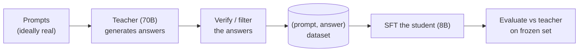
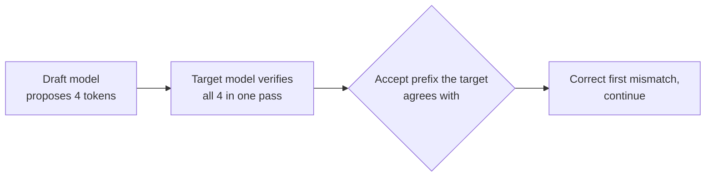
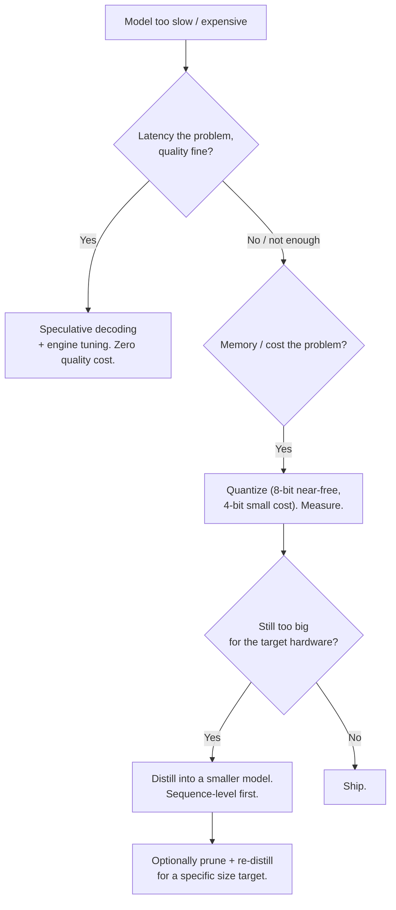

import TOCInline from '@theme/TOCInline';

# Distillation & Model Compression

<TOCInline toc={toc} minHeadingLevel={2} maxHeadingLevel={2} />

:::tip[In this guide]
You have a model that is accurate and too expensive. Compression is the set of
techniques that make it smaller or faster while trying to keep the accuracy:
distillation trains a small model to imitate a big one, pruning removes weights,
quantization lowers precision, and speculative decoding speeds inference without
touching the model at all. This page is the map — what each does, what it costs,
and which one to reach for.
:::

## What Is It?

Four distinct levers, often confused because they all end in "cheaper":

| Technique | What it changes | Produces | Needs training? |
| --- | --- | --- | --- |
| **Distillation** | Transfers behaviour to a *smaller* model | A new small model | Yes |
| **Pruning** | Removes weights or structures | A sparser / smaller model | Usually a fine-tune to recover |
| **Quantization** | Lowers numeric precision of weights | Same model, fewer bits | No (post-training) or yes (QAT) |
| **Speculative decoding** | Speeds up inference | Same outputs, faster | No |

Quantization is covered in depth in
[GPU Sizing & Quantization](../13-production-genai-and-llmops/03-gpu-sizing-and-quantization.mdx);
this page covers the other three and places all four relative to each other, so
you pick the right one instead of the one you read about most recently.

## Why Does It Matter?

Because the model that wins your eval is frequently the one you cannot afford to
serve. A 70B model that answers perfectly at 3 seconds and real GPU cost is a
worse product than an 8B model that answers almost as well at 400 ms and a tenth
the cost — *if* you can close the quality gap. Compression is how you try.

The honest framing, and the one that should shape the whole decision: **these
techniques trade quality for cost, and the trade is only worth making when you
can measure that you kept enough quality.** Every path here routes back through
the same frozen eval set from
[Evaluating a Fine-Tune](./07-evaluating-fine-tunes.mdx). A compressed model
with no before/after number is a guess wearing a benchmark.

## Knowledge Distillation

The idea: a large, accurate **teacher** model supervises the training of a
small, cheap **student**. The student learns to reproduce the teacher's
behaviour, and ends up far better than a small model trained from scratch on the
same labels — because the teacher's outputs carry more information than a bare
label does.

There are two levels, and the distinction decides your whole pipeline.

### Sequence-level (response) distillation

The practical default, and the one most teams mean when they say
"distillation": run the teacher on a set of prompts, collect its *outputs*, and
supervised-fine-tune the student on those `(prompt, teacher_output)` pairs.



This is just SFT where the targets happen to be machine-generated — which is why
it lives next to
[Synthetic Data Generation](./09-synthetic-data-generation.mdx): sequence-level
distillation *is* "fine-tune on a strong model's answers," and every filter,
verification and licensing rule from that page applies unchanged. It needs no
access to the teacher's internals, works with any hosted teacher you are
licensed to distill from, and uses the ordinary
[training pipeline](./04-training-run.mdx) you already have.

Its ceiling: the student can only be as good as the teacher's visible outputs,
and it inherits the teacher's mistakes. Verify the teacher's answers before
training on them, or you are distilling errors with confidence.

### Logit-level (soft-label) distillation

The richer form, when you control both models (both open-weight, served
yourself). Instead of training on the teacher's single chosen token, train on
its full **probability distribution** over the vocabulary at each step — the
"soft labels" or "dark knowledge."

The signal is strictly richer. A hard label says "the answer is *cat*." The
teacher's distribution says "*cat* 0.7, *dog* 0.2, *kitten* 0.08, …" — which
teaches the student not just the answer but the teacher's sense of what was
*nearly* right. The loss minimises KL divergence between student and teacher
distributions, usually with a temperature to soften both:

```python
import torch.nn.functional as F

def distillation_loss(student_logits, teacher_logits, labels, T=2.0, alpha=0.5):
    # Soft targets: match the teacher's softened distribution.
    soft = F.kl_div(
        F.log_softmax(student_logits / T, dim=-1),
        F.softmax(teacher_logits / T, dim=-1),
        reduction="batchmean",
    ) * (T * T)                      # scale restores gradient magnitude
    # Hard targets: still learn the true label.
    hard = F.cross_entropy(student_logits, labels)
    return alpha * soft + (1 - alpha) * hard
```

| | Sequence-level | Logit-level |
| --- | --- | --- |
| Needs teacher internals | No — outputs only | Yes — logits per step |
| Works with a hosted teacher | Yes (if licensed) | No |
| Signal richness | One token per step | Full distribution per step |
| Pipeline | Ordinary SFT | Custom training loop, both models loaded |
| Tokenizer constraint | None | Teacher and student must share a vocabulary |
| Typical use | The common case | When you own both models and want the last few points |

The tokenizer constraint trips people: logit distillation needs the two models
to share a vocabulary, or the per-token distributions do not line up. Different
families usually cannot be distilled this way without extra machinery, which is
another reason sequence-level is the common path.

## Pruning

Remove parameters that contribute little, then fine-tune briefly to recover.

- **Unstructured pruning** zeroes individual weights by magnitude. It produces a
  sparse matrix that, without specialised sparse kernels, is *not actually
  faster* — you store zeros and still multiply them. High theoretical
  compression, little practical speedup on commodity hardware.
- **Structured pruning** removes whole units — attention heads, neurons, even
  layers. It yields a genuinely smaller, genuinely faster dense model, at a
  larger accuracy hit, usually recovered with a short fine-tune.

For LLMs on normal serving hardware, structured pruning is the one that pays,
and it is frequently combined with distillation: prune to a smaller architecture,
then distill the original into the pruned student to recover quality. Several
well-known small models were produced exactly this way. Unstructured pruning is
mostly a research and specialised-hardware story; know it exists, reach for
quantization first.

## Speculative Decoding

The odd one out: it makes inference faster **without changing the model or its
outputs at all.** Worth knowing because it is pure upside and interviewers like
it.

A small, fast **draft** model proposes several tokens ahead. The large target
model then verifies all of them in a single forward pass. Tokens the target
would have produced anyway are accepted in bulk; the first disagreement is
corrected and the rest discarded.



Because verification is one parallel pass instead of four serial ones, you get
the target model's exact output distribution at lower latency — a 2–3× decode
speedup is typical when the draft agrees often. It costs extra memory for the
draft model and gains nothing when draft and target rarely agree, so pair a draft
that is a smaller version of the same family. This is a *serving* technique; it
belongs with
[GPU Serving Engines](../13-production-genai-and-llmops/02-gpu-serving-engines.mdx),
and most modern engines implement it for you. The reason it sits here is that it
is the compression lever that costs you **zero quality** — so it should be on
before you consider any lever that does.

## Choosing the Lever

Order matters, because the cheapest and safest options come first and several
problems dissolve before you reach the expensive ones.



| Lever | Effort | Quality cost | Speed / size win | Reach for it when |
| --- | --- | --- | --- | --- |
| Speculative decoding | Low (engine flag) | **None** | 2–3× decode latency | Latency hurts, quality is fine |
| Quantization (8-bit) | Low | Near-zero | ~2× memory | Almost always, first |
| Quantization (4-bit) | Low | Small | ~4× memory | Fitting a bigger model on a card |
| Distillation (sequence) | Medium | Moderate, measurable | Whole model-class smaller | Quantized model still too big/slow |
| Distillation (logit) | High | Smaller than sequence | Same | You own both models and need the last points |
| Structured pruning | High | Moderate–large | Smaller dense model | A specific size target, with re-distill |

The blunt heuristic: **speculative decoding and quantization before
distillation, always.** They are cheaper, faster to apply, and lose little or no
quality. Distillation is a training project with its own data pipeline and its
own eval — reach for it when precision reduction has run out of room, not before.

## Evaluate Like Any Other Model Change

A compressed model is a changed model, and the discipline is identical to
[Evaluating a Fine-Tune](./07-evaluating-fine-tunes.mdx):

- **Baseline the teacher (or original) on a frozen set first.** No starting
  number, no claim of success.
- **Report the gap, not just the student's score.** "Student holds 96% of
  teacher quality at 20% of the cost" is a decision. "Student scores 0.81" is
  not.
- **Run the regression suite.** Compression often damages capabilities you did
  not target — a distilled or heavily quantized model can lose reasoning,
  long-context, or non-English ability while your task metric holds. Test the
  things you did *not* optimise.
- **Re-check safety.** Behaviour learned through alignment can degrade under
  compression. Re-run safety evals rather than assuming they carried over.
- **Price the win honestly.** Put latency, cost per request and quality in one
  table and let someone make the trade deliberately.

## Common Mistakes

- Distilling before trying speculative decoding and quantization, which are
  cheaper and lossless or near-lossless.
- Treating sequence-level distillation as special when it is SFT on generated
  data — and skipping that page's filtering and verification as a result.
- Distilling a teacher's *unverified* answers, so the student learns the
  teacher's mistakes with confidence.
- Attempting logit distillation across models with different tokenizers.
- Unstructured pruning expecting a speedup, then finding none without sparse
  kernels.
- Reporting the student's score with no teacher baseline and no gap.
- Measuring only the target task and missing the capabilities compression
  silently broke.
- Assuming alignment and safety survive compression.
- Ignoring the teacher model's licence before distilling (see
  [Synthetic Data](./09-synthetic-data-generation.mdx)).

## Interview Questions

- What is knowledge distillation, and why does a student trained on a teacher's
  outputs beat the same student trained on raw labels?
- Sequence-level versus logit-level distillation: what does each need, and when
  can you only do one?
- Why is logit distillation impossible with most hosted teacher models, and what
  constraint does it put on the student?
- How does distillation relate to synthetic data generation?
- What is the difference between structured and unstructured pruning, and which
  actually speeds up inference on commodity GPUs?
- Explain speculative decoding. Why does it not change the model's output
  distribution?
- Order these for a too-expensive model: distillation, quantization, speculative
  decoding. Justify the order.
- A distilled model matches the teacher on your task but users complain it got
  worse. What did you forget to measure?
- When is it not worth compressing a model at all?

## Things to Remember

- Four levers, not one: distillation (train a smaller model), pruning (remove
  weights), quantization (fewer bits), speculative decoding (faster inference).
- Speculative decoding costs zero quality — turn it on before anything lossy.
- Quantization is the next reach: 8-bit near-free, 4-bit a small measured cost.
- Distillation is a training project. Sequence-level (SFT on teacher outputs) is
  the common case; logit-level needs both models, shared tokenizer, and buys the
  last few points.
- Structured pruning yields a real speedup; unstructured usually does not
  without special kernels. Pruning pairs well with re-distillation.
- Verify the teacher's outputs before training on them, and check the teacher's
  licence first.
- A compressed model is a changed model: baseline, report the gap, run the
  regression suite, re-check safety, price the trade.

## Mini Exercise

Take a task where a large model clearly beats a small one on your eval set.

First, measure the large model (your teacher) and a small base model on a frozen
set — that gap is the quality you are trying to recover.

Second, do a sequence-level distillation: run the teacher over a few hundred
real prompts, *verify or spot-check* its answers, and SFT the small model on the
survivors. Re-measure. Record both the quality recovered and the cost and
latency difference between teacher and student.

Third, add the two lossless levers to the teacher instead — turn on your serving
engine's speculative decoding and quantize to 8-bit — and measure the latency
and memory change with no quality loss. Now put all three options in one table
(teacher, quantized teacher, distilled student) with quality, latency and cost,
and write down which you would ship and why.

## Done When

- [ ] You can name the four compression levers and say which changes the model,
      which changes precision, and which changes neither.
- [ ] You can explain sequence-level versus logit-level distillation and when
      each is possible.
- [ ] You can explain why distillation and synthetic data are the same pipeline.
- [ ] You can explain speculative decoding and why it is lossless.
- [ ] You can order the levers by effort and quality cost and justify reaching
      for distillation last.
- [ ] You evaluate a compressed model against a frozen baseline, report the gap,
      and re-check capabilities and safety you did not target.

Next: [15 · Multimodal GenAI](../15-multimodal-genai/index.mdx).
