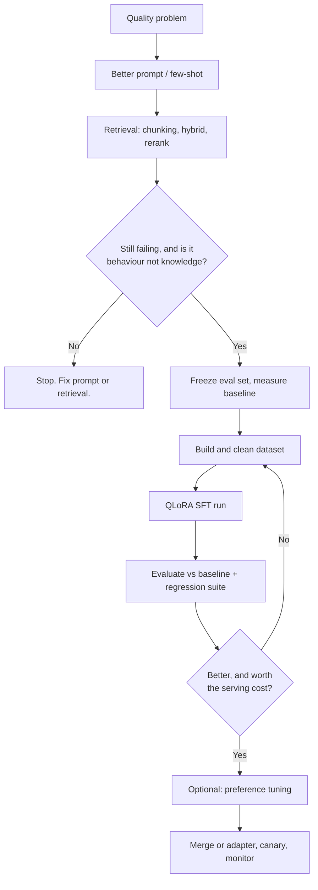

import TOCInline from '@theme/TOCInline';

# 14 · Fine-Tuning and Model Adaptation

<ProgressToggle sectionId="14-fine-tuning-and-model-adaptation" />

<TOCInline toc={toc} minHeadingLevel={2} maxHeadingLevel={2} />

:::tip[In this guide]
Fine-tuning is the most expensive and least reversible lever you have, and it is
the one people reach for first. This section teaches you to run it properly —
and to recognise the much more common case where prompting, retrieval or better
chunking gets you there for a fraction of the cost. The most valuable outcome of
this section may well be a well-argued decision *not* to fine-tune.
:::

## Goal

Two things, in this order. First, be able to look at a quality problem and say
with evidence whether fine-tuning is the right fix — and defend the answer when
it is "no". Second, if the answer is yes, be able to take it from raw data
through a QLoRA run, evaluation against a frozen baseline, and a deployed
adapter, without learning each step the expensive way.

## Estimated Time

2–3 weeks. Roughly one week on the decision and the data, one on training and
evaluation, and one on serving plus the embedding-model work. The data week is
the one people underestimate.

## Prerequisites

- [RAG Fundamentals](../06-rag/index.mdx) — you cannot judge whether
  fine-tuning is the right fix until you have exhausted retrieval. This section
  assumes a RAG-first posture throughout.
- [Professional Python](../01-python/01-core-python/04-professional-python.mdx) —
  training runs are long-lived scripts with config, logging, and pinned
  dependencies. Treat them as code, not notebooks.
- A frozen evaluation set and a measured baseline. If you do not have one, the
  evaluation section of this roadmap comes first. You cannot improve a number
  you have never written down.

## What You Will Learn

1. [When to Fine-Tune](./01-when-to-fine-tune.mdx) — the escalation ladder from
   prompting to fine-tuning, what fine-tuning is genuinely good and bad at, total
   cost of ownership, and a go/no-go checklist to clear before buying GPU time.
2. [Data Preparation](./02-data-preparation.mdx) — how much data you need by
   goal, the three dataset formats, chat templates and completion-only masking,
   cleaning and decontamination, and a worked `datasets` pipeline.
3. [PEFT: LoRA & QLoRA](./03-peft-lora-qlora.mdx) — the memory arithmetic that
   rules out full fine-tuning, what the LoRA knobs actually do, QLoRA's 4-bit
   base, a VRAM table, and the honest quality tradeoff.
4. [Running a Training Job](./04-training-run.mdx) — a commented `SFTTrainer`
   script, hyperparameter starting points, how to read a loss curve, compute
   choices, Unsloth and Axolotl, and a symptom-to-fix debugging table.
5. [Preference Tuning: DPO & Friends](./05-preference-tuning.mdx) — why SFT is
   not the end, DPO without a reward model, ORPO and KTO and GRPO, preference
   data collection, and the failure modes including length bias.
6. [Serving Fine-Tuned Models](./06-serving-fine-tuned-models.mdx) — adapters
   versus merged weights, vLLM multi-adapter serving, GGUF and Ollama, model
   registry and lineage, canary rollout, and the cost comparison that decides
   whether the project succeeded.
7. [Evaluating a Fine-Tune](./07-evaluating-fine-tunes.mdx) — baselining before
   you train, deterministic checks before model-graded ones, regression suites
   for capabilities you did *not* train on, safety re-evaluation, and a
   ship/no-ship scorecard.
8. [Fine-Tuning Embeddings & Rerankers](./08-fine-tuning-embeddings.mdx) — the
   highest-return fine-tune most RAG teams never try: hard-negative mining,
   `sentence-transformers` training, reranker fine-tuning, and the re-embedding
   migration it forces.

The general evaluation machinery — dataset construction, judge calibration, CI
harnesses — is not repeated here. It lives in
[12 · Evaluation](../12-evaluation-testing-and-observability/index.mdx) and applies unchanged to a
fine-tune. Page 7 covers only what is specific to evaluating a trained model,
including the warning that matters most: re-measure safety behaviour after
training rather than assuming it was inherited.

## Decision First, Then Pipeline

The diamond on the left is the part of this diagram that matters. Most teams
skip it, arrive at the pipeline on the right, and spend a month learning that
their problem was retrieval.

## Interview Relevance

Fine-tuning questions are mostly judgement tests wearing a technical costume.
"Your support bot gives wrong answers about last month's pricing — would you
fine-tune?" is checking whether you can tell a knowledge problem from a
behaviour problem. Expect to be asked the LoRA memory argument, the difference
between SFT and DPO, how you would build a dataset from production logs without
leaking your eval set, and how you would know the fine-tune was worth it. The
answer that lands best is usually the one that includes a cost number and a
case for not doing it.

## Done When

- [ ] You can state, in two sentences, why facts belong in retrieval and behaviour belongs in weights.
- [ ] You can walk the escalation ladder — prompt, few-shot, RAG, fine-tune — and justify the order by cost and reversibility.
- [ ] You have a go/no-go checklist you would actually make a team complete before approving GPU spend.
- [ ] You can explain the full-fine-tune memory arithmetic for a 7B model and why LoRA changes it.
- [ ] You have run a QLoRA SFT job end to end on a small dataset and read its loss curve.
- [ ] You can describe how you would evaluate the result against a frozen baseline, including a regression suite for untrained capabilities.
- [ ] You can name the serving pattern you would use, and the cost comparison that justifies it.
- [ ] You know that fine-tuning an embedding model or reranker is usually the cheaper win than fine-tuning the generator, and why.

Next: [15 · Multimodal GenAI](../15-multimodal-genai/index.mdx).