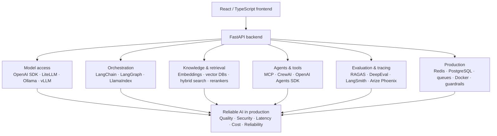
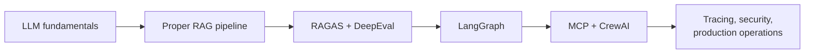

import TOCInline from '@theme/TOCInline';

# Modern GenAI Engineer Roadmap: Frameworks, Tools & Production Skills

For a transition from React/FastAPI development into GenAI and Agentic AI
engineering, you need more than LangChain, CrewAI, and RAGAS. You need the
complete AI application lifecycle: **model access, retrieval, orchestration,
evaluation, observability, security, deployment, and cost optimization**.

The important thing is **not** to learn every framework equally. Learn the
concepts first, then become hands-on with a focused set of tools that transfer
across projects and interviews.

<TOCInline toc={toc} minHeadingLevel={2} maxHeadingLevel={2} />

---

## 1. The Modern GenAI Ecosystem at a Glance

Each layer is a place where an AI feature can fail independently of the others.
That is the whole reason to learn them as separate layers rather than as one
framework.

---

## 2. Frameworks You Should Know

The priority levels below (**P0** / **P1** / **P2**) are for a developer aiming
at practical GenAI engineering roles. They are **not** a ranking of framework
quality.

| Priority | Meaning |
| --- | --- |
| **P0** | Learn hands-on. Expect to use and defend it in interviews. |
| **P1** | Understand the role it plays; reach for it when the need appears. |
| **P2** | Recognize the name and the architecture it represents. |

### A. LLM Application Frameworks

| # | Framework | Priority | Use it for |
| --- | --- | --- | --- |
| 1 | **LangChain** | P0 | A basic RAG application and model-backed workflows |
| 2 | **LangGraph** | P0 | Agents needing controlled execution, memory, recovery |
| 3 | **LlamaIndex** | P1 | Document-heavy RAG and knowledge assistants |
| 4 | **Haystack** | P2 | Learning an alternative pipeline-oriented architecture |

**1. LangChain — P0.** Connects models, prompts, tools, retrievers, structured
output, and integrations. Understand LCEL, chat models, tool calling, output
parsers, and retrievers.

**2. LangGraph — P0.** Stateful, multi-step workflows with graph nodes,
conditional edges, checkpoints, retries, human approval, and persistent
conversation state.

**3. LlamaIndex — P1.** Focuses on ingesting, indexing, retrieving, and querying
data sources. Learn connectors, document nodes, indices, retrievers, and query
engines.

**4. Haystack — P2.** Composable pipelines for search, retrieval, generation,
and agentic workflows.

:::tip[Recommendation]
Learn LangChain fundamentals first, then LangGraph. Explore LlamaIndex when you
need its data-ingestion and retrieval ecosystem. You don't need to master all
three simultaneously.
:::

### B. Agent Frameworks and Protocols

| # | Framework | Priority | What to learn |
| --- | --- | --- | --- |
| 5 | **CrewAI** | P0 | Agents vs tasks, delegation, tool access, task dependencies |
| 6 | **OpenAI Agents SDK** | P0 | Instructions, tools, handoffs, guardrails, tracing |
| 7 | **Model Context Protocol (MCP)** | P0 | Clients, servers, tool schemas, transports, auth |
| 8 | **MS Agent Framework / AutoGen** | P2 | Multi-agent coordination, enterprise workflows |

**5. CrewAI — P0.** Role-based agents, tasks, crews, sequential or hierarchical
execution, and flows. Learn agents vs tasks, delegation, tool access, task
dependencies — and **when a multi-agent design is unnecessary**.

**6. OpenAI Agents SDK — P0.** Agent instructions, tools, handoffs, guardrails,
and tracing. Useful for understanding a code-first agent SDK. Learn the
concepts; you can apply them to compatible models and APIs where supported.

**7. Model Context Protocol (MCP) — P0.** A standard for exposing tools,
resources, and prompts to AI applications. Learn clients, servers, tool schemas,
transports, authentication, authorization, and approval for sensitive actions.

**8. Microsoft Agent Framework / AutoGen — P2.** Explore multi-agent
coordination and enterprise agent workflows. Microsoft Agent Framework is the
newer direction to investigate; check the current relationship and migration
guidance before starting a new AutoGen-specific project.

Other names worth recognizing: **PydanticAI**, **Google ADK**, and **Semantic
Kernel**.

:::note[What actually transfers]
The transferable skills matter more than memorizing SDK syntax: **state, tool
calls, routing, validation, retries, observability, and safe execution.**
:::

### C. RAG Evaluation, Testing, and Observability

This is one of the most important areas for production GenAI interviews. Making
a RAG endpoint return an answer is easy; **proving that it returns a grounded,
relevant, safe answer** is much harder.

| # | Tool | Priority | Primary strength |
| --- | --- | --- | --- |
| 9 | **Ragas** | P0 | RAG/LLM quality metrics and evaluation workflows |
| 10 | **DeepEval** | P0 | LLM test cases, synthetic data, CI-oriented testing |
| 11 | **LangSmith** | P0 | Traces, datasets, experiments, debugging, monitoring |
| 12 | **Arize Phoenix** | P1 | Open-source-oriented tracing and retrieval analysis |
| 13 | **W&B Weave** | P1 | Tracing, experiment tracking, output comparison |

**9. Ragas — P0.** Evaluate RAG and LLM applications with metrics such as
faithfulness, answer relevancy, context precision, and context recall. Supports
broader evaluation workflows too. Know how to create test datasets, run
evaluations, interpret scores, and compare changes.

**10. DeepEval — P0.** LLM testing with test cases, reusable evaluation metrics,
synthetic test generation, and CI-oriented workflows. Think of it as an LLM
testing toolkit that complements ordinary `pytest` tests.

**11. LangSmith — P0.** Traces, datasets, experiments, evaluation, debugging,
and monitoring for LLM applications, particularly LangChain/LangGraph workflows.
Learn how to inspect every model call, retrieved document, tool invocation,
error, and latency contribution.

**12. Arize Phoenix — P1.** Open-source-oriented LLM tracing, retrieval
analysis, and evaluation using OpenTelemetry-compatible approaches and related
instrumentation. Useful when you want an alternative to a vendor-specific
observability platform.

**13. W&B Weave — P1.** Trace and evaluate model-powered applications, track
experiments, and compare outputs. **Choose one tracing platform to learn deeply
before exploring alternatives.**

#### Evaluation Concepts You Must Know

| Concept | What it tells you |
| --- | --- |
| **Faithfulness** | Is the answer supported by retrieved context? |
| **Answer relevancy** | Does the answer address the question? |
| **Context precision** | Are the retrieved results relevant, particularly near the top? |
| **Context recall** | Did retrieval find the relevant information needed to answer? |
| **Precision@K** | What fraction of the top K retrieved results are relevant? |
| **Recall@K** | What fraction of all relevant results appear in the top K? |
| **NDCG@K** | Are relevant results ranked highly, with graded relevance accounted for? |
| **Exact match / F1** | Does the output match the expected answer, exactly or by token overlap? |
| **Latency / cost** | How long and how much does each request consume? |

Also learn **golden datasets, regression testing, pairwise comparisons,
LLM-as-a-judge, human evaluation, and adversarial testing**. An LLM judge can be
biased or inconsistent, so calibrate it against human-reviewed examples.

:::warning[Important distinction]
RAGAS and DeepEval are **not** interchangeable with LangSmith and Phoenix. The
former are particularly useful for **evaluating quality**; the latter emphasize
**tracing and observability** as well as evaluation capabilities.
:::

### D. Vector Databases, Retrieval, and Search

You need this layer even if you use a high-level RAG framework.

| # | Store | Priority | Where it fits |
| --- | --- | --- | --- |
| 14 | **Chroma** | P0 | Straightforward vector store for local RAG experiments and prototypes |
| 15 | **pgvector** | P0 | Vector similarity in PostgreSQL, when app data and embeddings share one database |
| 16 | **Qdrant** | P1 | Dedicated vector search with filtering and retrieval features |
| 17 | **Pinecone** | P1 | Managed vector database option for hosted applications |
| 18 | **Weaviate** | P2 | Vector search with hybrid retrieval and extra data modeling |
| 19 | **Elasticsearch / OpenSearch** | P1 | Combining lexical search, filters, and semantic retrieval |

Alongside the databases, understand these retrieval techniques:

- Dense vector search and embedding models.
- BM25 and keyword search.
- Hybrid search and reciprocal rank fusion (RRF).
- Metadata filtering and access-control filters.
- Reranking with cross-encoders or dedicated reranking models.
- Chunking, overlap, parent-child retrieval, and document structure.
- Query rewriting, multi-query retrieval, and HyDE.
- Semantic caching, deduplication, and citation/source attribution.

:::tip
You do not need to master six vector databases. Learn **one** deeply, understand
**PostgreSQL with pgvector**, and know how to choose between dedicated vector
search and hybrid search systems.
:::

### E. Model Serving and Inference

| # | Tool | Priority | What it gives you |
| --- | --- | --- | --- |
| 20 | **Ollama** | P0 | Local models, parameter experiments, embeddings, no paid API calls |
| 21 | **vLLM** | P1 | High-throughput serving, batching, efficient GPU inference |
| 22 | **Hugging Face Transformers** | P0 | Tokenizers, model loading, generation, pipelines, config |
| 23 | **LiteLLM** | P1 | Unified interface/proxy across providers, routing, operational controls |
| 24 | **NVIDIA NIM** | P1 | Packaged inference microservices for supported models |

Also recognize **SGLang, Hugging Face TGI, MLX, TensorRT-LLM, and llama.cpp**.
Their suitability depends on hardware, model compatibility, throughput,
deployment constraints, and latency targets.

Be comfortable with OpenAI-compatible APIs, streaming, structured outputs, tool
calling, rate limits, retries, timeouts, batching, quantization, KV cache,
tokens per second, time to first token, and concurrency.

### F. Guardrails, AI Security, and Structured Outputs

These are essential for enterprise AI roles, because an agent can do real damage
if it has unrestricted access to tools or data.

| # | Tool | Priority | Role |
| --- | --- | --- | --- |
| 25 | **Guardrails AI** | P1 | Output validation and configurable checks for model responses |
| 26 | **NVIDIA NeMo Guardrails** | P1 | Programmable controls for conversational behavior |
| 27 | **Pydantic** | P0 | Validate requests, model outputs, tool arguments, structured data |

Learn the security concepts alongside the tools:

- Prompt injection and **indirect** prompt injection.
- Data leakage, sensitive-data handling, and PII redaction.
- Least-privilege tool access and authorization at the backend.
- JSON Schema, structured output validation, and rejection of invalid arguments.
- Human-in-the-loop approval for payments, emails, file deletion, and other
  consequential actions.
- Tool allowlists, output sanitization, sandboxing, audit logs, and rate limiting.
- RAG poisoning, cross-user retrieval leakage, and document-level permissions.
- Denial-of-wallet attacks, token budgets, and per-user usage limits.

:::danger[Key principle]
A prompt telling an agent not to perform an unsafe action is **not** an
authorization mechanism. **Enforce permissions in application code.**
:::

### G. Document Ingestion and Multimodal AI

Production RAG starts with reliable extraction, not just embeddings.

| # | Tool | Priority | Role |
| --- | --- | --- | --- |
| 28 | **Unstructured** | P1 | Extract and partition PDFs, Office files, HTML, and more |
| 29 | **Docling** | P1 | Document conversion and layout-aware extraction, PDFs and tables |
| 30 | **Sentence Transformers** | P0 | Embeddings, semantic similarity, reranking models |
| 31 | **PEFT / TRL** | P2 | LoRA/QLoRA parameter-efficient fine-tuning and training workflows |

With PEFT/TRL, the judgment call matters more than the API: learn **when
fine-tuning is preferable to better retrieval or prompting**.

Also learn the fundamentals of OCR, PDF parsing, table extraction, image
embeddings, vision-language models, speech-to-text, text-to-speech, and
multimodal RAG.

You do **not** need to train a foundation model from scratch to qualify as a
GenAI application engineer.

### H. Backend Infrastructure and Production Operations

These aren't all AI frameworks, but they frequently determine whether an AI
application is production-ready.

| Tool / technology | What you should know |
| --- | --- |
| **FastAPI + Pydantic** | APIs, async I/O, validation, streaming, authentication |
| **PostgreSQL** | Users, conversations, metadata, transactions |
| **Redis** | Caching, rate limits, short-lived state, coordination |
| **Celery or ARQ** | Background jobs and worker queues |
| **Kafka or RabbitMQ** | Messaging and event-driven processing; learn when needed |
| **Docker + Docker Compose** | Reproducible environments, local multi-service development |
| **Kubernetes** | Deployment, scaling, health checks, resource limits |
| **OpenTelemetry + Prometheus + Grafana** | Traces, metrics, dashboards, alerts |
| **pytest** | Unit, integration, and regression tests |
| **GitHub Actions / Jenkins** | CI/CD, automated quality checks, deployment |

:::warning[The AI-specific constraint]
Model inference may be slow, rate-limited, or GPU-bound. **Do not make every
expensive AI operation block an HTTP request.** Use a queue for long-running
ingestion or batch jobs and expose job status when appropriate.
:::

### I. Emerging and Complementary Tools to Recognize

Useful to investigate **after** you understand the core stack.

| Area | Tools to recognize |
| --- | --- |
| AI application development | PydanticAI, DSPy |
| Workflow orchestration | Temporal, Prefect, Airflow |
| Data and schema integration | Pandas, Polars, SQLAlchemy |
| AI tracing and evaluation | Langfuse, Braintrust |
| Agent communication | MCP, A2A (Agent2Agent) |
| Synthetic data | SDV and model-assisted dataset generation |
| Model optimization | PEFT, bitsandbytes, quantization tooling |
| Prompt/version management | Prompt registries, versioned configurations, evaluation datasets |
| AI security | OWASP guidance for LLM applications and agentic systems |
| Model and data governance | Model cards, dataset provenance, access controls, audit trails |

Tool names and APIs evolve quickly. Before adopting a library for a new project,
check whether it is **actively maintained**, **compatible with your model
provider**, and **appropriate for your deployment requirements**.

---

## 3. Your Priority Checklist

The learning tracker below is 19 items across four phases. **Complete the
P0 topics before expanding into every tool.**

### Phase 1 — Model Fundamentals

- [ ] Tokens, context windows, attention, transformers
- [ ] Temperature, `top_p`, `max_tokens`, streaming
- [ ] OpenAI-compatible APIs, Ollama, NVIDIA endpoints
- [ ] Embeddings, cosine similarity, tokenization

### Phase 2 — Production RAG

- [ ] Ingestion, parsing, chunking, metadata
- [ ] Chroma or pgvector with Sentence Transformers
- [ ] Hybrid search, BM25, reranking, RRF
- [ ] Citations, access filters, query rewriting
- [ ] RAGAS and DeepEval evaluations

### Phase 3 — Agents

- [ ] LangChain and tool calling
- [ ] LangGraph state, checkpoints, persistence
- [ ] CrewAI agents, tasks, crews and flows
- [ ] MCP servers, tools, authentication and approvals
- [ ] Retries, timeouts, loops and failure recovery

### Phase 4 — Production Readiness

- [ ] LangSmith or Phoenix tracing
- [ ] LLM-as-a-judge and regression datasets
- [ ] Prompt injection and output validation
- [ ] FastAPI, Redis, PostgreSQL, queues
- [ ] Docker, pytest, CI/CD, cost and latency monitoring

---

## 4. Build These Projects to Prove Your Skills

Do **not** create ten disconnected demos. Build three progressively more
advanced projects that demonstrate the whole stack.

### Project 1 — Production-Style RAG Assistant (start here)

- FastAPI + Ollama or an API model
- PDF ingestion and Chroma/pgvector
- Hybrid search, reranking, citations
- RAGAS/DeepEval test suite
- LangSmith or Phoenix traces

**Demonstrates:** retrieval quality, evaluation, and grounded responses.

### Project 2 — Agentic Research Assistant

- LangGraph stateful workflow
- CrewAI comparison for role-based delegation
- MCP server with a few useful tools
- Human approval before sensitive actions
- Persistent state, retries, and audit logs

**Demonstrates:** agents, orchestration, and tool security.

### Project 3 — AI Evaluation and Monitoring Platform

- A dataset of real and adversarial questions
- Regression evaluations and LLM-as-a-judge
- Traces, latency, token usage, and cost
- Background ingestion jobs and failure recovery
- Docker Compose deployment and CI checks

**Demonstrates:** production reliability and AI quality engineering.

---

## 5. What Interviewers Are Likely to Ask

Make sure you can explain these **without relying on framework-specific
terminology**.

1. When should you use RAG instead of fine-tuning?
2. How do you choose chunk size, overlap, embedding model, and top K?
3. What is the difference between RAGAS faithfulness and answer relevancy?
4. How do you measure retrieval quality separately from answer quality?
5. When is LangGraph better than a simple chain or a CrewAI workflow?
6. What is the difference between an agent, a workflow, and an MCP server?
7. How do you prevent prompt injection from triggering unauthorized tools?
8. How do you evaluate an AI application when there is no single exact answer?
9. How would you debug an answer that is wrong despite retrieving the correct document?
10. How would you reduce inference latency and cost without degrading answer quality?
11. How do you handle long-running ingestion, retries, duplicate jobs, and failures?
12. How do you test AI changes in CI/CD when outputs are nondeterministic?

For each question, prepare three things: a **conceptual explanation**, a **small
runnable Python example**, and a **production design trade-off**.

---

## 6. Recommended Starting Stack

Given React/TypeScript experience plus Python/FastAPI, this is the stack to
choose first:

| Layer | Initial choice |
| --- | --- |
| Backend | FastAPI + Pydantic |
| Model access | OpenAI SDK-compatible endpoint + Ollama |
| RAG | LangChain + Chroma, then pgvector |
| Embeddings | Sentence Transformers |
| Agent workflows | LangGraph |
| Multi-agent framework | CrewAI |
| Tool integration | MCP |
| Evaluation | RAGAS + DeepEval |
| Tracing | LangSmith |
| Persistence / jobs | PostgreSQL + Redis + a queue |
| Testing / deployment | pytest + Docker Compose + CI/CD |

You can replace individual components later without relearning the whole
architecture.

### The Order That Works

Finish LLM fundamentals → build a proper RAG pipeline → add RAGAS and DeepEval →
learn LangGraph → learn MCP and CrewAI → add tracing, security, and production
operations.

---

## Done When

- [ ] You can name the layer a given failure belongs to: model, retrieval, orchestration, or infrastructure.
- [ ] You can justify your vector store choice against pgvector and one dedicated alternative.
- [ ] You can separate a retrieval-quality problem from a generation-quality problem using metrics.
- [ ] You can explain why a system prompt is not an authorization mechanism.
- [ ] You have all three projects running, with traces and an evaluation suite.

Related: [AI Engineering Roadmap](./01-ai-engineering-roadmap.mdx) for the
field on one page, [LLM / GenAI Evaluation](./11-llm-genai-evaluation-guide.mdx)
for metrics in depth, [AI Security](./16-ai-security.mdx) for the threat model,
and the [Pacing plan](../pacing.mdx) for scheduling it.
