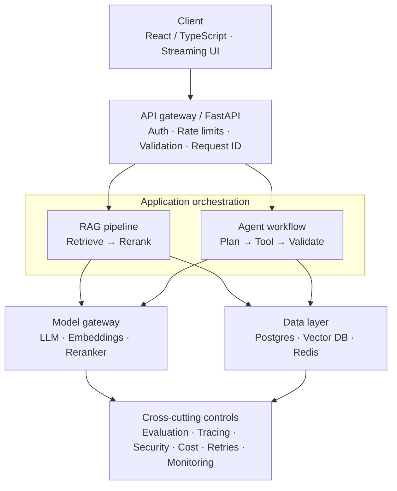
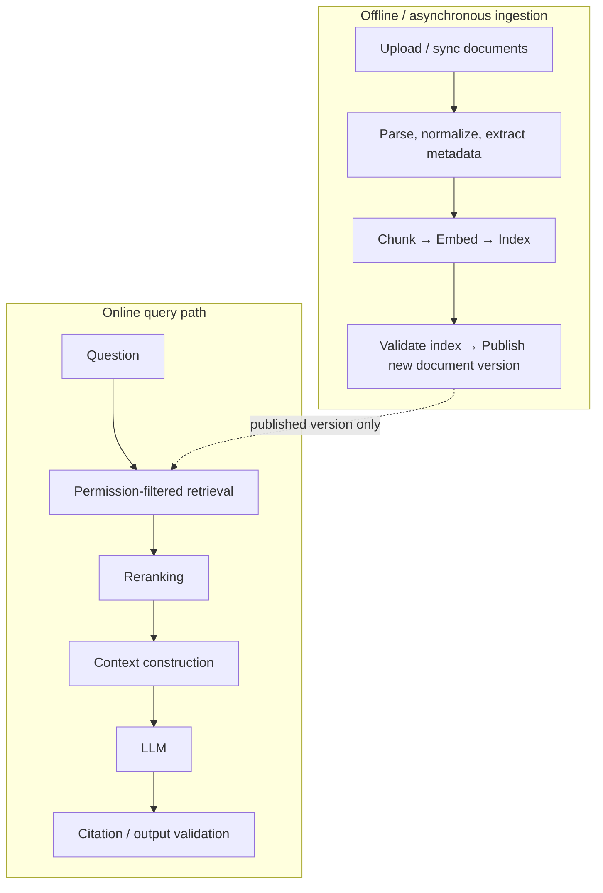
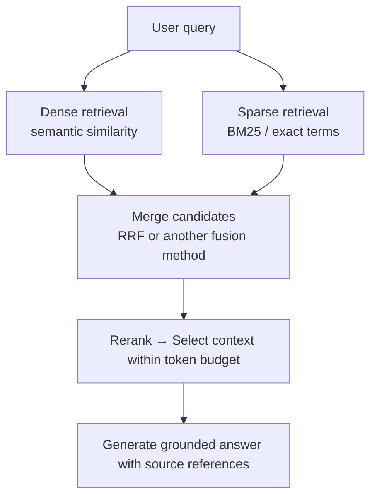
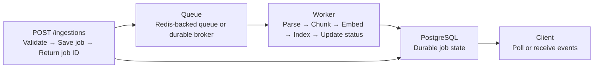

import TOCInline from '@theme/TOCInline';

# Production Patterns for AI Applications: RAG, LLMs, and Agents

For production GenAI engineering, the key shift is from *"the model generates an
answer"* to **"the system reliably delivers a correct, secure, observable, and
cost-effective result."**

The patterns below are framework-agnostic. They apply whether you're running
Ollama locally, calling NVIDIA endpoints, or using a hosted model provider.

<TOCInline toc={toc} minHeadingLevel={2} maxHeadingLevel={2} />

---

## 1. The Production AI Architecture



:::note
The diagram shows **logical components, not necessarily separate
microservices**. Start with a modular monolith in FastAPI and split services
only when scale, ownership, or deployment needs justify it.
:::

---

## 2. The Essential Production Patterns

Priority guide: **P0** = learn first · **P1** = learn next · **P2** = advanced
or workload-dependent.

**1. Deterministic workflow before autonomous agents — P0.** Use explicit steps
and conditional branches for predictable tasks. Introduce agent autonomy only
when dynamic tool selection or planning provides real value.

> Classify a question → retrieve documents → generate an answer → validate
> citations, instead of letting an agent decide every step.

**2. Retrieve, rerank, then generate — P0.** Retrieve a broader candidate set,
rerank it for relevance, select a token-budgeted context, then call the LLM.
Apply metadata and permission filters **before** documents reach the model.

> Hybrid BM25 + vector retrieval → rerank top candidates → generate a cited
> answer.

**3. Validate at every trust boundary — P0.** Validate incoming requests,
retrieved data, model output, and tool arguments. Treat retrieved documents and
tool results as **untrusted data**. Enforce authorization in application code,
not only in prompts.

**4. Trace every model call — P0.** Capture latency, model/version, token usage,
retrieval results, tool calls, errors, and evaluation scores. Redact secrets and
sensitive content before logging. Tools: OpenTelemetry, LangSmith, Langfuse,
Arize Phoenix.

**5. Bounded retries, timeouts, and fallbacks — P0.** Set timeouts on model and
retrieval calls. Retry transient failures with exponential backoff and jitter.
Limit attempts and total execution time. Do **not** retry every error or
silently replace a failed model with a lower-quality one.

**6. Budgets and backpressure — P0.** Cap input and output tokens, agent steps,
tool calls, wall-clock time, and per-user spending. Use concurrency limits and
queues so a model outage or traffic spike can't overwhelm the application.

**7. Evaluation-driven releases — P0.** Maintain a versioned golden dataset. Run
deterministic tests and LLM evaluations before releasing changes to prompts,
models, embeddings, chunking, or retrieval settings. Roll back when quality
drops beyond defined thresholds.

---

## 3. Production RAG Patterns

A basic RAG application is:

```
Question → Embed → Search → Prompt → LLM → Answer
```

A production RAG system adds quality checks, permissions, fallbacks, and an
**independently testable ingestion pipeline**.

### Pattern A — Separate Ingestion from Query-Time Retrieval



Why separate them:

- Ingestion can take minutes and needs background processing.
- User queries should not wait for PDFs to be parsed or embedded.
- You can retry failed documents independently.
- You can track document versions and avoid partially indexed content.

:::danger[Production rule]
Never expose a new document version as *ready* until the required indexing steps
have **succeeded**.
:::

### Pattern B — Hybrid Retrieval and Reranking

Do not assume vector search alone is always the best retrieval strategy.



This is particularly useful when users ask questions involving **exact error
codes, product IDs, names, dates, or technical terms**.

Evaluate each stage independently: retrieval recall, ranking quality, answer
faithfulness, and end-to-end answer quality.

### Pattern C — Abstain When Evidence Is Insufficient

Do not force the model to answer every question. A reliable RAG workflow should
be able to:

- Detect that retrieval returned no useful evidence.
- Ask a clarifying question when the query is ambiguous.
- Say that the available documents do not contain the answer.
- Return citations for claims that are supported.
- Escalate to a human or an authorized alternative when appropriate.

:::warning
A similarity threshold alone is **not** a universal confidence score. Calibrate
thresholds against a representative evaluation dataset.
:::

### Pattern D — Treat Document Permissions as Part of Retrieval

For multi-user or enterprise applications, retrieval must enforce access
control. If user A uploads a confidential document, user B must not receive its
chunks simply because they are semantically similar to B's question.

- Attach tenant, document, and access metadata to indexed chunks.
- Enforce authorization in the **retrieval layer**.
- Avoid relying on a prompt that tells the LLM not to reveal unauthorized data.
- Test cross-tenant isolation explicitly.
- Apply equivalent controls to **cached results and citations**.

:::danger
This is a security requirement, not an optional RAG optimization.
:::

### Pattern E — Version Your Entire Retrieval Pipeline

Treat all of these as versioned configuration:

- Embedding model and dimensions.
- Chunking algorithm and settings.
- Document parser version.
- Index configuration and metadata schema.
- Retrieval filters, candidate count, and reranker.
- System prompt and output schema.

If you change the embedding model, you may need to **re-embed and reindex** the
corpus. Don't silently mix incompatible embedding spaces.

---

## 4. Production Patterns for LLM Calls

| Pattern | How to implement it | Why it matters |
| --- | --- | --- |
| **Model gateway** | One interface for providers and model routing | Reduces provider coupling |
| **Structured output** | Pydantic schema + supported constrained output | Predictable response contracts |
| **Timeout + retry** | Per-call deadlines, bounded retries | Prevents stuck requests |
| **Fallback** | Explicitly configured alternate model | Improves availability when safe |
| **Token budgeting** | Reserve space for output and instructions | Prevents context overflow |
| **Semantic cache** | Reuse equivalent responses when safe | Reduces latency and cost |
| **Streaming** | Stream chunks or events to the UI | Improves perceived responsiveness |
| **Circuit breaker** | Temporarily stop calls to a failing dependency | Prevents cascading failures |
| **Bulkhead / concurrency limit** | Limit simultaneous expensive operations | Protects shared resources |

### Important Details

**Retries.** Retry transient timeouts, rate limits, and eligible server errors,
respecting provider retry instructions. Don't automatically retry authentication
errors, invalid requests, or safety rejections.

**Fallbacks.** Use a fallback only when its capabilities, permissions, output
format, and quality are acceptable. **A failed tool action is not the same as a
failed model call** — never repeat a side effect blindly.

**Caching.** Exact-response caching is often safer than semantic caching. Cache
keys may need to include tenant, authorization scope, model version, prompt
version, retrieval configuration, and conversation context. Never share
personalized or permission-restricted answers across users.

**Streaming.** Once tokens have been sent to the client, you cannot simply
replace the entire response with a different model's answer. Plan for
interrupted streams, partial responses, cancellation, and safe error reporting.

---

## 5. Agent and Tool Execution Patterns

Agents introduce a different set of failure modes: loops, repeated actions, tool
errors, untrusted tool results, and unexpected spending.

**1. Router pattern.** Classify a request and route it to a specialist
workflow — RAG, SQL, or a support tool. Use explicit rules for predictable
routing and an LLM classifier only where needed.

**2. Bounded agent loop.** Set maximum steps, tool calls, elapsed time, and
token budgets. Validate the final answer and terminate on completion, failure,
or budget exhaustion. **Never let the model control an unlimited loop.**

**3. Human approval.** Pause before sensitive actions, show the intended action
and arguments, and resume only after an authenticated user approves.
**Revalidate authorization at execution time.**

**4. Durable state and checkpointing.** Persist workflow state so a long-running
process can resume after a restart. Store conversation history separately from
workflow checkpoints where appropriate. Use a stable run ID and
conversation/thread ID.

**5. Tool allowlists and least privilege.** Give each agent only the tools and
data it needs. Validate tool arguments, enforce authorization server-side,
sandbox risky execution, and audit sensitive actions.

**6. Idempotent tool actions.** An agent may retry after a timeout even when the
external operation actually succeeded. Use idempotency keys or provider
operation IDs for actions such as creating tickets, sending messages, and
initiating payments.

:::danger[A critical distinction]
**Checkpointing does not make external side effects exactly-once.** A database
transaction cannot atomically commit an unrelated email or payment-provider
request. Use idempotency, durable action records, reconciliation, and explicit
operation states.
:::

---

## 6. Background Jobs and Asynchronous Processing

Use a queue when an operation is expensive, long-running, retryable, or does not
need to finish before the API responds — bulk document ingestion, batch
evaluations, embedding generation, long-running agent workflows.



A practical job state machine:

```
queued → running → succeeded | failed
```

You may also need `retrying`, `cancelled`, or `dead_lettered`.

Production requirements:

- Persist job state and retry counts.
- Make job execution idempotent.
- Apply backpressure and limit concurrent embedding/model calls.
- Distinguish transient failures from permanent failures.
- Support cancellation, timeouts, and dead-letter handling.
- Expose status through an endpoint such as `GET /jobs/{job_id}`.
- Avoid holding a database transaction open during a long model call.

For a Python stack, investigate **Celery, ARQ, or Dramatiq**. Choose based on
durability, scheduling, throughput, and operational requirements rather than
popularity alone.

---

## 7. Testing and Evaluation Patterns

A production AI test strategy needs several layers. **No single LLM-as-a-judge
score is enough.**

| Layer | What it covers |
| --- | --- |
| **Unit tests** | Chunking, authorization filters, prompt construction, schemas, retry logic, deterministic business rules — without calling an LLM |
| **Integration tests** | Actual retrieval, model adapters, persistence, queue workers, tool execution, error paths |
| **Quality evaluations** | Retrieval precision/recall, faithfulness, answer relevance, citation correctness, task success against a reviewed dataset |
| **Adversarial tests** | Prompt injection, cross-tenant access, malformed tool arguments, excessive agent loops, sensitive-data disclosure, tool failures |
| **Load and reliability tests** | Concurrency, provider rate limits, queue backlogs, dependency outages, slow model responses, client cancellation |

### Release Pattern: Evaluate Before Deploying

1. Version the model, prompt, retrieval configuration, and evaluation dataset.
2. Run unit and integration tests.
3. Run quality evaluations on a representative golden dataset.
4. Check security, latency, and cost thresholds.
5. Deploy to a small traffic segment where practical.
6. Compare live metrics against the baseline and roll back if necessary.

Use **strict pass/fail gates** for deterministic requirements such as
authorization and schema validity. Use **calibrated thresholds and human
review** for subjective quality metrics.

---

## 8. Observability: Know What Happened Inside Every Request

Track the full request lifecycle, not just whether the HTTP endpoint returned
`200 OK`.

| Metric | What to measure |
| --- | --- |
| **Latency** | End-to-end p50, p95, p99; time to first token |
| **Model usage** | Input/output tokens, model calls, cost per request |
| **Retrieval** | Candidate count, retrieval latency, relevant-document rate |
| **Quality** | Faithfulness, groundedness, task success, user feedback |
| **Reliability** | Error rate, timeout rate, retry count, fallback rate |
| **Agents** | Steps per run, tool success rate, budget exhaustion |
| **Queues** | Queue depth, job age, processing time, failure rate |
| **Security** | Authorization failures, blocked tool calls, suspicious inputs |

Use distributed trace IDs to connect the API request, retrieval calls, LLM
calls, and background jobs. Record useful metadata, but **do not
indiscriminately log prompts, confidential documents, API keys, or personal
information**.

---

## 9. Production Design Decisions

Common architectural choices worth being able to justify in an interview.

| Problem | Prefer this pattern |
| --- | --- |
| Simple FAQ bot | Basic RAG with grounded answers |
| Exact identifiers and semantic questions | Hybrid retrieval + reranking |
| Long PDF ingestion | Background workers + durable job state |
| Dynamic multi-step tasks | Bounded agent workflow |
| Predictable business process | Explicit workflow / state machine |
| Expensive repeated queries | Carefully scoped caching |
| Provider rate limits | Concurrency control + backoff |
| Sensitive tool actions | Server-side authorization + approval |
| Long-running agent | Checkpointing + resumable execution |
| Model quality regression | Golden dataset + automated evaluations |
| Provider outage | Timeout + circuit breaker + safe fallback |
| High concurrent inference load | Queueing, batching, capacity management |

---

## 10. Your Implementation Roadmap

Build these patterns into your FastAPI projects in this order.

- [ ] **Step 1 — Reliable LLM endpoint.** Structured outputs, timeouts, bounded
      retries, token limits, request IDs, and safe errors.
- [ ] **Step 2 — Production RAG.** Separate ingestion, hybrid retrieval,
      reranking, citations, access filters, and versioned indexes.
- [ ] **Step 3 — Quality and observability.** Golden datasets, RAGAS/DeepEval,
      traces, regression gates, latency and cost metrics.
- [ ] **Step 4 — Background processing.** Queue, worker, durable job state,
      idempotency, retry policies, and dead-letter handling.
- [ ] **Step 5 — Controlled agents.** LangGraph state/checkpoints, MCP tools,
      execution budgets, authorization, and human approval.
- [ ] **Step 6 — Scale and resilience.** Caching, concurrency controls, circuit
      breakers, load tests, deployment and rollback strategies.

---

## 11. Production AI Concepts to Memorize for Interviews

Beyond frameworks, make sure you can explain:

| Area | Concepts |
| --- | --- |
| **Reliability** | Idempotency, exponential backoff with jitter, circuit breakers, bulkheads, deadlines, backpressure |
| **Data consistency** | Document versioning, atomic publication of indexes, eventual consistency, durable state, duplicate-job handling |
| **AI quality** | Retrieval vs generation failures, evaluation datasets, calibration, groundedness, abstention |
| **Security** | Prompt injection, least privilege, tenant isolation, data exfiltration, human approval |
| **Performance** | Caching, batching, concurrency, token budgets, model routing, latency/cost trade-offs |
| **Architecture** | Queues vs synchronous requests, workflows vs agents, monolith vs microservices, stateless APIs vs durable workers |

:::tip[The strongest recommendation]
Start with a **production-style RAG application**, not a multi-agent system.
Make retrieval accurate, failures recoverable, outputs testable, and costs
measurable. Then add agentic workflows when you have a real use case that
benefits from them.
:::

---

## Done When

- [ ] You can explain why ingestion and query-time retrieval belong on separate paths.
- [ ] Your retrieval layer enforces permissions, and you have a test proving cross-tenant isolation.
- [ ] Every model call has a timeout, a retry policy, and a trace.
- [ ] Your agent loops are bounded by steps, time, tokens, and cost.
- [ ] Your tool actions are idempotent, and you can explain why checkpointing isn't enough.
- [ ] A prompt or model change can't ship without passing evaluation gates.

Related: [09 · Production Patterns](../10-production-patterns/index.mdx) for the
hands-on build, [Production AI](./15-production-ai.mdx) for the infrastructure
layer, [LLMOps](./14-llmops-roadmap.mdx) for the improvement loop,
[AI Security](./16-ai-security.mdx) for the threat model, and the
[Modern GenAI Engineer Roadmap](./20-modern-genai-engineer-roadmap.mdx) for the
tool choices behind these patterns.
