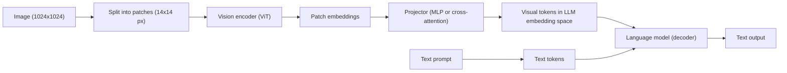

import TOCInline from '@theme/TOCInline';

# Multimodal AI

<TOCInline toc={toc} minHeadingLevel={2} maxHeadingLevel={2} />

:::tip[In this guide]
What makes a model multimodal, how an image becomes tokens and why that gets
expensive fast, working code for sending images and audio, and an honest account
of what vision models do well versus where they quietly fail.
:::

## What Is It?

A **multimodal model** accepts more than one kind of input — text plus images,
audio or video — and reasons over all of it in one pass. Almost everything you
will use is a **vision-language model (VLM)**: text and images in, text out.

People mean two different things by "multimodal," and the difference predicts
behaviour:

| Approach | How it is built | Consequence |
| --- | --- | --- |
| **Projection onto a text decoder** | A pretrained vision encoder bolted to a pretrained LLM through a small trained adapter | Cheap to train, dominant in open models. The LLM is the reasoner; vision is a translation layer feeding it |
| **Shared representation space** | One model trained from the start on interleaved modalities | Better cross-modal reasoning, can emit non-text output. Far more expensive to train |

Most open models (Llama Vision, Qwen-VL, LLaVA-style) are the first kind;
frontier hosted models are closer to the second. The first kind inherits a
specific weakness: the language model never sees the image, it sees a fixed set
of vectors a projector handed it, and whatever the encoder discarded is gone.

## Why Does It Matter?

A large share of real enterprise knowledge is not text. Scanned contracts, slide
decks, dashboards, engineering diagrams, screenshots in bug reports. A text-only
pipeline either cannot read them or reads them badly and does not tell you.

Multimodal also deletes preprocessing stages: "invoice image to validated JSON"
replaces an OCR-plus-regex pipeline that broke whenever a vendor changed their
template. The catch is cost and reliability, which is most of this page.

## The Common Architecture



Three parts, because they fail separately:

| Component | Job | Typical failure |
| --- | --- | --- |
| Vision encoder | Pixels to patch embeddings | Loses fine detail; small text falls below its effective resolution |
| Projector | Map visual embeddings into the LLM's token space | Information bottleneck — often compresses hundreds of patches into far fewer tokens |
| Language model | Reason and generate | Hallucinates plausible detail when the visual signal is weak |

When a VLM confidently reads the wrong number off a chart, that is usually the
encoder or projector dropping the signal and the language model filling the gap
from its prior.

## Images Are Expensive In Context

The projector's output lands in the decoder's token space and is treated exactly
like word tokens: it occupies context, costs money, counts against your window.
Rough per-image numbers for an OpenAI-compatible endpoint:

| Input | Detail setting | Approx. tokens |
| --- | --- | --- |
| Any image | `low` | ~85 |
| 512x512 | `high` | ~255 |
| 1024x1024 | `high` | ~765 |
| 1024x2048 | `high` | ~1105 |
| 2048x4096 | `high` | ~1105 (downscaled to fit) |

Two things follow. A high-detail screenshot costs more than a page of prose —
1024x1024 is roughly 570 words' worth of tokens. And `detail: low` is about 9x
cheaper and enough for "what kind of document is this?" but nowhere near enough
to read a table.

:::warning
Oversized images are downscaled server-side before tokenisation. A 4000x3000
photo buys no more detail than a pre-scaled one — it just wastes upload
bandwidth. Downscale on your side, where you control the resampling.
:::

The rule: **pick the lowest detail that answers your question, and resize before
you send.**

## Calling A Vision Model

Message content becomes a list of parts rather than a string:

```json
{
  "role": "user",
  "content": [
    { "type": "text", "text": "What is the total on this invoice?" },
    {
      "type": "image_url",
      "image_url": { "url": "https://example.com/invoice.png", "detail": "high" }
    }
  ]
}
```

A local file goes in the same slot as a data URL. Code handling both, mixed in
one request:

```python
import base64
import mimetypes
from pathlib import Path

from openai import AsyncOpenAI

client = AsyncOpenAI()


def image_part(source: str | Path, detail: str = "auto") -> dict[str, object]:
    """Content part from an HTTP URL or a local file."""
    if isinstance(source, str) and source.startswith(("http://", "https://")):
        url = source
    else:
        path = Path(source)
        mime = mimetypes.guess_type(path.name)[0] or "image/png"
        url = f"data:{mime};base64,{base64.b64encode(path.read_bytes()).decode()}"
    return {"type": "image_url", "image_url": {"url": url, "detail": detail}}


async def ask(question: str, sources: list[str | Path], detail: str = "auto") -> str:
    content: list[dict[str, object]] = [{"type": "text", "text": question}]
    content.extend(image_part(s, detail) for s in sources)
    resp = await client.chat.completions.create(
        model="gpt-4o-mini",
        messages=[{"role": "user", "content": content}],
        temperature=0,
    )
    return resp.choices[0].message.content or ""


# await ask("What changed?", ["https://x/a.png", "out/b.png"], detail="high")
```

Local models work the same way. Ollama serves vision models (Llama Vision,
Qwen-VL, LLaVA) behind an OpenAI-compatible endpoint, so only the base URL
changes — `AsyncOpenAI(base_url="http://localhost:11434/v1", api_key="ollama")`.
Expect a visible drop on detail-sensitive work: local VLMs are fine for
classification and captioning, weak on dense documents.

## What VLMs Are Good And Bad At

Be specific, because "it can see images" invites optimistic assumptions.

| Task | Reliability | Failure mode |
| --- | --- | --- |
| Scene description | Good | Over-describes; invents plausible background detail |
| OCR of clean printed text | Good | Solid at reasonable resolution |
| Chart reading (trend, direction) | Good | Reads the shape correctly |
| Chart reading (exact values) | Poor | Reports a number 10–20% off, or the wrong series, with full confidence |
| Spatial reasoning (left/above/inside) | Mixed | Degrades fast past a handful of objects; position often guessed |
| Counting | Poor beyond ~5 | Settles on a round number. Counting 23 things reliably is out of reach |
| Precise measurement (pixels, angles) | Poor | No metric sense; estimates near-arbitrary |
| Dense small text (footnotes, fine print) | Poor | Silently skips or paraphrases what it cannot resolve |
| Handwriting | Poor to mixed | Fine on neat capitals, unreliable on cursive, guesses rather than abstains |

The pattern across the bad rows: **VLMs do not know when they cannot see
something.** They are trained to produce an answer, so a weak visual signal
becomes a confident guess rather than an "I can't tell." Design around that.

## Prompting A Vision Model

**Ask for structured output.** It constrains the model and gives you something
to validate.

```python
from pydantic import BaseModel, Field

SYSTEM = (
    "Extract invoice fields from the image. Use null for any field you cannot "
    "read directly off the image, and list its name in illegible_fields. "
    "Never infer or calculate a value."
)


class Invoice(BaseModel):
    vendor: str | None
    invoice_number: str | None
    total: float | None
    illegible_fields: list[str] = Field(default_factory=list)


resp = await client.beta.chat.completions.parse(
    model="gpt-4o",
    messages=[
        {"role": "system", "content": SYSTEM},
        {"role": "user", "content": [image_part("invoice.png", detail="high")]},
    ],
    response_format=Invoice,
    temperature=0,
)
invoice: Invoice = resp.choices[0].message.parsed
```

**Ground answers in visible evidence.** Make the model say where it looked. It
does not eliminate hallucination but it makes it reviewable and reduces
invention.

```text
For each field, report the text you read verbatim and roughly where on the page
it appeared (header, top-right, table row 3). If that verbatim text does not
literally appear in the image, the field must be null.
```

**Give it permission to refuse.** The default is to answer anyway, so override
it explicitly and provide a cheap escape route — a `null`, an empty list, a
`"not_visible"` enum member. "Say you don't know" with nowhere structured to put
that is a weak instruction.

## Audio And Video In Brief

Three audio capabilities, often conflated. **Speech-to-text** for transcription
and voice input. **Text-to-speech** for spoken responses. **Native audio models**
(audio to audio) for low-latency conversation, keeping the tone and prosody a
transcript loses. STT is the mature one — cheap, good, and it gives you
timestamps:

```python
async def transcribe(path: str, language: str | None = None) -> str:
    with open(path, "rb") as fh:
        resp = await client.audio.transcriptions.create(
            model="whisper-1",
            file=fh,
            language=language,          # omit to auto-detect
            response_format="verbose_json",
        )
    return resp.text
```

Keep `verbose_json` if the transcript will be chunked for retrieval — a citation
pointing at 04:12 beats one pointing at a two-hour recording. STT-then-LLM-then-
TTS is simple and debuggable but stacks three latencies; native audio models cut
that, at the cost of the transcript you would otherwise log and evaluate. For
anything auditable, keep the transcript.

**Video is mostly sampled frames** plus that transcript: decode, extract every
Nth frame, send those frames as images.

```python
import subprocess
from pathlib import Path


def sample_frames(video: str, out_dir: str, fps: float = 0.2) -> list[Path]:
    """Extract frames at `fps` (0.2 = one frame every 5 seconds)."""
    out = Path(out_dir)
    out.mkdir(parents=True, exist_ok=True)
    subprocess.run(
        ["ffmpeg", "-i", video, "-vf", f"fps={fps},scale=768:-1",
         "-y", str(out / "frame_%04d.jpg")],
        check=True, capture_output=True,
    )
    return sorted(out.glob("*.jpg"))
```

Do the arithmetic. One frame every 5 seconds over a 10-minute video is 120
frames — at ~765 tokens each on high detail, roughly 92,000 tokens for one clip.
It is lossy too: 0.2 fps walks past a 1-second slide transition or a brief error
dialog, and stills carry almost no motion information, so "did they pick it up
or put it down?" is unanswerable. Sample on scene changes instead of a fixed
interval, keep the transcript as the primary index, and keep frames small.

## Embeddings Across Modalities

CLIP-style models train an image encoder and a text encoder together so a
matching image and caption land near each other in **one shared vector space**.
You can embed a text query and search images with it directly.

```python
from PIL import Image
from sentence_transformers import SentenceTransformer

model = SentenceTransformer("clip-ViT-B-32")
image_vecs = model.encode([Image.open("a.jpg"), Image.open("b.jpg")])
query_vec = model.encode("a red bicycle leaning on a wall")
# cosine similarity between query_vec and image_vecs ranks the photos
```

Genuinely good for image search by text description, reverse image search,
deduplication, and **zero-shot classification** — embed your label names, embed
the image, take the nearest label, no training data needed.

Where it disappoints next to a text embedding model:

| Limitation | Detail |
| --- | --- |
| Short text context | CLIP text encoders cap around 77 tokens. Longer passages are truncated, not embedded |
| Caption-level semantics only | Trained on short alt-text; captures what is in the picture, not fine relationships |
| Weak on text inside images | A slide full of words embeds as "a slide," not as its content |
| Modality gap | Image and text vectors cluster in separate regions; cross-modal scores are not comparable to text-text scores |

Do not use a CLIP text encoder for text-to-text document retrieval; a dedicated
text model clearly wins. For document work the honest answer is usually to
describe the image in text and embed that. The next page covers why.

## Cost And Latency Reality

Indicative figures for a mid-tier hosted model. The ratios are the lesson, not
the absolute numbers.

| Request | Input tokens | Relative cost | Added latency |
| --- | --- | --- | --- |
| 500-word text question | ~700 | 1x | baseline |
| Text plus one `low` detail image | ~790 | ~1.1x | +100–300 ms |
| Text plus one 1024x1024 `high` image | ~1470 | ~2.1x | +300–800 ms |
| Text plus five `high` images | ~4500 | ~6.4x | +1–3 s |
| 120 video frames at `high` | ~92000 | ~130x | +10–60 s |

Time-to-first-token grows with visual token count, on top of upload time. The
architecture that follows:

- **Extract once, reuse forever.** Run the vision pass at ingest, store the text,
  let every later query hit text only. The biggest lever you have.
- **Cache on content hash** of image bytes plus prompt plus model name. The same
  screenshot gets asked about repeatedly.
- **Downscale before sending.** 768px on the long edge handles most screenshots.
- **Use `low` detail for routing**, then give only the pages that matter a `high`
  pass.
- **Cap images per request in code.** "Analyse these 40 screenshots" should be
  rejected or batched, not silently billed.

## Evaluation And Maturity

Your existing evaluation machinery transfers, with one addition: evaluate the
**extraction step separately** from the final answer. Otherwise a pipeline that
misreads a total and then reasons flawlessly about the wrong number looks like a
reasoning problem, and you tune the wrong stage. Build a labelled image set with
ground-truth fields, score extraction per field, keep it as a regression test,
then score the end-to-end answer on top. The groundwork — datasets, metrics,
LLM-as-judge, evals in CI — is in section 12, Evaluation.

Two honest notes about where this all stands. **OCR-plus-text still frequently
beats end-to-end vision for document work.** A layout-aware parser plus a strong
text model is often more accurate, cheaper and far more debuggable, because you
get an intermediate artifact you can inspect, diff and test. Reach for
end-to-end vision when layout itself carries meaning, not as the default.

And **measure, do not assume.** Public benchmarks lean on clean, well-framed
images; your users upload phone photos of crumpled receipts in bad light. The
tooling moves fast enough that every claim here is worth re-testing on 50 of
your own examples.

## Common Mistakes

- Sending full-resolution images and paying for detail the server throws away.
- Using `high` detail everywhere, including classification that `low` handles.
- Trusting exact numbers read off a chart without a verification step.
- Asking a VLM to count things and believing the answer.
- Running the vision pass at query time when you could run it once at ingest.
- No cap on images per request, so one user can run up a large bill.
- Giving the model no structured way to say "not visible," then being surprised by invented values.
- Treating sampled frames as if they captured motion or short events.
- Logging only the final answer, so you cannot tell whether vision or reasoning failed.
- Forgetting that text inside a user-supplied image is untrusted input and can carry injected instructions.

## Interview Questions

- Walk through how an image becomes tokens in a VLM. Where is information lost?
- Why does a 1024x1024 image cost roughly as many tokens as a page of text?
- Projection-based VLM versus shared representation space: what differs, and why does it matter?
- Name three things VLMs are unreliable at and explain the common cause.
- When would you use OCR plus a text model instead of a VLM?
- How would you cut the cost of a vision-heavy pipeline by an order of magnitude?
- What is wrong with sampling video at one frame every five seconds?
- What are CLIP-style joint embeddings good for, and where do they lose to text embeddings?

## Things to Remember

- Images are tokens, and they are expensive. Resolution and detail drive the bill.
- Most VLMs are a vision encoder projected onto a text decoder. The language model never sees pixels.
- VLMs do not know what they cannot see, and they guess confidently. Build a refusal path.
- Good at description, clean OCR and chart trends. Bad at exact values, counting and fine print.
- Extract once at ingest, store text, query text. That is the main cost lever.
- Evaluate extraction and reasoning separately, or you will tune the wrong stage.

## Mini Exercise

Take one screenshot containing a small table of numbers. Send it three times: at
`detail: low`, at `detail: high`, and downscaled to 512px wide at `high`. Ask
for the table as structured JSON each time, instructing the model to use `null`
for anything unreadable. Record tokens, latency and correct cells for each, then
ask it to count the rows. You end up with local numbers for the
resolution-versus-cost tradeoff and a look at how the model behaves when it
cannot quite read something.

## Done When

- [ ] You can explain the vision-encoder / projector / language-model split and which stage causes which failure.
- [ ] You can estimate an image's token cost from its resolution and detail setting.
- [ ] You have called a vision model with both a URL and a base64-encoded local file.
- [ ] You can name three tasks VLMs are unreliable at, with the reason.
- [ ] You can state two concrete ways to cut the cost of a vision pipeline.
