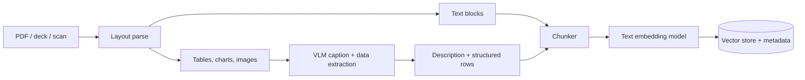
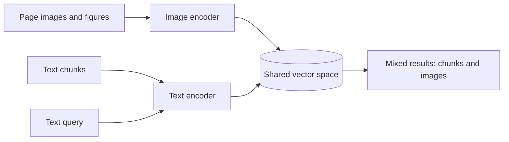
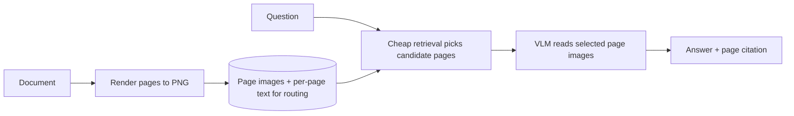

import TOCInline from '@theme/TOCInline';

# Multimodal RAG

<TOCInline toc={toc} minHeadingLevel={2} maxHeadingLevel={2} />

:::tip[In this guide]
Your corpus is PDFs, decks and scans. A text-only pipeline drops the tables and
charts that hold the answer, and nothing errors. The three architectures that
fix it, why parsing is the real bottleneck, and what captioning a large corpus
actually costs.
:::

## What Is It?

**Multimodal RAG** is retrieval over a corpus where the answer is not always in
the prose. Tables, charts, diagrams, scanned pages and slide layouts carry
meaning a plain text extractor loses or mangles.

The previous page covered the model side — how an image becomes tokens, what
vision-language models are reliable at, how to call one. This page is the
pipeline side: how non-text content gets indexed, retrieved, and cited back to
the region of the page it came from. The syllabus calls this **document
intelligence**, which is the right framing. Most of the work is not model work.

## Why Does It Matter? The Silence Is The Problem

You ingest 40,000 PDFs. The pipeline reports success. Answers look fluent. And a
fifth of questions get a confidently wrong answer, because the number lived in a
table your extractor flattened into space-separated digits with the headers gone.

Nothing in the stack tells you:

| Stage | What happens | What you see |
| --- | --- | --- |
| Parse | Table becomes unlabelled number runs; chart becomes nothing | Successful parse, non-zero character count |
| Chunk | Garbled rows split mid-table | Normal chunk count |
| Embed | Digit soup embeds as low-signal noise | No error; vectors exist |
| Retrieve | That chunk never ranks for a real question | Results returned, just the wrong ones |
| Generate | Model answers from whatever prose it did get | Fluent, plausible, unsupported |

A text-only pipeline on a visual corpus does not fail loudly. It fails quietly
and uniformly. The first countermeasure is not an architecture, it is an
assertion at ingest:

```python
def flag_suspicious_pages(pages: list[str], min_chars: int = 80) -> list[int]:
    """Pages with almost no extractable text are probably scans or images."""
    return [i for i, text in enumerate(pages) if len(text.strip()) < min_chars]
```

A page that extracts 11 characters is a bug, not a short page. Without this you
cannot tell a blank page from a failed one.

## The Three Architectures

| Architecture | Vision cost paid at | Quality on text questions | Best for |
| --- | --- | --- | --- |
| Caption-then-index | Ingest | High — it is normal text retrieval | Almost everything |
| Joint embedding | Ingest, cheap | Low — short-text encoders | Finding figures by appearance |
| Page-as-image | Query time | Bypasses text retrieval | Layout-heavy, high-value documents |

### Caption-Then-Index

At ingest, run a vision model over each non-text asset and write a text
description. Embed the description with your normal text model. At query time
nothing is special.



**Verdict: least elegant, usually best.** It feels like a hack — you discard the
pixels and keep a paraphrase. It wins for structural reasons. One embedding
space, so a text question and a chart description are directly comparable: no
modality gap, no score calibration problem. Your hybrid search, reranking,
filters and evals keep working. The intermediate artifact is **human-readable**,
so when retrieval misses you read the caption and see why — that debuggability is
worth more than it sounds. And vision cost is paid once per asset, not per query.

The cost: the caption is lossy and fixed at ingest. One written for "what does
this chart show?" will not serve "what was the Q3 EMEA figure?" unless you asked
for the numbers. The extraction prompt matters more than the model choice.

### Joint Embedding

One CLIP-style space for images and text. Embed images at ingest, embed the query
as text, search across both.



**Verdict: good for a narrow job, disappointing as your main retriever.** It
works for "find the slide with the architecture diagram" — visual-appearance
queries. Where it disappoints:

| Problem | Why |
| --- | --- |
| Short text context | CLIP text encoders cap near 77 tokens; prose chunks get truncated, not embedded |
| Caption-level semantics | Trained on alt-text, so it captures what the picture *is*, not what it *says* |
| Text inside images | A dense table embeds as "a table" — useless for a question about its contents |
| Modality gap | Image-text and text-text scores sit on different scales, so one ranked list is not meaningfully ordered |

Use it as a **separate retriever** fused into your results, never as a
replacement for text retrieval. Late-interaction document retrievers
(ColPali-style, matching query tokens against page patches) close much of this
gap and are the most interesting thing here, but the tooling is still young.

### Page-As-Image

Skip extraction. Render each page and let a VLM read it at query time.



**Verdict: expensive, and the strongest option on layout-heavy documents.** When
meaning lives in the layout — a form where position defines the field, a floor
plan, a financial statement with nested indentation — no text extraction survives
it and reading the page is simply correct.

The arithmetic kills it as a default. A high-detail page is roughly 765 input
tokens, so five candidate pages is about 3,800 extra tokens on **every query**,
plus time-to-first-token. You still need cheap retrieval to pick those five
pages, so you have added a stage rather than replaced one. Use it as a selective
escalation: layout-heavy documents, or a retry after the first attempt abstains.

## Document Parsing Is The Real Bottleneck

The model rarely limits a document pipeline. Parsing does. **Layout detection**
means finding regions on a page and classifying them as title, paragraph, table,
figure, caption, header; without it everything downstream is guessing.
**Reading order** is the sequence a human would read those regions in. A PDF's
text operators are in *drawing* order, whatever the producing application
emitted. On a two-column paper that commonly means line one of column one, then
line one of column two, then line two of column one. The output looks
grammatical and is semantically scrambled. No error is raised.

| Approach | How it works | Good at | Failure mode |
| --- | --- | --- | --- |
| **Text-layer extraction** (`pypdf`, `pdfminer`) | Reads embedded text operators | Fast, free, exact characters on digital-native PDFs | Drawing-order output on multi-column pages; tables flatten to unlabelled runs; returns empty on scans without complaint |
| **OCR** (Tesseract, PaddleOCR, cloud OCR) | Recognises characters from pixels | The only option for scans and photos | Character errors on small or low-contrast text; no structure unless paired with layout detection; slow |
| **Layout-aware parsing** (Unstructured, Docling, Azure Document Intelligence, AWS Textract) | Detects regions, then extracts per region in reading order | Preserves tables, headings, columns, order; emits element types you can route on | Slowest and priciest; model-based, with its own errors; cloud options send documents off-machine |

The default: **layout-aware parsing for anything you care about**, text-layer as
a fast path for documents verified clean, OCR only for pages flagged image-only.
Decide per page, from measurable signals, and log the decision:

```python
from enum import StrEnum


class Route(StrEnum):
    TEXT_LAYER = "text_layer"
    OCR = "ocr"
    LAYOUT = "layout"


def choose_route(chars: int, image_ratio: float, columns: int, tables: int) -> Route:
    if chars < 80 and image_ratio > 0.5:
        return Route.OCR          # a scan: there is no text layer
    if columns > 1 or tables > 0:
        return Route.LAYOUT       # reading order or tables at risk
    return Route.TEXT_LAYER       # clean single-column prose
```

## Tables: Two Representations, Not One

A detected table should produce **both** a text form for retrieval and structured
rows for computation. Markdown is a good text form — models read it reliably and
it keeps the header-to-cell relationship. Name the columns in prose too, so a
piece of the table is interpretable on its own.

```python
from pydantic import BaseModel, Field


class TableAsset(BaseModel):
    asset_id: str
    page: int
    caption: str | None = None
    headers: list[str]
    rows: list[list[str]] = Field(default_factory=list)

    def to_markdown(self) -> str:
        rows = [self.headers, ["---"] * len(self.headers), *self.rows]
        return "\n".join("| " + " | ".join(r) + " |" for r in rows)

    def to_retrieval_text(self) -> str:
        head = [f"Table: {self.caption}"] if self.caption else []
        head.append("Columns: " + ", ".join(self.headers) + ".")
        return "\n".join([*head, self.to_markdown()])

    def to_records(self) -> list[dict[str, str]]:
        return [dict(zip(self.headers, row, strict=False)) for row in self.rows]
```

Two practical details. A wide table serialised as markdown blows past a sensible
chunk size — split by **row groups and repeat the header row** in each piece,
never cut arbitrarily. And store `to_records()` output as metadata or in a side
table keyed by `asset_id`, so "sum the EMEA column" is answered by code rather
than by the model guessing.

## Charts And Figures: Caption With Extraction

A bare caption ("a bar chart of revenue by region") is nearly useless, because
every real question is about the values. Ask for the data, and pass the
surrounding page text — the caption and the referring paragraph usually name the
units, period and series the model would otherwise invent.

```python
EXTRACT_PROMPT = """Describe this figure so it can be found by search and read by
a model that cannot see it.

Return: type; title and axis labels verbatim; one sentence on what it shows;
data_points (every series or category and its value you can read directly, null
where you cannot read it precisely); unreadable (anything present but illegible).

Never interpolate, estimate, or compute a value that is not printed or clearly
marked on an axis. Nearby text for context:
---
{surrounding_text}
---"""
```

:::warning
**Extracted numbers need verification.** Reading exact values off a chart is one
of the things vision models are measurably bad at: right trend, wrong magnitude,
full confidence. Treat `data_points` as a retrieval aid, not a source of truth.
Prefer the table when a document has both, cite the figure and show the image so
a human closes the loop, and never let an extracted value feed a calculation.
:::

## Chunking A Multimodal Document

The strategies in [chunking strategies](../06-rag/05-chunking-strategies.mdx)
still apply. Three rules sit on top.

**Keep a figure with its caption and referring text.** The description, the
caption, and the sentence saying "as Figure 4 shows, latency degrades past 200
concurrent requests" belong in one chunk. Split them and the figure loses its
interpretation while the prose loses its evidence.

**Never split a table mid-row.** Treat it as atomic, divisible only by row groups
with headers repeated.

**Store an asset reference on the chunk.** The text is what gets retrieved; the
asset reference is what lets the answer display the figure. Without it you can
retrieve a perfect description of a diagram and have no way to show it.

```python
class AssetRef(BaseModel):
    asset_id: str
    asset_type: str            # table | chart | image | page
    page: int
    bbox: tuple[float, float, float, float] | None = None
    uri: str                   # object-store path to the cropped render


class Chunk(BaseModel):
    chunk_id: str
    text: str                  # prose and/or asset description
    source_file: str           # include a document version
    page_start: int
    page_end: int
    assets: list[AssetRef] = Field(default_factory=list)
    parse_route: str
    derived_from_vision: bool = False
```

Assembling these into a prompt — ordering, dedup, budget — is
[context construction](../07-advanced-rag/06-context-construction.mdx). One
multimodal addition: mark vision-derived text in the prompt, prefixed with
something like `[Figure 4, page 12, description generated from image]`, so the
model and the reader both know the provenance is weaker than quoted prose.

## Metadata And Citations That Resolve To A Region

"Source: annual-report.pdf" is unverifiable when the claim came from one cell of
one table on page 47. A citation should resolve to a **page and a region**.

| Field | Why you need it |
| --- | --- |
| `source_file` plus document version | Re-ingested documents change; a citation must point at the version that was read |
| `page_start` / `page_end` | The smallest unit a user can navigate to |
| `asset_type` | Lets you filter to tables, and lets the UI render appropriately |
| `bbox` | Highlight the exact region in a viewer. This is what makes a citation checkable |
| `parse_route` | When one document answers badly, you want to know whether OCR was involved |
| `derived_from_vision` | Flags lower-confidence text so you can measure it separately |

`bbox` is the field teams skip and later regret. Store page coordinates at parse
time; recovering them afterwards means re-parsing the corpus.

## Serving It

The response carries image references alongside the text, with enough for the
client to render a thumbnail and a deep link.

```python
from fastapi import APIRouter

router = APIRouter()


class Citation(BaseModel):
    chunk_id: str
    source_file: str
    page: int
    asset_type: str = "text"
    bbox: tuple[float, float, float, float] | None = None
    image_url: str | None = None     # short-lived signed URL for the crop
    snippet: str


class AskRequest(BaseModel):
    question: str
    top_k: int = Field(default=8, ge=1, le=50)


class AskResponse(BaseModel):
    answer: str
    citations: list[Citation] = Field(default_factory=list)
    abstained: bool = False
    vision_derived_citations: int = 0


@router.post("/api/v1/ask", response_model=AskResponse)
async def ask(body: AskRequest) -> AskResponse:
    chunks = await retriever.search(body.question, top_k=body.top_k)
    if not chunks:
        return AskResponse(answer="", abstained=True)

    result = await generator.answer(body.question, chunks)
    cited = result.cited_chunks
    citations: list[Citation] = []
    for c in cited:
        asset = next(iter(c.assets), None)
        citations.append(Citation(
            chunk_id=c.chunk_id, source_file=c.source_file, page=c.page_start,
            asset_type=asset.asset_type if asset else "text",
            bbox=asset.bbox if asset else None,
            image_url=await assets.signed_url(asset.uri) if asset else None,
            snippet=c.text[:300],
        ))
    return AskResponse(
        answer=result.text,
        citations=citations,
        vision_derived_citations=sum(c.derived_from_vision for c in cited),
    )
```

Serve crops through **signed URLs generated per request**, behind the same
authorisation the chunk passed. An object-store path baked into chunk metadata is
an access-control hole: the vector filter protected the text, then the image URL
leaked it anyway.

## A Worked Ingest Pipeline

Each page is routed, each asset gets both representations, each chunk carries its
references.

```python
import hashlib
from pathlib import Path


def asset_id(name: str, page: int, bbox: object) -> str:
    return hashlib.sha256(f"{name}:{page}:{bbox}".encode()).hexdigest()[:16]


async def ingest(path: Path, version: str) -> list[Chunk]:
    chunks: list[Chunk] = []
    source = f"{path.name}@{version}"

    for page in layout_parser.parse(path):          # elements with bboxes
        route = choose_route(**page.signals)
        elements = ocr.extract(page) if route is Route.OCR else page.elements

        for el in elements:
            aid = asset_id(path.name, page.number, el.bbox)

            if el.kind == "table":
                table = TableAsset(asset_id=aid, page=page.number, caption=el.caption,
                                   headers=el.headers, rows=el.rows)
                await records.save(aid, table.to_records())   # for computation
                text, from_vision = table.to_retrieval_text(), route is Route.OCR
            elif el.kind in {"figure", "chart", "image"}:
                described = await vlm.describe(                # cached on image hash
                    el.render(), surrounding_text=page.text_near(el.bbox, chars=600))
                text, from_vision = f"{el.caption or ''}\n{described}".strip(), True
            else:
                continue            # prose goes through the normal chunker below

            uri = await assets.store(el.render(), aid)
            chunks.append(Chunk(
                chunk_id=f"{aid}-0", text=text, source_file=source,
                page_start=page.number, page_end=page.number,
                assets=[AssetRef(asset_id=aid, asset_type=el.kind, page=page.number,
                                 bbox=el.bbox, uri=uri)],
                parse_route=route, derived_from_vision=from_vision))

        chunks.extend(prose_chunks(page, source, route))

    await index.upsert(chunks)      # content-derived ids make this idempotent
    return chunks
```

Two properties to keep: ids are content-derived, so re-ingesting updates instead
of duplicating; and `vlm.describe` is the only per-asset network call, so it is
the natural place for a cache keyed on image hash plus prompt version.

## The Cost Model

Assume 50,000 documents averaging 20 pages, so **1,000,000 pages**, with 0.4
captionable assets per page, so **400,000 assets**. Each call is roughly 765 image
tokens plus prompt and surrounding text — call it 1,100 input, 250 output.

| Quantity | Calculation | Result |
| --- | --- | --- |
| Input tokens | 400,000 × 1,100 | 440M |
| Output tokens | 400,000 × 250 | 100M |
| Small model, about $0.15 and $0.60 per 1M | 440 × 0.15 + 100 × 0.60 | about $126 |
| Frontier model, about $2.50 and $10 per 1M | 440 × 2.50 + 100 × 10 | about $2,100 |
| Wall clock at 2 s per call, 20 concurrent | 400,000 × 2 ÷ 20 | about 11 hours |
| Page-as-image over the whole corpus | 1,000,000 × 1,100 input | 1.1B tokens, 2.5× the figures above |

Prices move; the structure does not. Three things make the real bill worse:
**re-captioning** when you change model or prompt (budget two or three full
passes in year one), **retries** pushing call count 5–15% above asset count, and
**developer iteration** while tuning the prompt.

The argument against eager captioning is that **retrieval is Zipfian**. A small
minority of documents is ever retrieved, so most of that spend buys descriptions
nobody reads.

| Strategy | How | Tradeoff |
| --- | --- | --- |
| **Selective** | Caption only assets passing a filter: recent documents, high-value collections, assets above a size threshold | Deterministic cost and coverage. You pick the filter and will get it partly wrong |
| **Lazy** | Index a cheap placeholder (caption plus nearby prose) at ingest; caption properly on first retrieval hit, cache, backfill | Cost tracks real usage. First query on an asset is slow, untouched assets retrieve worse |

A good combination: caption tables eagerly, since serialising them needs no model
and they carry disproportionate answer value; caption figures lazily; render page
images on demand only for documents flagged layout-heavy.

## Evaluation, Or You Never Find Out

General technique is in [RAG evaluation](../06-rag/14-rag-evaluation.mdx).
The multimodal requirement is narrow and non-negotiable: **your eval set must
contain cases whose answer exists only in a table or a figure.** If every
question is answerable from prose, a completely broken table pipeline scores
perfectly and you ship it.

| Stratum | Share | What a failure tells you |
| --- | --- | --- |
| Answer in prose | 40% | Baseline; a regression here means normal retrieval broke |
| Answer in a table cell | 25% | Table detection or serialisation is wrong |
| Answer in a chart or figure | 15% | Captioning prompt or extraction is wrong |
| Answer requires layout | 10% | You need the page-as-image path |
| Answer spans prose plus a figure | 10% | Chunking separates figures from their context |

Three metrics beyond the usual ones. **Asset recall@k**: for table and figure
cases, is the chunk carrying the right `asset_id` in the top k? That measures the
pipeline, not the model. **Citation resolution rate**: what fraction of citations
carry a usable page and bbox? A correct answer with an unverifiable citation is
half a product. **Extraction accuracy, scored separately** against a few hundred
labelled tables and figures — without that split, a pipeline that misreads a
total and then reasons flawlessly about the wrong number looks like a reasoning
bug, and you tune the wrong stage.

## Common Mistakes

- Running a text-only pipeline over a visual corpus and never measuring the gap.
- No assertion on pages that extract almost no text, so scans look like blank pages.
- Trusting a PDF text dump on multi-column pages, where reading order is scrambled silently.
- Storing a table as a flattened string with the headers lost.
- Captioning figures without the surrounding text, so units and periods get guessed.
- Letting extracted chart values feed a calculation instead of treating them as a retrieval aid.
- Splitting a figure away from its caption and referring paragraph.
- No `bbox` stored at parse time, so citations can never resolve to a region.
- Baking object-store paths into chunk metadata, bypassing authorisation on images.
- Captioning an entire corpus eagerly before anyone has asked a question.
- An eval set where every answer lives in prose, so the multimodal half is untested.

## Interview Questions

- A text-only pipeline over scanned PDFs reports success. How do you detect the problem?
- Compare caption-then-index, joint embedding and page-as-image. Which do you build first, and why?
- What exactly goes wrong extracting text from a two-column PDF with `pypdf`?
- How do you represent a detected table so both retrieval and computation work?
- A chart holds the answer and the model reads the value wrong. What do you change?
- How would you chunk a page with prose, a figure, a caption and a table?
- What must a citation carry for a user to verify a claim from a scanned table?
- Estimate the cost of captioning a million-page corpus, then argue for something cheaper.
- How do you build an eval set that would catch a broken table pipeline?

## Things to Remember

- A text-only pipeline on a visual corpus fails silently and uniformly. Assert at ingest.
- Caption-then-index wins because it keeps one embedding space and a readable intermediate artifact.
- Parsing, not the model, is the bottleneck. Layout detection and reading order cause most errors.
- Tables need two representations: markdown for retrieval, structured rows for computation.
- Vision-extracted numbers are a retrieval aid, not a source of truth.
- Store page and bbox at parse time, or citations can never resolve to a region.
- Captioning a large corpus is a real bill. Prefer selective or lazy captioning.
- If no eval case's answer lives in a table or figure, you are not testing this pipeline.

## Mini Exercise

Take one real PDF with a multi-column page, a table and a chart. Extract it three
ways: `pypdf` text layer, OCR on rendered pages, and a layout-aware parser. For
each, record characters per page, whether the table's headers stayed attached to
their cells, and whether the chart produced anything.

Then write five questions whose answers live only in the table or the chart, run
them against an index built from each extraction, and record recall@5. You end up
with a concrete number for what layout-aware parsing is worth on your documents,
plus a small eval set that would have caught the silent failure.

## Done When

- [ ] You can explain how a text-only pipeline drops tables and charts without raising an error, and name the ingest-time assertion that catches it.
- [ ] You can describe the three architectures with an honest verdict on each, and say which you would build first.
- [ ] You can compare text-layer extraction, OCR and layout-aware parsing by failure mode, and route per page.
- [ ] You have ingested a table as both markdown and structured rows, with an asset reference and bbox on the chunk.
- [ ] You can estimate the cost of captioning a corpus and argue for selective or lazy captioning.
- [ ] Your eval set contains cases whose answers live only in a table or a figure.
