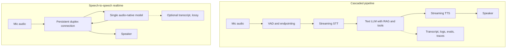

import TOCInline from '@theme/TOCInline';

# Voice & Realtime AI

<TOCInline toc={toc} minHeadingLevel={2} maxHeadingLevel={2} />

:::tip[In this guide]
You have a text LLM service that works. Putting a voice in front of it changes
almost nothing about the model and almost everything about the engineering. The
two architectures and when each wins, a worked latency budget, how to cancel a
turn correctly when the user talks over you, and what voice adds to your eval
set and your retention policy.
:::

## What Is It?

A voice agent is a conversational system where the input and output are audio
rather than text. The previous two pages in this section dealt with images:
[vision-language models](./01-multimodal-ai.mdx) and
[retrieval over visual documents](./02-multimodal-rag.mdx). Audio is the other
modality, and it is different in one decisive way: it is **realtime**. An image
sits still while you process it. A conversation does not.

Two architectures dominate.

**Cascaded**, also called the pipeline approach: speech-to-text, then your
existing text LLM, then text-to-speech. Three models, three network hops, three
failure modes, and the latency is the sum of all of them.

**Speech-to-speech**, also called realtime: one model that consumes audio and
emits audio, usually over a persistent bidirectional connection such as a
WebSocket or WebRTC session. No transcript in the middle unless you ask for one.



## Why Does It Matter?

Because the quality bar is set by human conversational reflexes, not by answer
accuracy. People tolerate roughly 200–300ms of silence after they stop speaking
before a response feels delayed. Past about 800ms they assume you did not hear
them and start speaking again, which collides with your reply and the turn falls
apart. There is no spinner in a phone call.

That single constraint reorders your priorities. A text assistant that takes
four seconds to produce a better answer is a reasonable product. A voice agent
that takes four seconds is unusable regardless of how good the answer was.
Everything below is downstream of that.

## The Two Architectures, Compared

| Dimension | Cascaded | Speech-to-speech |
| --- | --- | --- |
| Typical turn latency | 800ms–2s, tunable | 300–600ms |
| Prosody, tone, emotion | Lost at STT, re-invented at TTS | Preserved end to end |
| Interruption handling | You build it | Native to the model |
| Tool calling, structured output | Mature, same as your text stack | Less mature, varies by provider |
| Reuse of prompts, RAG, evals, guardrails | Full | Partial at best |
| Debuggability | Each stage inspectable and swappable | Mostly a black box |
| Logging and audit | Clean transcript per stage | Transcript is a side channel and lossy |
| Provider choice | Many, mix and match | Few |
| Cost shape | Per audio minute plus per token | Per audio minute, in and out |

When each wins:

| Situation | Choose |
| --- | --- |
| Answers depend on retrieval over your own corpus | Cascaded |
| The agent executes consequential tool calls | Cascaded |
| Regulated domain needing an auditable transcript per turn | Cascaded |
| You already have evals, guardrails and prompts you trust | Cascaded |
| Interruption-heavy, chatty, low-stakes interaction | Speech-to-speech |
| Tone and emotion carry real information, such as coaching or language practice | Speech-to-speech |
| Latency is the product and the task is narrow | Speech-to-speech |

A pragmatic third option exists: speech-to-speech for the conversational surface,
with a cascaded text path behind it for anything that needs retrieval, tools or
an audit record. You pay complexity for it, so do not start there.

## The Latency Budget Is The Whole Engineering Problem

Build the budget before you build anything else. Here is one turn in a cascaded
pipeline, naive implementation on the left and tuned on the right. Numbers are
illustrative order-of-magnitude figures for a hosted stack, not measurements
from your system.

| Stage | Naive | Tuned | What changed |
| --- | --- | --- | --- |
| Capture, encode, uplink | 60ms | 40ms | Smaller frames, Opus, WebRTC instead of HTTP |
| Endpointing silence window | 700ms | 220ms | Semantic endpointing instead of a fixed window |
| STT finalisation after endpoint | 320ms | 50ms | Streaming STT, partials already delivered |
| LLM time to first token | 650ms | 300ms | Shorter system prompt, prompt caching, speculative start on a stable partial |
| Waiting for the full answer text | 900ms | 0ms | Sentence-chunked streaming into TTS |
| TTS time to first audio | 480ms | 120ms | Streaming synthesis, short first sentence |
| Playback buffer and downlink | 160ms | 70ms | Smaller jitter buffer |
| **Total to first audio** | **3,270ms** | **800ms** | |

The naive column is what you get by composing three request/response calls
correctly. It is more than three seconds and it is unshippable. The tuned column
is the same three models with four changes:

1. **Streaming STT with partial hypotheses.** You receive text while the user is
   still talking. Final transcription becomes a confirmation step, not a wait.
2. **Speculative LLM start on a stable partial.** Fire the model call when the
   partial transcript stops changing, cancel and refire if it gets revised. You
   are trading a small amount of wasted spend for several hundred milliseconds.
3. **Sentence-chunked output into streaming TTS.** Do not wait for the full
   completion. Flush the first speakable clause to TTS the moment you have it.
   This is the single largest win in the table.
4. **A deliberately short first sentence.** Prompt for it: open with a brief
   acknowledgement or the headline answer, then elaborate. Audio starts sooner
   and the rest of the generation hides behind playback.

Once audio is playing, the budget changes character. Playback of one sentence
buys you roughly two to four seconds of cover to generate the next one. Your
real constraint becomes **never underrunning the audio buffer mid-answer**,
which is a throughput problem, not a first-token problem. See
[cost and latency](../13-production-genai-and-llmops/08-cost-and-latency.mdx) for how this
interacts with batching and provider selection.

## A Streaming Cascaded Turn

The structure that matters: partials drive a speculative model start, model
tokens are chunked into speakable units, each chunk is synthesised and played as
it arrives, and everything stays cancellable.

```python
import asyncio
import re

SENTENCE_END = re.compile(r"(?<=[.!?;])\s+")


async def sentence_chunks(tokens, first_limit: int = 60, limit: int = 180):
    """Yield speakable chunks from a token stream.

    The first chunk is deliberately small: time-to-first-audio dominates
    perceived latency, so flush early even on a clause boundary.
    """
    buf, target = "", first_limit
    async for tok in tokens:
        buf += tok
        boundary = None
        for boundary in SENTENCE_END.finditer(buf):
            pass  # keep the last boundary found
        if boundary is not None and len(buf) >= 12:
            cut = boundary.end()
        elif len(buf) >= target:
            cut = buf.rfind(" ", 0, target) + 1 or len(buf)
        else:
            continue
        chunk, buf = buf[:cut].strip(), buf[cut:]
        if chunk:
            yield chunk
            target = limit
    if buf.strip():
        yield buf.strip()


async def handle_turn(mic, stt, llm, tts, speaker, session) -> None:
    speculative: asyncio.Task | None = None
    prefix = ""
    transcript = ""

    async for hyp in stt.stream(mic):
        transcript = hyp.text
        if hyp.is_final:
            break
        # Start the model early once the partial stops moving.
        if hyp.stable and speculative is None and len(transcript.split()) >= 5:
            prefix = transcript
            speculative = asyncio.create_task(
                llm.start(session.messages_for(transcript))
            )

    if speculative is not None and not transcript.startswith(prefix):
        speculative.cancel()  # the partial was revised; the guess is stale
        speculative = None

    stream = await (speculative or llm.start(session.messages_for(transcript)))
    session.llm_stream = stream

    async for chunk in sentence_chunks(stream):
        audio = tts.stream(chunk)  # streaming synthesis, not synthesise-then-play
        session.played_chunks.append([chunk, 0])
        async for pcm in audio:
            if session.barge_in.is_set():
                raise Interrupted(transcript=transcript)
            await speaker.write(pcm)
            session.played_chunks[-1][1] += len(pcm)

    session.commit_turn(user=transcript, assistant=session.spoken_text())
```

Two details worth copying. The byte count per chunk is tracked as it is written,
because that is the only honest record of what reached the user. And the
barge-in flag is checked inside the playback loop, not between chunks, since a
chunk can be several seconds of audio.

## Turn Detection: VAD And Endpointing

Voice activity detection tells you whether the current frame contains speech.
**Endpointing** is the harder decision built on top of it: has the user finished
their turn? Get it wrong in either direction and the agent feels broken.

| Strategy | Mechanism | Fails by |
| --- | --- | --- |
| Fixed silence threshold, aggressive | 200–300ms of silence ends the turn | Cutting people off mid-thought, especially on pauses for numbers or thinking |
| Fixed silence threshold, conservative | 800–1,000ms | Every turn feels sluggish; users repeat themselves |
| Semantic endpointing | Silence plus a check on whether the partial transcript is a complete utterance | Needs a model call or classifier in the hot path |
| Push to talk | User signals the end explicitly | Not conversational, but it is the correct answer for some products |

Semantic endpointing is the technique that actually resolves the tradeoff. "My
account number is four one two" with 300ms of silence is syntactically
incomplete, so you wait. "What is my balance" with 300ms of silence is complete,
so you go. A small classifier or a cheap fast model over the partial transcript
is enough, and it lets you run a short silence window without truncating people.

Practical notes: adapt the window to context, so dictating digits or an address
gets a longer one; treat filler sounds as speech so a thinking "umm" does not
end a turn; and use the client-side VAD for playback control but the
server-side one for the turn decision, because the client's is cheap and noisy.

## Barge-In: Cancel, Then Truncate History

The user starts talking while the agent is mid-sentence. Three things have to
happen, in order, and almost every first implementation gets the third wrong.

1. **Stop playback immediately.** Drop everything queued locally. Do not wait
   for the buffer to drain, or the agent keeps talking for another second after
   the user interrupted.
2. **Cancel the backend work for real.** Close the LLM stream and the TTS
   stream. Muting the client while generation continues still bills you, still
   holds a connection, and still produces audio nobody hears.
3. **Truncate conversation history to what the user actually heard.** This is
   the subtle one. If you generated six sentences and the user heard one and a
   half, storing all six poisons every subsequent turn. The model will say "as I
   mentioned, the fee is waived" about audio that never played, and the user
   will think the agent is hallucinating. It is, in a sense, and you caused it.

```python
import asyncio

BYTES_PER_MS = 32  # 16 kHz, 16-bit mono PCM


class Interrupted(Exception):
    def __init__(self, transcript: str):
        self.transcript = transcript


def heard_text(played_chunks: list[list], synthesised: dict[str, int]) -> str:
    """Reconstruct what reached the user from (text, bytes_written) pairs.

    Proportional truncation by character count is an approximation. If your
    TTS provider returns word timings, use those instead.
    """
    out = []
    for text, written in played_chunks:
        total = synthesised.get(text, written)
        if written >= total:
            out.append(text)
            continue
        if written < BYTES_PER_MS * 120:  # under ~120ms is inaudible
            break
        cut = max(1, int(len(text) * written / total))
        head = text[:cut].rsplit(" ", 1)[0] or text[:cut]
        out.append(head)
        break
    return " ".join(out)


async def on_barge_in(session) -> None:
    session.barge_in.set()

    # 1. silence the output path first
    await session.speaker.stop(drop_queued=True)

    # 2. cancel the work, then wait for it to actually unwind
    tasks = [t for t in (session.turn_task, session.tts_task) if t and not t.done()]
    for t in tasks:
        t.cancel()
    if session.llm_stream is not None:
        await session.llm_stream.aclose()
    await asyncio.gather(*tasks, return_exceptions=True)

    # 3. commit only the audio the user received
    spoken = heard_text(session.played_chunks, session.synthesised_bytes)
    if spoken:
        session.history.append(
            {"role": "assistant", "content": spoken + " [interrupted by user]"}
        )
    session.played_chunks.clear()
    session.barge_in.clear()
```

Leaving the explicit interruption marker in the history matters too. Without it
the model sees a half-finished sentence and tries to continue it. With it, the
model knows the user cut in and responds to the interruption instead.

## STT Realities

Word error rate is a single number over a benchmark corpus, and it will mislead
you, because errors are not uniformly distributed. Transcription fails hardest
on proper nouns, product names, domain jargon, acronyms, accented speech,
code-switching between languages, and numbers. Those are exactly the tokens that
carry the meaning. A 5 percent WER that is entirely in filler words is harmless.
A 5 percent WER concentrated on account numbers is a different product.

The downstream effect is worse than a wrong transcript. Your LLM receives
"cancel my Ora subscription" instead of "cancel my Aura subscription", has no
signal that anything is uncertain, and answers fluently about the wrong thing.
The transcription error is laundered into a confident hallucination. Nothing in
the text half of your stack can detect this, because by the time the text exists
it looks clean.

Mitigations, roughly in order of effort:

- **Vocabulary and phrase hints.** Most streaming STT providers accept a biasing
  list. Feed it your product names, plan tiers, and the entities relevant to this
  specific user or session.
- **Domain biasing per route.** A billing flow and a technical support flow need
  different hint lists. Switch them with the conversation state.
- **Post-correction against a known entity list.** Fuzzy-match transcribed spans
  against your actual catalogue before the text reaches the model, and attach the
  match confidence.
- **Confirm high-stakes values back to the user.** Account numbers, amounts,
  dates, addresses and email addresses get read back and confirmed. This is not
  a UX nicety, it is your error correction mechanism.
- **Pass uncertainty through.** If your STT exposes per-word confidence, let the
  prompt see it so the model can ask rather than guess.

## TTS Realities

The metric that matters is **time to first audio**, not total synthesis time. A
provider that returns a complete 20-second clip in 900ms is worse for
conversation than one that starts streaming at 150ms and finishes in 3 seconds.
Measure the first number and make sure the API you chose streams.

Pronunciation is the recurring bug. Names, acronyms that should be spelled out
versus said as words, currency, dates, phone numbers, units and code identifiers
all get mangled by default. Normalise the text before synthesis rather than
hoping: expand "$1.2M" to spoken form, decide per-acronym whether it is said or
spelled, and keep a lexicon or SSML override list for the names in your domain.
Numbers read aloud wrong are heard as factual errors.

On voice cloning: cloning a specific person's voice needs that person's explicit
consent, and synthetic speech that could be mistaken for a human generally needs
disclosure. Treat both as product requirements, not legal footnotes. They
intersect with the impersonation concerns in
[security and privacy](../13-production-genai-and-llmops/09-security-and-privacy.mdx).

## How RAG And Tools Change

Retrieval runs on a transcript that may be wrong in exactly the term you are
retrieving on. Hybrid search helps here more than it does in text, because a
lexical match on a mis-transcribed product name fails while a semantic match may
survive. Expanding the query with likely corrections from your entity list is
cheap and effective.

Answer shape changes more than answer content:

- **Short, because listening has no skim mode.** Two or three sentences. A reader
  scans a 300-word answer in seconds; a listener sits through 90 seconds of it.
- **Never read a URL, a table, or a long list aloud.** Offer to send it, or name
  the top option and ask whether to continue. If there is a screen available, use
  it; the patterns in
  [AI product UX](../08-llm-application-development/04-ai-product-ux-patterns.mdx) apply.
- **Confirm before any consequential tool call.** There is no visible undo in a
  voice channel and no confirmation dialog the user can read. Say what you are
  about to do, wait for a yes, then do it. Design the tool surface so read
  operations are free and write operations are explicitly gated, as in
  [tool design](../09-tool-calling-and-ai-agents/07-tool-design.mdx) and
  [agent safety](../09-tool-calling-and-ai-agents/11-agent-safety.mdx).
- **Keep tool latency off the critical path where possible.** Speak an
  acknowledgement, run the call, then speak the result. Silence during a
  three-second API call reads as a dropped line.
- **Barge-in and tool calls interact badly.** Decide explicitly whether an
  interruption cancels an in-flight side effect. Usually it must not, but the
  user has to be told what happened.

## Evaluation Needs Audio

A text eval set cannot evaluate a voice agent. You need three layers, and the
third is the one teams skip.

| Layer | What you measure | How |
| --- | --- | --- |
| Transcription | WER on your own domain audio, and entity error rate on the tokens that matter | Hand-labelled clips from real traffic, including accents and noise |
| Task | End-to-end success rate from audio in to action taken | Replay recorded audio through the full pipeline |
| Conversation | Time to first audio, p95 turn latency, interruption rate, barge-in correctness, false endpoint rate | Instrumented sessions, scripted interruptions |

Build the audio set the same way you build a text set, as described in
[eval datasets](../12-evaluation-testing-and-observability/02-eval-datasets.mdx): sampled from real usage,
labelled, versioned, and weighted toward the failures you have actually seen.
Include noisy audio, fast speech, accents, code-switching, and one clip per
entity type that your STT keeps getting wrong.

**Barge-in correctness** deserves a dedicated test. Script an interruption at a
known offset, then assert three things: playback stopped within your target
window, the backend task was actually cancelled, and the committed history
matches the audio that played. That last assertion is the one that catches the
history-truncation bug.

Be clear about what an LLM judge over the transcript can see. It can score
helpfulness and correctness. It cannot see that the agent took 2.5 seconds to
start, interrupted the user twice, read a URL character by character, or
delivered a sympathetic line in a brisk tone. Prosody and timing failures are
invisible to transcript-level judging, which means the metrics in
[evaluation metrics](../12-evaluation-testing-and-observability/03-metrics.mdx) need latency and
interruption counters sitting next to the quality scores.

## Operations, Cost And Compliance

**Recording consent.** Some jurisdictions require all-party consent to record a
call. The disclosure has to happen before capture begins, and in a voice channel
that means spoken, at the top of the session, in the right language. Build
consent state into the session, and make the recording path respect it rather
than filtering later.

**PII in audio.** Redacting the transcript is not enough. The raw audio still
contains the card number the user read out, and it is biometric data besides.
Either redact the audio itself at the detected spans or do not retain it. Decide
retention separately for audio, transcript, and derived embeddings, because they
have different risk profiles and different deletion costs.

**Retention and deletion.** A deletion request has to reach every copy: object
storage, the STT provider's logs, your trace store, and any eval set you built
from production audio. That last one is the leak people forget. Eval sets made
from real calls are a long-lived PII store.

**Cost shape.** Voice billing is per minute, not per token, which changes the
arithmetic. Assume, purely as illustration, streaming STT at 0.006 USD per
minute, TTS at 15 USD per million characters, and a text model at 0.60 USD per
million input tokens and 2.40 USD per million output tokens.

One minute of conversation, assuming three turns, 2,000 input tokens of context
per turn, 80 output tokens per turn, and the agent speaking for about half the
minute, so roughly 450 characters of synthesis:

```text
STT      1.0 min        x 0.006 / min   = 0.00600
LLM in   6,000 tokens   x 0.60 / 1M     = 0.00360
LLM out  240 tokens     x 2.40 / 1M     = 0.00058
TTS      450 chars      x 15.00 / 1M    = 0.00675
                                   total = 0.01693 USD per voice minute
```

The same three turns as text cost 0.00418 USD, so voice is roughly four times a
text exchange, and the two speech models are 75 percent of the bill. A realtime
speech-to-speech API priced per audio minute in and out, assuming 0.06 USD per
input minute and 0.24 USD per output minute, lands near 0.15 USD for that same
minute, roughly nine times the cascaded pipeline. Those assumed rates move
constantly, so recompute with current numbers before deciding anything.

Two consequences. First, the speculative LLM start that buys you 300ms is nearly
free in this cost structure, so take it. Second, concurrency is your capacity
unit, not requests per second, because every session holds a connection and
audio pipeline for its full duration. Size and rate-limit on concurrent sessions,
as the connection-oriented patterns in
[API service design](../08-llm-application-development/02-api-service-design.mdx) imply.

## Common Mistakes

- Composing three request/response calls and discovering the turn takes three seconds.
- Waiting for the full LLM completion before starting synthesis.
- Measuring total TTS synthesis time instead of time to first audio.
- A fixed silence threshold for endpointing, tuned once, on quiet office audio.
- Muting the client on barge-in while the LLM and TTS keep running and billing.
- Storing the full generated answer in history after an interruption, so the next turn references audio nobody heard.
- Checking the barge-in flag between sentences rather than inside the playback loop.
- Trusting a vendor's benchmark WER and never measuring on your own domain audio.
- No phrase hints, so every product name and plan tier transcribes wrong.
- Executing a consequential tool call without a spoken confirmation.
- Reading a URL, a table or a nine-item list aloud.
- Answering at text length, so every reply is 60 seconds of monologue.
- An eval set that is entirely text, so timing and prosody failures are structurally invisible.
- Redacting the transcript and retaining the raw audio.
- Building an eval set from production calls and forgetting it is now a PII store.

## Interview Questions

- Walk through a cascaded voice turn and give a latency budget per stage. Where is the largest win?
- When would you choose speech-to-speech over a cascaded pipeline, and what do you give up?
- A user interrupts the agent mid-answer. Describe everything that must happen.
- Why does storing the full generated answer after an interruption break the next turn?
- How do you decide the user has finished speaking? What breaks at each threshold?
- What is semantic endpointing and what does it cost you in the hot path?
- Your STT gets product names wrong 8 percent of the time. List four mitigations in order of effort.
- Explain how a transcription error becomes a model hallucination with no error anywhere in the logs.
- How do you start a model call before the user stops talking without wasting spend?
- What does an LLM judge over the transcript fail to measure in a voice agent?
- Estimate the cost of a voice minute versus the same exchange as text, and say where the money goes.
- What changes about retrieval when the query is an error-prone transcript?
- A user asks to delete their data. Where does their voice data live?

## Things to Remember

- Human conversation breaks past roughly 800ms of silence. Every design decision is downstream of that.
- Cascaded keeps your text stack, your evals and your audit trail. Start there unless latency or prosody is the product.
- Sentence-chunked streaming into streaming TTS is the single largest latency win available.
- Time to first audio is the metric; total synthesis time is not.
- Endpointing is a tradeoff with no good fixed threshold. Semantic endpointing is how you escape it.
- On barge-in: stop playback, cancel the real backend work, then truncate history to what was actually heard.
- WER is concentrated on proper nouns, jargon and numbers, which are the tokens that matter.
- Confirm high-stakes values back to the user. It is error correction, not politeness.
- There is no visible undo in a voice channel, so gate write operations behind spoken confirmation.
- You need an audio eval set. Transcript-level judging cannot see timing or prosody failures.
- Redacting the transcript does not redact the audio, and your eval set is a PII store.
- Capacity is concurrent sessions, not requests per second.

## Mini Exercise

Build one cascaded turn against a streaming STT provider, any text model, and a
streaming TTS provider. Instrument seven timestamps: first audio frame received,
endpoint decision, final transcript, first model token, first text chunk sent to
TTS, first audio byte returned, first audio byte played. Run ten turns and record
p50 and p95 for each gap.

Then apply the four tuned-column changes one at a time and re-measure after each,
so you learn what each is worth on your stack rather than on this page's table.

Finally, script a barge-in at 1.5 seconds into a long answer and assert three
things: playback stopped within 150ms, the model and TTS tasks reached a
cancelled state, and the assistant message committed to history contains only
the words that actually played. Make that third assertion fail first, so you see
the bug before you fix it.
