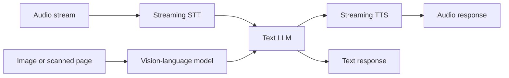

import TOCInline from '@theme/TOCInline';

# 15 · Multimodal GenAI

<ProgressToggle sectionId="15-multimodal-genai" />

<TOCInline toc={toc} minHeadingLevel={2} maxHeadingLevel={2} />

:::tip[In this guide]
Everything up to here assumed text in and text out. This section is what
changes when the input is an image, a scanned PDF or a stream of audio: how
those models consume data, what it costs in context, why a text-only RAG
pipeline silently drops half of a real document, and why voice is an exercise
in latency budgeting rather than prompting.
:::

## Goal

Be able to pick a modality architecture deliberately — a vision-language model
versus OCR-then-text, a cascaded voice pipeline versus speech-to-speech — and
say what each costs in latency, money and failure modes.

The test: given a 200-page scanned contract with tables, you can describe an
ingestion pipeline that keeps the tables, and say what the citations resolve to.

## Estimated Time

1–2 weeks, or dip in per modality as a project needs it.

## Prerequisites

- [03 · LLM Fundamentals](../03-llm-fundamentals/index.mdx) — tokens and context windows, since images consume both.
- [06 · RAG](../06-rag/index.mdx), particularly the [ingestion pipeline](../06-rag/01-ingestion-pipeline.mdx), for the document pages.
- [08 · LLM Application Development](../08-llm-application-development/index.mdx) — streaming and cancellation, which the voice page depends on.

## What You Will Learn

1. [Multimodal AI](./01-multimodal-ai.mdx) — how vision-language models work, what images cost in context, calling a VLM, and where the tooling is still immature.
2. [Multimodal RAG](./02-multimodal-rag.mdx) — document intelligence: why text-only pipelines silently drop tables and figures, the three retrieval architectures, layout-aware parsing, and the cost model.
3. [Voice & Realtime AI](./03-voice-and-realtime.mdx) — cascaded STT→LLM→TTS versus speech-to-speech, the conversational latency budget, turn detection, barge-in and history truncation, and per-minute cost.

Pages 1–2 are a pair: the model, then the pipeline. Page 3 stands alone and is
mostly a latency and cancellation problem wearing an AI costume.

## Where This Fits

Note what the diagram shows: in both cascaded architectures the text LLM stays
in the middle, which is why your prompts, retrieval, evals and logging all
survive. The modality is an adapter on each end. Speech-to-speech models
collapse that middle, and you trade the leverage of your text stack for
latency.

## What Is Not Here Anymore

This page used to be a catch-all list of optional extensions. Those topics all
have proper homes now:

| Topic | Where it lives |
| --- | --- |
| Advanced and multi-agent systems | [09 · Tool Calling and AI Agents](../09-tool-calling-and-ai-agents/index.mdx) |
| GraphRAG and structured retrieval | [Graph & Structured RAG](../07-advanced-rag/08-graph-and-structured-rag.mdx) |
| Query transformations, HyDE, step-back | [Query Transformation](../07-advanced-rag/05-query-transformation.mdx) |
| Streaming UIs and interaction patterns | [AI Product & UX Patterns](../08-llm-application-development/04-ai-product-ux-patterns.mdx) |
| Eval pipelines, tracing, CI gates | [12 · Evaluation, Testing and Observability](../12-evaluation-testing-and-observability/index.mdx) |
| Quantization, batching, caching, cost | [Cost & Latency Optimization](../13-production-genai-and-llmops/08-cost-and-latency.mdx) |
| LoRA/QLoRA and adapters | [14 · Fine-Tuning and Model Adaptation](../14-fine-tuning-and-model-adaptation/index.mdx) |

## Interview Relevance

Multimodal questions are usually a proxy for whether you think about data
pipelines or only about prompts. The strong answer to "how would you do RAG
over scanned PDFs" is about parsing, layout, table handling and citation
granularity — the model choice is the least interesting part. For voice, the
question is almost always latency: if you cannot name the stages of the budget
and which ones you can overlap, the rest does not land.

## Done When

- [ ] You can explain how an image becomes tokens, and estimate what a page costs in context.
- [ ] You can choose between VLM-native and OCR-then-text for a given document set, and defend it.
- [ ] Your ingestion pipeline keeps tables and figures, and citations resolve to a page and region.
- [ ] You can write the latency budget for a cascaded voice turn and name what you would overlap first.
- [ ] You can describe correct barge-in handling, including truncating history to what the user actually heard.

Next: [16 · AI System Design](../16-ai-system-design/index.mdx).
