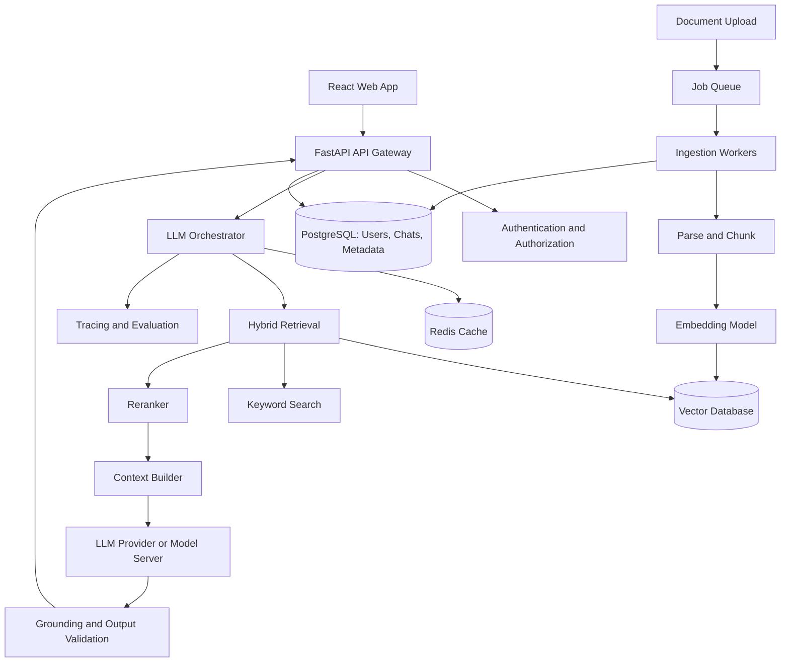
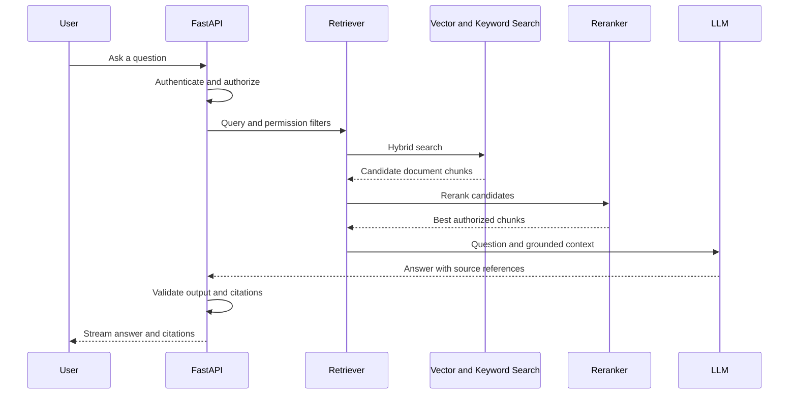

import TOCInline from '@theme/TOCInline';

# AI System Design Roadmap — Beginner to Production

<TOCInline toc={toc} minHeadingLevel={2} maxHeadingLevel={2} />

:::tip[In this guide]
A roadmap for learning AI system design the same way you'd learn backend or
frontend system design — **requirements → architecture → data flow → component
choices → scaling → evaluation → security → trade-offs** — plus a reusable
interview template and a fully worked production RAG chatbot.
:::

## What Is It?

AI system design is designing systems whose core component is a model. You still
design APIs, databases, caches, and queues, but you also handle things a normal
backend doesn't:

- **Probabilistic outputs**: the same input can give different answers.
- **Retrieval quality**: wrong context in means a wrong answer out.
- **Model latency and capacity**: measured in tokens, not just requests.
- **Token costs**: every call has a direct, variable price.
- **Hallucinations**: confident answers that aren't supported by evidence.
- **Evaluation**: "does it work?" needs datasets and metrics, not just unit tests.

## Why Does It Matter?

AI system design is now a standard senior interview round, and the same skills
decide whether a demo survives real users. The framework below gives you a
structure so you never jump straight to technologies.

## 1. Complete Roadmap

**Suggested order:** learn Phases 1–3 first, then Phases 5–6 alongside them.
Study agents and advanced inference after you understand the production RAG
lifecycle.

| Phase | Topic | Priority |
| --- | --- | --- |
| 1 | System design fundamentals | P0 · Must know |
| 2 | LLM application architecture | P0 · Must know |
| 3 | Production RAG systems | P0 · Must know |
| 4 | Agents and workflows | P1 · Important |
| 5 | Evaluation and observability | P0 · Must know |
| 6 | Production hardening | P0 · Must know |
| 7 | Advanced AI infrastructure | P1 · Important |

### Phase 1 — System design fundamentals

**P0 · Must know**

- [ ] Functional vs. non-functional requirements
- [ ] Capacity estimation: RPS, concurrent users, storage
- [ ] API design, caching, databases, queues
- [ ] Horizontal scaling, load balancing, rate limiting
- [ ] Latency, availability, reliability and cost

### Phase 2 — LLM application architecture

**P0 · Must know**

- [ ] Model APIs, local inference and model gateways
- [ ] Prompt templates and structured outputs
- [ ] Streaming responses and token limits
- [ ] Model selection, fallback and routing
- [ ] Context windows, conversation history and caching

### Phase 3 — Production RAG systems

**P0 · Must know**

- [ ] Ingestion, parsing, chunking and embeddings
- [ ] Vector databases and metadata filters
- [ ] Hybrid search, reranking and top-k
- [ ] Citations, access control and document updates
- [ ] Retrieval evaluation, groundedness and freshness

### Phase 4 — Agents and workflows

**P1 · Important**

- [ ] Tool calling and workflow orchestration
- [ ] State, checkpoints and persistent memory
- [ ] Human approval for sensitive actions
- [ ] Retries, timeouts, idempotency and bounded loops
- [ ] When to use a deterministic workflow vs. an agent

### Phase 5 — Evaluation and observability

**P0 · Must know**

- [ ] Offline datasets and regression testing
- [ ] LLM-as-a-judge and human evaluation
- [ ] Precision@k, Recall@k, MRR and nDCG
- [ ] Traces, token usage, latency and cost per request
- [ ] Quality monitoring and model-version comparisons

### Phase 6 — Production hardening

**P0 · Must know**

- [ ] Prompt injection and indirect injection
- [ ] PII handling, tenant isolation and authorization
- [ ] Guardrails and output validation
- [ ] Async workers, queues and backpressure
- [ ] Disaster recovery, circuit breakers and graceful degradation

### Phase 7 — Advanced AI infrastructure

**P1 · Important**

- [ ] GPU inference, batching and KV-cache concepts
- [ ] vLLM / SGLang, model serving and quantization
- [ ] Semantic caching and prompt caching
- [ ] Multi-model routing and cost optimization
- [ ] Multimodal pipelines and large-scale agent systems

## 2. Reusable AI System Design Interview Template

Use this template for almost any question: "Design ChatGPT," "Design a
production RAG system," "Design an AI customer support agent," or "Design an AI
code assistant."

### The 10-step interview framework

| Step | What to do | What to cover |
| --- | --- | --- |
| 1. Clarify requirements | Identify users, core features, constraints, and what is out of scope | Who uses it? What must it do? What can wait? |
| 2. Define success metrics | Include product metrics, AI quality metrics, latency and cost | Resolution rate, groundedness, p95 latency, cost per request |
| 3. Estimate scale | Users, requests per second, token throughput, storage and concurrency | Peak RPS, tokens per second, concurrent generations |
| 4. Define APIs and data models | Request/response contracts, database schema, conversation IDs and job states | Endpoints, streaming format, tables |
| 5. Draw the high-level architecture | Client, API, orchestration, model, retrieval, databases, cache and queues | Boxes and arrows, sync vs async paths |
| 6. Explain the request flow | Walk through one complete request from user input to final response | Auth → retrieve → generate → validate → stream |
| 7. Deep-dive into the hardest component | RAG: retrieval and grounding. Agents: tools and state. Chat: streaming and inference | The part where the real trade-offs live |
| 8. Design for failures | Timeouts, retries, rate limits, fallback, malformed outputs and unavailable dependencies | What breaks, and what the user sees |
| 9. Cover AI safety and evaluation | Hallucinations, prompt injection, authorization, offline evaluations and production monitoring | How you know it's good and safe |
| 10. Explain trade-offs and evolution | What would you build for the MVP, and what changes at 10× or 100× scale? | Build vs buy, cost vs quality |

### What to say during an interview

A strong opening is:

> "I'll first clarify the functional and non-functional requirements. Then I'll
> estimate the workload, propose the high-level architecture, walk through the
> main data flows, and deep-dive into the AI-specific challenges, reliability,
> evaluation and scaling trade-offs."

This gives the interviewer a clear structure and helps you avoid jumping
straight into technologies.

## 3. Worked Example — Design a Production RAG Chatbot

**Problem:** Design an internal company assistant that answers employee
questions using company documents, with citations and access control.

### Step 1: Requirements

| Type | Requirements |
| --- | --- |
| Functional | Ask questions, retrieve documents, answer with citations, maintain chat history |
| Ingestion | Upload PDFs and DOCX files; re-index updated documents |
| Security | Employees can access only authorized documents |
| Quality | Answers must be grounded in retrieved content; abstain when evidence is insufficient |
| Performance | Streaming response; target p95 time-to-first-token under 2 seconds |
| Scale assumption | 10,000 employees, 1,000,000 indexed chunks |

:::note
The latency target is a design goal, not a guarantee. It must be validated
against the chosen model, deployment, and workload.
:::

### Step 2: High-level architecture



Two paths to notice: the **online query path** (top) is latency-sensitive and
user-facing; the **offline ingestion path** (bottom) is throughput-oriented and
runs in background workers so heavy ingestion never competes with `/chat`
traffic.

### Step 3: Explain each component

| Component | Responsibility |
| --- | --- |
| **React frontend** | Chat interface, streaming text, citations, conversation history and feedback |
| **FastAPI backend** | Authentication, request validation, authorization, rate limiting and streaming APIs |
| **PostgreSQL + Redis** | PostgreSQL stores users, chats, document metadata and permissions. Redis can cache safe, reusable results and manage short-lived state |
| **Vector database + keyword search** | Find semantically similar chunks and exact keyword matches. Apply authorization filters before exposing results |
| **Reranker + LLM** | Improve the ordering of retrieved evidence, then generate an answer from the selected context and return source references |

:::note
These are example technology choices, not mandatory components. For a small MVP,
PostgreSQL with pgvector and PostgreSQL full-text search may be enough; a
separate search cluster and queue can be added when the workload justifies them.
:::

### Step 4: End-to-end query flow



A production implementation also needs explicit handling for:

- no relevant results (abstain instead of guessing),
- model timeouts,
- invalid citations,
- token limits,
- revoked document access.

### Step 5: Deep-dive — the hardest component

For a RAG system the hardest part is **retrieval and grounding**, so that is
where to spend interview time:

- **Chunking**: split on semantic boundaries with some overlap; tune chunk size
  against an evaluation set.
- **Hybrid retrieval**: dense vectors catch meaning, keyword/BM25 catches exact
  terms (policy IDs, error codes); fuse the rankings, then **rerank** the top
  candidates.
- **Authorization in the query**: apply tenant and document permission filters
  in the retrieval query itself, so unauthorized chunks are never retrieved.
- **Grounding**: instruct the model to answer only from context, require
  citations, validate that cited sources were actually retrieved, and abstain
  when evidence is weak.
- **Freshness**: version documents, propagate deletes, and re-index on update.

## 4. Capacity Estimation — What Interviewers Expect

Assume the system has 10,000 employees, with 20% active during a busy period,
each asking 10 questions per day.

| Metric | Estimate |
| --- | --- |
| Daily questions | 20,000 |
| Average request rate over 10 hours | 0.56 requests/sec |
| Peak traffic at 10× average | 5.6 requests/sec |
| Average input tokens | 2,000/request |
| Average output tokens | 500/request |
| Daily input tokens | 40 million |
| Daily output tokens | 10 million |

The arithmetic:

- Active users: 10,000 × 20% = 2,000; questions: 2,000 × 10 = **20,000/day**.
- Average rate: 20,000 ÷ (10 hours × 3,600 s) ≈ **0.56 requests/sec**; peak at
  10× ≈ **5.6 requests/sec**.
- Tokens per day: 20,000 × 2,000 = **40M input**; 20,000 × 500 = **10M output**.

These estimates exclude retries, ingestion, embedding generation, and other
workloads.

**The key insight:** LLM capacity is not determined by API requests per second
alone. Input length, output length, time-to-first-token, generation speed, and
concurrency all matter. Calculate peak tokens per second and concurrent
generations separately.

For example, at the 5.6 requests/sec peak:

| Quantity | Calculation | Result |
| --- | --- | --- |
| Peak input tokens/sec | 5.6 × 2,000 | about 11,200 tokens/sec |
| Peak output tokens/sec | 5.6 × 500 | about 2,800 tokens/sec |
| Concurrent generations | peak RPS × average generation time (Little's law) | if a response takes about 15 s, roughly 84 at once |

The 15-second figure is an assumption (500 output tokens at about 35 tokens/sec
plus retrieval time); replace it with measurements from your chosen model. The
concurrent-generations number is what you size inference capacity and
concurrency limits against.

## 5. API and Data Model Template

For the example chatbot, start with a simple API contract.

```http
POST /api/v1/chat/stream
```

```json
{
  "conversation_id": "conv_123",
  "message": "What is our leave policy?"
}
```

A streamed response could contain events such as:

```json
{ "type": "token", "text": "Employees receive" }
```

```json
{ "type": "citation", "document_id": "doc_456", "page": 12 }
```

```json
{ "type": "done", "message_id": "msg_789" }
```

Use **Server-Sent Events (SSE)** for a straightforward one-way streaming chat.
Use **WebSockets** when you genuinely need bidirectional, continuous
communication.

A minimal FastAPI sketch of the streaming endpoint:

```python
import json
from fastapi import APIRouter, Depends
from fastapi.responses import StreamingResponse

router = APIRouter()

@router.post("/api/v1/chat/stream")
async def chat_stream(body: ChatRequest, user: User = Depends(current_user)):
    async def event_stream():
        async for event in orchestrator.stream(user, body):    # token / citation / done
            yield f"data: {json.dumps(event)}\n\n"

    return StreamingResponse(event_stream(), media_type="text/event-stream")
```

The browser's built-in `EventSource` only supports `GET`, so for a `POST` body
the React client typically reads the stream with `fetch` and a stream reader.
See [Python concurrency](../01-python/02-language-deep-dives/07-concurrency.mdx) for handling client
disconnects and cancellation on streaming endpoints.

### Suggested core tables

| Table | Purpose |
| --- | --- |
| `users` | Identity and tenant membership |
| `conversations` | Owner, title and timestamps |
| `messages` | Role, content, model and token usage |
| `documents` | Source, version, owner and permissions |
| `document_chunks` | Chunk IDs, content and metadata |
| `evaluations` | Test case, expected behavior and measured scores |

Store chunk embeddings in the vector index, with stable chunk IDs linking back to
authorized document metadata.

## 6. Production Concerns and Trade-offs

| Challenge | Practical design |
| --- | --- |
| Hallucinations | Ground answers in evidence, validate citations, allow abstention |
| Slow model | Stream output, control context size, select a faster model |
| High costs | Token budgets, prompt caching, model routing and usage limits |
| Poor retrieval | Hybrid search, reranking, chunking experiments and retrieval evaluation |
| Model outage | Timeouts, circuit breakers and controlled fallback |
| Prompt injection | Treat retrieved content as untrusted; restrict tools and permissions |
| Stale documents | Versioned ingestion, deletion propagation and re-indexing |
| Duplicate jobs | Idempotency keys and durable job states |
| Tenant data leakage | Enforce authorization in retrieval and cache keys, not just the UI |
| Quality regressions | Versioned evaluation datasets and release gates |

:::warning
**One critical distinction:** a good answer from an LLM does not prove the
retrieval system is good. Measure retrieval quality and answer quality
separately, otherwise you can't tell which stage is failing.
:::

Related deep dives: [API & service design](../08-llm-application-development/02-api-service-design.mdx) for
timeouts, retries, caching, and circuit breakers;
[Logging, monitoring & guardrails](../13-production-genai-and-llmops/04-logging-monitoring-guardrails.mdx) for
injection defenses and output validation;
[Deployment basics](../13-production-genai-and-llmops/05-deployment-basics.mdx) for scaling and rollouts.

## 7. Reusable Architecture Decision Checklist

Before choosing a technology, answer these questions.

**Requirements**

- [ ] Defined core user flows and out-of-scope features
- [ ] Defined latency, availability and quality targets

**Architecture**

- [ ] Defined synchronous versus asynchronous operations
- [ ] Defined persistent storage, caches and queues
- [ ] Defined model serving and retrieval strategy

**AI quality**

- [ ] Defined evaluation datasets and acceptance thresholds
- [ ] Defined citation, abstention and grounding behavior

**Production**

- [ ] Defined timeouts, retries and failure fallbacks
- [ ] Defined authorization, privacy and prompt-injection defenses
- [ ] Defined tracing, cost monitoring and rollback strategy

## 8. Practice These AI System Design Interview Questions

Study them in roughly this order.

| # | Question | Focus |
| --- | --- | --- |
| 1 | **Design a production RAG chatbot** (start here) | Ingestion, retrieval, citations, evaluation and permissions |
| 2 | **Design a ChatGPT-like application** | Conversation history, streaming, model routing, token limits and scaling |
| 3 | **Design an AI customer support agent** | Tool calling, CRM integration, state, human approval and safe actions |
| 4 | **Design a document ingestion platform** | Uploads, background workers, retries, versioning and incremental indexing |
| 5 | **Design a scalable LLM gateway** | Provider abstraction, quotas, rate limiting, retries, routing and cost tracking |
| 6 | **Design an AI evaluation platform** | Datasets, automated evaluators, LLM-as-a-judge, traces and regression gates |
| 7 | **Design a production AI agent platform** | Durable execution, checkpoints, tool permissions, budgets and recovery |

For each one, run the 10-step template from Section 2 out loud, and finish with
"what changes at 10× and 100× scale?"

## 9. Your Practical Learning Project

Build one project incrementally using JavaScript/TypeScript for the frontend and
Python/FastAPI for the backend.

**Company Knowledge Assistant**

Suggested stack: React + TypeScript · FastAPI · PostgreSQL + pgvector · Redis ·
an LLM API or Ollama

1. Build a basic chat endpoint and streaming UI.
2. Add PDF ingestion and embeddings.
3. Add hybrid retrieval, reranking and citations.
4. Add user authentication and document-level access control.
5. Add background ingestion jobs and retry handling.
6. Add an evaluation dataset and measure retrieval and answer quality.
7. Add tracing, cost tracking, rate limiting and production deployment.

## Common Mistakes

- Naming technologies (Kafka, Kubernetes, a vector DB) before stating
  requirements and scale.
- Sizing the system by requests per second and ignoring tokens and concurrent
  generations.
- Judging RAG by the final answer only, without measuring retrieval separately.
- Enforcing permissions in the UI or the prompt instead of in the retrieval
  query and cache keys.
- No abstention path: the system answers even when it found nothing relevant.
- Forgetting failure modes: model timeouts, malformed output, revoked access,
  provider outages.
- No evaluation plan, no cost tracking, and no rollback strategy for prompt or
  model changes.
- Running ingestion inside the serving path, so uploads spike chat latency.
- Over-engineering the MVP instead of describing a staged evolution.

## Interview Questions

- Walk me through one request from user input to streamed answer.
- How would you estimate capacity for an LLM feature? Why isn't RPS enough?
- How do you enforce document-level access control in RAG?
- How do you reduce hallucinations, and how do you measure them?
- How would you evaluate retrieval separately from generation?
- When would you use a deterministic workflow instead of an agent?
- What happens when the model provider is down or slow?
- How do you defend against indirect prompt injection from retrieved documents?
- How do you keep the index fresh when documents change or are deleted?
- What would you build for the MVP, and what changes at 10× and 100× scale?

## Things to Remember

- Use the same structure every time: requirements → metrics → scale → API and
  data → architecture → flow → deep-dive → failures → safety and evaluation →
  trade-offs.
- LLM capacity is about tokens, time-to-first-token, and concurrency, not just
  requests per second.
- Retrieval quality and answer quality are separate things to measure.
- Authorization belongs in retrieval and cache keys.
- Ingestion is an asynchronous, retryable, idempotent pipeline separate from
  serving.
- Start with the RAG chatbot design; study agents and large-scale model serving
  after you can explain the RAG lifecycle without a diagram.

## Mini Exercise

1. Pick "Design a production RAG chatbot" and set a 40-minute timer. Walk
   through all 10 steps out loud, drawing the architecture from memory.
2. Redo the capacity estimate for a different workload (for example 100,000
   users, 5 questions per day each, 3,000 input and 800 output tokens) and
   compute peak tokens per second and concurrent generations.
3. Write 20 questions with expected source documents as your first retrieval
   evaluation set, and compute recall@5 for your current retriever.
4. Repeat the template for "Design an LLM gateway" and list how it differs from
   the RAG design.

## Done When

- [ ] You can explain the 10-step framework and open an interview with it.
- [ ] You can draw and narrate the RAG chatbot architecture and its query flow
      without notes.
- [ ] You can estimate requests, tokens per second, and concurrency for an LLM
      workload.
- [ ] You can design the streaming API and core tables for a chat product.
- [ ] You can explain how you'd handle hallucinations, outages, injection,
      stale data, and tenant isolation.
- [ ] You have completed (or planned) the Company Knowledge Assistant project.
- [ ] You've practiced all 7 questions with the template.
