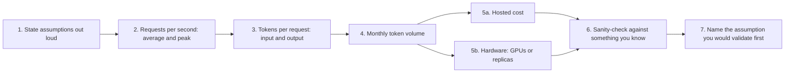

import TOCInline from '@theme/TOCInline';

# Capacity & Cost Estimation

<TOCInline toc={toc} minHeadingLevel={2} maxHeadingLevel={2} />

:::tip[In this guide]
The back-of-envelope page. How to go from "50,000 employees" to a requests-per-second
figure, a token volume, a monthly bill and a GPU count — with the assumptions
stated out loud, which is the part interviewers actually grade.
:::

## What Is It?

Capacity and cost estimation is deriving the size and price of a system from a
handful of stated assumptions, in a few minutes, without a spreadsheet. For an
LLM system that means four numbers: **peak requests per second**, **tokens per
request**, **monthly token volume**, and **concurrent generations**. Everything
else — GPU count, replica count, vector store tier, monthly bill — falls out of
those.

[AI System Design](./06-ai-system-design.mdx) covers where this step sits in the
10-step interview framework. This page is the arithmetic itself.

## Why Does It Matter?

It separates people who have run a system from people who have read about one.
Someone who has operated an LLM product knows input tokens dominate a RAG bill,
knows reranking has its own per-search price, knows a peak-sized GPU fleet is
idle most of the day. Someone who has not will quote a requests-per-second
number and stop.

The thing being graded is **not the number**. The interviewer cannot check your
arithmetic against reality either. They are checking that you:

| Signal | What it looks like |
| --- | --- |
| State assumptions | "I'll assume 40% adoption and 6 questions per active day" |
| Pick the right unit | Tokens and concurrency, not just RPS |
| Know what dominates | Input tokens for RAG, prefill for self-hosted, idle time for GPUs |
| Round aggressively | "About 8 requests per second at peak", not 7.43 |
| Know the error bars | "This is right to within 3x; adoption is the weak assumption" |

A defensible number with stated assumptions beats a precise number pulled from
nowhere. Every time.

## The Method



Run it in that order every time. Steps 1 and 7 are the ones candidates skip and
the ones interviewers remember. Step 6 is what catches an arithmetic slip: if
your answer is $4M a month for an internal tool used by 20,000 people, you have
dropped a factor of a thousand somewhere.

## Traffic Arithmetic

Users to requests per second, in three moves.

Assume **100,000 daily active users** at **4 requests each**:

| Step | Calculation | Result |
| --- | --- | --- |
| Daily requests | 100,000 × 4 | 400,000 per day |
| Naive average | 400,000 ÷ 86,400 s | 4.6 rps |
| Active-hours average | 400,000 ÷ (14 h × 3,600 s) | 7.9 rps |
| Peak | 7.9 × 4 | about 32 rps |

Use the **active-hours average**, not the 24-hour one. Nobody asks your internal
assistant questions at 3 a.m., so dividing by 86,400 understates the real load by
roughly 2x before you even get to peak.

Peak-to-average ratios worth carrying in your head:

| Workload | Peak / active-hours average | Why |
| --- | --- | --- |
| Internal business tool | 3–5x | Everyone works the same hours; Monday morning and post-lunch spikes |
| Consumer app, global | 2–3x | Time zones flatten the curve |
| Batch or scheduled jobs | 10–50x | Everything fires at the top of the hour |
| Event-driven (launches, incidents) | 10x+ | Unbounded; needs a queue, not capacity |

**You size for peak because queueing is non-linear.** As utilisation approaches
capacity, waiting time grows roughly as `rho / (1 - rho)`: at 50% utilisation
queue delay is about equal to service time, at 90% it is nine times service time,
at 95% it is nineteen. Sizing for average does not give you a slow system at
peak, it gives you a system whose p95 latency triples and whose timeouts cascade.
Target 50–70% utilisation at peak and autoscale toward average.

## Token Arithmetic

This is the LLM-specific step and the one people get wrong. Break the input down
by component rather than guessing a total — a realistic RAG assistant:

| Component | Tokens | Notes |
| --- | --- | --- |
| System prompt and tool definitions | 400 | Fixed; a candidate for prompt caching |
| Retrieved context: 6 chunks × 450 tokens | 2,700 | **The dominant term.** `top_k` × chunk size |
| Conversation history, trimmed to 3 turns | 700 | Grows without a cap; cap it |
| User question | 60 | |
| **Total input** | **about 3,900** | Round to 4,000 |
| Output: answer plus citations | 350 | |

Two things fall out immediately. **Input is roughly 11x output**, which is the
opposite of a plain chatbot and changes everything downstream: your bill is an
input-token bill, and your self-hosted capacity is prefill-bound, not
decode-bound. And **`top_k` is your main cost dial.** Going from 6 chunks to 12
adds 2,700 input tokens, a 70% increase in per-request cost, for whatever recall
improvement you measured — which is why you measure it.

Monthly volume at the 400,000-requests-per-day scale, 30 days:

```text
requests/month = 400,000 × 30        = 12,000,000
input tokens   = 12M × 4,000         = 48,000,000,000   (48B)
output tokens  = 12M × 350           =  4,200,000,000   (4.2B)
```

## Cost: The Hosted Path

Assume a mid-tier model at about **$0.30 per 1M input** and **$1.20 per 1M
output**, hosted reranking at **$1 per 1,000 searches**, query embeddings at
**$0.02 per 1M tokens**. Three scales:

| | Small | Medium | Large |
| --- | --- | --- | --- |
| Daily active users | 1,000 | 20,000 | 100,000 |
| Requests / month | 90,000 | 2.4M | 15M |
| Input tokens | 360M | 9.6B | 60B |
| Output tokens | 31.5M | 840M | 5.25B |
| LLM cost | $146 | $3,888 | $24,300 |
| Query embeddings | under $1 | $3 | $18 |
| Reranking | $90 | $2,400 | $15,000 |
| Vector store (managed) | $70 | $500 | $2,500 |
| **Total / month** | **about $310** | **about $6,800** | **about $41,800** |
| **Per request** | **$0.0034** | **$0.0028** | **$0.0028** |

Three observations that matter more than the totals:

- **Reranking is 30–35% of the bill** and is the line item people forget. It is
  priced per search, not per token, so it does not shrink when you trim context.
  Self-hosting a cross-encoder is often the single biggest saving available.
- **Cost per request is nearly flat with scale.** Token pricing is linear, so
  there are no economies of scale on the hosted path. That is exactly why
  self-hosting becomes interesting at volume.
- **Ingest embeddings are a one-off, not a line item.** 2M chunks × 400 tokens is
  800M tokens, about $16 at $0.02 per 1M. It stops being free when you change
  embedding model and re-embed the corpus — budget for that happening twice.

:::note
These prices will be wrong by the time you read them; hosted prices for a given
quality level have fallen by roughly an order of magnitude in two years. The
**method** is the durable part. In an interview, say "assume about $X per million
tokens" and move on — nobody is checking the rate card.
:::

## Cost: The Self-Hosted Path

Four numbers, in order: tokens per second per GPU, requests per second per GPU,
replicas for peak, GPU-hour cost.

Take an 8B-class model on one modern 80GB GPU with vLLM-style continuous
batching. Indicative throughput: **prefill about 15,000 tokens/sec**, **aggregate
decode about 2,500 tokens/sec** across the batch.

| Step | Calculation | Result |
| --- | --- | --- |
| GPU time for prefill | 4,000 input ÷ 15,000 | 0.27 s |
| GPU time for decode | 350 output ÷ 2,500 | 0.14 s |
| GPU budget per request | 0.27 + 0.14 | about 0.41 s |
| Requests/sec per GPU | 1 ÷ 0.41 | about 2.4 |
| Replicas for 32 rps peak | 32 ÷ 2.4 | 14, round to 16 with headroom |
| Cost at $2.50/GPU-hour | 16 × 2.50 × 730 h | about $29,200 / month |

Note that **prefill is two-thirds of the GPU budget.** For RAG, capacity is
driven by retrieved context length, not answer length. Halving `top_k` buys you
almost as much capacity as halving answer length twice over.

Against the hosted large column — about $24,300 of LLM cost — a peak-sized fleet
at $29,200 loses. Autoscaling from 4 replicas at average to 16 at peak lands near
$11,000 and wins. That gap *is* the answer: self-hosting is a bet on utilisation.

| What moves the break-even | Direction |
| --- | --- |
| Utilisation | The whole game. A fleet at 20% utilisation pays 5x per token |
| Traffic spikiness | Spiky favours hosted; you do not pay for idle capacity |
| Model size | A 70B model needs multi-GPU serving; hosted pricing scales more gently than your hardware does |
| Quantisation or a smaller model | Moves break-even down sharply, often more than any infra change |
| Engineering cost | 0.5–1 FTE to run inference reliably, fully loaded $10k–$20k/month. This frequently exceeds the GPU saving |
| Data residency or privacy | Can make self-hosting non-negotiable regardless of the arithmetic |

Say that last row out loud in an interview. "Below roughly 5–10M requests a month
the engineering cost dominates, so I would start hosted and revisit" is a senior
answer.

## Storage And Memory For The Retrieval Layer

One formula. Raw vectors are `n × d × 4` bytes for float32, and an in-memory
index like HNSW adds roughly 50–100% on top for graph links.

```text
1,000,000 chunks × 1,536 dims × 4 bytes  =  6.1 GB raw vectors
HNSW overhead at ~1.8x                   =  about 11 GB RAM
chunk text and metadata, ~2 KB each      =  2 GB
                                            ----
                                            about 13 GB
```

So a million chunks fits comfortably on one mid-size instance, and int8
quantisation cuts the vector part 4x if it does not. The number worth
remembering: **a 1,536-dim float32 vector is 6 KB.** Index tuning, quantisation
tradeoffs, sharding and re-index strategy are in
[vector store operations](../05-embeddings-and-semantic-search/06-vector-store-operations.mdx).

## Latency Budget

Decompose the target before you promise it. A p95 time-to-first-token target of
2 seconds, spent:

| Stage | p95 budget | Notes |
| --- | --- | --- |
| Network, TLS, auth, rate limit | 80 ms | |
| Query embedding | 40 ms | Cache repeat queries |
| Vector search, top 50 | 60 ms | Grows with index size, not much |
| Rerank 50 down to 8 | 250 ms | Often the biggest non-LLM term |
| Context assembly | 20 ms | |
| LLM prefill, 4,000 tokens | 900 ms | Scales with input length |
| **Sum to first token** | **1,350 ms** | 650 ms of headroom against the 2 s target |
| Decode 350 tokens at 60 tok/s | 5,800 ms | To full answer |

Two conclusions. The TTFT target is achievable with room to spare, so promise it.
And the full answer takes about 7 seconds, so **streaming is not a nicety, it is
load-bearing** — without it the product feels broken no matter what your TTFT is.

Summing p95s is pessimistic, since stages rarely hit p95 together. Use it anyway:
it is a conservative check, and if the sum of p95s exceeds your target you should
stop promising the target rather than hope for correlation luck.

## Capacity Planning For Growth

What breaks first as you 10x:

| Component | First constraint | Fix |
| --- | --- | --- |
| LLM provider | Tokens-per-minute quota, long before your budget | Request a quota raise early; multi-provider routing; queue with backpressure |
| Reranker | Per-search cost and latency dominate | Rerank fewer candidates; self-host a cross-encoder; cache by query |
| Vector index | No longer fits in RAM | Quantise to int8, shard, or move to a disk-based index |
| Ingest pipeline | Embedding throughput and the re-index window | Batch, parallel workers, incremental and delta indexing |
| Relational store | Write volume from message and trace logs | Partition by month; push traces to object storage |
| Context budget | History and `top_k` creep input tokens upward | Cap history, summarise, hold `top_k` to what evals justify |
| Cost | Finance notices before engineering does | Per-tenant budgets, semantic caching, model routing |

The provider quota row is the one that surprises teams. At 32 rps peak with 4,000
input tokens, you need `32 × 4,000 × 60` = **7.7M tokens per minute**, which is
far above a default account limit. That is a lead-time problem, not an
engineering problem, and it belongs in your estimate.

## Numbers Worth Memorising

| Anchor | Rough value |
| --- | --- |
| Tokens per English word | 1.3 |
| Tokens per page of prose (about 500 words) | 650 |
| Tokens per PDF page sent as a high-detail image | 765 |
| Typical RAG chunk | 300–600 tokens |
| Typical chat answer | 200–500 tokens |
| Hosted small model, per 1M input | $0.10–$1 |
| Hosted frontier model, per 1M input | $2–$15; output usually 3–4x input |
| Embeddings, per 1M tokens | $0.02–$0.15 |
| Hosted reranking, per 1,000 searches | $1–$2 |
| Single-stream decode speed | 30–100 tokens/sec |
| Aggregate decode, 8B on one GPU with batching | 1,000–3,000 tokens/sec |
| Prefill, 8B on one GPU | 10,000–20,000 tokens/sec |
| GPU on-demand, per hour | $1–$4 mid-range, $3–$10 high-end |
| A 1,536-dim float32 vector | 6 KB |
| Seconds in a day / hours in a month | 86,400 / 730 |

:::warning
**These age, and some age fast.** Prices and throughput have moved by roughly an
order of magnitude in two years, always in the same direction. The ratios are
more durable than the absolutes: input is cheaper than output, embeddings are
nearly free, reranking is priced per search, and prefill is much faster than
decode. Re-check anything you plan to put in a budget document.
:::

## How To Present It In An Interview

- **Assumptions out loud, first.** "I'll assume 40% adoption, 6 questions per
  active user per day, and a 4x peak." Write them where the interviewer can see
  them. Everything after is conditional on these, which protects you.
- **Round hard, immediately.** 7.43 rps is 8 rps. 3,860 tokens is 4,000. Carrying
  precision you do not have is the tell of someone who has not done this.
- **Order of magnitude, stated as such.** "Low thousands of dollars a month, not
  tens of thousands" is a better answer than $4,712.
- **Name the unit every time.** Tokens per minute, requests per second,
  dollars per month. Unit confusion is the most common real error.
- **Sanity-check against an anchor you know.** Per user per month, per request,
  or against a comparable SaaS seat price.
- **Say which assumption you would validate first**, and why. For RAG it is
  almost always adoption rate and retrieved-context size, because input tokens
  dominate. This is the sentence that signals you have shipped something.
- **Offer the sensitivity.** "If adoption is 80% instead of 40%, double it. The
  architecture does not change until about 10x."

## Worked Example: A RAG Assistant For 50,000 Employees

**Assumptions, stated:** 50,000 employees; 40% adopt within a year, so 20,000
monthly actives; half of those use it on a given workday, so 10,000 daily
actives; 6 questions each; 21 workdays a month; a 9-hour active window; 4x peak;
4,000 input and 350 output tokens per request; 2M indexed chunks.

| Quantity | Calculation | Result |
| --- | --- | --- |
| Requests per workday | 10,000 × 6 | 60,000 |
| Requests per month | 60,000 × 21 | 1.26M |
| Average rps | 60,000 ÷ (9 × 3,600) | 1.9 |
| Peak rps | 1.9 × 4 | about 7.5 |
| Input tokens / month | 1.26M × 4,000 | 5.0B |
| Output tokens / month | 1.26M × 350 | 441M |
| Concurrent generations | 7.5 rps × 7 s (Little's law) | about 52 |
| Peak tokens per minute | 7.5 × 4,000 × 60 | 1.8M — **check the provider quota** |

Monthly cost:

| Line | Amount |
| --- | --- |
| LLM input, 5.0B at $0.30 / 1M | $1,500 |
| LLM output, 441M at $1.20 / 1M | $530 |
| Reranking, 1.26M searches at $1 / 1k | $1,260 |
| Query embeddings | under $5 |
| Vector store, 2M chunks managed | $500 |
| App compute, Postgres, Redis | $600 |
| Tracing and observability | $300 |
| **Total** | **about $4,700 / month** |
| **Per request** | **about $0.0037** |

**Sanity-check:** $4,700 a month across 20,000 monthly actives is about $0.24 per
user per month. A per-seat SaaS tool is $10–$30. So this is cheap enough that
cost is not the constraint — which is itself the useful conclusion, and it tells
you the design should optimise for answer quality and latency instead.

**What I would validate first:** the 40% adoption assumption and the 4,000-token
input figure. Adoption scales the whole bill linearly, and input tokens are 70%
of the LLM line — if `top_k` has to double to hit the recall target, the LLM cost
roughly doubles. Everything else is noise at this scale.

## Common Mistakes

- Quoting requests per second and stopping, with no token or concurrency figure.
- Dividing daily volume by 86,400 instead of the active window, understating load 2x.
- Sizing for average and then being surprised when p95 latency triples at peak.
- Guessing total input tokens instead of decomposing them, so `top_k` never surfaces as the cost dial.
- Forgetting reranking, which can be a third of the bill and is priced per search.
- Comparing hosted cost against a peak-sized GPU fleet running at 20% utilisation.
- Leaving the engineering cost of self-hosting out of the self-hosting case.
- Ignoring provider tokens-per-minute quotas, which bind long before the budget does.
- Promising a p95 target without decomposing it across stages first.
- Carrying four significant figures through an estimate built on a guessed adoption rate.
- Treating a one-off ingest embedding cost as a recurring line, or forgetting re-embedding entirely.

## Interview Questions

- 50,000 employees get an internal assistant. Estimate peak RPS and monthly cost.
- Why is requests per second not enough to size an LLM system?
- Break down the input tokens for a RAG request. Which term dominates, and what do you do about it?
- How many concurrent generations does 10 rps imply? What do you need to know to answer?
- At what volume does self-hosting beat a hosted API, and what moves that point?
- Why is a RAG workload prefill-bound rather than decode-bound?
- You have a p95 time-to-first-token target of 2 seconds. Show it is achievable.
- How much RAM does a 2M-chunk vector index need?
- What breaks first when this system sees 10x traffic?
- Which of your assumptions would you validate first, and why that one?

## Things to Remember

- State assumptions out loud. A defensible number beats a correct one.
- Divide by the active window, not by 86,400. Then multiply by a peak factor.
- Size for peak because queue delay grows as `rho / (1 - rho)`. Aim for 50–70% at peak.
- Decompose tokens by component. For RAG, retrieved context dominates and `top_k` is the dial.
- Input is roughly 10x output in RAG, so the bill and the GPU budget are both prefill-driven.
- Reranking is priced per search and is often a third of the bill.
- Self-hosting is a bet on utilisation, and the engineering cost usually decides it.
- Check the provider tokens-per-minute quota. It binds before your budget does.
- Round to one significant figure and name the unit every single time.

## Mini Exercise

Size your own RAG project. Pick a plausible user count, write down every
assumption on one line each, and produce: peak rps, input and output tokens per
request, monthly token volume, monthly cost, concurrent generations, and peak
tokens per minute. Time yourself — aim for under 10 minutes with no spreadsheet.

Then change one assumption by 10x (adoption, or `top_k`) and redo it. Note which
line items moved and which did not, and write one sentence on what would break
architecturally at the larger number. That sensitivity is the part interviewers
probe when they say "and at 10x?".

## Done When

- [ ] You can go from a user count to peak rps, stating the active window and peak factor.
- [ ] You can decompose input tokens by component and say which term dominates.
- [ ] You can produce a monthly hosted cost including reranking, embeddings and the vector store.
- [ ] You can estimate GPUs needed for a peak load and explain why prefill dominates for RAG.
- [ ] You can decompose a p95 latency target across stages and say whether it is achievable.
- [ ] You can present the whole estimate in under 10 minutes with assumptions stated and the weakest one named.
