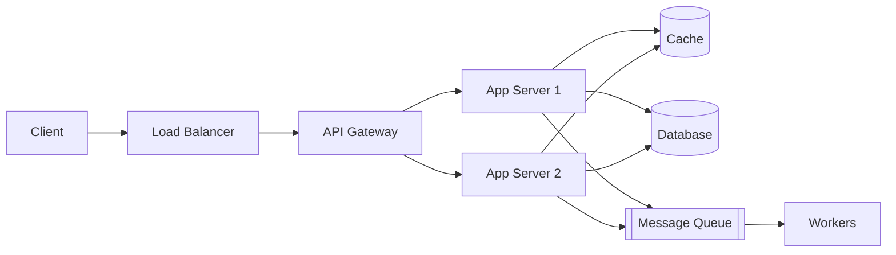
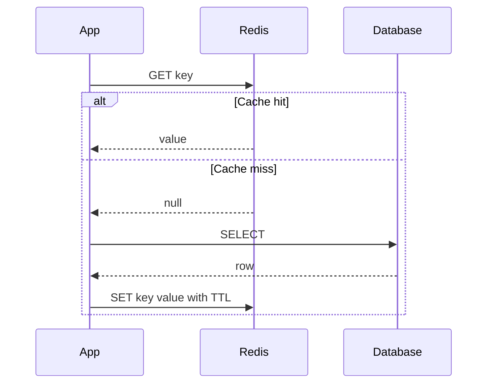
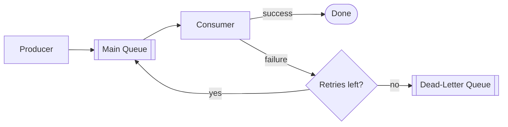
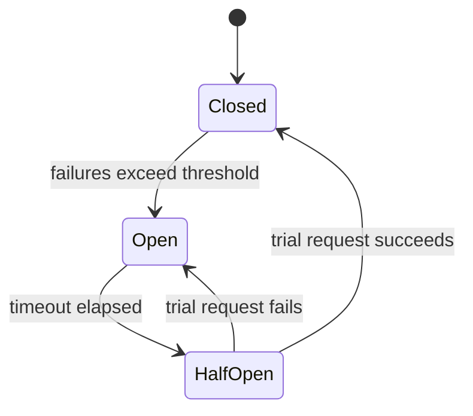
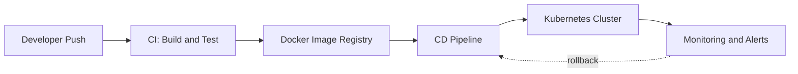
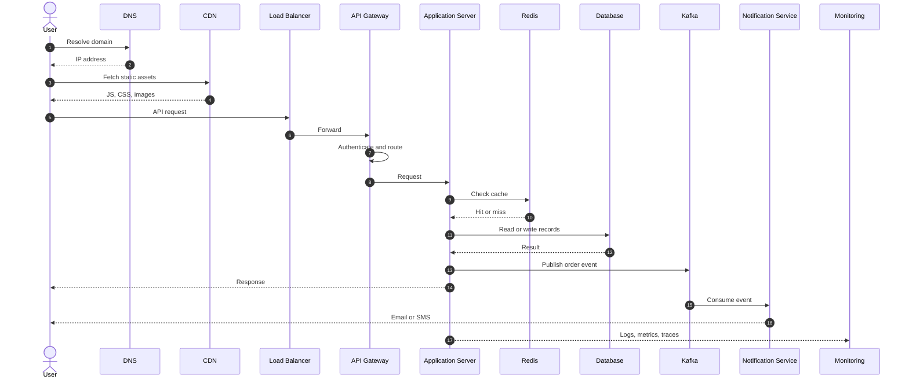
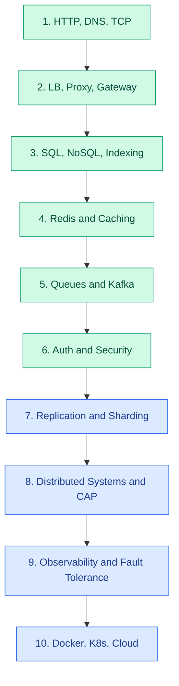

# Backend System Design

Backend system design is about understanding how different components work together to build **scalable, reliable, secure and high-performance** applications. If you are preparing for Backend Engineering or System Design interviews, learn these components in the order below.

## Table of Contents

1. [Core Backend Components](#1-core-backend-components)
   - [API Gateway](#11-api-gateway)
   - [Load Balancer](#12-load-balancer)
   - [Application Server](#13-application-server)
   - [Database](#14-database)
   - [Cache](#15-cache)
   - [Message Queue](#16-message-queue)
2. [Networking and Traffic Management](#2-networking-and-traffic-management)
3. [Storage Components](#3-storage-components)
4. [Distributed Systems Components](#4-distributed-systems-components)
5. [Security Components](#5-security-components)
6. [Reliability and Observability](#6-reliability-and-observability)
7. [Deployment and Infrastructure](#7-deployment-and-infrastructure)
8. [How Everything Connects](#8-how-everything-connects)
9. [Recommended Learning Order](#9-recommended-learning-order)
10. [Practical Projects](#10-practical-projects)

---

## 1. Core Backend Components

The high-level picture of the six core building blocks:

### 1.1 API Gateway

**Theory.** A single entry point for all client requests. Instead of clients knowing about dozens of backend services, they talk to one gateway that handles cross-cutting concerns before forwarding traffic.

- **Routing** – map a path or host to the right backend service.
- **Authentication** – verify tokens or API keys once, at the edge.
- **Rate limiting** – protect services from abuse and traffic spikes.
- **Request validation** – reject malformed requests early.
- **API versioning** – serve `/v1` and `/v2` side by side during migrations.

**Trade-off.** It centralizes policy but can become a bottleneck or single point of failure, so it must itself be replicated.

### 1.2 Load Balancer

**Theory.** Distributes incoming traffic across multiple servers so no single machine is overloaded, enabling horizontal scaling and high availability.

- **Round Robin** – requests go to servers in rotation; simple, assumes equal servers and request cost.
- **Least Connections** – send to the server with the fewest active connections; better for long-lived or uneven requests.
- **Health checks** – periodically probe servers and stop routing to unhealthy ones.
- **Failover** – shift traffic to standby servers or another region on failure.

**Layers.** L4 balancers route on IP and port (fast). L7 balancers route on HTTP content such as path, headers and cookies (flexible).

### 1.3 Application Server

**Theory.** Executes the business logic. It receives validated requests, applies rules, talks to the database, cache and queues, and returns a response.

- REST APIs
- Controllers and services (layered design)
- Validation
- Business rules
- **Stateless services** – keep no session state in server memory, so any instance can handle any request. This is what makes horizontal scaling and easy replacement possible.

### 1.4 Database

**Theory.** Stores persistent data. The choice between SQL and NoSQL is driven by data shape, consistency needs and scale.

- **SQL (PostgreSQL, MySQL)** – structured schema, joins, strong ACID transactions.
- **NoSQL (MongoDB, DynamoDB)** – flexible schema, horizontal scale, often tuned for specific access patterns.
- **Indexing** – extra data structures (commonly B-trees) that speed up reads at the cost of slower writes and more storage.
- **Replication** – copies of data on multiple nodes for availability and read scaling.
- **Partitioning and sharding** – split data so each node holds a subset, for write scaling.
- **Transactions** – group operations into an all-or-nothing unit (ACID: atomicity, consistency, isolation, durability).

### 1.5 Cache

**Theory.** Stores frequently accessed data in memory to cut latency and database load. Memory is orders of magnitude faster than disk or network round trips.

- **Redis** – in-memory store with rich data structures.
- **Cache-aside** – the app checks the cache, on a miss reads the DB and populates the cache. Most common.
- **Write-through** – writes go to cache and DB together; consistent but slower writes.
- **Write-behind** – write to cache first, flush to DB asynchronously; fast but risks data loss.
- **TTL** – time-to-live expiry to bound staleness.
- **Cache invalidation** – deciding when cached data is stale; famously one of the hard problems in computing.

### 1.6 Message Queue

**Theory.** Enables asynchronous communication. A producer publishes a message and moves on; a consumer processes it later. This decouples services, absorbs traffic spikes and improves resilience.

- **Kafka** – distributed, durable log; high throughput, replayable, ordered within a partition.
- **RabbitMQ** – traditional broker with flexible routing.
- **AWS SQS** – fully managed queue.
- **Producers and consumers** – consumer groups let you scale processing horizontally.
- **Retries** – re-attempt failed messages, ideally with backoff.
- **Dead-letter queues (DLQ)** – park messages that keep failing for later inspection.

---

## 2. Networking and Traffic Management

| Component | Purpose |
|---|---|
| DNS | Resolves domain names to IP addresses |
| CDN | Delivers static content closer to users |
| Reverse Proxy | Routes requests to backend services |
| Firewall | Filters network traffic |
| WAF | Protects against web attacks |
| TLS/SSL | Encrypts communication |
| Service Discovery | Finds available services |
| Rate Limiter | Controls request frequency |

**Theory notes**

- **DNS** is a hierarchical, cached lookup system. TTLs on records control how quickly changes propagate.
- **CDN** caches static assets at edge locations, reducing latency and origin load.
- **Reverse proxy** (Nginx, Envoy) sits in front of servers and handles TLS termination, compression, caching and routing.
- **WAF** inspects HTTP traffic for attacks such as SQL injection and XSS; a firewall works at lower network layers.
- **Service discovery** lets services find each other when instances scale up and down dynamically (for example Consul or Kubernetes DNS).
- **Rate limiters** commonly use token bucket, leaky bucket or sliding window algorithms.

---

## 3. Storage Components

| Component | Purpose |
|---|---|
| Relational DB | Structured relational data |
| NoSQL DB | Flexible or specialized data models |
| Object Storage | Stores images, videos, files |
| Search Engine | Full-text search |
| Vector Database | Semantic similarity search |
| Data Warehouse | Analytics and reporting |

**Examples:** PostgreSQL, MongoDB, S3, Elasticsearch, Qdrant, BigQuery.

**Theory notes**

- **Object storage** is flat, cheap and highly durable; ideal for blobs, accessed via HTTP rather than a filesystem.
- **Search engines** build inverted indexes mapping terms to documents for fast full-text queries and ranking.
- **Vector databases** store embeddings and find nearest neighbors, powering semantic search and retrieval for AI applications.
- **Data warehouses** use columnar storage optimized for large analytical scans (OLAP), as opposed to row-oriented transactional workloads (OLTP).

---

## 4. Distributed Systems Components

These are particularly important for designing large-scale applications.

| Component / Concept | Purpose |
|---|---|
| Replication | Maintain multiple copies of data |
| Sharding | Distribute data across databases |
| Partitioning | Divide data into smaller sections |
| Consistent Hashing | Distribute keys across nodes |
| Leader Election | Select a coordinator |
| Distributed Lock | Coordinate concurrent operations |
| Consensus | Agree on distributed state |
| Circuit Breaker | Prevent cascading failures |
| Retry Mechanism | Recover from transient failures |
| Idempotency | Prevent duplicate effects |
| Eventual Consistency | Allow replicas to converge over time |

**Theory notes**

- **CAP theorem.** During a network partition a system must choose between consistency and availability. Partition tolerance is not optional in a real network.
- **Consistent hashing** places nodes and keys on a ring so that adding or removing a node only remaps a small fraction of keys.
- **Consensus** (Raft, Paxos) lets nodes agree on a value despite failures; it underpins leader election and systems like etcd and ZooKeeper.
- **Idempotency** means repeating an operation has the same effect as doing it once. Use idempotency keys so retries never double-charge a payment.
- **Eventual consistency** trades immediate agreement between replicas for availability and speed.
- **Retries** should use exponential backoff with jitter to avoid retry storms.

The diagram above shows the **circuit breaker** states: it stops calling a failing service (Open), periodically probes it (Half-Open), and resumes normal traffic once healthy (Closed).

---

## 5. Security Components

| Component | Purpose |
|---|---|
| Authentication | Verifies user identity |
| Authorization | Checks user permissions |
| OAuth 2.0 | Delegated authorization |
| JWT | Token-based authentication |
| RBAC | Role-based access control |
| Secrets Manager | Securely stores credentials |
| Encryption | Protects sensitive data |
| API Rate Limiting | Prevents abuse |
| Audit Logs | Tracks security-sensitive actions |

**Theory notes**

- **Authentication vs authorization.** Authentication answers "who are you?"; authorization answers "what may you do?"
- **OAuth 2.0** lets a user grant a third-party app limited access without sharing their password.
- **JWT** is a signed, self-contained token. Servers verify the signature without a session lookup, but revoking a token before expiry needs extra design (short lifetimes, refresh tokens, denylists).
- **RBAC** assigns permissions to roles and roles to users.
- **Encryption** applies in transit (TLS) and at rest (disk or field-level encryption).
- **Secrets managers** (Vault, AWS Secrets Manager) keep credentials out of code and config files.

---

## 6. Reliability and Observability

| Component | Purpose |
|---|---|
| Logging | Records application events |
| Metrics | Tracks CPU, memory, latency, errors |
| Distributed Tracing | Tracks requests across services |
| Health Checks | Checks service availability |
| Alerting | Notifies about failures |
| Circuit Breaker | Stops repeated calls to failing services |
| Bulkhead | Isolates failures |
| Failover | Switches to backup resources |
| Backup & Recovery | Restores lost data |

**Tools:** Prometheus, Grafana, OpenTelemetry, ELK Stack, Jaeger.

**Theory notes**

- **The three pillars of observability** are logs (what happened), metrics (how much, how often) and traces (where time was spent across services).
- **Bulkhead** pattern isolates resources such as thread pools per dependency, so one slow dependency cannot exhaust everything.
- **Backup and recovery** is defined by two targets: RPO (how much data you can lose) and RTO (how long you can be down).
- **SLIs, SLOs and error budgets** turn reliability into measurable goals.

---

## 7. Deployment and Infrastructure

| Component | Purpose |
|---|---|
| Docker | Containerization |
| Kubernetes | Container orchestration |
| CI/CD | Automated build and deployment |
| API Gateway | Centralized API management |
| Reverse Proxy | Nginx, Envoy |
| Infrastructure as Code | Terraform |
| Cloud | AWS, Azure, GCP |
| Service Mesh | Service-to-service communication |

**Theory notes**

- **Docker** packages an app and its dependencies into a portable image, giving consistent environments.
- **Kubernetes** schedules containers, scales them, restarts failed ones and handles rolling updates.
- **CI/CD** automates build, test and release; common strategies include rolling, blue-green and canary deployments.
- **Infrastructure as Code** makes infrastructure reviewable, versioned and reproducible.
- **Service mesh** (Istio, Linkerd) moves concerns like mTLS, retries and traffic shaping into sidecar proxies.

---

## 8. How Everything Connects

A real-world example: an **e-commerce application**.

**Request flow, step by step**

1. User opens the application.
2. DNS resolves the domain.
3. CDN serves static assets.
4. Request reaches the Load Balancer.
5. API Gateway authenticates and routes the request.
6. Application Server executes business logic.
7. Redis checks for cached data.
8. Database retrieves or updates records.
9. Kafka publishes asynchronous events.
10. Notification service sends email or SMS.
11. Monitoring tools collect logs, metrics and traces.

Note that steps 9 and 10 are asynchronous: the user gets a response without waiting for the email to be sent. That is the core benefit of a message queue.

---

## 9. Recommended Learning Order

| Stage | Topics | Priority |
|---|---|---|
| 1 | Client-server, HTTP, DNS, TCP | Essential |
| 2 | Load balancer, reverse proxy, API gateway | Essential |
| 3 | SQL, NoSQL, indexing, transactions | Essential |
| 4 | Redis, caching strategies | Essential |
| 5 | Message queues, Kafka, RabbitMQ | Essential |
| 6 | Authentication, authorization, security | Essential |
| 7 | Replication, sharding, partitioning | Advanced |
| 8 | Distributed systems, consistency, CAP | Advanced |
| 9 | Observability, fault tolerance | Advanced |
| 10 | Docker, Kubernetes, cloud architecture | Advanced |

Green stages are **Essential**; blue stages are **Advanced**.

---

## 10. Practical Projects

Do not learn these only theoretically. Build these systems:

| # | Project | Components practiced |
|---|---|---|
| 1 | URL Shortener | API Gateway, Redis, database, load balancing |
| 2 | E-commerce Backend | Authentication, orders, payments, Kafka, caching |
| 3 | Chat Application | WebSockets, message queues, databases |
| 4 | YouTube-like Platform | CDN, object storage, transcoding, queues |
| 5 | Ride Booking System | Geospatial queries, real-time updates, distributed systems |
| 6 | Notification System | Kafka, workers, retries, dead-letter queues |

> **Recommendation:** Use **Java + Spring Boot** or **Python + FastAPI** to implement these concepts. Start with a **modular monolith**, then evolve it into **microservices**.
