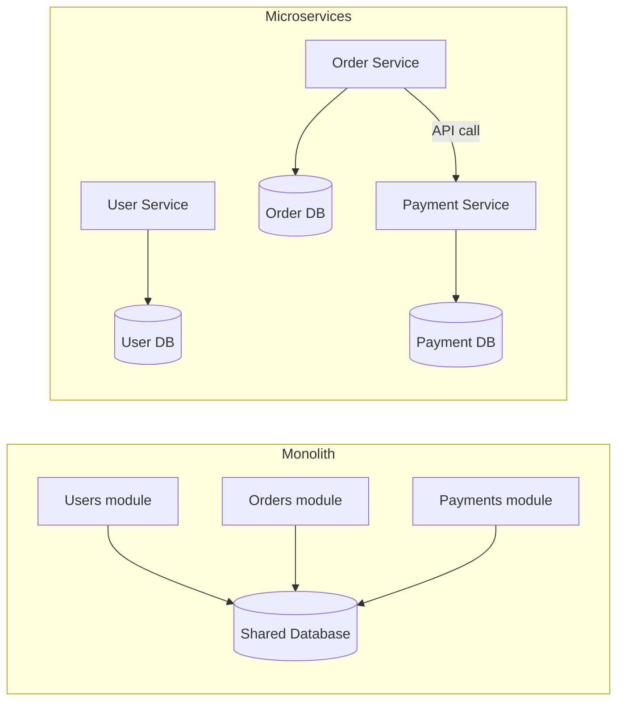
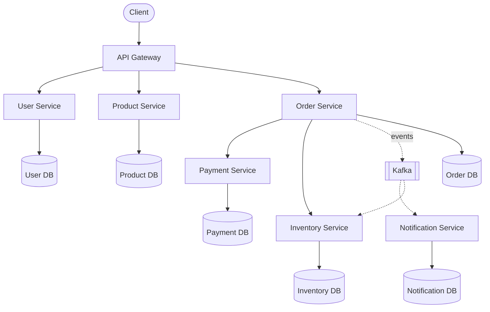
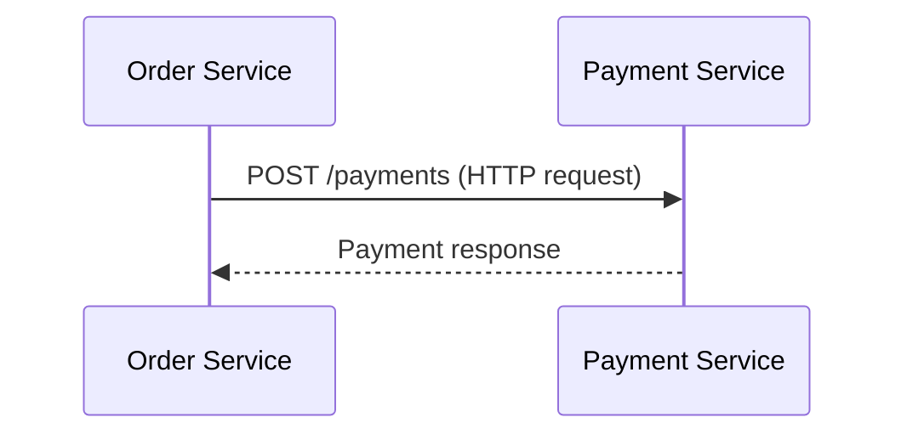
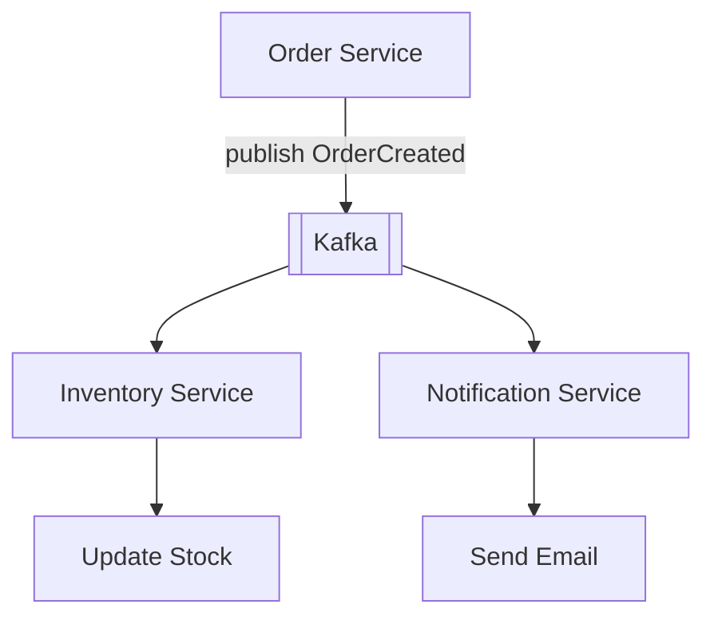
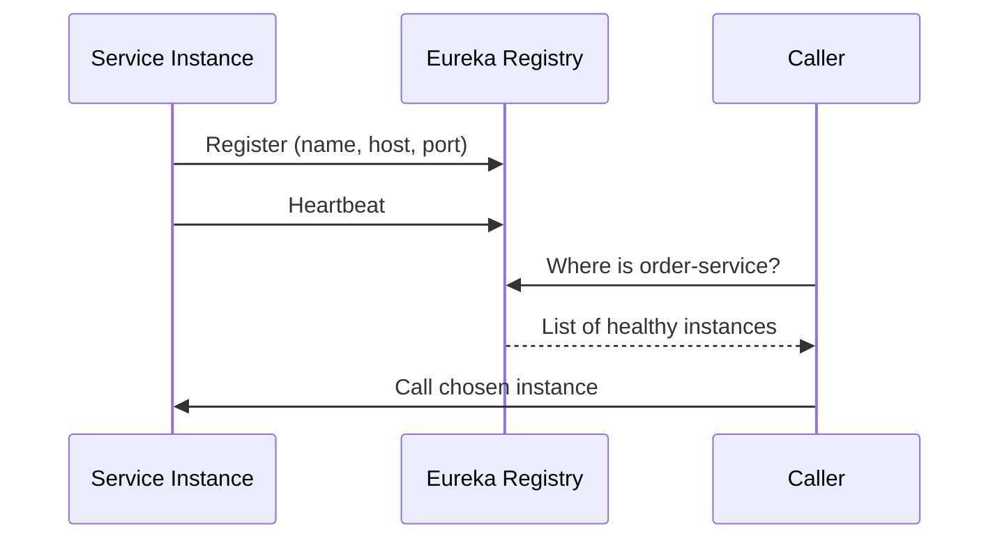
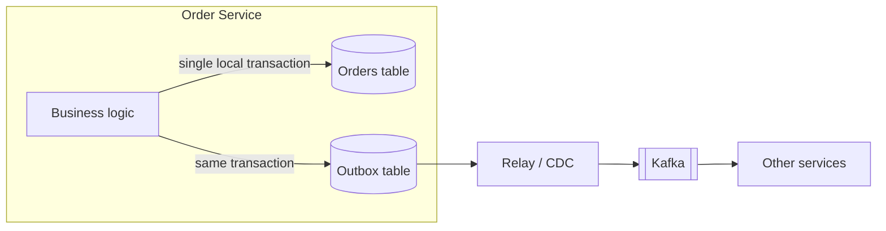
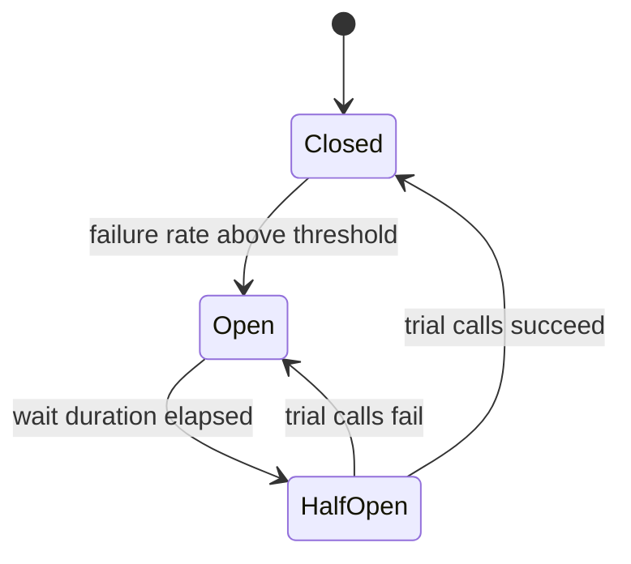
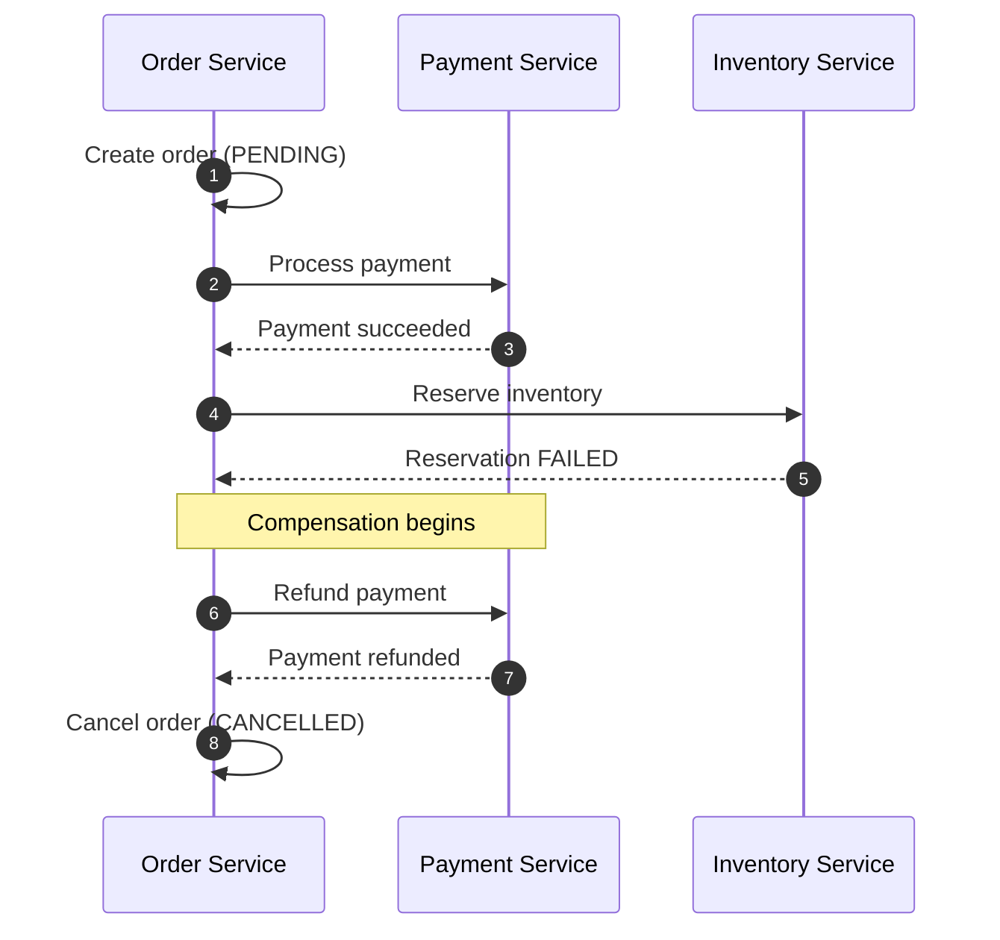
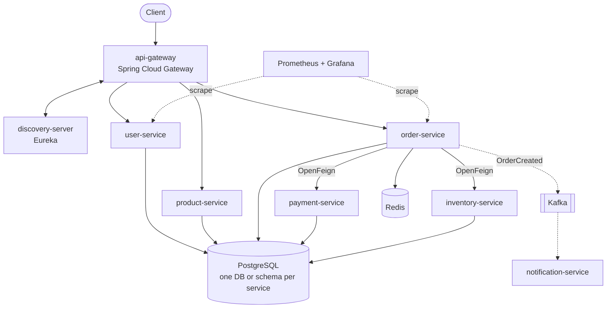

# Microservices Architecture

Microservices is an architectural style where a large application is divided into multiple **small, independently deployable services**. Each service handles a specific business capability and communicates with other services through APIs or messaging systems.

## Table of Contents

1. [Monolith vs Microservices](#1-monolith-vs-microservices)
2. [Real-World Example: E-commerce Application](#2-real-world-example-e-commerce-application)
3. [How Services Communicate](#3-how-services-communicate)
   - [Synchronous communication](#a-synchronous-communication)
   - [Asynchronous communication](#b-asynchronous-communication)
4. [Important Microservices Components](#4-important-microservices-components)
5. [Important Concepts for Interviews](#5-important-concepts-for-interviews)
6. [Distributed Transactions and the Saga Pattern](#6-distributed-transactions-and-the-saga-pattern)
7. [Build Microservices Using Spring Boot](#7-build-microservices-using-spring-boot)
8. [Learning Roadmap](#8-learning-roadmap)

---

## 1. Monolith vs Microservices

**Monolithic architecture** – one application containing multiple modules, typically deployed together.

**Microservices architecture** – multiple independently deployable services communicating over a network.



| Monolith | Microservices |
|---|---|
| Single deployable application | Multiple deployable services |
| Often shared database | Services own their data |
| Usually simpler initially | More operational complexity |
| Scaling entire application is common | Scale individual services |
| Internal method calls | Network communication |

**Theory notes**

- **Start with a monolith when unsure.** Microservices solve organizational and scaling problems, but they add network failures, deployment complexity and debugging difficulty. A well-structured modular monolith is often the right first step.
- **Service boundaries** should follow business capabilities (bounded contexts from Domain-Driven Design), not technical layers.
- **Network calls are not method calls.** They can be slow, fail partially and time out, which is why resilience patterns matter so much.
- **Benefits:** independent deployment and scaling, team autonomy, fault isolation, freedom to choose technology per service.
- **Costs:** distributed data consistency, operational overhead, testing across services, observability needs.

---

## 2. Real-World Example: E-commerce Application

Imagine building an Amazon-like backend. Instead of one huge backend, divide it into services.

| Service | Responsibility | Database |
|---|---|---|
| User Service | Registration, login, profiles | User DB |
| Product Service | Product catalog, pricing | Product DB |
| Order Service | Order creation, order history | Order DB |
| Payment Service | Payment processing | Payment DB |
| Inventory Service | Stock management | Inventory DB |
| Notification Service | Email, SMS, push | Notification DB |

Each service:

- Has its own business logic.
- Can be deployed independently.
- Can be scaled independently.
- **Owns its data.**
- Communicates with other services.



**Database per service** is the key rule: no service reads another service's tables directly. Data is shared only through APIs or events. This keeps services loosely coupled, but it means you cannot use joins or a single ACID transaction across services (see the Saga section).

---

## 3. How Services Communicate

There are two major communication patterns.

### A. Synchronous communication

One service directly calls another and **waits for its response**. Examples: REST API, gRPC.



Useful when you need an immediate response.

**Trade-offs**

- Simple to reason about and debug.
- **Temporal coupling:** if the Payment Service is down or slow, the Order Service is affected.
- Failures can cascade through a call chain, so use timeouts, retries and circuit breakers.
- **REST** is ubiquitous and human-readable; **gRPC** uses Protocol Buffers over HTTP/2 for faster, strongly typed internal calls.

### B. Asynchronous communication

Services communicate using **message brokers**. Examples: Kafka, RabbitMQ, AWS SQS.



The Order Service does not need to wait for the Notification Service to finish.

**Trade-offs**

- **Loose coupling:** the producer does not know who consumes its events.
- Better resilience: if a consumer is down, messages wait in the broker.
- Easy to add new consumers without changing the producer.
- Harder to trace and debug; results are **eventually consistent**.
- Consumers must be **idempotent**, because messages can be delivered more than once.

**Rule of thumb:** use synchronous calls when the caller needs the answer now (for example, checking a price); use asynchronous events to announce that something happened (for example, an order was created).

---

## 4. Important Microservices Components

| Component | Purpose | Examples |
|---|---|---|
| API Gateway | Entry point for requests | Spring Cloud Gateway |
| Service Discovery | Find service instances | Eureka, Consul |
| Load Balancer | Distribute requests | Nginx |
| Config Server | Centralized configuration | Spring Cloud Config |
| Message Broker | Async communication | Kafka, RabbitMQ |
| Distributed Cache | Shared caching | Redis |
| Circuit Breaker | Handle service failures | Resilience4j |
| Distributed Tracing | Track requests | Jaeger, Zipkin |
| Centralized Logging | Collect service logs | ELK |
| Containerization | Package services | Docker |
| Orchestration | Manage containers | Kubernetes |

**Theory notes**

- **Service discovery** solves the problem that instances come and go with changing IPs. Services register themselves, and callers look up healthy instances. Two styles exist: client-side (the caller picks an instance, as with Eureka) and server-side (a load balancer or platform does it, as with Kubernetes).
- **Config server** externalizes configuration so you can change settings per environment without rebuilding images.
- **Centralized logging and tracing** are essential: one user request may touch many services, and you need a shared correlation or trace ID to follow it.



---

## 5. Important Concepts for Interviews

These are particularly important:

1. **Service discovery** – dynamically locate service instances.
2. **API Gateway pattern** – single entry point handling routing, authentication and rate limiting.
3. **Synchronous vs asynchronous communication** – request/response versus events.
4. **Database per service** – each service owns its data store.
5. **Distributed transactions** – operations spanning multiple services and databases.
6. **Saga pattern** – a sequence of local transactions with compensating actions.
7. **Event-driven architecture** – services react to published events.
8. **Circuit breaker pattern** – stop calling a failing service to prevent cascading failure.
9. **Retry and timeout mechanisms** – bound waiting, and recover from transient errors with backoff.
10. **Idempotency** – repeating an operation has the same effect as doing it once.
11. **Eventual consistency** – data across services converges over time.
12. **Distributed tracing** – follow a request across service boundaries.
13. **CQRS** – Command Query Responsibility Segregation: separate models for writes and reads, often with read-optimized views built from events.
14. **Outbox pattern** – write the business change and the outgoing event in the same local transaction (an outbox table), then a relay publishes it to the broker. This avoids the "saved to DB but event never published" problem.
15. **Service security** – authenticate at the gateway, propagate identity (for example JWT), and secure service-to-service traffic (mTLS).



**Circuit breaker states** (Resilience4j follows this model):



---

## 6. Distributed Transactions and the Saga Pattern

Suppose a customer places an order. Three services are involved:

1. **Order Service** → create order
2. **Payment Service** → deduct payment
3. **Inventory Service** → reduce stock

What if payment succeeds but the inventory update fails?

You cannot simply roll back all databases using a traditional single-database transaction, because each service owns a separate database. Two-phase commit exists but is generally avoided in microservices due to blocking and availability problems.

This is where the **Saga Pattern** comes in: a saga is a sequence of local transactions, where each step publishes an event or triggers the next step. If a step fails, the saga runs **compensating transactions** to undo the earlier steps.

A possible flow:

1. Create order.
2. Process payment.
3. Reserve inventory.
4. If inventory reservation fails, initiate payment refund.
5. Cancel the order.

These rollback-like actions are called **compensating transactions**.



**Two ways to coordinate a saga**

| Style | How it works | Pros | Cons |
|---|---|---|---|
| Choreography | Services react to each other's events; no central controller | Simple, loosely coupled for small flows | Hard to see the overall flow as it grows |
| Orchestration | A central orchestrator tells each service what to do next | Clear flow, easier to monitor and change | Orchestrator is an extra component to build and run |

**Things to remember**

- Compensating actions must be **idempotent** and designed up front (refund, release stock, cancel order).
- Sagas are **eventually consistent**; intermediate states such as PENDING are visible, so model them explicitly.
- Combine sagas with the **outbox pattern** so state changes and events never get out of sync.

---

## 7. Build Microservices Using Spring Boot

A practical project structure:

```text
ecommerce-platform/
│
├── api-gateway/
│
├── discovery-server/
│
├── user-service/
│
├── product-service/
│
├── order-service/
│
├── payment-service/
│
├── inventory-service/
│
├── notification-service/
│
├── docker-compose.yml
│
└── README.md
```

Suggested technology stack:

| Layer | Technology |
|---|---|
| Backend | Java + Spring Boot |
| API Gateway | Spring Cloud Gateway |
| Discovery | Eureka |
| Communication | REST + OpenFeign |
| Async messaging | Kafka |
| Database | PostgreSQL |
| Cache | Redis |
| Security | Spring Security + JWT |
| Resilience | Resilience4j |
| Containers | Docker |
| Deployment | Kubernetes |
| Monitoring | Prometheus + Grafana |



**Tips**

- Give each service its own database (or at least its own schema) from day one.
- Use `docker-compose.yml` to run PostgreSQL, Kafka, Redis and your services locally.
- Put the JWT validation in the gateway, and keep services focused on business logic.
- Add Resilience4j timeouts, retries and circuit breakers to every OpenFeign client.

---

## 8. Learning Roadmap

Track your progress through the ten stages:

- [ ] **1. Monolith vs Microservices** – understand architecture and service boundaries.
- [ ] **2. Build independent Spring Boot services** – User, Product and Order services.
- [ ] **3. API Gateway** – centralized routing and authentication.
- [ ] **4. Service Discovery** – Eureka and dynamic service registration.
- [ ] **5. Inter-service communication** – REST, OpenFeign and gRPC.
- [ ] **6. Kafka and event-driven architecture** – producers, consumers and event handling.
- [ ] **7. Resilience patterns** – timeout, retry, circuit breaker and bulkhead.
- [ ] **8. Saga and distributed transactions** – choreography, orchestration and compensation.
- [ ] **9. Docker and Kubernetes** – containerize and deploy services.
- [ ] **10. Observability** – logs, metrics and distributed tracing.

```mermaid
flowchart LR
    A[1. Monolith vs<br/>Microservices] --> B[2. Spring Boot<br/>services]
    B --> C[3. API Gateway]
    C --> D[4. Service<br/>Discovery]
    D --> E[5. Inter-service<br/>communication]
    E --> F[6. Kafka and<br/>events]
    F --> G[7. Resilience<br/>patterns]
    G --> H[8. Saga]
    H --> I[9. Docker and<br/>Kubernetes]
    I --> J[10. Observability]

    classDef core fill:#d1fae5,stroke:#059669,color:#064e3b
    classDef advanced fill:#dbeafe,stroke:#2563eb,color:#1e3a8a
    class A,B,C,D,E core
    class F,G,H,I,J advanced
```



Green stages build the foundation; blue stages cover the harder distributed-systems topics.
