# AWS Learning Roadmap

Instead of learning AWS as a disconnected list of services, learn it by building **one project**: a mini ChatGPT/RAG platform built with FastAPI. Each phase adds one AWS service, and each service solves a real problem you hit in the previous phase. This teaches cloud, backend, DevOps and AI together, and gives you concrete stories for interviews.

> **Credits note.** The source notes mention that AWS gives new customers about $100 immediately plus up to another $100 for completing learning activities (EC2, Bedrock, Lambda, RDS, Budgets). Credit amounts, eligibility and the Free vs Paid plan rules change over time, so confirm them on the AWS Free Tier page before relying on them.

## Table of Contents

1. [The Services to Learn and Their Priority](#1-the-services-to-learn-and-their-priority)
2. [The Project: Production AI Chat/RAG API](#2-the-project-production-ai-chatrag-api)
3. [Foundations: IAM and VPC](#3-foundations-iam-and-vpc)
4. [Phase 1 – EC2](#4-phase-1--ec2)
5. [Phase 2 – Docker and ECR](#5-phase-2--docker-and-ecr)
6. [Phase 3 – ECS and Fargate](#6-phase-3--ecs-and-fargate)
7. [Phase 4 – RDS PostgreSQL](#7-phase-4--rds-postgresql)
8. [Phase 5 – S3](#8-phase-5--s3)
9. [Phase 6 – Bedrock](#9-phase-6--bedrock)
10. [Phase 7 – Building the RAG Pipeline](#10-phase-7--building-the-rag-pipeline)
11. [Phase 8 – SQS](#11-phase-8--sqs)
12. [Phase 9 – Lambda and API Gateway](#12-phase-9--lambda-and-api-gateway)
13. [Phase 10 – CloudWatch](#13-phase-10--cloudwatch)
14. [Supporting Services: CloudFront, DynamoDB, Secrets Manager](#14-supporting-services-cloudfront-dynamodb-secrets-manager)
15. [How to Spend Your Credits](#15-how-to-spend-your-credits)
16. [Interview Cheat Sheet](#16-interview-cheat-sheet)
17. [Learning Checklist](#17-learning-checklist)

---

## 1. The Services to Learn and Their Priority

| Service | What you should practice | Priority |
|---|---|---|
| IAM | Users, roles, policies, least privilege | ⭐⭐⭐⭐⭐ |
| EC2 | Deploy FastAPI manually on Linux | ⭐⭐⭐⭐⭐ |
| S3 | File, document and image storage | ⭐⭐⭐⭐⭐ |
| RDS PostgreSQL | Production SQL database | ⭐⭐⭐⭐⭐ |
| ECS/Fargate | Deploy Dockerized FastAPI | ⭐⭐⭐⭐⭐ |
| CloudWatch | Logs, metrics, monitoring | ⭐⭐⭐⭐⭐ |
| Bedrock | AWS-hosted LLM/GenAI APIs | ⭐⭐⭐⭐⭐ |
| VPC | Networking, subnets, security groups | ⭐⭐⭐⭐⭐ |
| Lambda | Serverless APIs and background jobs | ⭐⭐⭐⭐ |
| API Gateway | Expose Lambda APIs | ⭐⭐⭐⭐ |
| CloudFront | CDN and caching | ⭐⭐⭐⭐ |
| ECR | Store Docker images | ⭐⭐⭐⭐ |
| SQS | Async jobs and queues | ⭐⭐⭐⭐ |
| Secrets Manager | API keys and database secrets | ⭐⭐⭐⭐ |
| DynamoDB | NoSQL/serverless database | ⭐⭐⭐ |

**Core mental model.** Almost every AWS service falls into one of five buckets:

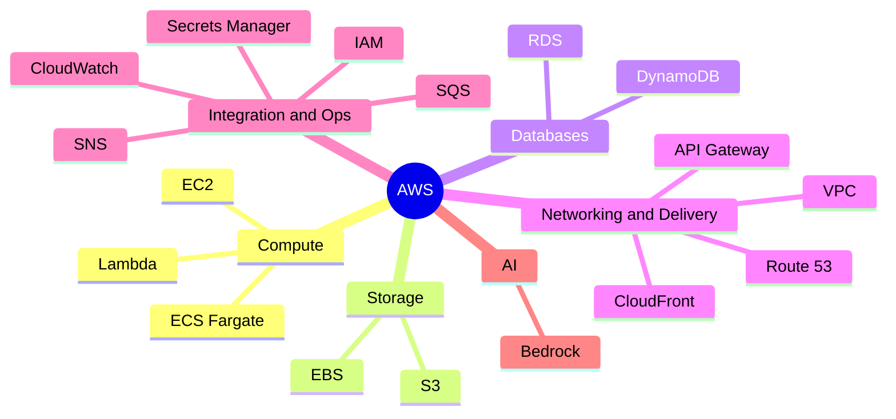

---

## 2. The Project: Production AI Chat/RAG API

A "Production AI Chat/RAG API on AWS" that is very close to what you may already have built locally with Ollama + FastAPI.

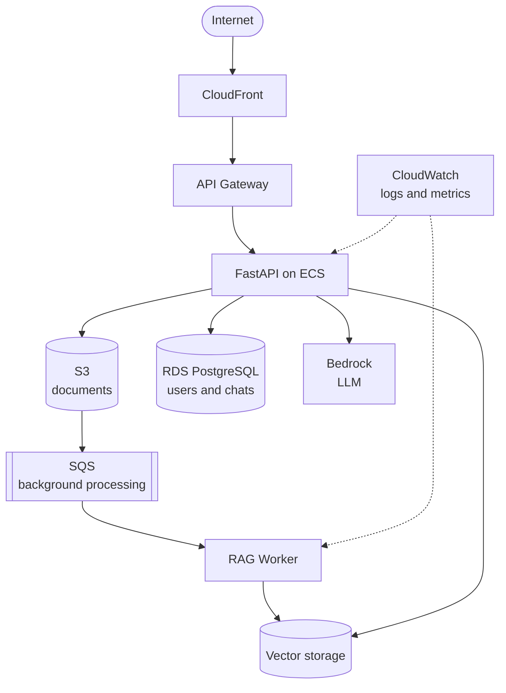

The full version with a frontend:

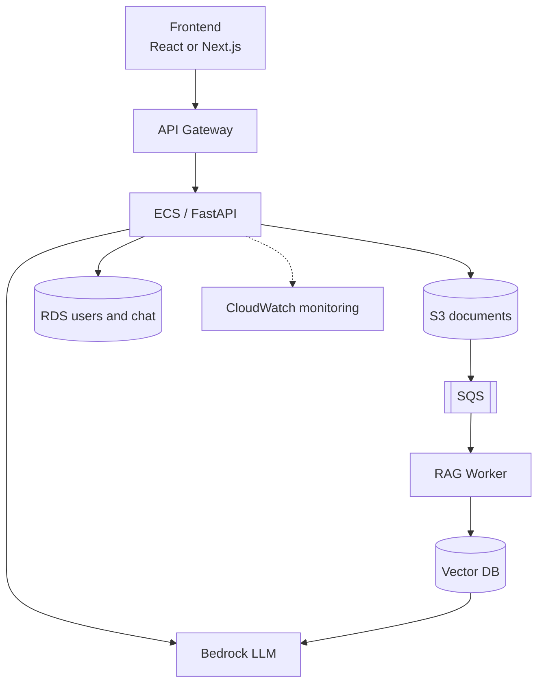

**Why this project works for interviews:** it touches authentication, databases, object storage, queues, containers, networking, observability, serverless and AI, so almost any "tell me about a project" question has a good answer.

---

## 3. Foundations: IAM and VPC

Learn these first (and keep returning to them); every other service depends on them.

### IAM (Identity and Access Management)

**Theory.** IAM controls **who** can do **what** on **which** resources.

- **User** – a long-lived identity for a person (prefer SSO or short-lived credentials where possible).
- **Group** – a set of users sharing permissions.
- **Role** – an identity assumed temporarily by a service or person; it provides short-lived credentials. EC2, ECS tasks and Lambda functions use roles, never hard-coded keys.
- **Policy** – a JSON document listing allowed or denied actions on resources.
- **Least privilege** – grant only the permissions needed, nothing more.
- **Evaluation rule** – an explicit Deny always wins; otherwise access requires an explicit Allow; the default is deny.
- Never use the **root account** for daily work; enable MFA on it and lock it away.

Example policy allowing read-only access to one bucket prefix:

```json
{
  "Version": "2012-10-17",
  "Statement": [
    {
      "Effect": "Allow",
      "Action": ["s3:GetObject"],
      "Resource": "arn:aws:s3:::my-rag-docs/user1/*"
    }
  ]
}
```

**Two kinds of policies on roles:** the *trust policy* says who may assume the role; the *permissions policy* says what the role may do.

### VPC (Virtual Private Cloud)

**Theory.** A VPC is your private, isolated network inside AWS.

- **Subnet** – a slice of the VPC's IP range in one Availability Zone. **Public subnet** has a route to an Internet Gateway; **private subnet** does not.
- **Internet Gateway (IGW)** – lets public subnets talk to the internet.
- **NAT Gateway** – lets private subnets make outbound calls (for example to download updates) without being reachable from the internet. It costs money, so be careful in learning accounts.
- **Route table** – decides where traffic from a subnet goes.
- **Security group** – a *stateful* firewall attached to a resource (instance, task, database). Allow rules only.
- **Network ACL** – a *stateless* firewall at subnet level. Allow and deny rules; usually left at defaults.
- **VPC endpoints** – private paths to AWS services such as S3 without going over the internet.

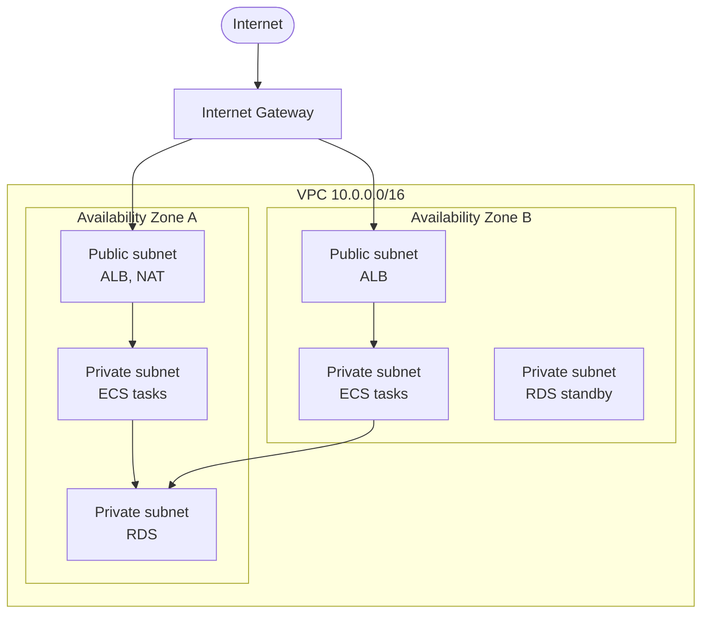

**Standard production pattern:** load balancer in public subnets, application in private subnets, database in private subnets. The database security group allows port 5432 only from the application's security group.

**Interview questions**

- *What is the difference between a security group and a network ACL?* Security groups are stateful and attached to resources with allow-only rules; NACLs are stateless, attached to subnets and support deny rules.
- *What is the difference between an IAM user and a role?* A user has long-term credentials; a role is assumed temporarily and is the right choice for AWS services.
- *How can a private-subnet instance reach the internet?* Through a NAT Gateway in a public subnet.
- *Why put a database in a private subnet?* So it cannot be reached directly from the internet; only the app tier can connect.

---

## 4. Phase 1 – EC2

Take your existing FastAPI app:

```python
from fastapi import FastAPI

app = FastAPI()

@app.get("/health")
def health():
    return {"status": "ok"}
```

Deploy it to an EC2 Linux instance.

**First milestone:** your laptop sends HTTP to an EC2 instance that is running FastAPI.

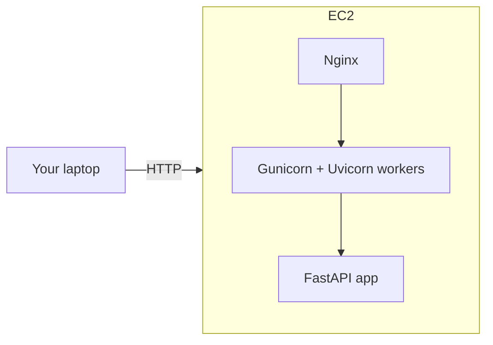

**Theory**

- **EC2** gives you a virtual server. You choose the AMI (OS image), instance type (CPU and memory), storage (EBS volume), key pair and security group.
- **Pricing models:** On-Demand (pay per second), Reserved/Savings Plans (commitment for discount), Spot (cheap but can be interrupted).
- **Public vs private IP:** the public IP changes when you stop and start an instance unless you attach an **Elastic IP**.
- **Security groups** act as the firewall: open 22 (SSH) only to your IP, and 80/443 to the world.
- **Instance role:** attach an IAM role so the app reads S3 or Bedrock without access keys on disk.

**What to learn, step by step**

1. Launch a small instance (free-tier eligible type if available), download the key pair.
2. SSH in: `ssh -i key.pem ec2-user@PUBLIC_IP` (the username depends on the AMI).
3. Install Python, create a virtualenv, copy or clone your app.
4. Run with Gunicorn using Uvicorn workers:

```bash
gunicorn main:app -k uvicorn.workers.UvicornWorker -w 2 -b 127.0.0.1:8000
```

5. Keep it alive with **systemd**:

```ini
[Unit]
Description=FastAPI app
After=network.target

[Service]
User=ec2-user
WorkingDirectory=/home/ec2-user/app
EnvironmentFile=/home/ec2-user/app/.env
ExecStart=/home/ec2-user/app/venv/bin/gunicorn main:app -k uvicorn.workers.UvicornWorker -w 2 -b 127.0.0.1:8000
Restart=always

[Install]
WantedBy=multi-user.target
```

6. Put **Nginx** in front as a reverse proxy:

```nginx
server {
    listen 80;
    server_name _;

    location / {
        proxy_pass http://127.0.0.1:8000;
        proxy_set_header Host $host;
        proxy_set_header X-Real-IP $remote_addr;
        proxy_set_header X-Forwarded-Proto $scheme;
    }
}
```

7. Add **HTTPS** (a domain plus Let's Encrypt/Certbot, or terminate TLS at a load balancer with an ACM certificate).

**Why this matters:** you finally understand what happens after `uvicorn main:app`: a process manager, a reverse proxy, ports, firewalls and TLS.

**Interview questions**

- *Why use Nginx in front of Uvicorn?* TLS termination, buffering slow clients, static files, load balancing, and protection of the app server.
- *Why Gunicorn with Uvicorn workers?* Gunicorn manages multiple worker processes (use more CPU cores, restart crashed workers), while Uvicorn workers run the async ASGI app.
- *What happens to the public IP when you stop an instance?* It changes unless you use an Elastic IP.
- *How do you give an EC2 app access to S3 securely?* Attach an IAM instance profile (role); never store access keys in code or on disk.
- *Horizontal vs vertical scaling?* Vertical means a bigger instance; horizontal means more instances behind a load balancer (the app must be stateless).

---

## 5. Phase 2 – Docker and ECR

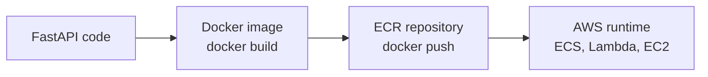

**Theory**

- A **container image** packages the app and its dependencies, so it runs the same everywhere. A **container** is a running instance of an image.
- **ECR (Elastic Container Registry)** is AWS's private Docker image storage. It integrates with IAM and with ECS.
- Images are built in **layers**; order your Dockerfile so rarely changing steps (installing dependencies) come before frequently changing ones (copying source), which makes builds faster through caching.

Example Dockerfile:

```dockerfile
FROM python:3.12-slim

WORKDIR /app

COPY requirements.txt .
RUN pip install --no-cache-dir -r requirements.txt

COPY . .

EXPOSE 8000
CMD ["uvicorn", "main:app", "--host", "0.0.0.0", "--port", "8000"]
```

Commands to learn:

```bash
docker build -t rag-api .
docker run -p 8000:8000 rag-api

# push to ECR
aws ecr get-login-password --region REGION | docker login --username AWS --password-stdin ACCOUNT_ID.dkr.ecr.REGION.amazonaws.com
docker tag rag-api:latest ACCOUNT_ID.dkr.ecr.REGION.amazonaws.com/rag-api:latest
docker push ACCOUNT_ID.dkr.ecr.REGION.amazonaws.com/rag-api:latest
```

**Good practices:** use a slim base image, do not run as root, add a `.dockerignore`, never bake secrets into images, tag images with a version or commit hash instead of only `latest`, and enable ECR image scanning.

**Interview questions**

- *Image vs container?* An image is a read-only template; a container is a running instance of it.
- *Why order Dockerfile instructions carefully?* Layer caching; unchanged layers are reused.
- *What is ECR for?* A managed, private registry that integrates with IAM and ECS.

---

## 6. Phase 3 – ECS and Fargate

This is where to spend serious learning time. Instead of manually running FastAPI on a server you manage, you hand a container to AWS and let it run it.

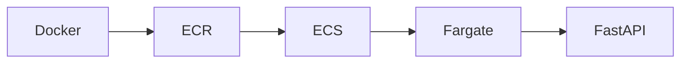

**Theory**

- **ECS (Elastic Container Service)** is AWS's container orchestrator.
- **Task definition** – the blueprint: image, CPU, memory, ports, environment variables, secrets, log configuration, IAM roles.
- **Task** – a running copy of a task definition.
- **Service** – keeps a desired number of tasks running, replaces failed ones, and integrates with a load balancer for rolling deployments.
- **Cluster** – a logical grouping of tasks and services.
- **Launch types:** **Fargate** (serverless, no servers to manage, pay for vCPU and memory used) vs **EC2** (you manage the instances; cheaper at steady high scale, more control).
- **Two IAM roles to know:** the **task execution role** (lets ECS pull the image from ECR and write logs) and the **task role** (what your application code is allowed to do, such as reading S3 or calling Bedrock).
- **Load balancing:** an **Application Load Balancer (ALB)** distributes traffic to tasks, runs health checks (for example `/health`) and removes unhealthy tasks.
- **Autoscaling:** scale the service's task count based on CPU, memory or request count.

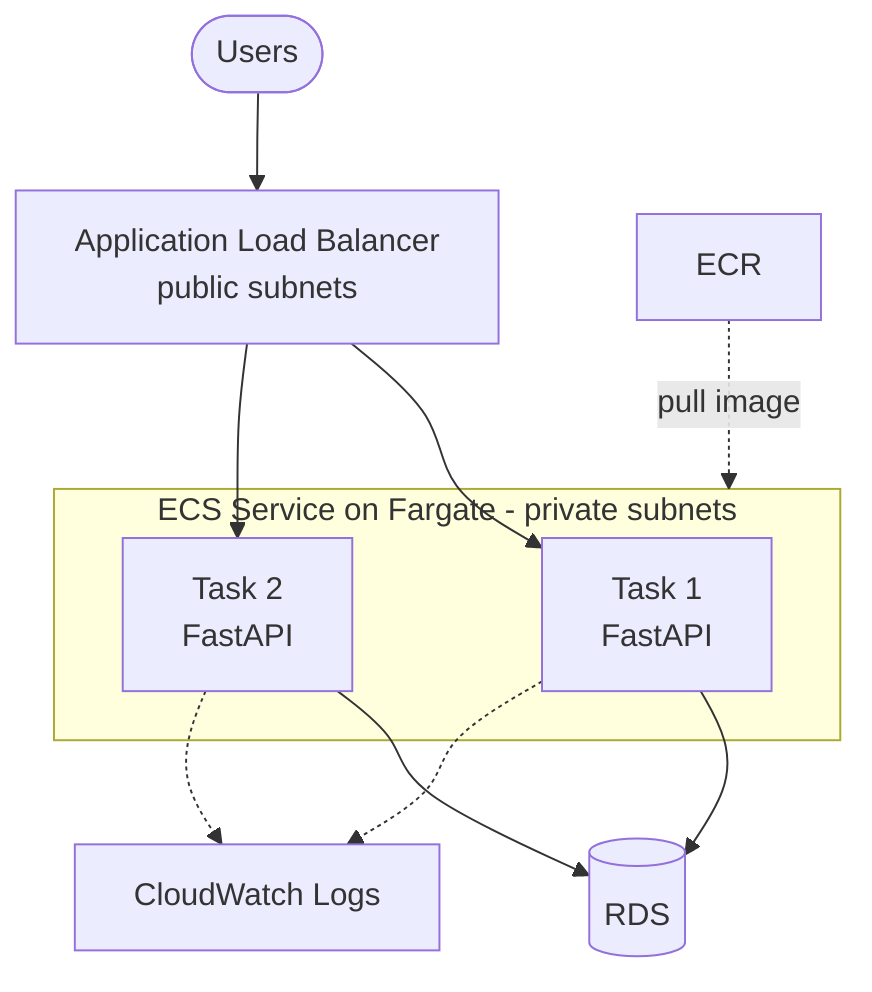

**Why this matters in interviews:** you can explain a realistic production deployment model: immutable images, rolling deployments, health checks, autoscaling and no server patching.

**Interview questions**

- *Fargate vs EC2 launch type?* Fargate removes server management; EC2 gives control and can be cheaper at sustained scale.
- *Task execution role vs task role?* Execution role is for ECS itself (pull image, send logs); task role is for your code's AWS API calls.
- *How does a rolling deployment work?* ECS starts new tasks, waits for them to pass health checks, then drains and stops old ones.
- *Where should tasks run?* In private subnets behind an ALB in public subnets.
- *ECS vs Kubernetes (EKS)?* ECS is simpler and AWS-native; EKS gives the Kubernetes API and portability with more operational complexity.

---

## 7. Phase 4 – RDS PostgreSQL

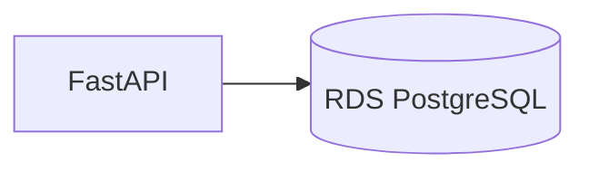

**Theory**

- **RDS** is a managed relational database: AWS handles provisioning, patching, backups and failover; you handle schema, queries and tuning.
- **Multi-AZ** keeps a synchronous standby in another Availability Zone for **high availability** (automatic failover). It is not for read scaling.
- **Read replicas** use asynchronous replication for **read scaling**; they can lag.
- **Automated backups** and point-in-time recovery; **snapshots** for manual backups.
- Keep RDS in **private subnets**; only the app's security group may reach port 5432.
- Use **connection pooling** (for example SQLAlchemy pool settings, or RDS Proxy for Lambda-heavy workloads) because databases handle limited connections.
- Store credentials in **Secrets Manager**, not in code.
- **Aurora** is AWS's cloud-native engine compatible with PostgreSQL/MySQL, with different storage and scaling characteristics.

Create these tables:

```text
users
conversations
messages
documents
```

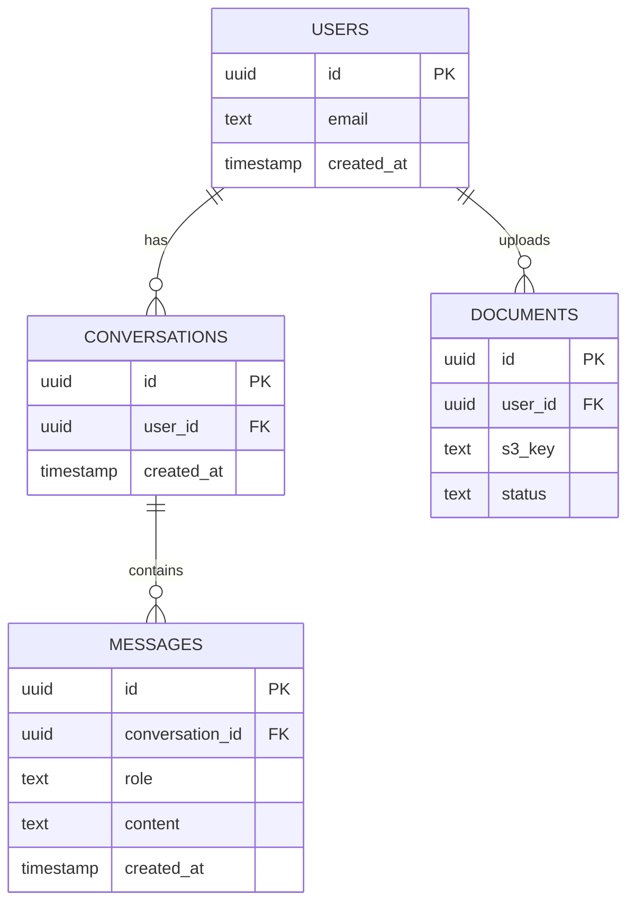

Your AI chat flow becomes:

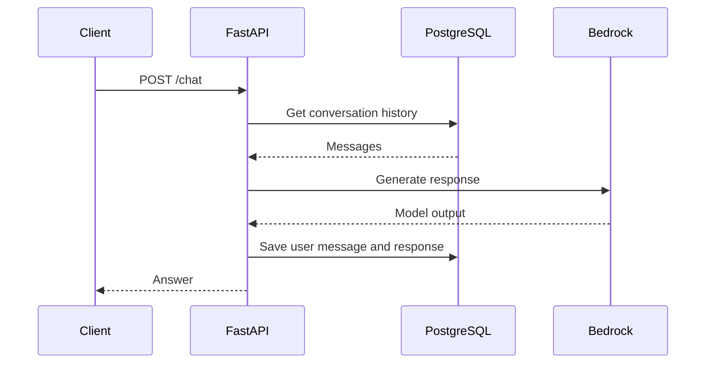

**Interview questions**

- *Multi-AZ vs read replica?* Multi-AZ is for availability (failover); read replicas are for read scalability.
- *How do you handle too many database connections?* Connection pooling, RDS Proxy, limiting app concurrency.
- *Why index `messages.conversation_id`?* Fetching a conversation's history filters on it; an index avoids a full table scan.
- *RDS vs running Postgres on EC2?* RDS manages patching, backups and failover; EC2 gives full control but you own all operations.

---

## 8. Phase 5 – S3

Implement document uploads. Instead of storing `./documents/file.pdf` on local disk, store objects in S3:

```text
S3
 ├── user1/
 │    ├── resume.pdf
 │    └── notes.pdf
 │
 └── user2/
      └── document.pdf
```

**Theory**

- **S3** is object storage: flat key-value storage of objects (up to terabytes each) in **buckets**. "Folders" are just **key prefixes**.
- Highly durable and available, effectively unlimited scale, pay for storage and requests.
- **Storage classes:** Standard, Standard-IA (infrequent access), Glacier tiers (archive), Intelligent-Tiering (automatic).
- **Consistency:** S3 provides strong read-after-write consistency.
- **Security:** buckets are private by default; keep **Block Public Access** on; use IAM policies, bucket policies and encryption at rest (SSE-S3 or SSE-KMS).
- **Presigned URLs** give temporary access to a private object (or permission to upload one) without exposing credentials.
- **Versioning** protects against accidental overwrite and deletion.
- **Lifecycle policies** move or expire objects automatically (for example delete temporary uploads after 30 days).
- **Event notifications** trigger Lambda, SQS or SNS when an object is created.
- **Multipart upload** for large files.

Presigned upload URL in FastAPI:

```python
import boto3
from fastapi import FastAPI

app = FastAPI()
s3 = boto3.client("s3")

@app.post("/documents/upload-url")
def get_upload_url(user_id: str, filename: str):
    key = f"{user_id}/{filename}"
    url = s3.generate_presigned_url(
        "put_object",
        Params={"Bucket": "my-rag-docs", "Key": key},
        ExpiresIn=300,
    )
    return {"upload_url": url, "key": key}
```

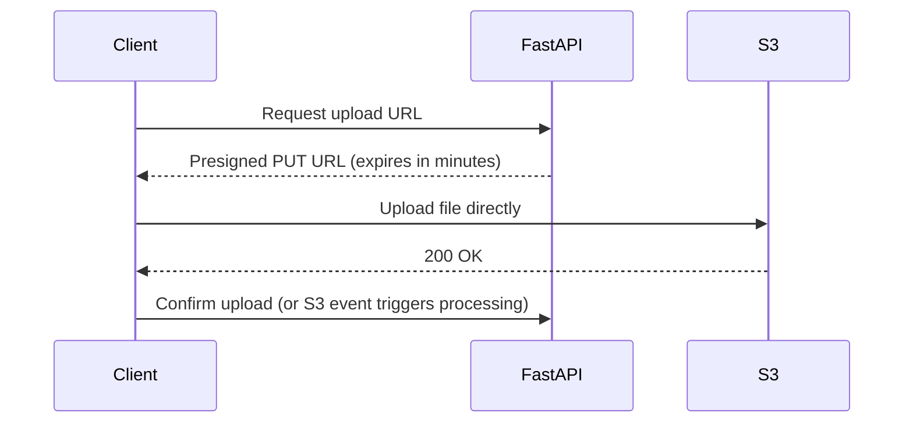

The client uploads **directly to S3**, so large files never pass through your API server.

**Interview questions**

- *Is S3 a filesystem?* No, it is object storage with a flat namespace; prefixes only look like folders.
- *How do you let users upload or download private files securely?* Presigned URLs with short expiry.
- *How do you reduce S3 cost for old data?* Lifecycle rules and cheaper storage classes.
- *How do you react to uploads?* S3 event notifications to Lambda or SQS.
- *Design a URL shortener's or video platform's file store?* S3 for blobs, CDN (CloudFront) in front, metadata in a database.

---

## 9. Phase 6 – Bedrock

This is probably the most relevant AWS service for an AI direction. You already use:

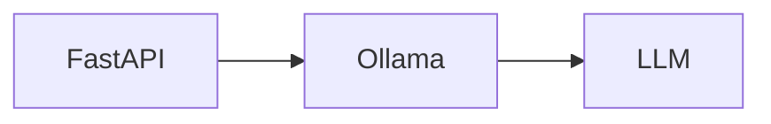

Change it to:

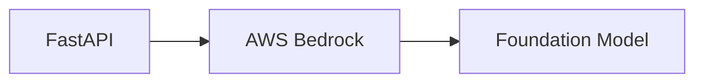

**Theory**

- **Amazon Bedrock** is a managed service that exposes foundation models from several providers through one API. You do not host or scale GPUs yourself.
- You must typically **enable access** to specific models in your account and region, and model availability varies by region.
- **Invocation styles:** a unified **Converse** API (consistent request format across models, supports multi-turn chat and tool use) and the lower-level **InvokeModel** (model-specific payloads). Both have streaming variants.
- **Streaming** returns tokens as they are generated, which improves perceived latency in chat UIs.
- **Embeddings models** turn text into vectors for semantic search (needed for RAG).
- **Cost model:** usually per input and output token (or provisioned throughput for steady high volume). Track token usage per request.
- **Quotas and throttling:** requests-per-minute and tokens-per-minute limits per model; handle `ThrottlingException` with retries and exponential backoff.
- **Security:** call Bedrock using the app's IAM role (permission `bedrock:InvokeModel` and related actions on specific models), keep traffic private with VPC endpoints, and consider **Guardrails** for content filtering.
- **Knowledge Bases for Bedrock** is a managed RAG feature; building your own pipeline first teaches the fundamentals.

Minimal call using the Converse API:

```python
import boto3

bedrock = boto3.client("bedrock-runtime", region_name="us-east-1")

def ask(prompt: str, model_id: str) -> str:
    response = bedrock.converse(
        modelId=model_id,
        messages=[{"role": "user", "content": [{"text": prompt}]}],
        inferenceConfig={"maxTokens": 512, "temperature": 0.2},
    )
    usage = response["usage"]  # inputTokens, outputTokens
    print("tokens:", usage)
    return response["output"]["message"]["content"][0]["text"]
```

(Look up the current model IDs available in your region in the Bedrock console; they change over time.)

**What to learn:** model invocation, streaming, embeddings, token usage, model selection, IAM permissions, rate limits, cost considerations.

**Interview questions**

- *Why use Bedrock instead of self-hosting an open model?* No GPU management, pay per use, built-in scaling, IAM integration, multiple model choices; self-hosting gives more control and can be cheaper at very high steady volume.
- *How do you reduce LLM cost?* Smaller models for simple tasks, shorter prompts, caching, limit output tokens, retrieve fewer and better chunks.
- *How do you handle throttling?* Retry with exponential backoff and jitter, queue requests, request quota increases.
- *How do you give the app permission to call a model?* Attach an IAM role with least-privilege Bedrock permissions to the task or function.

---

## 10. Phase 7 – Building the RAG Pipeline

This is where a previous local RAG project becomes an AWS project.

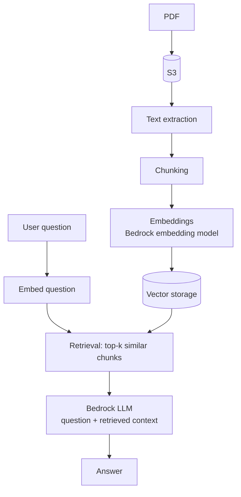

**Theory**

- **RAG (Retrieval-Augmented Generation)** gives an LLM relevant external knowledge at query time, which reduces hallucination and lets you use private or fresh data without retraining.
- **Two pipelines:**
  - *Ingestion (offline):* extract text, clean, **chunk**, **embed**, store vectors with metadata.
  - *Query (online):* embed the question, find the nearest chunks, build a prompt with that context, call the LLM, return the answer (ideally with citations).
- **Chunking** trade-off: chunks too small lose context; too large dilute relevance and waste tokens. Common approach is a few hundred tokens with some overlap.
- **Embeddings** map text to vectors where similar meaning is close together; similarity is usually **cosine similarity**.
- **Vector storage options on AWS:** PostgreSQL with the **pgvector** extension (great because you already have RDS), Amazon OpenSearch (vector search plus keyword), or managed options through Knowledge Bases. Start with pgvector to keep the stack simple.
- **Improving quality:** hybrid search (keyword plus vector), re-ranking, metadata filters (for example per user), query rewriting, evaluating retrieval separately from generation.
- **Security:** filter by user or tenant at retrieval time so users never see each other's documents.

Prompt assembly:

```python
def build_prompt(question: str, chunks: list[str]) -> str:
    context = "\n\n".join(chunks)
    return (
        "Answer using only the context below. "
        "If the answer is not in the context, say you do not know.\n\n"
        f"Context:\n{context}\n\nQuestion: {question}"
    )
```

**Interview questions**

- *RAG vs fine-tuning?* RAG injects knowledge at query time (cheap to update, citable); fine-tuning changes model behavior or style and is poor for frequently changing facts.
- *How do you pick a chunk size?* Experiment and evaluate retrieval quality; balance context versus precision; use overlap.
- *Why might RAG still hallucinate?* Poor retrieval, irrelevant chunks, or the model ignoring context; fix with better retrieval, stricter prompts and evaluation.
- *How do you keep one user's documents private?* Store a user ID in metadata and always filter on it in the vector query.
- *Why pgvector over a dedicated vector DB?* Fewer moving parts, transactional consistency with relational data; dedicated systems help at very large scale.

---

## 11. Phase 8 – SQS

Suppose the user uploads a 50-page PDF. Do not make the HTTP request wait for everything.

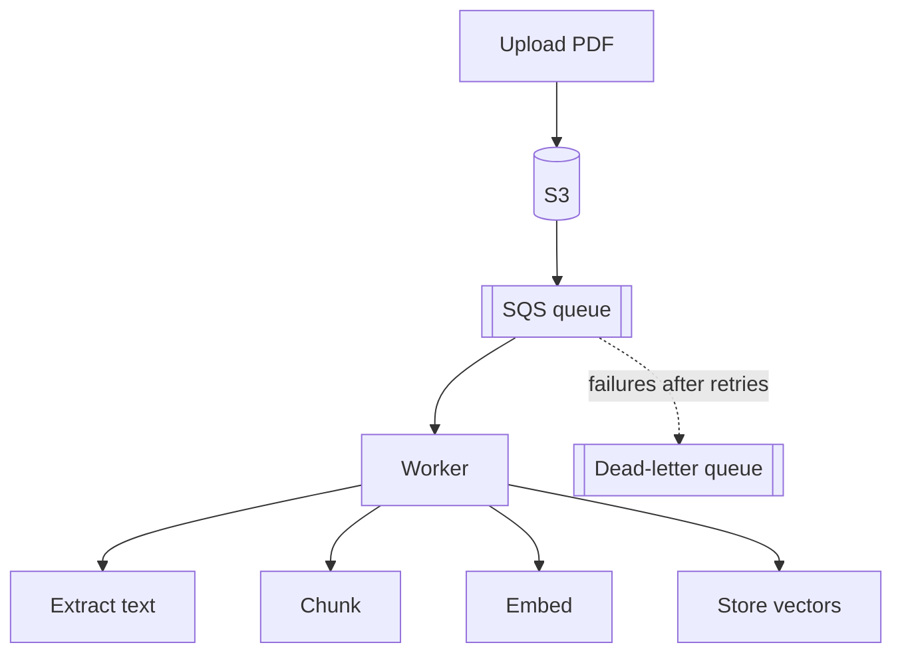

Now you are learning **event-driven architecture**, a very good system-design interview topic.

**Theory**

- **SQS** is a fully managed message queue that decouples producers from consumers and absorbs traffic spikes.
- **Standard queues:** nearly unlimited throughput, **at-least-once** delivery, best-effort ordering. **FIFO queues:** ordering and exactly-once processing semantics within a message group, with lower throughput.
- **Visibility timeout:** after a consumer receives a message it becomes invisible for a period; if the consumer does not delete it before the timeout, it reappears and is retried. Set it longer than your processing time.
- **Long polling** reduces empty responses and cost.
- **Dead-letter queue (DLQ):** messages that fail more than a configured number of receives move here for inspection.
- **Idempotent consumers:** because delivery is at-least-once, processing the same message twice must be safe (for example check whether a document is already processed).
- **Scaling workers:** scale the number of consumers based on queue depth.
- **SQS vs SNS:** SQS is a queue (one consumer group pulls each message); SNS is pub/sub (push to many subscribers). A common pattern is SNS fan-out to multiple SQS queues.
- **SQS vs Kafka:** SQS is simple and managed with no replay; Kafka is a durable log with replay and high-throughput streaming, with more operational weight (AWS offers managed Kafka as MSK).

Worker loop sketch:

```python
import json
import boto3

sqs = boto3.client("sqs")
QUEUE_URL = "https://sqs.REGION.amazonaws.com/ACCOUNT_ID/doc-processing"

while True:
    resp = sqs.receive_message(
        QueueUrl=QUEUE_URL,
        MaxNumberOfMessages=5,
        WaitTimeSeconds=20,  # long polling
    )
    for msg in resp.get("Messages", []):
        body = json.loads(msg["Body"])
        process_document(body)  # must be idempotent
        sqs.delete_message(QueueUrl=QUEUE_URL, ReceiptHandle=msg["ReceiptHandle"])
```

**Interview questions**

- *Why use a queue for PDF processing?* Keeps requests fast, isolates slow work, enables retries and independent scaling.
- *What is the visibility timeout?* The window during which a received message is hidden from other consumers.
- *Can SQS deliver a message twice?* Yes on standard queues, so consumers must be idempotent.
- *What is a DLQ for?* Capturing poison messages so they do not block or endlessly retry.
- *How do you tell the user processing is done?* Store a status field (PENDING, PROCESSING, DONE, FAILED) and have the client poll, or push through WebSockets or notifications.

---

## 12. Phase 9 – Lambda and API Gateway

Build small serverless functions.

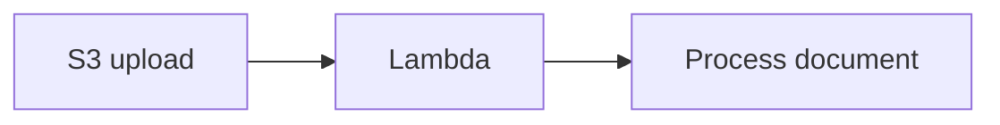

Or:

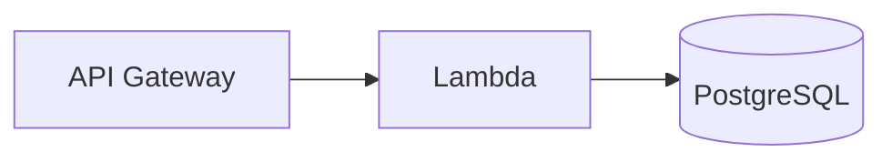

**Theory**

- **Lambda** runs your code in response to events without servers to manage. You pay per invocation and per millisecond of execution (memory-based pricing); it scales automatically.
- **Triggers:** API Gateway, S3 events, SQS, EventBridge schedules, DynamoDB streams and more.
- **Limits to remember:** maximum execution time of 15 minutes, limited memory/CPU configuration, ephemeral storage; not suited to long-running jobs.
- **Cold start:** the first invocation after idle (or when scaling out) takes extra time to initialize the runtime. Reduce with smaller packages, lighter dependencies, provisioned concurrency, or keeping initialization outside the handler.
- **Concurrency:** each concurrent request uses its own execution environment; control with reserved concurrency to protect downstream databases.
- **Stateless:** do not rely on local memory between invocations; use S3, DynamoDB or RDS.
- **Lambda with RDS:** many concurrent Lambdas can exhaust database connections, so use **RDS Proxy**.
- **Lambda with SQS:** Lambda can poll the queue and process batches, with a DLQ for failures.
- **API Gateway:** a managed front door for HTTP APIs and REST APIs, handling routing, authentication (IAM, Cognito, JWT authorizers, Lambda authorizers), throttling, usage plans and request validation. **HTTP APIs** are cheaper and simpler; **REST APIs** have more features.

Lambda handler for an S3 event:

```python
import json

def handler(event, context):
    for record in event["Records"]:
        bucket = record["s3"]["bucket"]["name"]
        key = record["s3"]["object"]["key"]
        print(f"New object: s3://{bucket}/{key}")
        # enqueue to SQS or start processing here
    return {"statusCode": 200, "body": json.dumps("ok")}
```

**Lambda vs ECS/Fargate: how to choose**

| Factor | Lambda | ECS/Fargate |
|---|---|---|
| Workload | Short, event-driven, spiky | Long-running, steady, web services |
| Scaling | Automatic per request, to zero | Task-based autoscaling, always at least one task |
| Max run time | 15 minutes | No hard limit |
| Cold starts | Yes | No (tasks stay warm) |
| Cost pattern | Cheap at low or bursty volume | Cheaper at steady high volume |
| Ops effort | Lowest | Low to moderate |

**Interview questions**

- *What is a cold start and how do you mitigate it?* Initialization delay on a new execution environment; mitigate with provisioned concurrency, smaller packages, lighter runtimes.
- *When would you not use Lambda?* Long-running jobs over 15 minutes, sustained heavy traffic where containers are cheaper, workloads needing persistent connections or specialized hardware.
- *How do you stop Lambdas from overwhelming a database?* Reserved concurrency and RDS Proxy.
- *How does API Gateway protect a backend?* Throttling, authorizers, request validation, usage plans.
- *Lambda failure handling with async triggers?* Automatic retries, then DLQ or on-failure destinations.

---

## 13. Phase 10 – CloudWatch

Do not just deploy things. Learn to answer: **"My API is slow. How do I know why?"**

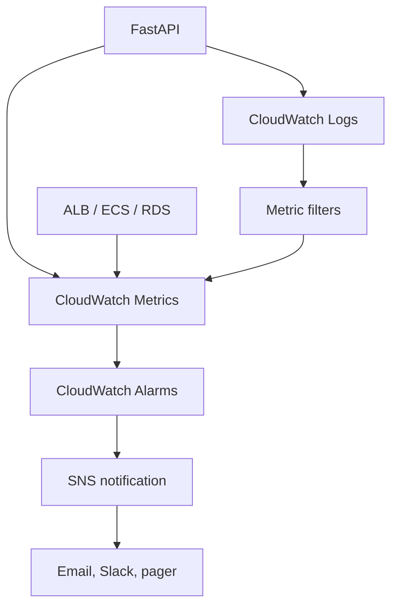

**Theory**

- **Logs:** collected into **log groups** and **log streams**; set a retention period to control cost. Use **structured JSON logs** with a request ID so you can search them. **Logs Insights** lets you query logs with a SQL-like language.
- **Metrics:** time series data. AWS services publish metrics automatically (ECS CPU and memory, ALB request count and latency and 5xx count, RDS CPU, connections and free storage, SQS queue depth and age of oldest message, Lambda errors, duration and throttles). You can publish **custom metrics** too.
- **Alarms:** watch a metric against a threshold and trigger an action (SNS notification, autoscaling).
- **Dashboards:** combine key metrics on one screen.
- **Related services:** **X-Ray** (distributed tracing), **CloudTrail** (audit log of AWS API calls: who did what), **AWS Budgets** (cost alerts).
- **The golden signals:** latency, traffic, errors, saturation.

**Debugging flow for "the API is slow"**

1. Check the ALB target response time and request count: is it all requests or one endpoint?
2. Check ECS CPU and memory: is the service saturated? Does it need more tasks?
3. Check RDS CPU, connections and slow queries: is the database the bottleneck?
4. Check Bedrock latency and throttling: is the LLM call the slow part?
5. Check logs with a request ID to see where time is spent; use tracing for multi-service requests.
6. Fix the cause, then add an alarm so you find out earlier next time.

**Interview questions**

- *CloudWatch vs CloudTrail?* CloudWatch is for operational telemetry (logs, metrics, alarms); CloudTrail records API activity for audit and security.
- *How do you alert on 5xx spikes?* Alarm on the ALB's 5xx count metric (or an error-rate metric), send to SNS.
- *How do you control log costs?* Retention policies, avoid excessive debug logging, filter before ingesting.
- *How do you trace a request across services?* Propagate a correlation or trace ID and use X-Ray or OpenTelemetry.
- *What would you monitor for the queue workers?* Queue depth, age of the oldest message, DLQ count, worker error rate.

---

## 14. Supporting Services: CloudFront, DynamoDB, Secrets Manager

### CloudFront (CDN and caching)

- Caches content at **edge locations** close to users, cutting latency and origin load; also provides TLS, DDoS protection with AWS Shield (basic is automatic) and can attach AWS WAF.
- **Origins** can be S3, an ALB, or API Gateway.
- Control caching with TTLs, cache policies and **invalidations** (to purge changed content).
- Use **Origin Access Control** so an S3 bucket is only reachable through CloudFront.
- Good for the project's frontend and any static or cacheable API responses. Chat responses are usually not cacheable.

### DynamoDB (NoSQL, serverless)

- Key-value and document store with single-digit millisecond latency that scales horizontally.
- **Partition key** (and optional **sort key**) determine data distribution and access patterns; design tables around queries, not normalization, and avoid **hot partitions**.
- **Capacity modes:** on-demand (pay per request) or provisioned (with autoscaling).
- **GSI/LSI** secondary indexes support additional access patterns.
- **TTL** can auto-expire items (for example sessions).
- Consistency: eventually consistent reads by default, strongly consistent reads optional.
- In this project it is a good fit for session or rate-limit data and chat history at large scale, while Postgres stays the system of record for relational data.

**SQL vs DynamoDB:** choose SQL for relational data, ad hoc queries and transactions across tables; choose DynamoDB for known access patterns, massive scale and predictable low latency.

### Secrets Manager

- Stores database passwords, API keys and other secrets, **encrypted** with KMS, with IAM-controlled access, audit through CloudTrail and optional **automatic rotation** (for example for RDS credentials).
- The app fetches secrets at startup through its IAM role; ECS can inject secrets into containers as environment variables.
- **Secrets Manager vs SSM Parameter Store:** Secrets Manager adds rotation and costs more per secret; Parameter Store is cheaper and fine for plain configuration and simple secrets.
- Never commit secrets to Git or bake them into images.

**Interview questions**

- *How do you serve a global audience with low latency?* CloudFront in front of S3 or the load balancer.
- *How do you design a DynamoDB table?* List the access patterns first, then choose keys and indexes to serve them.
- *Where do you keep a database password in production?* Secrets Manager, accessed via IAM role, with rotation.

---

## 15. How to Spend Your Credits

Do not try to spend all of it. The objective is AWS experience, not reaching a $0 balance. Keep a large buffer.

**Mostly free to practice:**

```text
$0
│
├── IAM
├── S3 basics
├── Lambda basics
├── API Gateway basics
├── CloudWatch
└── DynamoDB basics
```

**Then use credits selectively** (rough ranges from the source notes; actual costs depend on region, size and how long you leave things running):

| Area | Budget idea |
|---|---|
| EC2 experiments | $5–15 |
| RDS PostgreSQL experiments | $10–30 |
| ECS/Fargate | $10–30 |
| Bedrock experiments | $20–50 |

**Cost safety rules**

1. Set up **AWS Budgets** alerts on day one.
2. Know whether your account is on the **Free plan** (designed to avoid charges) or the **Paid plan** (can bill beyond credits).
3. **Stop or delete** resources when you finish a session: EC2 instances, RDS databases, ECS services, **NAT Gateways** and load balancers all bill by the hour.
4. Delete unused Elastic IPs, EBS volumes and snapshots.
5. Prefer small instance sizes and short experiments.
6. Use Infrastructure as Code (Terraform or CloudFormation) so you can tear everything down and rebuild with one command.
7. Never commit access keys; use IAM roles and short-lived credentials.

---

## 16. Interview Cheat Sheet

### Which service for which job?

| Need | Service |
|---|---|
| Run a VM | EC2 |
| Run containers without managing servers | ECS on Fargate |
| Run short event-driven code | Lambda |
| Store files and blobs | S3 |
| Relational database | RDS (or Aurora) |
| Key-value NoSQL at scale | DynamoDB |
| In-memory cache | ElastiCache (Redis) |
| Queue between services | SQS |
| Pub/sub fan-out | SNS |
| Event routing and schedules | EventBridge |
| CDN | CloudFront |
| DNS | Route 53 |
| Front door for APIs | API Gateway |
| Load balancing | ALB / NLB |
| Secrets | Secrets Manager |
| Logs, metrics, alarms | CloudWatch |
| Audit of API calls | CloudTrail |
| Managed LLM access | Bedrock |
| Container images | ECR |

### Key concepts to be able to explain

- **Regions and Availability Zones:** a Region is a geographic area; an AZ is one or more isolated data centers within it. Deploy across at least two AZs for high availability.
- **Shared responsibility model:** AWS secures the cloud itself (hardware, facilities, managed service internals); you secure what you put in it (IAM, data, network rules, patching your own instances, app code).
- **Well-Architected pillars:** operational excellence, security, reliability, performance efficiency, cost optimization, sustainability.
- **High availability:** multiple AZs, load balancers, health checks, Multi-AZ databases, stateless apps.
- **Scaling:** autoscaling groups or ECS autoscaling for compute, read replicas for reads, caching, queues to smooth spikes.
- **Security basics:** least-privilege IAM roles, private subnets, security groups, encryption at rest and in transit, secrets in Secrets Manager, MFA, CloudTrail enabled.

### Design question template

When asked "design X on AWS", walk through this order:

1. Clarify requirements: users, traffic, latency, data size, consistency, budget.
2. Draw the request path: DNS and CDN, load balancer, compute, cache, database, storage.
3. Decide sync vs async work and where queues fit.
4. Cover data: which database for which data, backups, replication.
5. Cover security: IAM, network isolation, encryption, secrets.
6. Cover reliability: multi-AZ, health checks, retries, DLQs.
7. Cover observability and cost.
8. State trade-offs and how you would scale it 10x.

### Example: "Design a document Q&A service on AWS"

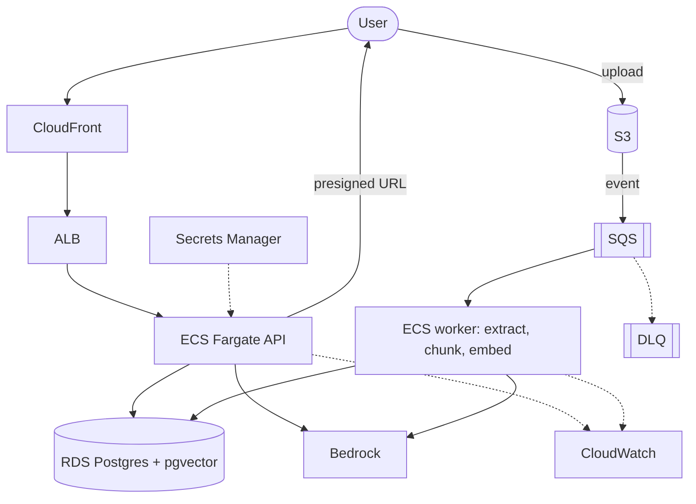

Talking points: direct-to-S3 uploads, async ingestion with retries and a DLQ, per-user metadata filtering, private subnets, autoscaling workers on queue depth, token-cost tracking, and CloudWatch alarms on latency, errors and queue age.

---

## 17. Learning Checklist

- [ ] **Foundations** – create an AWS account safely (MFA on root, a non-root admin user, Budgets alert); understand IAM roles, policies and VPC basics.
- [ ] **Phase 1 – EC2** – deploy FastAPI with Gunicorn, systemd, Nginx and HTTPS on a Linux instance.
- [ ] **Phase 2 – Docker and ECR** – containerize the app and push an image to ECR.
- [ ] **Phase 3 – ECS/Fargate** – run the container behind an ALB with health checks and autoscaling.
- [ ] **Phase 4 – RDS PostgreSQL** – users, conversations, messages and documents tables; connect from private subnets.
- [ ] **Phase 5 – S3** – presigned-URL uploads, prefixes per user, versioning and lifecycle rules.
- [ ] **Phase 6 – Bedrock** – invoke a model, stream responses, track tokens, handle throttling.
- [ ] **Phase 7 – RAG** – extract, chunk, embed, store vectors, retrieve and answer with sources.
- [ ] **Phase 8 – SQS** – move document processing to a worker with retries and a DLQ.
- [ ] **Phase 9 – Lambda and API Gateway** – an S3-triggered function and a small API.
- [ ] **Phase 10 – CloudWatch** – structured logs, dashboards, latency and error alarms.
- [ ] **Extras** – CloudFront for the frontend, DynamoDB for a session or rate-limit table, Secrets Manager for credentials.
- [ ] **Interview prep** – practice drawing the full architecture from memory and explaining each trade-off aloud.

```mermaid
flowchart LR
    A[IAM and VPC] --> B[EC2]
    B --> C[Docker and ECR]
    C --> D[ECS Fargate]
    D --> E[RDS]
    E --> F[S3]
    F --> G[Bedrock]
    G --> H[RAG]
    H --> I[SQS]
    I --> J[Lambda and API Gateway]
    J --> K[CloudWatch]

    classDef core fill:#d1fae5,stroke:#059669,color:#064e3b
    classDef adv fill:#dbeafe,stroke:#2563eb,color:#1e3a8a
    class A,B,C,D,E,F core
    class G,H,I,J,K adv
```

That single project gives you hands-on experience with AWS, Docker, Linux, networking, databases, distributed systems, serverless, AI, RAG, queues, authentication and observability, and it maps directly onto an existing FastAPI/RAG learning path rather than a disconnected list of services.
