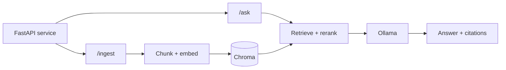

import TOCInline from '@theme/TOCInline';

# Start Here

<TOCInline toc={toc} minHeadingLevel={2} maxHeadingLevel={2} />

:::tip[What this is]
One continuous path from Python syntax to a deployed, production-grade RAG
service — plus the interview prep to talk about it. Everything runs locally on
hardware you own; no API keys required to follow along.
:::

## How It's Organized

Thirteen numbered sections, each with its own index page stating the **goal**,
**estimated time**, **prerequisites**, and a **Done When** checklist. Read the
index first, then work through its pages in order.

Sections **00–14 teach you to build**. Section **15 prepares you to talk about
what you built.**

| # | Section | What you get out of it | Time |
| --- | --- | --- | --- |
| 00 | [Prerequisites](./00-prerequisites/index.mdx) | Tooling, environment, and the AI vocabulary | 2–4 days |
| 01 | [Python](./01-python/index.mdx) | Production-quality Python, plus DSA and SQL | 2–3 weeks |
| 02 | [FastAPI](./02-fastapi/index.mdx) | Validated, authenticated, tested, deployable APIs | 4–6 weeks |
| 03 | [Local LLMs / Ollama](./03-local-llms-ollama/index.mdx) | Models on your own machine, plus NVIDIA and GPU serving | 1–2 weeks |
| 04 | [Embeddings / Vector DB](./04-embeddings-vector-db/index.mdx) | Vectors, index internals, pgvector, and store operations | 1–2 weeks |
| 05 | [RAG Fundamentals](./05-rag-fundamentals/index.mdx) | An end-to-end ingest → retrieve → generate service | 1–2 weeks |
| 06 | [Advanced RAG](./06-advanced-rag/index.mdx) | The full pattern catalog, and how to pick from it | 2–3 weeks |
| 07 | [LangChain & LlamaIndex](./07-langchain-lcel/index.mdx) | Framework fluency, and when to skip the framework | 1–2 weeks |
| 08 | [Agents & Agentic AI](./08-agentic-ai/index.mdx) | LangGraph agents, memory, planning, safety, production | 3–4 weeks |
| 09 | [MCP](./09-mcp/index.mdx) | Expose your tools so any assistant can use them | 1 week |
| 10 | [Production Patterns](./10-production-patterns/index.mdx) | Logging, guardrails, deployment | 1–2 weeks |
| 11 | [Evaluation](./11-evaluation/index.mdx) | Datasets, metrics, judges, CI gates, online evals | 1–2 weeks |
| 12 | [Fine-Tuning](./12-fine-tuning/index.mdx) | Whether to fine-tune at all, then LoRA/QLoRA end to end | 2–3 weeks |
| 13 | [System Design & Interview](./13-system-design-interview/index.mdx) | Whiteboard architecture and tradeoff talk | 1–2 weeks |
| 14 | [Optional Extensions](./14-optional-extensions/index.mdx) | Multimodal, GraphRAG, streaming UIs, and beyond | Ongoing |
| 15 | [AI Interview Roadmaps](./15-ai-roadmaps/index.mdx) | Topic-by-topic interview prep across the stack | Ongoing |

Plus a [Pacing Plan](./pacing.mdx) that lays the whole thing out over 20 weeks,
and a [Progress tracker](/progress) stored in your browser.

## Where to Jump In

Not everyone starts at zero. Pick the row that sounds like you:

| If you… | Start at |
| --- | --- |
| Are new to Python | [00 · Prerequisites](./00-prerequisites/index.mdx) |
| Know Python, not backend | [02 · FastAPI](./02-fastapi/index.mdx) |
| Ship backends already | [03 · Local LLMs](./03-local-llms-ollama/index.mdx) |
| Have used LLM APIs, not RAG | [04 · Embeddings / Vector DB](./04-embeddings-vector-db/index.mdx) |
| Built a RAG demo that underperforms | [06 · Advanced RAG](./06-advanced-rag/index.mdx) |
| Ship agents, need tool integration | [09 · MCP](./09-mcp/index.mdx) |
| Cannot tell if a change helped | [11 · Evaluation](./11-evaluation/index.mdx) |
| Have an interview next week | [15 · AI Interview Roadmaps](./15-ai-roadmaps/index.mdx) |

## The Project You'll Build

One project, grown across the whole roadmap rather than restarted each section.

By section 09 it has structured logging, guardrails, caching, tests, and a
Dockerfile. By section 10 you can defend every box on that diagram.

## How to Read a Section

Each section index follows the same shape, so you always know where you are:

1. **Goal** — what you'll be able to do afterwards.
2. **Estimated time** — a realistic range, not a promise.
3. **Prerequisites** — what to finish first.
4. **The pages** — in reading order.
5. **Interview relevance** — what gets asked about this topic.
6. **Done When** — a checklist to decide you're actually finished.

## A Few Conventions

- Code fences show line numbers, and most pages open with an inline table of contents.
- Framework APIs move fast. Snippets illustrate the **concept** — check current docs before shipping.
- `:::tip` blocks summarize; `:::warning` blocks mark the things that bite people.
- Diagrams are Mermaid, so they stay readable in both light and dark mode.

Ready? Start with [00 · Prerequisites](./00-prerequisites/index.mdx).
