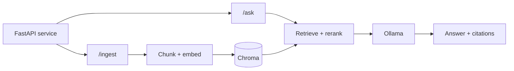

import TOCInline from '@theme/TOCInline';

# Start Here

<TOCInline toc={toc} minHeadingLevel={2} maxHeadingLevel={2} />

:::tip[What this is]
One continuous path from Python syntax to a deployed, production-grade RAG
service — plus the interview prep to talk about it. Everything runs locally on
hardware you own; no API keys required to follow along.
:::

## How It's Organized

Eighteen numbered sections, each with its own index page stating the **goal**,
**estimated time**, **prerequisites**, and a **Done When** checklist. Read the
index first, then work through its pages in order.

Sections **00–16 teach you to build**. Section **17 prepares you to talk about
what you built.**

The **Phase** column maps each section to the twelve-phase GenAI syllabus the
section names come from. Phases 4 and 7 each span two sections — RAG splits into
fundamentals and the pattern catalog, and the framework phase separates MCP from
the libraries, because a protocol is not a library.

| # | Section | Phase | What you get out of it | Time |
| --- | --- | --- | --- | --- |
| 00 | [Prerequisites](./00-prerequisites/index.mdx) | — | Tooling, environment, and the AI vocabulary | 2–4 days |
| 01 | [Python](./01-python/index.mdx) | — | Production-quality Python, plus DSA and SQL | 2–3 weeks |
| 02 | [FastAPI](./02-fastapi/index.mdx) | — | Validated, authenticated, tested, deployable APIs | 4–6 weeks |
| 03 | [LLM Fundamentals](./03-llm-fundamentals/index.mdx) | 1 | Run a model, then tokens, attention, decoding, reasoning models | 1–2 weeks |
| 04 | [Prompt Engineering](./04-prompt-engineering/index.mdx) | 2 | Reliable prompts, structured output, injection defence | 1 week |
| 05 | [Embeddings and Semantic Search](./05-embeddings-and-semantic-search/index.mdx) | 3 | Vectors, index internals, pgvector, hybrid search | 1–2 weeks |
| 06 | [RAG (Retrieval-Augmented Generation)](./06-rag/index.mdx) | 4 | An end-to-end ingest → retrieve → generate service | 1–2 weeks |
| 07 | [Advanced RAG](./07-advanced-rag/index.mdx) | 4 | The full pattern catalog, and how to pick from it | 2–3 weeks |
| 08 | [LLM Application Development](./08-llm-application-development/index.mdx) | 5 | Provider abstraction, resilience, extraction tasks, AI UX | 1–2 weeks |
| 09 | [Tool Calling and AI Agents](./09-tool-calling-and-ai-agents/index.mdx) | 6 | Tool schemas, agent loops, memory, safety, production | 3–4 weeks |
| 10 | [GenAI Frameworks and Ecosystem](./10-genai-frameworks-and-ecosystem/index.mdx) | 7 | LangChain, LCEL, LangGraph, LlamaIndex, CrewAI, Pydantic AI | 1–2 weeks |
| 11 | [MCP](./11-mcp/index.mdx) | 7 | Expose your tools so any assistant can use them | 1 week |
| 12 | [Evaluation, Testing and Observability](./12-evaluation-testing-and-observability/index.mdx) | 8 | Datasets, metrics, judges, CI gates, tracing | 1–2 weeks |
| 13 | [Production GenAI and LLMOps](./13-production-genai-and-llmops/index.mdx) | 9 | GPU serving, queues, gateway, cost, security, governance | 3 weeks |
| 14 | [Fine-Tuning and Model Adaptation](./14-fine-tuning-and-model-adaptation/index.mdx) | 10 | Whether to fine-tune, then LoRA/QLoRA end to end | 2–3 weeks |
| 15 | [Multimodal GenAI](./15-multimodal-genai/index.mdx) | 11 | Vision-language models, document intelligence, voice | 1–2 weeks |
| 16 | [AI System Design](./16-ai-system-design/index.mdx) | 12 | Whiteboard architecture, tradeoffs, capacity and cost | 1–2 weeks |
| 17 | [AI Interview Roadmaps](./17-interview-roadmaps/index.mdx) | — | Topic-by-topic interview prep across the stack | Ongoing |

Plus a [Pacing Plan](./pacing.mdx) that lays the whole thing out over 22 weeks,
and a [Progress tracker](/progress) stored in your browser.

## Where to Jump In

Not everyone starts at zero. Pick the row that sounds like you:

| If you… | Start at |
| --- | --- |
| Are new to Python | [00 · Prerequisites](./00-prerequisites/index.mdx) |
| Know Python, not backend | [02 · FastAPI](./02-fastapi/index.mdx) |
| Ship backends already | [03 · LLM Fundamentals](./03-llm-fundamentals/index.mdx) |
| Prompting feels like guesswork | [04 · Prompt Engineering](./04-prompt-engineering/index.mdx) |
| Have used LLM APIs, not RAG | [05 · Embeddings and Semantic Search](./05-embeddings-and-semantic-search/index.mdx) |
| Built a RAG demo that underperforms | [07 · Advanced RAG](./07-advanced-rag/index.mdx) |
| Need structured data out of documents, not chat | [Extraction & Classification](./08-llm-application-development/03-extraction-and-classification.mdx) |
| Ship agents, need tool integration | [11 · MCP](./11-mcp/index.mdx) |
| Cannot tell if a change helped | [12 · Evaluation](./12-evaluation-testing-and-observability/index.mdx) |
| Have an interview next week | [17 · AI Interview Roadmaps](./17-interview-roadmaps/index.mdx) |

## The Project You'll Build

One project, grown across the whole roadmap rather than restarted each section.

By section 13 it has structured logging, guardrails, caching, tests, and a
Dockerfile. By section 16 you can defend every box on that diagram.

## How to Read a Section

Each section index follows the same shape, so you always know where you are:

1. **Goal** — what you'll be able to do afterwards.
2. **Estimated time** — a realistic range, not a promise.
3. **Prerequisites** — what to finish first.
4. **The pages** — in reading order.
5. **Interview relevance** — what gets asked about this topic.
6. **Done When** — a checklist to decide you're actually finished.

## A Few Conventions

- Code fences show line numbers, and most pages open with an inline table of contents.
- Framework APIs move fast. Snippets illustrate the **concept** — check current docs before shipping.
- `:::tip` blocks summarize; `:::warning` blocks mark the things that bite people.
- Diagrams are Mermaid, so they stay readable in both light and dark mode.

Ready? Start with [00 · Prerequisites](./00-prerequisites/index.mdx).
